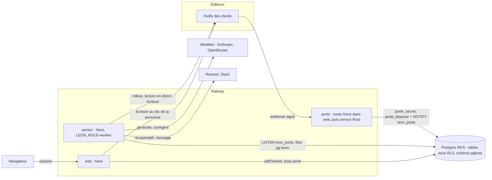

# 00. Architecture du système d'agents : la loi commune

19 novembre 2026 · document d'architecture · à relire par David et Amos

Ce document fixe tout ce qui doit être identique d'un chapitre à l'autre : noms de modules, de tables, de types, de files, d'étapes, flux, règles de droits. Les rédacteurs le recopient. Ils ne le réinterprètent pas. Un rédacteur qui trouve une erreur ici l'écrit en tête de son chapitre, sous « Écart avec l'architecture », et garde le nom fixé ici.

Sources : `systeme-complet.md`, les huit cartes (`cartes/`), les neuf notes (`recherches/`), et le code relu le 19/11/2026 (commit `f79eb80`, dernière migration `0074-points-lignes-retirees.sql`).

Convention de lecture :

- **existe** : présent dans le code, avec son chemin. Vérifié par lecture.
- **à créer** : n'existe pas. Le nom est fixé ici.
- **à vérifier** : vient d'une note de recherche qui ne l'a pas confirmé, ou d'une bibliothèque que je n'ai pas pu lire (`node_modules` absent).

Rien n'a été lancé : ni serveur, ni test, ni migration.

Version relue le 19/11/2026. Trois critiques (code, sécurité, exploitation) ont attaqué la première version : 44 objections. Chacune a été revérifiée dans le dépôt ou dans sa source. Ce qui a changé, ce qui a été écarté et ce qui peut attendre sont en section 14. Le plus court chemin vers un premier agent chez un client (« jalon 1 ») est en 14.3.

## 1. Résumé

On construit un système d'agents branché sur la mémoire de Leon. Chaque élément indexé émet un événement. Un « standard » l'étiquette. Un moteur exécute la fiche de l'agent concerné, au nom d'une personne réelle. Les écritures dans les outils passent par la table `actions`, avec ou sans clic selon quatre choses : l'enjeu, le public qui lira l'écriture, ce que l'exécution a lu, et le cran d'autonomie. Un poste de contrôle montre tout et permet d'annuler.

Les cinq choix qui comptent :

1. **TypeScript partout, Rust à un seul endroit, et pas en premier.** Tout le métier reste en TypeScript. Rust n'a qu'une place : « la porte », la passerelle de webhooks. Son contrat tient en deux fonctions SQL. Une route Hono le tient d'abord. Le service Rust est écrit en entier au chapitre 15 et se construit quand une mesure le demande (section 3).
2. **pg-boss reste, derrière une interface d'exécution durable.** Les agents ne connaissent que `DurableContext` (étape rejouable, attente, attente d'un événement). Le journal des étapes est en Postgres. Au premier jalon le moteur est linéaire : étapes journalisées, verrou en base, arrêt propre. DBOS ou Temporal peuvent remplacer le moteur sans réécrire une fiche.
3. **Un agent est une fiche, pas du code.** Une donnée TypeScript validée par zod, sans fonction. La validation de la fiche impose déjà la règle de sécurité : le décideur ne lit que des champs typés.
4. **Toujours une personne, jamais un compte de service.** Lecture sous ses droits (réduits à l'organisation pour un agent d'équipe). Écriture par sa connexion. Budget réservé en base avant chaque exécution, par organisation et par personne. Un agent d'équipe ne fait que proposer : celui qui l'a activé valide chaque action.
5. **Double modèle, et un clic dès que l'écriture élargit le public.** Un lecteur sans outils borne le contenu non fiable. Un décideur avec outils ne voit que cette sortie. Une écriture vers l'extérieur à partir d'un contenu extérieur demande toujours un clic. Une donnée privée ne part jamais sans clic vers d'autres que la personne. Un texte rédigé à partir d'un contenu brut non plus.

## 2. La stack complète

Versions : celles de `package.json` (existe) pour ce qui est installé, celles des notes 01, 02, 03, 05 et 08 (registres lus le 19/11/2026) pour le reste. Quand le registre a une version plus récente que le dépôt, les deux sont données.

| Brique | On garde | On ajoute | Version | Pourquoi |
|---|---|---|---|---|
| Langage métier | TypeScript, `strict`, `noUncheckedIndexedAccess` | rien | TypeScript 7.0.2 | Connecteurs, standard, moteur, actions, écrans : une seule langue pour deux fondateurs (notes 01 et 02) |
| Exécution | Node | rien | Node ≥ 24 (`engines`), pnpm 11.0.8 | Déjà en place, CI sur Node 24 |
| Web | Next (`next build --webpack`), React, Tailwind, next-intl, radix-ui | écran `/agents`, section « À valider » | next 16.4.5 (registre : 16.4.6), react 19.3.0, tailwindcss 4.3.3, next-intl 4.14.9, radix-ui 1.8.1 | Aucun changement de cadre |
| API | Hono montée sous `/api` | la porte en Hono (`/api/v1/porte/h/…`), la route des clics Slack | hono 4.13.18 (registre : 4.13.19) | Même garde par route, pas de `use` global. Les deux routes nouvelles sont publiques : elles vérifient une signature |
| Base | Postgres + RLS, deux rôles (`leon_owner`, `leon_app`), migrations SQL numérotées, Drizzle écrit à la main | rôle `leon_porte` et son adresse `DATABASE_URL_PORTE`, 11 migrations (section 7) | Postgres 17, pg 8.23.1, drizzle-orm 0.45.4 (pas de drizzle-kit) | La RLS porte les droits : tout nouvel état d'agent y entre |
| Vecteurs | pgvector, `halfvec(1024)`, index HNSW | rien | image `pgvector/pgvector:pg17` | Suffit à la charge visée (note 01) |
| Files | pg-boss, schéma `pgboss` | 18 files (section 10) | pg-boss 12.37.1 (registre : 12.38.2) | Déjà là, « au moins une fois », clés d'unicité. La 12.37.1 corrige un blocage des files `stately` (note 03) |
| Moteur d'agents | rien n'existe | moteur maison derrière `DurableContext`, journal `etapes_execution`, verrou en base ; linéaire au premier jalon | à créer ; sorties prévues : `@dbos-inc/dbos-sdk` 5.6.0, `@temporalio/worker` 1.26.0 | Note 03 : écrire derrière une interface étroite est la vraie décision. L'essai de DBOS passe avant de coder l'attente d'événement (écart E19) |
| Modèles | interface `Llm` (`streamText`, `runAgent`), Anthropic direct et OpenRouter, modèle par étape | méthode `generate`, 4 étapes, attribution du coût | `@anthropic-ai/sdk` 0.133.0 (registre : 1.11.0, voir écart E3) | Le tri et le lecteur exigent une sortie structurée |
| Modèles par étape | `reponse` et `point`, `resume`, `fil` : `claude-sonnet-5-5` ; `discussion` : `claude-opus-5-5` ; `agenda` : `claude-haiku-5-5` | `tri` et `lecture` : `claude-haiku-5-5` ; `decision` et `redaction` : `claude-sonnet-5-5` | prix dans `src/server/llm/models.ts` (existe) | Note 08 ; Sonnet à l'effort `low` ne réfléchit pas (carte 06) : `medium` pour décider et rédiger |
| Passerelle de webhooks | rien n'existe | « la porte » : un contrat SQL, tenu d'abord par une route Hono dans `web`, puis par un service Rust (chapitre 15) | pour le service Rust : axum 0.8.9, tokio 1.54.1, tower 0.5.3, tower-http 0.7.1, sqlx 0.9.1 (Rust ≥ 1.94), hmac 0.13.0, sha2 0.11.1, subtle 2.6.1, serde 1.0.229, serde_json 1.0.154, tracing 0.1.44, sentry 0.49.6, base64 0.23.1, hex 0.4.3, uuid 1.29.3 ; `aes-gcm` : version à vérifier | Section 3 |
| E-mail | Resend par `fetch`, sans SDK | envoi mutualisé, récapitulatif sans contenu (des comptes et des titres génériques) | API Resend (`https://api.resend.com/emails`) | Trois copies de `fetch` aujourd'hui (carte 08) : une seule fonction |
| Slack sortant | rien (le connecteur `slack` lit par Pipedream) | appli Slack à nous : le bot écrit à la personne, en message direct, avec deux boutons | Web API par `fetch`, sans SDK | Note 06 : pas besoin du Marketplace pour écrire. Publier dans un canal attend (14.3) |
| Authentification | Better Auth, session par cookie, jetons `leon_…` | rien | better-auth 1.7.18, @better-auth/sso 1.7.18 | Un clic de validation passe par la session |
| MCP | serveur MCP, huit outils | rien au départ (question Q9) | @modelcontextprotocol/server 2.3.1 | La note 08 cite `@modelcontextprotocol/sdk` 1.32.2 : ce n'est pas le paquet du dépôt |
| Validation | zod à toutes les frontières | schémas des fiches, des jobs, des sorties de modèle | zod 4.6.7 | Convention du dépôt |
| Observabilité | `logError` + Sentry, `appels_modele`, `console.info('[leon]', …)` | tables `executions_agent`, `etapes_execution` ; `appels_modele` attribué | @sentry/nextjs 11.11.0 | Note 08 : la table reste nécessaire au poste de contrôle. OpenTelemetry attend le SDK 1.11.0 |
| Tests | vitest (projets `unit`, `db`, `db-seul`), `createFakeLlm`, contrats de `src/test/contracts/` (dont les extraits `vendor-specs/`) | jeux de référence par agent, mode simulation, essais d'injection | vitest 5.0.4 | D15 : rejoués en CI avec le faux modèle. promptfoo 0.126.0 écarté au départ (racheté par OpenAI, note 08) |
| Lint | Biome | rien | @biomejs/biome 2.5.15 | |
| Intégration continue | GitHub Actions, jobs `code` et `base` | contrat `fournisseurs.json` et `vecteurs.json` dès la route Hono ; job `porte` (`cargo fmt --check`, `cargo clippy -- -D warnings`, `cargo test`) quand le service Rust existe | `Swatinem/rust-cache`, cargo-chef 0.1.78 | Note 02 : 2 à 4 minutes avec cache, non mesuré |
| Hébergement | Railway (un service), RDS Postgres à Francfort | deux services d'abord (`web`, `worker`), puis `porte` | 10 $ par Go de RAM et 20 $ par vCPU par mois (note 02) | D3. `railway.json` n'est plus lu après le 1er décembre 2026 : sa relève est la PR n° 0 (écart E7) |
| Extension | WXT, Chrome | rien | wxt 0.21.4 | Hors périmètre des agents |

## 3. Rust : où, pourquoi, et où non

Ce que disent les recherches, sans arrangement :

- « Tous les concurrents utilisent Rust » est faux. Parmi les produits proches (Glean, Langdock, Sana, Onyx, Notion, n8n, Nango, Linear), aucun Rust trouvé dans le métier. Seul Dust a un service Rust (`core`). Rust est massif chez les fournisseurs de briques (Qdrant, Meilisearch, Restate, cœur des SDK Temporal) et dans les outils lancés sur le poste (Codex CLI, runtime Copilot). (note 01)
- La note 01 recommande de **ne pas écrire de Rust au lancement**. La note 02 dit : « si Rust, un seul service : la passerelle », et « si le temps manque, démarrer la passerelle en TypeScript derrière le même contrat ».
- La décision D1 retient la porte en Rust. La relecture contradictoire a fixé l'ordre : la route Hono d'abord, le service Rust ensuite, sur mesure ou sur décision de David (écart E1, question Q1). Le chapitre 15 écrit le service en entier, pour que la décision se prenne sur pièces.
- Ce que Rust apporte ici est mince. Railway démarre la nouvelle version avant d'arrêter l'ancienne (README, « En ligne ») : une route Hono dans `web` a un trou de quelques secondes au plus, que Microsoft et Slack rattrapent par leurs reprises. Seul GitHub ne reprend pas (note 05). La porte Rust dépend du même Postgres : elle ne survit pas à une panne de base.
- Aucune mesure n'existe : mémoire, taille d'image, durée de build sont déduites, pas mesurées (note 02).

| Candidat | Verdict | Gain attendu | Coût | Mesure qui déclenche |
|---|---|---|---|---|
| **La porte** : passerelle de webhooks (axum, tokio, sqlx), service séparé | **Oui, seule pièce Rust, en second.** La route Hono tient le contrat d'abord | Reste debout pendant les déploiements de Node. Vérifie la signature sur le corps brut. 50 à 150 Mo de RAM (déduit), soit 1 à 2 $ par mois | Une chaîne `cargo`, un Dockerfile, un job de CI, du Rust que les deux fondateurs doivent savoir relire. Une seconde mise en œuvre de chaque mode de vérification et du déchiffrement `v1:`, tenue égale à la première par un jeu de vecteurs commun. 3 à 5 jours (estimation de ma part) | Un abonnement désactivé par un éditeur après des échecs pendant un déploiement, ou plus de 0,1 % de livraisons en 5xx ou hors délai sur 7 jours, ou un p95 de réponse au-dessus d'une seconde |
| Masquage de secrets (`maskSecrets`) et découpage (`chunkText`) en module `napi-rs` | Non maintenant | Regex en temps linéaire (pas de blocage sur une regex piégée), vitesse sur gros volumes | Binaire natif dans le build de Next, un plantage natif tue le processus Node, cible `gnu` ou `musl` à choisir (note 02) | Un profil du worker qui montre plus de 20 % du CPU dans `normalizeItem` ou `chunkText` pendant une première relève, ou un incident de regex bloquante |
| Relève des connecteurs en Rust | Non | Aucun : la charge est du réseau. Aucun concurrent ne le fait (Nango, Dust `connectors`, Pipedream) | Réécrire 42 connecteurs et leurs tests | Aucune mesure réaliste. À rouvrir seulement si le worker sature en CPU sur du décodage JSON, profil à l'appui |
| Moteur de recherche (tantivy embarqué, Qdrant) | Non. Si besoin : acheter un service, ne pas écrire | Recherche plus rapide à grand corpus | Une base de plus à opérer, double écriture, droits à refaire hors RLS | Recherche avec mots au-dessus d'une seconde au p95 sur le corpus d'un client, après avoir épuisé Postgres (carte 06 : sous RLS, l'index GIN n'est pas utilisé) |
| Exécution isolée en WebAssembly (`wasmtime` 50.0.3) d'outils générés | Non avant l'éditeur d'agents | Exécuter du code non fiable sans risque | Un bac à sable à maintenir. La note 01 conseille d'acheter ce service | La décision produit d'exécuter du code écrit par un client ou généré par un modèle |
| Moteur d'exécution durable | Rust « en dépendance » seulement | Temporal et Restate ont leur cœur en Rust | Aucun code Rust à nous | Section 9.2 : signaux de passage à DBOS ou Temporal |
| Client lourd (agent local, extension) | Non | C'est là que Rust gagne chez Codex et Copilot | Hors produit | Le jour où Leon livre un agent sur le poste |

Règles pour la porte. Elles lient ses deux mises en œuvre : la route Hono (chapitre 03) et le service Rust (chapitre 15).

- Elle ne lit aucune table et n'écrit dans aucune table directement. Son rôle Postgres (`leon_porte`) n'a que deux droits : exécuter `porte_secret` et `porte_deposer`. La route Hono passe par ce rôle elle aussi, avec son propre pool (section 7.4).
- Elle ne connaît ni pg-boss, ni les jetons OAuth, ni `LEON_CONNECTORS_KEY`. Elle connaît deux sortes de secrets : `LEON_PORTE_KEY`, qui déchiffre les secrets d'abonnement, et les secrets de signature d'application que la vérification nomme (section 8.3).
- Elle ne fait aucun traitement métier. La correspondance d'un événement est du TypeScript (`Connector.webhook.match`), faite par le worker.
- Sa table des fournisseurs (`services/porte/fournisseurs.json`) est **générée depuis le TypeScript** et vérifiée en CI. Le sens est TypeScript vers Rust, à l'inverse de ce que propose la note 02, parce que les connecteurs sont en TypeScript.
- Les deux mises en œuvre passent le même jeu de vecteurs (`services/porte/vecteurs.json`, généré lui aussi) : corps, en-têtes, secret, verdict attendu.
- **Son adresse ne change pas d'une mise en œuvre à l'autre.** `LEON_PORTE_URL` est un domaine à part dès le premier jour. Il pointe d'abord sur `web` (réécriture Next de `/h/:chemin*` vers `/api/v1/porte/h/:chemin*`, dans `next.config.ts`), puis sur le service Rust. Aucun abonnement n'est à recréer chez un éditeur.
- Un horodatage signé hors tolérance est refusé (section 8.3). L'identifiant de livraison est gardé 7 jours, plus que toute tolérance.
- Une adresse inconnue coûte le moins possible : limite de débit par adresse IP et cache négatif avant `porte_secret` ; même réponse et même délai qu'une signature fausse, pour ne pas dire si un abonnement existe.
- Elle ne garde que les en-têtes d'une liste blanche, 8 Kio au plus, jamais l'en-tête qui porte un jeton ou une signature.
- L'écho de validation (Microsoft Graph, `validationToken`) part en `text/plain; charset=utf-8` avec `X-Content-Type-Options: nosniff`, 1 024 caractères au plus, sans caractère de contrôle. Le format exact du jeton est à vérifier.

## 4. Vue d'ensemble : les processus

Deux services Railway d'abord, sur la même image. Un troisième quand le service Rust existe.

| Service | Ce qu'il lance | Variable de rôle | Ce qu'il fait | Adresse publique |
|---|---|---|---|---|
| `web` | `pnpm start` (Next) | `LEON_ROLE=web` | Pages, server actions, API Hono, MCP. Met des jobs en file. N'en lit aucun. Tient la porte en Hono tant que le service Rust n'existe pas | oui ; le domaine de `LEON_PORTE_URL` pointe aussi sur lui au départ |
| `worker` | `pnpm start` (même image) | `LEON_ROLE=worker` | Tous les `boss.work` et `boss.schedule` : relève, indexation, standard, moteur, canaux, renouvellements | non (bilan de santé `/api/health` seulement) |
| `porte` | binaire Rust (chapitre 15, en second) | sans objet | Reçoit les webhooks, vérifie, dépose, répond | oui : reprend le domaine de `LEON_PORTE_URL` |

`LEON_ROLE` (à créer, lue par `src/server/env.ts`, valeurs `web`, `worker`, `tout`, défaut `tout`) : `tout` garde le comportement d'aujourd'hui pour le développement et les tests. `src/server/role.ts` (à créer) exporte `runsWorkers(): boolean`. `src/instrumentation-node.ts` (existe) ne démarre les `startXWorker` que si `runsWorkers()`.

Le worker lance Next, pas un point d'entrée à part. Raison : la résolution de `@/` par `tsx` et l'initialisation de Sentry hors de Next ne sont pas vérifiées (carte 08, section 5). Un point d'entrée dédié est une optimisation pour plus tard.



Ce qui circule entre les processus :

| De | Vers | Par quoi | Contenu |
|---|---|---|---|
| porte | worker | table `boite_entree_webhooks` + `NOTIFY leon_porte` | une ligne par livraison, corps brut, hors de portée des personnes (modèle H, section 7.2) |
| web | worker | files pg-boss | des identifiants seulement (règle existante) |
| worker | web | tables sous RLS | `actions`, `executions_agent`, `etapes_execution` |
| web | worker | `Engine.signal` (un `upsert` pg-boss) | « l'action X est décidée ». Plus tard, avec `waitForEvent` (14.3) : au départ une exécution n'attend aucun clic |

Ce qui passe de la mémoire du processus à la base (D3) :

| Garde | Où aujourd'hui (existe) | Décision |
|---|---|---|
| Une réponse par discussion, 2 par personne | `src/server/discussion/agent.ts`, `Set` sur `globalThis` | Reste en mémoire tant que `web` a une seule instance. La base refuse déjà une seconde réponse (`saveReply`). Passe en base avant la deuxième instance de `web` |
| 3 réponses en tête par personne, cache de réponse | `src/server/answer/answer.ts` | Idem |
| Renouvellement d'un jeton OAuth | non verrouillé (`src/server/discussion/github-live.ts:10-12`, `shortcut`) | **Passe en base maintenant** : colonne `connections.renew_lock_at`, prise dans `ensureFreshTokens` (`src/server/connectors/oauth.ts`, existe). C'est le seul endroit où un jeton se renouvelle : la relève (`sync.ts`), la lecture en direct et les actions y passent toutes |
| Débit par outil (`minIntervalMs`) | compteur dans chaque client HTTP | Les lectures gardent le pas par client. **Les écritures passent par un créneau partagé en base** (`reserver_creneau`, section 9.4) : `web` et `worker` écrivent tous les deux, et chaque exécution ouvre son propre client |
| Jeton serveur Pipedream | `src/server/connectors/pipedream.ts`, variable de module | Reste : un jeton par processus ne casse rien |

Règle tant que le chantier « plusieurs instances » n'est pas fait : **une instance de `worker`, une instance de `web`**. Le README (« une seule instance de Leon par base ») devient « un seul worker par base ».

Connexions Postgres. `web` : 4 de pool + 2 pour la porte en Hono (`DATABASE_URL_PORTE`) + 2 pg-boss + 1 écoute = 9. `worker` : le pool passe de 4 à 16, avec `connectionTimeoutMillis: 10_000` (`src/server/db/client.ts`, existe : `max` vaut 16 quand `runsWorkers()`, 4 sinon ; aujourd'hui `pg` attend une connexion sans limite de temps), soit 16 + 2 + 1 + 1 (écoute de `leon_porte`) = 20. Total : 29, et 58 pendant le recouvrement d'une mise en ligne. Avec le service Rust : 5 de plus (10 au recouvrement), et `web` rend ses 2. RDS en accepte environ 200 (commentaire `shortcut` de `client.ts`).

Le pool du worker se taille sur les jobs concurrents (une trentaine au cumul des files de 10.1), pas sur des transactions longues : **aucune transaction `withTenant` ne reste ouverte pendant un appel au modèle ou un appel HTTP**. Le journal d'une étape s'écrit avant et après, en deux transactions courtes.

### 4.1 Arrêt, reprise et mise en ligne

Le dépôt n'a aucun arrêt propre : ni `SIGTERM` ni `boss.stop` dans `src/server`, hors tests. `railway.json` arrête l'ancienne version 10 secondes après la nouvelle (`drainingSeconds: "10"`). Le README demande d'« éviter de mettre en ligne pendant une relève » : avec des agents continus, ce n'est plus tenable. Règles :

1. **Arrêt propre.** `src/server/shutdown.ts` (à créer), enregistré par `src/instrumentation-node.ts` : sur `SIGTERM`, il lève le drapeau `stopping`, puis appelle `boss.stop({ graceful: true, timeout: 45_000 })` (options à vérifier dans pg-boss 12). `drainingSeconds` passe à 60 pour `worker`, et à 35 pour `web`, qui exécute les écritures au clic (30 s de délai HTTP, `TIMEOUT_MS` de `http.ts`).
2. **Le moteur regarde `stopping` avant chaque étape.** Il n'en commence pas de nouvelle : il rend le verrou et remet le job en file. Un appel au modèle en cours est annulé par son `signal` ; l'étape reste à `intention` et se rejoue. Une écriture en cours a ses 30 secondes pour finir.
3. **`incertain` est un cas nominal.** Une écriture tuée entre l'envoi et la réponse finit `echouee`, erreur `incertain`. Cela arrive à une panne, et à une mise en ligne si la règle 2 est débordée. Le poste de contrôle le montre, avec le lien vers l'objet à vérifier.
4. **Reprise après une mort brutale.** Une exécution porte un verrou (`executions_agent.verrou_le`), rafraîchi à chaque étape et toutes les 30 secondes pendant un appel long. Le tic `agent-reveils` remet en file une exécution `en-cours` dont le verrou a plus de 2 minutes. On n'attend pas l'expiration du job pg-boss (`expireInSeconds: 900`).
5. **Deux workers pendant le recouvrement** (quelques dizaines de secondes, README). C'est admis : pg-boss ne donne un job qu'à un lecteur, les tics sont des files `stately`, et le verrou de la règle 4 empêche deux déroulés de la même exécution.
6. **Migrations.** Les deux services lancent `pnpm db:migrate` en pré-déploiement. `runMigrations` prend un verrou consultatif (`src/server/db/migrate.ts`, existe) : le second lancement ne fait rien. Aucun service ne démarre donc avec un code en avance sur le schéma. Une migration reste compatible avec le code de la version précédente, qui tourne encore pendant le recouvrement.

## 5. Le cycle de vie d'un événement

Le chemin commun, quel que soit le signal :

```
signal (relève ou webhook)
  → ingestion (sources, turns, ingest_runs)            existe
  → indexation (passages, vecteurs)                    existe
  → emitIndexed : le seul point d'émission             à créer
  → evenements + file standard-trier                   à créer (rien pour l'historique : section 8.4)
  → règles, puis tri par le modèle                     à créer
  → routage : agents_actives → executions_agent        à créer
  → moteur : étapes journalisées dans etapes_execution à créer
  → actions (proposée, ou exécutée selon needsClick)   existe, à généraliser
  → canal : « À valider », e-mail, Slack               à créer
  → clic → écriture dans l'outil                       existe pour GitHub, à généraliser
```

### 5.1 Exemple 1 : une fin de réunion client, relevée par Fathom

Claire, commerciale, a branché Fathom et HubSpot. Elle a activé l'agent `suivi_echange` au cran « propose ».

| # | Ce qui se passe | Module (chemin) | Tables et files |
|---|---|---|---|
| 1 | Le tic de la minute trouve la connexion Fathom due et met un job en file | `enqueueDueSyncs`, `src/server/connectors/sync.ts` (existe) | file `connector-tick`, puis `connector-sync` (clé : `connectionId`) |
| 2 | La relève tourne sous les droits de Claire. Le connecteur rend la réunion et sa transcription | `runConnectorSync` (existe), `src/server/connectors/fathom/` (existe) | `connections` |
| 3 | L'élément est normalisé puis écrit. Visible de l'équipe (Fathom n'est pas `privateRaw`) | `normalizeItem`, `ingestConnectorItems` (existent) | `sources` (`kind = 'fathom'`, `metadata.nature = 'reunion'`), `turns`, `ingest_runs` ; file `pipeline-index` |
| 4 | Indexation : passages, vecteurs, run `done` | `indexIngestRun`, `src/server/search/index-run.ts` (existe) | `passages`, `passage_vectors` |
| 5 | **Émission.** Les deux appels `signalBriefings` et `signalLiaison` sont remplacés par un seul : `emitIndexed(ctx, scope)`. Il appelle les abonnés un par un, chacun dans son `try/catch` : point du matin, liaison, standard | `src/server/events/emit.ts` (à créer) | |
| 6 | L'abonné standard vérifie que l'élément est récent et postérieur au branchement de Fathom (section 8.4). Il écrit l'événement et marque le run signalé, dans une même transaction, puis met un job en file | `signalStandard`, `src/server/standard/signal.ts` (à créer) | `evenements` (statut `recu`, privé à Claire), `ingest_runs.signale_le` ; file `standard-trier` |
| 7 | **Règles.** Nature `reunion`. Fathom ne dit pas le côté des auteurs mais donne leurs adresses (`src/server/connectors/fathom/map.ts`, existe). La règle « participants » regarde ces adresses : au moins une hors des domaines de l'organisation donne `fin_reunion_client`. Aucun appel au modèle | `applyRules`, `src/server/standard/rules.ts` (à créer) | `evenements` (statut `trie`, `etiquette`, `trie_par = 'regle'`) |
| 8 | **Routage.** Le catalogue donne les fiches dont un déclencheur porte cette étiquette. On garde celles que Claire a activées (agents personnels) et, la source étant visible de l'équipe, les agents d'équipe de l'organisation | `routeEvent`, `src/server/standard/route.ts` (à créer) ; `AGENTS`, `src/server/agents/catalog/index.ts` (à créer) | `agents_actives` ; `reserver_execution` ; `executions_agent` (statut `en-file`, clé unique) ; file `agent-executer` ; `evenements` (statut `route`) |
| 9 | **Exécution.** Le worker bâtit l'identité (lecture et écriture : le contexte de Claire), réserve le budget de l'organisation et celui de Claire pour la journée, prend le verrou, puis déroule la fiche. Chaque étape est journalisée avant et après | `runExecution`, `src/server/agents/engine/run.ts` (à créer) | `reserver_budget` ; `executions_agent` (statut `en-cours`, `verrou_le`) ; `etapes_execution` |
| 9a | Étape `lire` : la transcription, sous les droits de lecture. Le journal ne garde que l'identifiant de la source et une empreinte, pas le texte. Le code note la provenance : des tours d'auteurs extérieurs, une source visible de l'équipe | `fetchSource`, `src/server/search/context.ts` (existe) ; `readProvenance`, `src/server/agents/provenance.ts` (à créer) | `sources`, `turns` ; `executions_agent` (`contenu_externe = true`, `donnees_privees = false`) |
| 9b | Étape `extraire` (le lecteur, sans outils) : décisions, promesses, prochaine étape, dans un schéma borné | `runReader`, `src/server/agents/reader.ts` (à créer) ; `Llm.generate`, étape de modèle `lecture` | `appels_modele` (avec organisation, personne, exécution) |
| 9c | Étape `chercher` : la fiche HubSpot du client dans la mémoire. La provenance des sources trouvées s'ajoute à celle de l'exécution | `searchPassages`, `src/server/search/search.ts` (existe) ; `readProvenance` | `passages` |
| 9d | Étape `rediger` : le mail de suivi. Texte seul, sans outils, nettoyé par le code. Le rédacteur a lu la transcription brute : sa sortie est un « texte libre » (section 9.5) | `runWriter`, `src/server/agents/writer.ts` (à créer) ; `sanitizeWriterOutput`, `src/server/actions/policy.ts` (à créer) ; étape de modèle `redaction` | `appels_modele` |
| 9e | Étapes `agir` : `hubspot.creer_note`, `hubspot.creer_tache` (public `interne`), `outlook.creer_brouillon` (public `soi`). Chacune est préparée (lecture de l'outil, vérification, calcul du public), puis enregistrée | `proposeFromRun`, `src/server/actions/propose.ts` (à créer) ; `openConnection`, `src/server/connectors/open.ts` (à créer) | `actions` (`origine = 'agent'`, `execution_id`, `enjeu`, `audience`, `texte_libre`, `contenu_externe`, `donnees_privees`, `expire_le` à 7 jours, `cle_idempotence`) |
| 9f | **Politique.** Cran « propose » : chaque action attend un clic. L'exécution, elle, n'attend pas : elle se termine et le budget est soldé | `needsClick`, `src/lib/agents.ts` (à créer) | `executions_agent` (statut `faite`) ; `solder_budget` |
| 10 | **Message de validation.** La pastille de la barre latérale compte les actions en attente. L'Accueil montre la section « À valider ». À l'heure choisie par Claire, le récapitulatif part par e-mail. Il ne porte que des comptes et des titres génériques (« 3 actions à valider »), aucun paramètre. Ses liens ouvrent `/agents/a-valider`, rien ne s'exécute par un GET | `readSidebar` (existe, à étendre) ; `listPendingActions`, `src/server/actions/store.ts` (à créer) ; `sendRecap`, `src/server/email/recap.ts` (à créer) | files `recap-tic`, `recap-envoyer` ; `messages_sortants` |
| 11 | **Clic.** Claire valide la note HubSpot. La ligne est réservée une seule fois, le créneau d'écriture de la connexion est pris, l'écriture part de la connexion HubSpot de Claire, sans rejeu | `decideActionAction` (existe) ; `decideAction`, `src/server/actions/decide.ts` (à créer, à partir de `src/server/discussion/github-actions.ts`) ; `reserveWriteSlot`, `src/server/connectors/pace.ts` (à créer) ; `hubspotActions`, `src/server/connectors/hubspot/actions.ts` (à créer) | `reserver_creneau` ; `actions` (`en-cours` puis `faite`, `result`, `annulation`, `decide_par = 'personne'`) |
| 12 | Rien à réveiller : l'exécution est finie depuis l'étape 9f. Le poste de contrôle lit l'état de chaque action dans `actions` | `listRunActions`, `src/server/agents/runs.ts` (à créer) | `actions` |
| 13 | La note écrite revient dans la mémoire à la relève suivante. Le standard la reconnaît comme une écriture de Leon et l'étiquette `bruit` : pas de boucle | `isOwnWrite`, `src/server/standard/rules.ts` (à créer) | `actions.result` |

### 5.2 Exemple 2 : un mail de client, reçu par webhook Outlook

Claire a branché Outlook (OAuth direct, `privateRaw`). Elle a activé l'agent `boite_mail` au cran « agit et prévient ».

| # | Ce qui se passe | Module (chemin) | Tables et files |
|---|---|---|---|
| 0 | **Au branchement.** Leon abonne la boîte de réception chez Microsoft Graph. L'adresse de rappel est `<LEON_PORTE_URL>/h/outlook/<abonnement_id>` ; l'adresse de cycle de vie est la même, suivie de `/cycle`. Le secret (`clientState`) est tiré au hasard et gardé chiffré. L'échéance est lue dans la réponse de Microsoft, jamais dans une constante. Un tic renouvelle aux trois quarts de la durée | `subscribeConnection`, `src/server/webhooks/subscriptions.ts` (à créer) ; `outlookConnector.webhook.subscribe` (à créer) | `abonnements_webhook` (état `active`, `expire_le`, `renouveler_le`) ; files `abonnement-tic`, `abonnement-renouveler` |
| 1 | **La porte.** Microsoft appelle. La porte lit le corps brut, borné à 256 Kio. Elle demande le secret de l'abonnement, le déchiffre, compare `clientState` en temps constant, dépose la livraison, répond 202. Moins d'une seconde | `src/server/webhooks/hono-gate.ts` (à créer), plus tard `services/porte/src/main.rs` ; fonctions SQL `porte_secret`, `porte_deposer` (à créer) | `boite_entree_webhooks` (hors de portée des personnes, unique par dépôt et livraison) ; `NOTIFY leon_porte` |
| 2 | **Le worker se réveille.** Il écoute `leon_porte`. Un tic de la minute rattrape une notification perdue. Il prend la ligne par `prendre_livraison`, qui rend le corps une seule fois et le vide. Il demande au connecteur ce que le corps désigne : des identifiants, rien d'autre | `src/server/webhooks/inbox.ts` (à créer) ; `outlookConnector.webhook.match` (à créer) | file `porte-traiter` (clé : la ligne), `porte-tic` ; `boite_entree_webhooks` (statut `traitee`) |
| 3 | **Relève ciblée.** Un job lit le message en direct chez Microsoft, avec la connexion de Claire, le normalise et l'ingère par le chemin ordinaire | `fetchOneAndIngest`, `src/server/webhooks/fetch-one.ts` (à créer) ; `outlookConnector.fetchOne` (à créer) ; `normalizeItem`, `ingestConnectorItems` (existent) | file `connector-fetch` (clé : connexion et objet) ; `sources` (`thread:<conversationId>`, privée à Claire), `turns`, `ingest_runs` |
| 4 | Indexation puis émission, comme les étapes 4 à 6 de l'exemple 1 | `indexIngestRun` (existe), `emitIndexed` (à créer) | `evenements` ; file `standard-trier` |
| 5 | **Tri.** Aucune règle ne tranche : Outlook ne marque que les tours de l'équipe, l'expéditeur est donc « inconnu », traité comme extérieur. Le message a moins de 2 minutes : il est trié tout de suite, sans attendre le lot. Le petit modèle lit 1 500 caractères derrière la ligne de garde et rend une étiquette : `mail_a_traiter`, urgence `normale`, confiance 0,93 | `triageOne`, `src/server/standard/triage.ts` (à créer) ; `Llm.generate`, étape de modèle `tri` | `evenements` (`etiquette`, `trie_par = 'modele'`, `expire_le` à 14 jours) ; `appels_modele` |
| 6 | **Routage** vers `boite_mail` | `routeEvent` (à créer) | `executions_agent` ; file `agent-executer` |
| 7 | **Exécution.** `lire` le fil : un mail compte toujours comme « contenu extérieur », et Outlook est `privateRaw`, donc « données privées ». `extraire` : intention, demande résumée en 300 caractères au plus, délai, « réponse possible ». `chercher` l'historique du client. `rediger` la réponse. Les destinataires permis sont calculés par le code : les participants du fil | `runExecution`, `runReader`, `runWriter`, `readProvenance` (à créer) ; `allowedRecipients`, `src/server/actions/policy.ts` (à créer) | `etapes_execution`, `appels_modele` ; `executions_agent` (`contenu_externe = true`, `donnees_privees = true`) |
| 8 | **Action sans clic.** `outlook.creer_brouillon` est d'enjeu bas et son public est `soi` : le brouillon ne sort pas de la boîte de Claire. Au cran « agit et prévient », elle part tout de suite : `createReply` puis `PATCH`, avec `once: true`. L'identifiant du brouillon est gardé pour l'annulation | `autoExecute`, `src/server/actions/decide.ts` (à créer) ; `outlookActions`, `src/server/connectors/outlook/actions.ts` (à créer) | `actions` (`faite`, `decide_par = 'autonomie'`, `annulation`) |
| 9 | **Ce qui ne part jamais seul.** Si la fiche avait `outlook.envoyer` vers le client (public `externe`), l'action attendrait un clic : l'exécution a lu un contenu extérieur. Une note HubSpot tirée de ce mail attendrait un clic elle aussi : le mail est privé à Claire, la note serait lue par ses collègues. Aucun cran ne lève ces deux règles | `needsClick` (à créer) | `actions` (`proposee`, `audience`, `contenu_externe = true`, `donnees_privees = true`) |
| 10 | **Prévenir.** Claire reçoit un message : « brouillon prêt dans Outlook », sans le texte du brouillon, avec « Annuler » et « Ouvrir ». Par Slack si elle l'a choisi, si l'organisation a installé l'appli et si son compte Slack est lié ; sinon dans le récapitulatif par e-mail | `notifyAction`, `src/server/channels/notify.ts` (à créer) ; `postSlackMessage`, `src/server/slack/post.ts` (à créer) | file `canal-envoyer` ; `messages_sortants` |
| 11 | **Annuler.** Claire clique « Annuler » dans Leon. Le brouillon est supprimé chez Microsoft, la ligne passe à `defaite` | `undoAction`, `src/server/actions/decide.ts` (à créer) | `actions` (`defaite_le`, statut `defaite`) |

Délais attendus (déduits, non mesurés) : exemple 1, jusqu'à 15 minutes de relève puis moins d'une minute ; exemple 2, quelques secondes pour la porte et le réveil, puis la lecture en direct, l'indexation et deux appels au modèle.

Ce que les deux exemples fixent pour tous les chapitres :

- Un webhook ne déclenche jamais un agent directement. Il déclenche une relève ciblée, qui rejoint l'ingestion.
- Le standard ne voit que des éléments indexés. Il n'y a qu'un point d'émission.
- Le moteur ne fait aucune écriture dans un outil hors de la table `actions`.
- Une exécution n'attend pas un clic. Elle propose, puis se termine. L'action validée s'exécute seule, comme aujourd'hui pour GitHub (`decideAction`).
- Ce qui est antérieur au branchement d'un outil, ou vieux de plus de 48 heures, n'émet aucun événement. L'historique nourrit la mémoire et la « preuve par le passé », pas les agents.
- Le sondage de 15 minutes reste. Il rattrape un webhook perdu, sans doublon : l'ingestion est idempotente (empreinte du texte des tours).

## 6. Arborescence des nouveaux modules

Dossiers en anglais, comme l'existant (`briefing`, `connectors`, `sessions`). Les mots du métier restent en français dans les noms de files, de tables, d'étiquettes et de statuts. Chaque module suit la forme des tâches de fond existantes : `queue.ts` (noms de files, schéma zod du job, envois) et `worker.ts` (lecture, `startXWorker` gardé sur `globalThis`).

```
src/
  lib/
    actions.ts               existe. Contrat serveur et navigateur : ACTION_KINDS (étendu), ACTION_KEYS,
                             ActionView (étendu : enjeu, origine, annulable), actionProvider, actionVerb
    agents.ts                à créer. AUTONOMY_LEVELS, RISK_LEVELS, AUDIENCES, needsClick, vues du poste de contrôle
  server/
    role.ts                  à créer. LEON_ROLE : runsWorkers()
    shutdown.ts              à créer. SIGTERM : drapeau stopping, boss.stop (section 4.1)
    events/
      event.ts               InternalEvent, EVENT_SIDES, EVENT_STATUSES, schémas zod
      emit.ts                emitIndexed(ctx, scope) : seul point d'émission ; liste des abonnés
      store.ts               écritures et lectures de la table evenements
    standard/
      labels.ts              ROUTING_LABELS : la liste fermée des étiquettes
      signal.ts              signalStandard : abonné de emitIndexed ; règles d'âge, de branchement, d'expéditeur
      rules.ts               applyRules, isOwnWrite : règles déterministes
      triage.ts              triageOne, triageBatch : le petit modèle, sortie structurée
      route.ts               routeEvent : étiquette → fiches → activations → exécutions
      clock.ts               déclencheurs d'horloge
      watches.ts             veilles : ouvrir, fermer, échoir
      queue.ts, worker.ts
    agents/
      definition.ts          AgentDefinition, AgentDefinitionSchema, checkDefinition
      catalog/
        index.ts             AGENTS : Record<AgentId, AgentDefinition>, validé au chargement
        <id>.ts              une fiche par fichier (boite-mail.ts, suivi-echange.ts, …)
      activation.ts          agents_actives : activer, régler, lister ; agentsAvailable(ctx)
      identity.ts            RunIdentity, resolveRunIdentity
      provenance.ts          readProvenance : contenu extérieur et données privées, par source lue
      departure.ts           ce qui se coupe quand un membre part ou perd son rôle
      budget.ts              reserveBudget, settleBudget
      reader.ts              runReader : le lecteur (étape de modèle `lecture`)
      writer.ts              runWriter : le rédacteur (étape de modèle `redaction`)
      decider.ts             runDecider : le décideur (étape de modèle `decision`, outils d'action)
      fields.ts              FieldSpec → schéma zod borné
      engine/
        durable.ts           DurableContext, Engine : les seules interfaces que les agents voient
        pgboss-engine.ts     implémentation maison : pg-boss + etapes_execution
        run.ts               runExecution : dérouler une fiche avec un DurableContext
      simulation.ts          mode simulation et preuve par le passé
      eval/                  jeux de référence : <id>/*.json, rejoués par eval.test.ts
      runs.ts                lectures de executions_agent et etapes_execution
      queue.ts, worker.ts
    actions/
      spec.ts                ActionSpec, ActionResult, LiveConnection, Reversibility
      capabilities.ts        ACTION_CAPABILITIES : « créer une tâche » → l'action de l'outil branché
      registry.ts            specOf(kind) : lit Connector.write de chaque connecteur
      store.ts               proposeAction, claimAction, finishAction, listPendingActions…
                             (déplacé de src/server/discussion/proposed-actions.ts)
      propose.ts             prepareAndPropose, proposeFromRun, outils d'action pour le décideur
      decide.ts              decideAction, autoExecute, undoAction, errorCode
      policy.ts              allowedRecipients, sanitizeWriterOutput
    connectors/
      types.ts               existe. Connector gagne fetchOne, webhook, write
      oauth.ts               existe. ensureFreshTokens prend connections.renew_lock_at
      http.ts                existe. ConnectorRateLimitError (porte retryAfterMs)
      open.ts                à créer. openConnection(ctx, provider) : généralise openGithub
      pace.ts                à créer. reserveWriteSlot : le créneau d'écriture partagé (reserver_creneau)
      queue.ts               existe. CONNECTOR_QUEUES gagne fetch : 'connector-fetch'
      <outil>/actions.ts     à créer, par outil du premier lot : les ActionSpec de l'outil
      <outil>/webhook.ts     à créer, par outil : WebhookSpec
      github/actions.ts      à créer : les 14 Spec déplacées de src/server/discussion/github-actions.ts
    webhooks/
      inbox.ts               prendre et traiter une ligne de boite_entree_webhooks
      subscriptions.ts       abonner, renouveler, cycle de vie, désabonner, résilier
      fetch-one.ts           fetchOneAndIngest : relève ciblée, par abonnement ou par compte
      crypto.ts              secrets d'abonnement (LEON_PORTE_KEY)
      verify.ts              l'interpréteur de WebhookVerification : le seul en TypeScript
      hono-gate.ts           la porte en Hono : première mise en œuvre du contrat
      providers-json.ts      génère services/porte/fournisseurs.json et vecteurs.json
      queue.ts, worker.ts
    email/
      send.ts                à créer. sendEmail et escapeHtml mutualisés
      recap.ts               à créer. le récapitulatif
      invitation.ts, account-deleted.ts   existent
    slack/
      install.ts             installation de l'appli (OAuth) → installations_slack
      link.ts                lier le compte Slack d'une personne (users.lookupByEmail)
      post.ts                chat.postMessage en message direct, blocs, boutons
      interactions.ts        clic sur un bouton : route Hono signée, hors de la boîte d'entrée
    channels/
      preferences.ts         preferences_canaux, langue de la personne
      notify.ts              notifyAction : quel canal, quel message
      queue.ts, worker.ts
    control/
      overview.ts            lectures du poste de contrôle : exécutions, journal, coût, taux d'acceptation
    llm/
      llm.ts                 existe. LlmStep étendu, generate, LlmAttribution
    db/schema/
      agents.ts              à créer. agentsActives, executionsAgent, etapesExecution, veilles, evenements
      webhooks.ts            à créer. abonnementsWebhook, boiteEntreeWebhooks
      channels.ts            à créer. preferencesCanaux, installationsSlack, messagesSortants
  app/(app)/agents/
    page.tsx, actions.ts     à créer. le poste de contrôle
    a-valider/page.tsx       à créer. la boîte à valider (cible des liens d'e-mail)
  components/verre/agents/   à créer. catalogue, exécutions, journal, coût
services/
  porte/
    fournisseurs.json        à créer avec la route Hono. généré, commité, vérifié en CI
    vecteurs.json            à créer avec la route Hono. généré, commité : les cas que les deux mises en œuvre passent
    Cargo.toml, Cargo.lock, rust-toolchain.toml, Dockerfile   à créer en second (chapitre 15) : le service Rust
    src/main.rs              routes /h/:outil et /h/:outil/:abonnement, /sante
    src/verifier.rs          les modes de vérification
    src/depot.rs             porte_secret, porte_deposer, cache des secrets
    src/secret.rs            déchiffrement v1 (AES-256-GCM)
```

Ce qui bouge dans l'existant :

| Fichier (existe) | Changement |
|---|---|
| `src/server/search/index-run.ts` | Les deux appels de signal (lignes 153-154) deviennent `emitIndexed(ctx, { ingestRunId: job.ingestRunId, ...scope })`. `signalBriefings` et `signalLiaison` deviennent deux abonnés dans `events/emit.ts` |
| `src/server/discussion/github-actions.ts` | Vidé par étapes : la mécanique va dans `actions/`, les 14 `Spec` dans `connectors/github/actions.ts`. Les noms d'outils (`creer_branche_github`…) ne changent pas |
| `src/server/discussion/proposed-actions.ts` | Déplacé dans `actions/store.ts` ; `discussionId` devient facultatif ; `toView` et `claimAction` lisent `expire_le` (section 8.2) |
| `src/server/discussion/github-live.ts` | `openGithub` appelle `openConnection`. Le `shortcut` des lignes 10-12 disparaît |
| `src/server/discussion/tools.ts` | La liste d'outils sépare lecture et écriture ; les outils d'écriture viennent de `actions/propose.ts` |
| `src/server/connectors/oauth.ts` | `ensureFreshTokens` prend `connections.renew_lock_at` avant de renouveler. S'il perd le verrou, il attend, relit la configuration et rend les jetons que l'autre a enregistrés (section 8.3) |
| `src/server/connectors/http.ts` | Une requête `once` refusée pour débit lève `ConnectorRateLimitError`, qui porte `retryAfterMs`. Le reste (5xx, réseau) garde `ConnectorHttpError` (section 9.4) |
| `src/server/connectors/oauth-routes.ts` | `oauthConfig` garde le `scope` rendu par l'éditeur dans `config.scope` (section 8.3) |
| `src/server/db/client.ts` | `max` selon `runsWorkers()`, `connectionTimeoutMillis`. Un second pool, `portePool`, ouvert par `DATABASE_URL_PORTE` |
| `src/server/auth/members.ts`, `src/server/auth/delete-account.ts` | `removeMember`, `setMemberRole` et `deleteAccount` appellent `agents/departure.ts` (section 9.10) |
| `src/instrumentation-node.ts` | Garde `runsWorkers()` ; enregistre `shutdown.ts` ; ajoute `startStandardWorker`, `startAgentsWorker`, `startWebhooksWorker`, `startChannelsWorker` |
| `src/server/llm/anthropic-llm.ts`, `openrouter-llm.ts`, `fake-llm.ts`, `get-llm.ts` | `generate`, `attribution` ; `logUsage` reçoit l'attribution. Les 14 faux `Llm` écrits à la main dans 6 fichiers de test gagnent `generate` dans la même PR (section 8.7) |
| `src/components/verre/shell/nav.ts` | Entrée `{ href: '/agents', label: 'Agents', labelKey: 'agents', icon: Bot }`, après Discussions. L'union `labelKey` gagne `'agents'`. Le commentaire « Les six sections » devient sept |
| `messages/fr.json`, `messages/en.json` | Clé `navigation.agents` ; clés `agents.*` et `discussionView.action.kinds.<outil>.<verbe>` |
| `docs/guides/connecteurs-verification.md` | La phrase qui liste la barre latérale suit `NAV` (`guides-docs.test.ts` compare les libellés joints) |
| `src/components/verre/shell/sidebar.test.ts` | Le titre du test (« six sections ») |
| `src/server/shell/shell.ts` | `SidebarData` gagne `pending: number` (la pastille) |
| `src/app/(app)/page.tsx` | Section « À valider », chargée par `optional('accueil.a_valider', …)` |
| `src/components/discussion/action-card.tsx` | Icône et textes par outil ; public et enjeu affichés avant le clic ; boutons « Annuler » sur une action `faite` annulable |
| `next.config.ts` | `rewrites()` : `/h/:chemin*` vers `/api/v1/porte/h/:chemin*` |
| `railway.json` | Remplacé avant le 1er décembre 2026 (PR n° 0, écart E7) ; `drainingSeconds` par service (section 4.1) |
| `README.md` | « En ligne » : deux services, un seul worker par base, arrêt propre. Rôle `leon_porte` à créer sur un volume ancien (section 7.4) |
| `docker/postgres/init.sql` | Rôle `leon_porte` |
| `.github/workflows/tests.yml` | Vérifie `fournisseurs.json` et `vecteurs.json` ; job `porte` quand le service Rust existe |

## 7. Modèle de données

### 7.1 Règles reprises de la carte 07 (elles lient le chapitre 01)

- Toute table qui porte `tenant_id` a la RLS activée (`rls-coverage.db.test.ts`). Aucune entrée nouvelle dans `RLS_EXCEPTIONS`.
- Politique de base : `tenant_acl`, `tenant_id = app_tenant() and acl && app_principals()`, en `using` et en `with check`. Jamais `force row level security`.
- Table privée à une personne : `acl uuid[] not null check (acl = array[user_id])`.
- Énumérations : `check (col = any (array['a', 'b']))`. Une exception : `appels_modele.step` garde la forme `check (step in (…))`, parce que `src/test/contracts/llm-contract.test.ts` lit cette forme (carte 06).
- Clé vers `sources` : composée, `(tenant_id, source_id) references sources (tenant_id, id)`, et ligne ajoutée à `COMPOSITE_KEYS` (`tenant-integrity.db.test.ts`).
- **Clé composée en `on delete set null` : toujours avec sa liste de colonnes**, `on delete set null (colonne)` (Postgres 15 et plus ; précédent : `0008-connecteurs.sql:38`, `on delete set null (connection_id)`). Sans la liste, `tenant_id` passerait aussi à nul et la suppression du parent échouerait sur le `not null`. Le test `COMPOSITE_KEYS` ne le voit pas : il ne lit que le début de la définition. Chaque migration qui pose une telle clé a un test qui supprime le parent.
- Pas de `delete` accordé à `leon_app`, sauf décision écrite dans `DELETE_ALLOWED`. Les purges et la suppression d'un compte passent par des fonctions.
- `grant update (colonnes)` colonne par colonne.
- Fonction hors RLS : `security definer set search_path = public, pg_temp`, `revoke all … from public`, `grant execute … to leon_app`. Elle ne rend que des identifiants ou des compteurs, jamais de texte. Une seule exception, écrite : `prendre_livraison` (7.4, écart E18).
- **Une fonction qui écrit, ou qui lit pour une organisation, prend l'organisation dans `app_tenant()` et la personne dans `app_user()`, jamais dans un paramètre.** Un identifiant reçu en paramètre (activation, connexion) est vérifié contre `app_tenant()` dans le corps. Seules les fonctions de tic, appelées hors contexte, rendent des identifiants de plusieurs organisations. Un test `db` par fonction prouve qu'une autre organisation est refusée.
- **Une fonction de tic qui rend une personne joint `member` et écarte un compte supprimé** (`"user".deleted_at`). Précédent : `runs_en_attente`, corrigée par `0019-corrections-audit.sql`. Sans cela, on renouvelle l'abonnement d'un parti et on lui envoie un récapitulatif.
- Chaque colonne ajoutée en SQL est déclarée dans le schéma Drizzle (`schema-contract.db.test.ts`). Un module de `src/server/db/schema/` n'exporte que des tables.
- Noms : tables et colonnes nouvelles en français sans accent, comme les tables récentes (`groupes`, `agendas`, `lecons`). Les colonnes ajoutées à `actions` et `connections` suivent la table : `actions` mélange déjà les deux langues, `connections` est en anglais.

Les numéros 0075 à 0085 sont réservés par ce document. Le dernier appliqué est `0074`. Ils suivent l'ordre de construction : 0075 à 0081 font le jalon 1 (14.3), 0082 à 0085 viennent après. Si `main` prend un de ces numéros avant nous, tout le bloc se décale d'autant (carte 07, piège 15).

Trois modèles de droits, nommés ainsi dans tous les chapitres :

- **P, privée à la personne** : `acl = array[user_id]`.
- **O, organisation** : lisible de tout membre (`acl = array[tenant_id]`, ou politique `tenant_only`), écrite par les administrateurs (`admin_insert`, `admin_update`, `app_est_admin()`).
- **H, hors RLS** : aucun droit direct pour `leon_app` ; accès par fonctions `security definer` ; identifiants et compteurs seulement.

### 7.2 Tables nouvelles

| Table | Rôle | Colonnes clés | Droits | Migration |
|---|---|---|---|---|
| `budgets_agents` | Budget réservé et dépensé par organisation et par mois | `tenant_id`, `mois date`, `reserve_usd numeric(12,5)`, `depense_usd numeric(12,5)` ; clé `(tenant_id, mois)` | H (RLS activée, aucune politique, aucun `grant`) | `0076-budget-agents.sql` |
| `budgets_personne_jour` | Ce qu'une personne a réservé dans la journée (UTC). Une inondation qui vise une boîte épuise ce plafond, pas celui de l'organisation | `tenant_id`, `user_id` (`on delete cascade`), `jour date`, `usd numeric(12,5)` ; clé `(tenant_id, user_id, jour)` | H | `0076-budget-agents.sql` |
| `evenements` | Un élément indexé à orienter, et son étiquette de routage. Durée de vie : 14 jours | `id`, `tenant_id`, `user_id` (propriétaire de la source), `source_id` (clé composée vers `sources`, `on delete cascade`), `ingest_run_id` (sans clé), `outil`, `nature`, `cote` (`equipe`, `externe`, `inconnu`), `cle_objet`, `empreinte`, `auteur_empreinte` (SHA-256 de l'adresse de l'auteur du dernier tour nouveau ; nul si l'outil ne la donne pas), `etiquette`, `urgence` (`basse`, `normale`, `haute`), `confiance real`, `trie_par` (`regle`, `modele`), `statut` (`recu`, `trie`, `route`, `ignore`), `raison` (`expediteur`, `budget`, `sans_agent` ; nul sinon), `cree_le`, `expire_le`, `acl` ; unique `(tenant_id, ingest_run_id)` ; index `(tenant_id, user_id, auteur_empreinte, cree_le)` | P. `grant select, insert` ; `update (etiquette, urgence, confiance, trie_par, statut, raison)` | `0077-evenements.sql` |
| `agents_actives` | L'activation d'une fiche, par personne ou pour l'équipe, avec son cran et ses réglages | `id`, `tenant_id`, `user_id` (celui qui a activé), `agent_id text`, `portee` (`personne`, `equipe`), `autonomie` (`propose`, `agit_previent`, `agit_seul`, défaut `propose`), `reglages jsonb`, `actif boolean`, `cree_le`, `modifie_le`, `acl` ; unique `(tenant_id, agent_id, user_id)` ; index unique partiel `(tenant_id, agent_id) where portee = 'equipe'` ; `check (portee = 'personne' or autonomie = 'propose')` | `portee = 'personne'` : P. `portee = 'equipe'` : lisible de l'organisation (`acl = array[tenant_id]`). Un `check` lie `portee` et `acl`. Deux politiques restrictives. Insertion : `user_id = app_user() and (portee = 'personne' or app_est_admin())`. Mise à jour, en `using` et en `with check` : `(portee = 'personne' and user_id = app_user()) or (portee = 'equipe' and app_est_admin())`. `update (autonomie, reglages, actif, modifie_le)`. Aucun `delete` : couper, c'est `actif = false`. Un test `db` prouve qu'un membre ordinaire ne modifie pas une activation d'équipe | `0078-agents-actives.sql` |
| `executions_par_jour` | Plafond d'exécutions par activation et par jour (copie de `points_par_jour`) | `activation_id` (`on delete cascade`), `jour date`, `nombre integer` ; clé `(activation_id, jour)` | H (pas de `tenant_id`) | `0078-agents-actives.sql` |
| `executions_agent` | Une exécution d'agent : son état, ce qu'elle attend, son coût. C'est le journal du poste de contrôle | `id`, `tenant_id`, `user_id` (la personne au nom de qui elle tourne), `activation_id` (clé composée, `on delete set null (activation_id)`), `agent_id`, `agent_version`, `evenement_id` (sans clé), `declencheur` (`evenement`, `horloge`, `veille`, `manuel`), `mode` (`reel`, `simulation`), `cle text` (64 hexa), `statut` (`en-file`, `en-cours`, `en-attente`, `faite`, `echouee`, `annulee`, `ignoree`), `raison` (`budget`, `plafond`, `parti`, `role`, `connexion`, `limite`, `refus`, `erreur`, `expiree`), `autonomie` (le cran effectif lu au départ), `contenu_externe boolean`, `donnees_privees boolean`, `verrou_le`, `attend_cle`, `reveil_le`, `source_ids uuid[]`, `cout_usd numeric(12,5)`, `nb_appels_modele integer`, `erreur` (300 caractères au plus), `cree_le`, `commence_le`, `fini_le`, `acl` ; unique `(tenant_id, cle)` | P, agent d'équipe compris : son journal est privé à son activateur (section 9.11). `grant select, insert` ; `update` sur les colonnes d'état. Pas de `delete` | `0079-executions-agent.sql` |
| `etapes_execution` | Le journal des étapes d'une exécution : ce qui rend une étape rejouable | `execution_id`, `tenant_id`, `rang integer`, `nom`, `genre` (`etape`, `attente`, `evenement`), `statut` (`intention`, `faite`, `echouee`), `cle_idempotence`, `entree jsonb`, `sortie jsonb` (étape `lire` ou `chercher` : identifiants de sources et empreinte, jamais le texte lu), `cree_le`, `fini_le`, `acl` ; clé `(execution_id, rang)` ; clé composée vers `executions_agent`, `on delete cascade` | L'ACL de l'exécution, imposée par une politique restrictive `same_acl_as_execution` (modèle : `same_acl_as_discussion`). `update (statut, sortie, fini_le)` | `0079-executions-agent.sql` |
| `veilles` | L'état court d'une veille : « attend une réponse depuis le… » | `id`, `tenant_id`, `user_id`, `activation_id` (clé composée, `on delete cascade`), `agent_id`, `motif`, `cle_objet`, `source_id` (clé composée vers `sources`, `on delete set null (source_id)`), `etat` (`ouverte`, `declenchee`, `close`), `ouverte_le`, `echeance_le`, `close_le`, `acl` ; unique `(tenant_id, activation_id, motif, cle_objet)` | P. `update (etat, echeance_le, close_le)`. Aucun `delete` | `0082-veilles.sql` |
| `abonnements_webhook` | Un abonnement chez un éditeur, lié à une connexion. Son `id` est l'identifiant opaque de l'adresse de rappel. Pour un webhook d'application (`portee = 'app'`), la ligne dit seulement : cette connexion écoute ce compte | `id`, `tenant_id`, `user_id` (créateur de la connexion), `connection_id` (clé composée, `on delete cascade`), `outil`, `portee` (`app`, `abonnement`), `compte` (clé de compte, pour `portee = 'app'`), `ressource`, `externe_id`, `secret` (`v1:…`, chiffré par `LEON_PORTE_KEY` ; nul pour `app`), `etat` (`active`, `expiree`, `erreur`, `manuelle`, `resiliee`), `expire_le`, `renouveler_le`, `renouvele_le`, `dernier_recu_le`, `erreur`, `cree_le`, `acl` ; unique `(connection_id, ressource)` | P. Restrictive à l'insertion : la connexion a été branchée par `user_id` (modèle : `own_discussion_and_connection`). `delete` accordé (se désabonner) | `0083-webhooks.sql` |
| `boite_entree_webhooks` | La boîte d'entrée : une ligne par livraison vérifiée. Pour un webhook d'application : une ligne par organisation et par compte, jamais une par personne. Le corps n'est lisible par personne : il sort une fois, par `prendre_livraison`, pour `match` | `id`, `tenant_id`, `outil`, `portee` (`app`, `abonnement`), `abonnement_id` (nul pour `app` ; `on delete cascade`), `compte` (pour `app`), `depot text` (l'`id` de l'abonnement, ou la clé de compte), `genre` (`livraison`, `cycle`), `livraison`, `corps text` (262 144 octets au plus), `entetes jsonb` (liste blanche, 8 Kio au plus), `statut` (`recue`, `traitee`, `ignoree`, `echouee`), `recu_le`, `traite_le` ; unique `(tenant_id, outil, depot, livraison)` | H : RLS activée, aucune politique, aucun `grant`. `porte_deposer` écrit, `prendre_livraison` lit et vide. Voir écart E2 | `0083-webhooks.sql` |
| `creneaux_ecriture` | Le prochain créneau d'écriture d'une connexion : le pas partagé entre `web`, `worker` et toutes les exécutions | `connection_id` (clé, `on delete cascade`), `prochain_le timestamptz` | H (pas de `tenant_id`) | `0081-connexions-renouvellement.sql` |
| `preferences_canaux` | Où et quand prévenir une personne | `tenant_id`, `user_id`, `recap_email boolean`, `recap_heure smallint` (défaut 8), `fuseau` (défaut `Europe/Paris`), `slack boolean`, `slack_user_id` (posé par `linkSlackUser`, jamais par un formulaire), `acl` ; clé `(tenant_id, user_id)` ; index unique partiel `(tenant_id, slack_user_id) where slack_user_id is not null` | P. Aucun `delete` | `0084-canaux-sortants.sql` |
| `installations_slack` | L'appli Slack de Leon installée dans l'espace d'une organisation | `tenant_id` (clé), `team_id` unique, `bot_token` (`v1:…`, chiffré par `LEON_CONNECTORS_KEY`), `bot_user_id`, `installe_par`, `cree_le` | O (`tenant_only` + `admin_*`). Comme pour `connections.secret`, c'est le code qui réserve la lecture du jeton. `delete` accordé (désinstaller) | `0084-canaux-sortants.sql` |
| `messages_sortants` | Journal des messages envoyés. Sert d'idempotence : pas deux récapitulatifs le même jour. Aucun texte | `id`, `tenant_id`, `user_id`, `canal` (`email`, `slack`), `genre` (`recap`, `validation`, `fait`, `alerte`), `cle`, `action_ids uuid[]`, `statut` (`en-file`, `envoye`, `echoue`), `cree_le`, `envoye_le`, `acl` ; unique `(tenant_id, cle)` | P. `update (statut, envoye_le)` | `0084-canaux-sortants.sql` |

### 7.3 Colonnes ajoutées aux tables existantes

| Table (existe) | Colonnes ajoutées | Autres changements | Migration |
|---|---|---|---|
| `appels_modele` | `tenant_id` (`on delete set null`), `user_id` (`on delete set null`), `execution_id` (sans clé), tous nuls pour les lignes passées | Le `check` de `step` gagne `tri`, `lecture`, `decision`, `redaction`. RLS activée avec une politique d'insertion seule (`for insert … with check (true)`) : `leon_app` n'a toujours que `insert`. Voir écart E4. Aucune lecture n'agrège par `user_id` pour un administrateur (section 9.11) | `0075-appels-modele-attribution.sql` |
| `ingest_runs` | `signale_le timestamptz` | La migration pose `signale_le = updated_at` sur les runs déjà `done`, sinon le rattrapage émettrait tout l'historique. Aucun droit à ajouter : `leon_app` a `select, insert, update` sur toute la table (`0003-memoire.sql:248`), sans `revoke` depuis | `0077-evenements.sql` |
| `reglages_organisation` | `agents_actifs boolean not null default true`, `agents_autonomie_max text not null default 'agit_previent'`, `agents_budget_mois_usd numeric(8,2)` (nul : le défaut du code) | Les politiques `admin_*` existantes s'appliquent. **Une organisation peut ne pas avoir de ligne** (0057 : « sans ligne » est un état normal) : l'absence de ligne vaut les défauts ci-contre. Le code lit par une fonction qui les applique ; le SQL joint par `left join` et `coalesce` ; l'écriture est un `upsert` | `0078-agents-actives.sql` |
| `actions` | `origine` (`discussion`, `agent`, défaut `discussion`), `execution_id` (clé composée, `on delete set null (execution_id)`), `etape_rang`, `enjeu` (`bas`, `moyen`, `haut`, défaut `haut`), `audience` (`soi`, `interne`, `externe`, défaut `externe`), `texte_libre boolean`, `contenu_externe boolean`, `donnees_privees boolean` (défaut faux pour les trois), `simulation boolean`, `cle_idempotence` (unique avec `tenant_id`), `expire_le timestamptz not null` (lignes passées : `created_at` + 1 heure), `decide_par` (`personne`, `autonomie`), `annulation jsonb`, `defaite_le` | `kind` : la liste fermée devient `check (kind ~ '^[a-z0-9_]+\.[a-z0-9_]+$')`, et `actions.kind` entre dans `VALIDATED_IN_CODE` (précédent : 0010). `status` gagne `defaite`. `grant update (status, result, decided_at, decide_par, annulation, defaite_le)`. La politique d'insertion vérifie aussi que l'exécution est celle de `user_id`. `acl = array[user_id]` ne change pas. Une action de discussion attend toujours un clic, comme aujourd'hui : ses défauts sont les plus prudents | `0080-actions-generalisees.sql` |
| `connections` | `renew_lock_at timestamptz` | Verrou de renouvellement, pris par un `update` atomique comme `sync_lock_at`, dans `ensureFreshTokens` | `0081-connexions-renouvellement.sql` |
| `"user"` | `locale text check (locale = any (array['fr', 'en']))` | Nul : `DEFAULT_LOCALE`. Écrite par le réglage de langue (`src/app/(app)/settings/actions.ts`, existe) | `0084-canaux-sortants.sql` |

### 7.4 Fonctions SQL nouvelles

Toutes `security definer set search_path = public, pg_temp`. « Pour soi » veut dire : pour `app_tenant()` et `app_user()`, lus dans le contexte, jamais reçus en paramètre.

| Fonction | Rend | Appelée par | Migration |
|---|---|---|---|
| `reserver_budget(p_usd numeric, p_plafond_mois_usd numeric, p_plafond_jour_usd numeric)` | `boolean`. Pour soi. Réserve dans `budgets_agents` et dans `budgets_personne_jour` d'un seul geste, ou rien. Rejette une valeur négative | le moteur, avant chaque exécution et chaque appel de tri | 0076 |
| `solder_budget(p_reserve_usd numeric, p_reel_usd numeric)` | `void`. Pour soi. Rend la réserve, compte le réel. Rejette une valeur négative ; `reserve_usd` ne passe jamais sous zéro ; `depense_usd` ne baisse jamais | le moteur, à la fin | 0076 |
| `budget_du_mois()` | `(reserve_usd, depense_usd)` pour `app_tenant()`, administrateurs seulement | le poste de contrôle | 0076 |
| `runs_a_signaler(p_minutes integer)` | `(ingest_run_id, tenant_id, user_id)` : runs `done` jamais signalés (modèle : `runs_en_attente`) | tic `standard-rattrapage` | 0077 |
| `purger_evenements()` | `integer` | tic `standard-rattrapage` | 0077 |
| `reserver_execution(p_activation uuid, p_plafond integer)` | `boolean` (copie de `reserver_point`). Vérifie que l'activation est de `app_tenant()` | `routeEvent` | 0078 |
| `activations_de(p_agent text)` | `(activation_id, tenant_id, user_id)` : actives, membre présent, organisation non coupée (pas de ligne de réglages : non coupée). Pour une activation d'équipe : activateur encore administrateur | tic `agent-horloge` | 0078 |
| `reprendre_agent_equipe(p_activation uuid)` | `boolean`. Vérifie `app_est_admin()`, que l'activation est de `app_tenant()` et de portée `equipe`, et que son activateur n'est plus membre ou plus administrateur. Pose `user_id = app_user()` et `actif = false` : le repreneur réactive lui-même, en connaissance de cause | le poste de contrôle | 0078 |
| `couper_agents_du_membre(p_user uuid, p_equipe_seulement boolean)` | `integer`. Administrateur de `app_tenant()` seulement. Coupe les activations de la personne (`actif = false`), annule ses actions d'agent en attente, passe ses abonnements à `resiliee`. Avec `p_equipe_seulement` : ses activations d'équipe et leurs actions seulement | `removeMember`, `setMemberRole` | 0080 ; complétée par `create or replace` en 0083 (abonnements) |
| `supprimer_agents_du_compte()` | `integer`. Pour soi. Supprime ses exécutions (les étapes partent en cascade), ses événements, ses veilles, ses activations personnelles, ses préférences de canaux. Annule ses actions d'agent en attente. Vide `params` et `annulation` de ses actions d'agent : la ligne reste comme journal. Modèle : `supprimer_notes_du_compte` (0067) | `deleteAccount` | 0080 ; complétée par `create or replace` en 0082 (veilles) et 0084 (canaux) |
| `executions_a_reveiller(p_max integer)` | `(execution_id, tenant_id, user_id)` : `en-attente` dont `reveil_le` est passé, ou `en-cours` dont `verrou_le` a plus de 2 minutes | tic `agent-reveils` | 0079 |
| `purger_executions(p_jours_simulation integer, p_jours_contenu integer)` | `integer` : supprime les simulations anciennes ; vide `entree` et `sortie` des étapes anciennes, et de toute exécution dont une source lue (`source_ids`) n'existe plus | tic `agent-reveils` (une fois par heure) | 0079 |
| `veilles_echues(p_max integer)` | `(veille_id, tenant_id, user_id)` | tic `agent-veilles` | 0082 |
| `porte_secret(p_outil text, p_abonnement uuid)` | `(tenant_id, secret)` : le secret chiffré d'un abonnement `active`. Rien pour un abonnement inconnu, expiré ou résilié | la porte | 0083 |
| `porte_deposer(p_outil text, p_abonnement uuid, p_compte text, p_genre text, p_livraison text, p_corps text, p_entetes jsonb)` | `integer` : lignes écrites. Portée `abonnement` : une ligne. Portée `app` : une ligne par organisation qui a au moins un abonnement actif pour cet outil et ce compte, jamais une par personne. `on conflict do nothing`, puis `pg_notify('leon_porte', …)` | la porte | 0083 |
| `webhooks_a_traiter(p_max integer)` | `(id, tenant_id)` | tic `porte-tic` | 0083 |
| `prendre_livraison(p_id uuid)` | `(outil, portee, genre, abonnement_id, compte, corps, entetes)`. Rend le corps une seule fois : le même geste le vide et passe la ligne à `traitee`. C'est l'exception à la règle « jamais de texte ». Un test de contrat vérifie que seul `webhooks/inbox.ts` l'appelle | `porte-traiter` | 0083 |
| `connexions_du_compte(p_tenant uuid, p_outil text, p_compte text)` | `(connection_id, user_id)` : les connexions actives qui écoutent ce compte, membre présent, par ancienneté | `connector-fetch` (portée `app`) | 0083 |
| `abonnements_a_renouveler(p_max integer)` | `(abonnement_id, tenant_id, user_id)` : état `active`, `renouveler_le` passé | tic `abonnement-tic` | 0083 |
| `purger_boite_entree()` | `integer` : supprime toute ligne de plus de 7 jours, quel que soit son statut ; vide le corps d'une ligne restée `recue` plus de 24 heures | tic `porte-tic` (une fois par heure) | 0083 |
| `reserver_creneau(p_connection uuid, p_pas_ms integer, p_retard_ms integer)` | `integer` : les millisecondes à attendre avant d'écrire. Vérifie que la connexion est de `app_tenant()` et créée par `app_user()`. `p_retard_ms` repousse le créneau de tous après un refus pour débit | `reserveWriteSlot` | 0081 |
| `compte_slack(p_team text, p_slack_user text)` | `(tenant_id, user_id)` : la personne liée à ce compte Slack dans cette installation, membre présent | la route des clics Slack | 0084 |
| `recaps_dus(p_max integer)` | `(tenant_id, user_id)` : l'heure locale est passée, il y a quelque chose à dire, rien n'est parti aujourd'hui | tic `recap-tic` | 0084 |
| `taux_acceptation_agents(p_jours integer)` | par `agent_id` : proposées, faites, annulées, expirées, défaites, faites sans clic. Pour `app_tenant()`, administrateurs seulement. Aucune ligne pour un agent activé par moins de trois personnes | le poste de contrôle | `0085-agents-statistiques.sql` |

`porte_secret` et `porte_deposer` sont les deux seules fonctions accordées au rôle `leon_porte`, et elles ne sont accordées à personne d'autre. `leon_app` ne peut donc ni lire le secret d'une autre organisation, ni déposer une livraison sans signature. Conséquences :

- La porte en Hono tourne dans `web`, dont le pool est celui de `leon_app` (`src/server/db/client.ts`). Elle a son propre pool, `portePool`, ouvert par `DATABASE_URL_PORTE` (rôle `leon_porte`, 2 connexions, `sslmode=verify-full` comme les deux autres adresses). Sans cette variable, la route répond 503 et les webhooks sont éteints ; le sondage de 15 minutes continue.
- Le rôle se crée dans `docker/postgres/init.sql`. Ce fichier ne s'exécute qu'à la création d'un volume (`docker-compose.yml`), et la CI le rejoue (`tests.yml`). Sur un volume plus ancien, et en production, le rôle se crée à la main avant la migration 0083.
- La migration 0083 commence par un bloc `do` qui échoue avec un message clair si le rôle manque. Le README donne la commande à jouer, à côté de celle de l'extension `vector` (carte 07, piège 17).

### 7.5 Listes de tests à tenir à jour

| Liste (existe) | Entrées à ajouter |
|---|---|
| `DELETE_ALLOWED`, `src/server/db/rls-coverage.db.test.ts` | `abonnements_webhook` (se désabonner), `installations_slack` (désinstaller). Rien d'autre : la suppression d'un compte passe par `supprimer_agents_du_compte()` |
| `COMPOSITE_KEYS`, `src/server/db/tenant-integrity.db.test.ts` | `evenements.source_id → sources`, `veilles.source_id → sources` |
| `VALIDATED_IN_CODE`, `src/server/db/schema-contract.db.test.ts` | `actions.kind` |
| `PUBLIC`, `src/test/contracts/route-guards.db.test.ts` | `/api/v1/porte/` (la porte en Hono), `/api/v1/slack/interactions` (les clics Slack). Les deux vérifient une signature |
| `.env.example` (`env-contract.test.ts`) | `LEON_ROLE`, `DATABASE_URL_PORTE`, `LEON_PORTE_KEY`, `LEON_PORTE_URL`, un `LEON_PORTE_SECRET_<OUTIL>` par outil du premier lot signé par un secret d'application, `LEON_MODEL_TRI`, `LEON_MODEL_LECTURE`, `LEON_MODEL_DECISION`, `LEON_MODEL_REDACTION`, `LEON_SLACK_CLIENT_ID`, `LEON_SLACK_CLIENT_SECRET`, `LEON_SLACK_SIGNING_SECRET` |
| Extraits `src/test/contracts/vendor-specs/*.json` (`vendor-params.test.ts`, `testHttp`) | Chaque opération d'écriture ajoutée pour Jira et Asana, extraite par `extract-vendor-specs.ts`. Sans cela `testHttp` refuse la requête (« absent de la spec »). Le contrat ne couvre que `jira`, `confluence`, `shortcut`, `asana`, `clickup`, `sentry` : rien à étendre pour Outlook, Gmail, HubSpot, Linear, Notion, Zendesk, GitHub |
| Faux `Llm` écrits à la main (`const … : Llm = {`) | 14 objets dans 6 fichiers : `briefing/briefings.db.test.ts`, `briefing/about-suggestion.db.test.ts`, `discussion/agent.db.test.ts` (3), `sessions/thread-state.db.test.ts` (3), `sessions/resume-worker.db.test.ts` (4), `answer/answer.test.ts` (2). Chacun gagne `generate` (section 8.7) |
| `src/test/contracts/guides-docs.test.ts`, `src/components/verre/shell/nav.ts` | La liste des libellés de `NAV` dans `docs/guides/connecteurs-verification.md` |
| `src/test/contracts/connectors-docs.test.ts` | `toHaveLength(42)` et la liste du README, le jour où un 43e outil entre (section 8.3) |
| `deleteAccount`, `src/server/auth/delete-account.ts` | Appelle `supprimer_agents_du_compte()`. Avant de supprimer les connexions, relève leurs abonnements ; après la transaction, désabonne chez chaque éditeur (modèle : `pipedreamUsersOf`). Les lignes d'`actions` restent comme journal, vidées de leurs paramètres |


## 8. Interfaces communes

Tout ce qui suit est à créer, sauf mention. Les rédacteurs recopient ces blocs tels quels.

### 8.1 Cran d'autonomie, niveau d'enjeu et public

```ts
// src/lib/agents.ts : partagé entre le serveur et le navigateur, comme src/lib/actions.ts.
export const AUTONOMY_LEVELS = ['propose', 'agit_previent', 'agit_seul'] as const;
export type AutonomyLevel = (typeof AUTONOMY_LEVELS)[number];

export const RISK_LEVELS = ['bas', 'moyen', 'haut'] as const;
export type RiskLevel = (typeof RISK_LEVELS)[number];

// Qui lira l'écriture. Calculé par la spec sur la cible réelle, jamais deviné : dans le doute, 'externe'.
// soi : la personne seule (brouillon dans sa boîte, créneau bloqué, étiquette sur son mail).
// interne : des collègues, dans l'outil (note de CRM, ticket, commentaire, page).
// externe : hors de la société (envoi, réponse publique, invitation, dépôt public, portail client).
export const AUDIENCES = ['soi', 'interne', 'externe'] as const;
export type Audience = (typeof AUDIENCES)[number];

const LEVEL: Record<AutonomyLevel, number> = { propose: 0, agit_previent: 1, agit_seul: 2 };

// La seule fonction qui dit si une action attend un clic. Appelée à la proposition ET juste avant l'exécution.
// Tout ce qu'elle lit est calculé par le code. Rien ne vient d'un modèle : ni l'étiquette du tri, ni sa confiance.
export function needsClick(input: {
  autonomy: AutonomyLevel; // le cran effectif
  risk: RiskLevel; // l'enjeu du type d'action
  audience: Audience;
  externalContent: boolean; // l'exécution a lu un contenu extérieur, ou d'un auteur de côté inconnu
  privateData: boolean; // l'exécution a lu une source que toute l'organisation ne voit pas
  freeText: boolean; // un paramètre vient d'un rédacteur qui a lu un contenu brut
}): boolean {
  const { autonomy, audience, externalContent, privateData, freeText } = input;
  if (audience !== 'soi') {
    // Une donnée privée ne part vers personne d'autre sans la personne.
    if (privateData) return true;
    // Un contenu extérieur ne fait rien sortir, et aucun texte libre qui en vient ne part vers des collègues.
    if (externalContent && (audience === 'externe' || freeText)) return true;
  }
  // Le cran qu'il faut : 1 pour bas et moyen, 2 pour haut. Ce qui sort de la société vaut haut.
  let required = input.risk === 'haut' || audience === 'externe' ? 2 : 1;
  // Des champs typés tirés d'un contenu extérieur, vers d'autres que soi : un cran de plus.
  if (externalContent && audience !== 'soi') required += 1;
  return LEVEL[autonomy] < required;
}
```

L'enjeu dit ce que l'écriture a de grave. Il est fixé par type d'action :

- `bas` : se défait, ne notifie personne (brouillon, note, étiquette, créneau bloqué).
- `moyen` : notifie des collègues, ou ne fait que se compenser (ticket, commentaire, fiche modifiée).
- `haut` : ne se défait pas (envoi, invitation, suppression, fusion).

Le public dit qui la lira. Il est calculé à chaque appel par `ActionSpec.audience`. Une écriture dont le public est `externe` vaut `haut`, quel que soit son type.

| Public | Ce que l'exécution a lu | Enjeu | « propose » | « agit et prévient » | « agit seul » |
|---|---|---|---|---|---|
| `soi` | peu importe | bas, moyen | clic | sans clic, prévenu | sans clic, au journal |
| `soi` | peu importe | haut | clic | clic | sans clic, prévenu |
| `interne` | rien d'extérieur, rien de privé | bas, moyen | clic | sans clic, prévenu | sans clic, au journal |
| `interne` | rien d'extérieur, rien de privé | haut | clic | clic | sans clic, prévenu |
| `interne` | un contenu extérieur ; paramètres typés seulement | bas, moyen | clic | clic | sans clic, prévenu |
| `interne` | un contenu extérieur ; paramètres typés seulement | haut | clic | clic | **clic, toujours** |
| `interne` | un contenu extérieur, et un texte libre | tous | clic | **clic, toujours** | **clic, toujours** |
| `interne` | une donnée privée | tous | clic | **clic, toujours** | **clic, toujours** |
| `externe` | rien d'extérieur, rien de privé | tous | clic | clic | sans clic, prévenu |
| `externe` | un contenu extérieur ou une donnée privée | tous | clic | **clic, toujours** | **clic, toujours** |

Les trois entrées de provenance (`externalContent`, `privateData`, `freeText`) sont définies en 9.5. Un test unitaire couvre chaque ligne du tableau.

Le cran effectif est le plus bas de trois valeurs : `agents_actives.autonomie`, `AgentDefinition.autonomy.max`, `reglages_organisation.agents_autonomie_max`. Pour un agent d'équipe, c'est toujours `propose` (section 9.1).

Ce que ces règles coûtent au produit, à dire au client (écart E16) : une note de CRM tirée d'un mail privé attend toujours un clic ; un compte-rendu rédigé à partir d'une transcription d'appel client aussi, sauf s'il est composé de champs typés.


### 8.2 La spécification d'action généralisée

Ce qui existe : `Spec` dans `src/server/discussion/github-actions.ts:56-70`, liée à `GithubClient` et à un argument `repo`. Ce qui change : plus de client dans le type, un enjeu, un public calculé, une réversibilité, une recherche de l'existant, une annulation.

```ts
// src/server/actions/spec.ts
import type { z } from 'zod';
import type { ProviderId } from '@/capture/turn';
import type { Audience, RiskLevel } from '@/lib/agents';
import type { ConnectorHttp } from '@/server/connectors/http';

// Une connexion ouverte : celle de la personne, jetons frais, configuration validée.
export type LiveConnection = {
  connectionId: string;
  provider: ProviderId;
  config: Record<string, unknown>;
  http: ConnectorHttp;
};

export const REVERSIBILITIES = ['annulable', 'compensable', 'irreversible'] as const;
export type Reversibility = (typeof REVERSIBILITIES)[number];
// annulable : l'outil sait défaire (supprimer un brouillon, corbeille). compensable : on réécrit l'état lu avant.
// irreversible : notification partie, envoi, suppression définitive.

export type Prepared = Record<string, string>; // toutes valeurs en texte, comme aujourd'hui
export type ActionResult = { url: string | null; undo?: Record<string, string> };

export type ActionSpec<S extends z.ZodObject = z.ZodObject> = {
  verb: string; // 'creer_brouillon' : le type d'action est `${provider}.${verb}`
  tool: string; // nom montré au modèle : 'creer_brouillon_outlook'
  description: string;
  right: string; // le droit à citer quand l'outil refuse
  risk: RiskLevel; // fixé dans le code, par type d'action
  reversibility: Reversibility;
  rules: Record<string, (value: string) => boolean>; // une règle par clé de paramètre, propre à l'outil
  input: S;
  // Lit l'outil, vérifie, rend les paramètres ou la phrase de refus pour le modèle (sans texte venu de l'outil).
  // Lit aussi ce qui fixe le public (dépôt public ou privé, projet interne ou portail client, destinataires)
  // et le range dans les paramètres.
  prepare(live: LiveConnection, input: z.infer<S>): Promise<Prepared | string>;
  // Qui lira l'écriture, d'après les paramètres préparés. Pure. Ne sait pas : 'externe'.
  audience(params: Prepared): Audience;
  summary(params: Prepared): string;
  // Les adresses visées, pour le contrôle des destinataires par le code. Absent : l'action ne vise personne.
  recipients?(params: Prepared): string[];
  // L'objet existe-t-il déjà pour cette clé ? Appelé avant de réécrire après une réponse perdue.
  findExisting?(live: LiveConnection, params: Prepared, idempotencyKey: string): Promise<ActionResult | null>;
  // Écrit, avec `once: true`. Rend l'adresse et de quoi annuler.
  execute(live: LiveConnection, params: Prepared, idempotencyKey: string): Promise<ActionResult>;
  // Obligatoire si reversibility n'est pas 'irreversible'.
  undo?(live: LiveConnection, params: Prepared, undo: Record<string, string>): Promise<void>;
};
```

Trois règles d'écriture pour toutes les specs :

- Une requête qui peut répondre sans corps (un `DELETE`, un 204) passe par `http.text`. `http.json` lèverait « Unreadable response » sur un corps vide (`send`, `src/server/connectors/http.ts`).
- Un refus pour débit n'est pas une écriture incertaine : rien n'a été écrit. `execute` laisse passer `ConnectorRateLimitError` (section 9.4). Au clic, la ligne revient à `proposee` et la carte dit de réessayer. Dans une exécution, l'étape est reprise après le délai.
- Toute écriture réserve d'abord le créneau de sa connexion (`reserveWriteSlot`, section 9.4).

Dans `src/lib/actions.ts` (existe) : `ACTION_KINDS` reste une liste fermée écrite à la main, étendue. `ActionName` et `actionName`, qui supposent le préfixe `github.`, sont remplacés par `actionProvider(kind)` et `actionVerb(kind)` (coupe au premier point). Les clés de texte passent à deux niveaux : `discussionView.action.kinds.<outil>.<verbe>`. `ActionStatus` gagne `'defaite'`. `ActionView` gagne `risk`, `audience`, `origin`, `undoable`, `expiresAt`.

L'expiration se lit en base, à un seul endroit. Aujourd'hui `toView` et `claimAction` (`src/server/discussion/proposed-actions.ts`, existe) comparent `created_at` à `ACTION_VALID_MS` (1 heure) : une action d'agent, valable 7 jours, s'afficherait « expiree » dès la première heure. Désormais les deux lisent `expire_le` : `toView` rend « expiree » quand `expire_le` est passé, `ActionView.expiresAt` en vient, `claimAction` compare `expire_le` à `now()`. `ACTION_VALID_MS` ne sert plus qu'à poser `expire_le` à l'insertion d'une proposition de discussion ; `ACTION_PENDING_MS` (7 jours, à créer) fait de même pour une proposition d'agent. Un test unitaire : une action d'agent à J+2 reste « proposee ».

Tests de contrat du registre : `ACTION_KINDS` et le registre ont les mêmes clés ; chaque spec a un test de `audience` qui couvre sa cible la plus large ; une spec `annulable` ou `compensable` a un `undo`.

Types d'action du premier lot (D14). Les noms sont fixés ; le chapitre 05 fixe les paramètres et dit, type par type, comment `prepare` lit le public.

| Outil | Type | Enjeu | Public | Réversibilité |
|---|---|---|---|---|
| Outlook | `outlook.creer_brouillon` | bas | `soi` | annulable |
| Outlook | `outlook.classer` | bas | `soi` | compensable |
| Outlook | `outlook.envoyer` | haut | selon les destinataires : `interne` s'ils sont tous de l'organisation, sinon `externe` | irréversible (demande `Mail.Send`, écart E8) |
| Outlook | `outlook.bloquer_creneau` | bas | `soi` | annulable |
| Outlook | `outlook.creer_evenement` (avec invités) | haut | selon les invités, comme `envoyer` | irréversible (les invitations partent) |
| Gmail | `gmail.creer_brouillon`, `gmail.classer` | bas | `soi` | annulable, compensable |
| Gmail | `gmail.envoyer` | haut | selon les destinataires | irréversible |
| HubSpot | `hubspot.creer_note`, `hubspot.creer_tache` | bas | `interne` | annulable |
| HubSpot | `hubspot.creer_contact`, `hubspot.creer_affaire`, `hubspot.modifier_fiche` | moyen | `interne` | annulable, compensable |
| Linear | `linear.creer_ticket`, `linear.commenter`, `linear.modifier_ticket` | moyen | `interne` (un ticket partagé avec un client : à vérifier au chapitre 05) | annulable, compensable |
| Notion | `notion.creer_page`, `notion.commenter` | bas | `interne` ; `externe` si la page mère est publiée ou partagée à un invité | annulable |
| Notion | `notion.modifier_page` | moyen | idem | compensable |
| Zendesk | `zendesk.ajouter_note_interne` | bas | `interne` | irréversible côté outil, sans effet extérieur |
| Zendesk | `zendesk.modifier_ticket` (des champs, jamais un commentaire) | moyen | `interne` | compensable |
| Zendesk | `zendesk.repondre` | haut | `externe` | irréversible |
| Jira | `jira.creer_ticket`, `jira.commenter`, `jira.changer_statut` | moyen | `interne` ; `externe` sur un projet de service desk | compensable |
| Asana | `asana.creer_tache`, `asana.commenter` | bas | `interne` | annulable |
| Asana | `asana.modifier_tache` | moyen | `interne` | compensable |
| GitHub | les 14 types existants | `fusionner_pr`, `supprimer_branche`, `supprimer_fichier` : haut ; `creer_branche` : bas ; les autres : moyen | `interne` sur un dépôt privé, `externe` sur un dépôt public. Le connecteur ne lit pas ce champ aujourd'hui : `prepare` le lit | chapitre 05 |

Un type dont l'enjeu dépendrait de ses paramètres se scinde en deux types (exemple : `bloquer_creneau` et `creer_evenement`). Le public, lui, se calcule à chaque appel : il ne peut que durcir la règle (écart E11). Quand une API a deux modes (note interne ou réponse publique), ce sont deux types.

`slack.publier` (un message du bot dans un canal) n'est pas dans le premier lot : le bot n'a pas les droits de la personne, et le type `LiveConnection` ne décrit pas une installation. Sa conception est en 14.3.


Capacités, pour qu'une fiche ne nomme pas un outil :

```ts
// src/server/actions/capabilities.ts
export const ACTION_CAPABILITIES = {
  'tache.creer': ['asana.creer_tache', 'linear.creer_ticket', 'jira.creer_ticket'],
  'ticket.creer': ['linear.creer_ticket', 'jira.creer_ticket', 'github.creer_ticket'],
  'fiche.noter': ['hubspot.creer_note'],
  'mail.brouillon': ['outlook.creer_brouillon', 'gmail.creer_brouillon'],
  'mail.envoyer': ['outlook.envoyer', 'gmail.envoyer'],
  'agenda.bloquer': ['outlook.bloquer_creneau'],
  'page.creer': ['notion.creer_page'],
  'support.noter': ['zendesk.ajouter_note_interne'],
  'support.repondre': ['zendesk.repondre'],
} as const satisfies Record<string, readonly ActionKind[]>;
export type ActionCapability = keyof typeof ACTION_CAPABILITIES;
```

Résolution d'une capacité : l'outil de la source qui a déclenché, s'il est dans la liste ; sinon le premier outil de la liste que la personne a branché avec le droit d'écrire ; sinon l'étape est sautée et le journal le dit. L'enjeu et le public retenus sont ceux du type résolu.

### 8.3 Les trois capacités nouvelles d'un connecteur

Ce qui existe : `Connector<Config>` dans `src/server/connectors/types.ts:100-117` (`verify`, `sync`, `oauth`, `pipedream`). On ajoute trois champs facultatifs, en syntaxe de méthode, pour que `Connector<Config>` reste assignable à `AnyConnector`.

```ts
// src/server/connectors/types.ts (existe), ajouts
import type { ActionSpec } from '@/server/actions/spec';

// L'identifiant d'élément du connecteur, celui de sources.external_id : 'issue:10001', 'thread:<id>'.
export type ItemRef = { externalId: string };

// Où la porte trouve le secret.
// 'abonnement' : abonnements_webhook.secret, chiffré par LEON_PORTE_KEY.
// 'env' : un secret de signature d'application, dans une variable donnée à la porte. Son nom : LEON_PORTE_SECRET_<OUTIL>,
// ou celui du secret client quand l'éditeur signe avec lui (HubSpot v3, Intercom). La porte ne reçoit que cette variable-là.
export type WebhookSecret = { from: 'abonnement' } | { from: 'env'; name: string };

// L'horodatage que l'éditeur fournit. Hors tolérance : refus.
export type WebhookTimestamp = {
  source: 'header' | 'body'; // un en-tête, ou un pointeur JSON dans le corps (Linear : /webhookTimestamp)
  name: string;
  unit: 's' | 'ms';
  toleranceSeconds: number; // 300 par défaut ; Linear : 60
};

export type SignedPart = 'method' | 'uri' | 'timestamp' | 'body' | { literal: string };

export type WebhookVerification =
  | {
      mode: 'hmac-sha256' | 'hmac-sha1';
      header: string;
      encoding: 'hex' | 'base64';
      prefix?: string; // 'sha256=', 'v0='
      // La chaîne signée : des morceaux joints par `separator`.
      // Corps seul (GitHub, Attio, Linear, Intercom) : ['body'] et ''.
      // Slack : [{ literal: 'v0' }, 'timestamp', 'body'] et ':'. Front : ['timestamp', 'body'] et ':'.
      // Zendesk, Close : ['timestamp', 'body'] et ''. HubSpot v3 : ['method', 'uri', 'body', 'timestamp'] et ''.
      signed: SignedPart[];
      separator: string;
      timestamp?: WebhookTimestamp; // obligatoire si `signed` contient 'timestamp' (test de contrat)
      secret: WebhookSecret;
      secretEncoding?: 'utf8' | 'hex' | 'base64'; // Close : clé hexadécimale à décoder
    }
  // En-têtes webhook-id, webhook-timestamp, webhook-signature ; tolérance de 300 s.
  | { mode: 'standard-webhooks'; secret: WebhookSecret }
  // Un jeton comparé en temps constant : dans un en-tête (Google : X-Goog-Channel-Token) ou dans le corps
  // (Microsoft : clientState). Pas d'horodatage.
  | { mode: 'jeton'; header?: string; bodyPointer?: string; secret: WebhookSecret };

export type WebhookMatch = { ref: ItemRef; removed?: boolean };
export type LifecycleEvent = { externalId: string; event: 'reautoriser' | 'supprime' | 'manque' };

export type WebhookSpec<Config> = {
  scope: 'app' | 'abonnement'; // une adresse par appli (le compte est lu dans le corps) ou une par abonnement
  bodyFormat: 'json' | 'form-payload';
  accountPointer?: string; // scope 'app' : pointeur JSON vers la clé de compte (celle de config.accountKey)
  deliveryHeader?: string; // identifiant de livraison ; absent : SHA-256 du corps
  handshake?: 'echo-validation-token' | 'slack-challenge';
  verification: WebhookVerification;
  // Pure. Valide le corps par zod et ne rend que des identifiants. Jamais de contenu.
  match(body: string, headers: Record<string, string>): WebhookMatch[];
  // Microsoft Graph : ce que dit une notification de cycle de vie. Pure, comme match.
  // Présent : subscribe déclare l'adresse de cycle de vie à la création (elle ne s'ajoute pas ensuite).
  lifecycle?(body: string): LifecycleEvent[];
  // expiresAt est lu dans la réponse de l'éditeur, jamais dans une constante. null : l'abonnement n'expire pas.
  subscribe?(config: Config, http: ConnectorHttp, target: { url: string; lifecycleUrl: string; secret: string }):
    Promise<Array<{ resource: string; externalId: string; expiresAt: string | null; secret?: string }>>;
  renew?(config: Config, http: ConnectorHttp, subscription: { externalId: string }):
    Promise<{ expiresAt: string | null }>;
  unsubscribe?(config: Config, http: ConnectorHttp, subscription: { externalId: string }): Promise<void>;
};

export type Connector<Config> = {
  // … les champs existants, inchangés …
  // Lire en direct un objet : relève ciblée après un webhook, relecture après une écriture.
  fetchOne?(config: Config, ref: ItemRef, http: ConnectorHttp): Promise<ConnectorItem | null>;
  // Recevoir : vérification (déclarative, exportée vers la porte), correspondance, abonnement, renouvellement.
  webhook?: WebhookSpec<Config>;
  // Écrire : les actions de l'outil, le pas entre deux écritures, et ce que cette connexion a le droit d'écrire.
  write?: {
    specs: Record<string, ActionSpec>; // clé : le verbe
    minIntervalMs: number; // le pas d'écriture de l'outil, tenu par reserveWriteSlot (section 9.4)
    granted(config: Config): 'oui' | 'non' | 'inconnu'; // lu dans le scope gardé ou le type de clé
  };
};
```

**Vérification.** Une seule description, deux interprètes : `src/server/webhooks/verify.ts` (TypeScript, pour la porte en Hono) et `services/porte/src/verifier.rs` (plus tard).

- Les morceaux de `signed` couvrent les schémas relevés par les notes 04 et 05. Un schéma qui n'y entre pas s'écrit en écart au chapitre 10. Il ne devient jamais du code propre à un outil dans la porte.
- Un horodatage hors tolérance est refusé. L'identifiant de livraison est gardé 7 jours (`purger_boite_entree`) : plus que toute tolérance.
- Un mode sans horodatage (corps seul, jeton) accepte un rejeu ancien. Il ne produit qu'une relève ciblée du même objet, et l'ingestion est idempotente : aucun effet.

**Abonnements.**

- Renouvellement. À l'abonnement et à chaque renouvellement, le code pose `renouveler_le = maintenant + 3/4 × (expire_le − maintenant)`. Le tic `abonnement-tic` passe toutes les 10 minutes. Une marge fixe de 24 heures laisserait toujours « dû » un abonnement d'un jour et renouvellerait tard un abonnement de trois jours (transcriptions Teams, note 05). La durée d'un abonnement Outlook diffère selon les sources (10 080 ou 4 230 minutes, note 04) : raison de plus pour lire la réponse.
- Cycle de vie. L'adresse est `<LEON_PORTE_URL>/h/<outil>/<abonnement_id>/cycle`, vérifiée comme une livraison, déposée avec `genre = 'cycle'`. `reautoriser` : renouveler tout de suite. `supprime` : réabonner. `manque` : une relève ordinaire de la connexion, hors tour. Sans cette adresse, un abonnement Graph meurt en silence et le sondage de 15 minutes masque la panne.
- Un abonnement mort se voit. `etat` (`expiree`, `erreur`) s'affiche sur la page Connexions. `dernier_recu_le` permet l'alerte « aucune livraison depuis N jours ».
- Gmail (`watch`, à renouveler chaque jour) et Google Agenda passent par Pipedream. Aucun webhook n'y est branché tant que Leon n'a pas sa propre appli Google (question Q3). Rien n'est prévu pour eux ici.

**Webhook d'application** (`scope: 'app'`). Plusieurs personnes branchent le même compte, chacune avec son OAuth. Trois règles :

- La livraison est déposée une fois par organisation, pas une fois par personne (`porte_deposer`). Le corps peut porter ce que tous ne voient pas : Linear, GitHub et Slack envoient l'objet complet, HubSpot l'identifiant et la propriété changée (notes 04 et 05). Il n'est lisible par personne (7.2).
- L'objet est relevé **une seule fois**. Le job `connector-fetch` a pour clé `outil:compte:externalId`. Il demande `connexions_du_compte`, essaie la plus ancienne, passe à la suivante si l'outil répond « introuvable » ou « interdit », s'arrête à trois. HubSpot compte 110 requêtes par 10 secondes pour tout le compte (note 06) : une lecture par personne et par événement l'épuiserait.
- L'élément est ingéré sous la connexion qui l'a lu, avec ses droits ordinaires. Les autres connexions du compte le reçoivent à leur sondage.

**Relève ciblée.** `fetchOneAndIngest` suit le chemin de la relève (`src/server/connectors/sync.ts:95`, existe) : `fetchOne`, puis `normalizeItem(item, provider)`, puis `ingestConnectorItems`, qui prend des `NormalizedItem[]`.

```ts
// src/server/connectors/open.ts : remplace openGithub (src/server/discussion/github-live.ts, existe).
// Ses propres connexions seulement (loadMyConnections), hors pause. Appelle ensureFreshTokens, valide la
// configuration par connector.configSchema, rend null si rien n'est branché.
export async function openConnection(
  ctx: TenantContext,
  provider: ProviderId,
  deps?: { fetchImpl?: typeof fetch; connectionId?: string },
): Promise<LiveConnection | null>;
```

**Le verrou de renouvellement vit dans `ensureFreshTokens`** (`src/server/connectors/oauth.ts:182`, existe), pas dans `openConnection`. La relève appelle `ensureFreshTokens` sans passer par `openConnection` (`sync.ts`, deux appels) : un verrou posé plus haut laisserait le jeton de rafraîchissement à usage unique en course entre la relève, la relève ciblée et un clic. Déroulé, quand le jeton expire dans moins de 5 minutes :

1. `update connections set renew_lock_at = now() where id = … and (renew_lock_at is null or renew_lock_at < now() - interval '1 minute')`.
2. Verrou gagné : renouveler, enregistrer (`saveOAuthTokens`, avec le garde `renewedFrom` existant), rendre le verrou.
3. Verrou perdu : attendre 10 secondes au plus, relire la configuration, rendre les jetons que l'autre a enregistrés.

Deux ajouts de lecture (D14), conçus ici, construits après le jalon 1 (14.3) :

- La nature `'fiche'` entre dans `ITEM_NATURES` (`src/capture/turn.ts`, existe) pour les affaires, contacts et sociétés de CRM. Aucune migration : la nature se valide dans le code.
- Le connecteur `google_agenda` devient le 43e outil. Aucune migration non plus (`sources.kind` se valide dans le code), mais sept surfaces à toucher dans la même PR : `PROVIDER_IDS` (`src/capture/turn.ts`) ; `PROVIDER_LABELS` et `PROVIDER_FAMILIES` (`src/lib/providers.ts`, « les 42 outils ») ; l'entrée du catalogue (`src/server/connectors/catalog.ts`) ; le connecteur dans `registry.ts` ; la liste du README, section Connecteurs ; `docs/guides/connecteurs-verification.md` ; `expect(expected).toHaveLength(42)` dans `src/test/contracts/connectors-docs.test.ts`.

Pour que `granted` puisse répondre, `oauthConfig` (`src/server/connectors/oauth-routes.ts`, existe) garde désormais le `scope` rendu par l'éditeur dans `config.scope` (carte 01, 5.4 point 7).


### 8.4 L'événement interne et les étiquettes

```ts
// src/server/events/event.ts
// Le côté de l'auteur, lu dans turns.author_side, jamais deviné. La colonne vaut 'team', 'external' ou nul
// (AUTHOR_SIDES, src/capture/turn.ts, existe). Correspondance : team → 'equipe', external → 'externe', nul → 'inconnu'.
export const EVENT_SIDES = ['equipe', 'externe', 'inconnu'] as const;
export type EventSide = (typeof EVENT_SIDES)[number];
export const eventSide = (side: AuthorSide | null): EventSide =>
  side === 'team' ? 'equipe' : side === 'external' ? 'externe' : 'inconnu';
export const EVENT_STATUSES = ['recu', 'trie', 'route', 'ignore'] as const;
export const EVENT_URGENCIES = ['basse', 'normale', 'haute'] as const;

export type InternalEvent = {
  id: string;
  tenantId: string;
  userId: string; // le propriétaire de la source : celui dont les droits ont servi à l'indexer
  sourceId: string;
  ingestRunId: string;
  tool: SourceKind;
  nature: ItemNature;
  side: EventSide; // le côté du dernier tour nouveau
  objectKey: string; // `${sources.kind}:${sources.external_id}` : le même objet relevé par deux personnes a la même clé
  fingerprint: string; // SHA-256 des external_id des tours nouveaux, triés
  authorFingerprint: string | null; // SHA-256 de l'adresse de l'auteur du dernier tour nouveau
  label: RoutingLabel | null;
  urgency: (typeof EVENT_URGENCIES)[number] | null;
  confidence: number | null;
  sortedBy: 'regle' | 'modele' | null;
  status: (typeof EVENT_STATUSES)[number];
  reason: 'expediteur' | 'budget' | 'sans_agent' | null; // pourquoi il est « ignore »
  createdAt: Date;
  expiresAt: Date;
};

// Le job ne porte que des identifiants.
export const EventJobSchema = z.object({ evenementId: z.uuid(), tenantId: z.uuid(), userId: z.uuid() });

// src/server/events/emit.ts : appelé une seule fois, à la fin de indexIngestRun.
// ingestRunId vient du job (job.ingestRunId) ; sourceId et turnIds du RunScope de index-run.ts.
// ctx est celui de l'indexation, bâti avec includeFormer : chaque abonné décide de ce qu'il fait d'un ancien membre.
export async function emitIndexed(
  ctx: TenantContext,
  scope: { ingestRunId: string; sourceId: string; turnIds: string[] },
): Promise<void>;
```

```ts
// src/server/standard/labels.ts : liste fermée. Ajouter une étiquette = une PR ici, avec sa règle ou ses exemples.
export const ROUTING_LABELS = [
  'mail_a_traiter', 'demande_rdv', 'reponse_recue',
  'fin_reunion_client', 'fin_reunion_interne',
  'ticket_nouveau', 'ticket_bug', 'ticket_resolu', 'demande_client', 'questionnaire_recu',
  'erreur_technique', 'code_fusionne', 'revue_demandee', 'retour_produit',
  'fiche_modifiee', 'tache_modifiee', 'page_modifiee', 'question_interne',
  'bruit', 'autre',
] as const;
export type RoutingLabel = (typeof ROUTING_LABELS)[number];
```

**Ce qui émet un événement.** `signalStandard` n'écrit un événement que si quatre conditions tiennent. Dans tous les cas il marque `ingest_runs.signale_le`, pour que le rattrapage ne repasse pas.

1. **Le propriétaire est membre.** `resolveTenantContext(userId, tenantId)`, sans `includeFormer`. L'indexation tourne pour un ancien membre ; le standard non.
2. **L'élément est récent.** Le plus récent des tours nouveaux (`turns.ts`) a moins de `EVENT_MAX_AGE_HOURS` (48).
3. **Il est postérieur au branchement.** Si la source vient d'une connexion (`sources.connection_id`), ce tour est postérieur à `connections.created_at`. Une première relève remonte jusqu'à 365 jours (`SINCE_VALUES`, `src/lib/connection-form.ts`, existe). Sans cette règle, brancher une boîte ferait trier tout son passé, proposer des brouillons sur des mails de l'an dernier et brûler le plafond du mois.
4. **L'expéditeur n'inonde pas.** Au-delà de `SENDER_EVENTS_PER_DAY` (20) événements du même `auteur_empreinte` pour la même personne en 24 heures, l'événement est écrit `ignore`, raison `expediteur`, sans appel au modèle.

L'historique nourrit la mémoire et la « preuve par le passé » (chapitre 12), pas les agents. Un test par condition.

**Tout de suite, ou par lot.** `signalStandard` envoie tout de suite dans `standard-trier` un événement dont le tour le plus récent a moins de `URGENT_MAX_AGE_SECONDS` (120) : en pratique, ce qui arrive par webhook. Le reste attend `standard-lot`, 5 minutes au plus, ce qui ne change rien pour un élément déjà relevé avec 15 minutes de retard. Le côté de l'auteur ne compte pas ici : 29 connecteurs sur 42 ne le donnent pas, et tout serait urgent.

**Sortie du tri par le modèle** (étape `tri`) : `{ etiquette: RoutingLabel, urgence, confiance }`. Aucun champ de texte libre. Sous `TRIAGE_MIN_CONFIDENCE` (0,8, à mesurer sur le jeu de référence), l'événement est routé mais l'exécution est forcée au cran « propose ». C'est un garde de qualité, **pas de sécurité** : un expéditeur extérieur écrit le texte que le tri lit, il peut donc en orienter l'étiquette et la confiance. Ce qu'il peut obtenir : réveiller un agent que la personne a activé, ou faire taire un élément (`bruit`). Ce qu'il ne peut pas obtenir : une écriture sans clic vers d'autres que la personne. `needsClick` ne lit rien de ce que rend le tri (section 9.5).

### 8.5 La fiche d'agent et le déclencheur

```ts
// src/server/agents/definition.ts
const Name = z.string().regex(/^[a-z][a-z0-9_]{1,39}$/);

export const AGENT_SERVICES =
  ['salarie', 'commerce', 'support', 'projets', 'produit', 'direction', 'equipe'] as const;
export const AGENT_SCOPES = ['personne', 'equipe'] as const;
export const WATCH_MOTIFS = ['attend_reponse', 'tache_en_retard', 'rdv_a_venir', 'sans_nouvelle'] as const;

// Le déclencheur.
export const TriggerSchema = z.discriminatedUnion('kind', [
  z.object({
    kind: z.literal('evenement'),
    labels: z.array(z.enum(ROUTING_LABELS)).min(1),
    tools: z.array(z.enum(PROVIDER_IDS)).optional(),
    side: z.enum(EVENT_SIDES).optional(),
  }),
  // Heure locale de la personne (preferences_canaux.fuseau). Cinq champs de cron.
  z.object({ kind: z.literal('horloge'), cron: z.string().max(40) }),
  // Une veille s'ouvre sur une étiquette, se ferme sur une autre, échoit après un délai.
  // afterHours négatif : avant une date portée par l'objet (un rendez-vous).
  z.object({
    kind: z.literal('veille'),
    motif: z.enum(WATCH_MOTIFS),
    opens: z.array(z.enum(ROUTING_LABELS)).min(1),
    closes: z.array(z.enum(ROUTING_LABELS)),
    afterHours: z.number().int(),
  }),
  z.object({ kind: z.literal('manuel') }),
]);
export type Trigger = z.infer<typeof TriggerSchema>;

// Un champ de sortie du lecteur : borné par construction.
const ScalarField = z.discriminatedUnion('type', [
  z.object({ type: z.literal('choix'), values: z.array(z.string().max(40)).min(2).max(20) }),
  z.object({ type: z.literal('texte'), max: z.number().int().min(1).max(500) }), // une ligne, caractères de format retirés
  z.object({ type: z.literal('date') }),
  z.object({ type: z.literal('booleen') }),
  z.object({ type: z.literal('personne') }), // une adresse déjà présente dans la source lue, vérifiée par le code
]);
export const FieldSpecSchema = z.union([
  ScalarField,
  z.object({ type: z.literal('liste'), max: z.number().int().min(1).max(20), of: z.record(Name, ScalarField) }),
]);

// D'où vient un paramètre d'action. Jamais du texte libre du modèle décideur.
export const ParamRefSchema = z.discriminatedUnion('from', [
  z.object({ from: z.literal('fixe'), value: z.string().max(500) }),
  z.object({ from: z.literal('etape'), step: Name, field: Name.optional() }),
  z.object({ from: z.literal('declencheur'), field: z.enum(['objet', 'url', 'titre']) }),
  z.object({ from: z.literal('destinataires') }), // calculés par le code (allowedRecipients)
]);

export const StepSchema = z.discriminatedUnion('kind', [
  // Code : lit la source qui a déclenché, ou son fil. Sortie : texte non fiable, jamais gardé dans le journal.
  z.object({ kind: z.literal('lire'), name: Name, what: z.enum(['declencheur', 'fil']),
    maxChars: z.number().int().min(500).max(40_000) }),
  // Code : searchPassages sous les droits de lecture. `query` peut citer {etape.champ} d'une étape `extraire`.
  // Sortie : texte non fiable, jamais gardé dans le journal.
  z.object({ kind: z.literal('chercher'), name: Name, query: z.string().max(300),
    tools: z.array(z.enum(PROVIDER_IDS)).optional(), natures: z.array(z.enum(ITEM_NATURES)).optional(),
    sinceDays: z.number().int().min(1).max(365).optional(), limit: z.number().int().min(1).max(10) }),
  // Modèle `lecture`, sans outils : du texte non fiable vers des champs bornés.
  z.object({ kind: z.literal('extraire'), name: Name, from: z.array(Name).min(1),
    instructions: z.string().max(4000), output: z.record(Name, FieldSpecSchema) }),
  // Modèle `redaction`, sans outils : un texte, nettoyé par le code, qui ne sert que de valeur de paramètre.
  // S'il cite une étape `lire` ou `chercher`, c'est un « texte libre » (section 9.5).
  z.object({ kind: z.literal('rediger'), name: Name, from: z.array(Name).min(1),
    instructions: z.string().max(4000), maxChars: z.number().int().min(100).max(8000) }),
  // Modèle `decision`, avec les outils d'action listés. Ne lit que des étapes `extraire`.
  // Ses outils préparent et notent une proposition ; ils n'écrivent rien (section 8.6).
  z.object({ kind: z.literal('decider'), name: Name, from: z.array(Name).min(1),
    instructions: z.string().max(4000),
    actions: z.array(z.union([z.enum(ACTION_KINDS), z.enum(ACTION_CAPABILITY_NAMES)])).min(1),
    maxActions: z.number().int().min(1).max(5) }),
  // Code : une action fixe. `each` : une fois par élément d'un champ `liste`.
  z.object({ kind: z.literal('agir'), name: Name,
    action: z.union([z.enum(ACTION_KINDS), z.enum(ACTION_CAPABILITY_NAMES)]),
    params: z.record(z.string(), ParamRefSchema),
    each: z.object({ step: Name, field: Name }).optional(),
    when: z.object({ step: Name, field: Name, equals: z.union([z.string(), z.boolean()]) }).optional() }),
]);

export const AgentDefinitionSchema = z
  .object({
    id: Name, // 'boite_mail' ; le fichier s'appelle boite-mail.ts
    version: z.number().int().min(1),
    service: z.enum(AGENT_SERVICES),
    scope: z.enum(AGENT_SCOPES),
    // Ce qu'il faut avoir branché pour que la fiche s'affiche.
    requires: z.object({
      read: z.array(z.enum(PROVIDER_FAMILIES_ORDER)).default([]),
      write: z.array(z.union([z.enum(ACTION_KINDS), z.enum(ACTION_CAPABILITY_NAMES)])).default([]),
    }),
    triggers: z.array(TriggerSchema).min(1),
    steps: z.array(StepSchema).min(1).max(12),
    // Les seules actions permises. Le contenu lu ne peut pas en ajouter.
    actions: z.array(z.union([z.enum(ACTION_KINDS), z.enum(ACTION_CAPABILITY_NAMES)])),
    autonomy: z.object({ default: z.enum(AUTONOMY_LEVELS), max: z.enum(AUTONOMY_LEVELS) }),
    limits: z.object({
      maxModelCalls: z.number().int().min(1).max(12),
      maxUsd: z.number().positive().max(0.5), // une chaîne type coûte 0,03 à 0,08 $ (section 9.3)
      maxRunsPerDay: z.number().int().min(1).max(200),
      timeoutSeconds: z.number().int().min(30).max(900),
    }),
    // Les réglages que la personne peut changer (agents_actives.reglages), décrits comme des champs bornés.
    settings: z.record(Name, FieldSpecSchema).default({}),
  })
  .superRefine(checkDefinition);
export type AgentDefinition = z.infer<typeof AgentDefinitionSchema>;
```

`PROVIDER_FAMILIES_ORDER` existe (`src/lib/providers.ts`). `ACTION_CAPABILITY_NAMES` est la liste des clés de `ACTION_CAPABILITIES`. Le nom et la description d'une fiche ne sont pas dans la fiche : ils sont dans `messages/fr.json` et `messages/en.json`, sous `agents.catalog.<id>.name` et `.description`.

`checkDefinition` refuse une fiche, donc fait échouer la CI, dans ces cas :

1. Deux étapes ont le même nom, ou une étape cite une étape qui ne la précède pas.
2. **Une étape `decider` cite autre chose que des étapes `extraire`.** C'est la règle du double modèle (D10), vérifiée à la compilation des fiches.
3. Un `query` de `chercher` cite un champ qui ne vient pas d'une étape `extraire`.
4. Une action d'une étape `agir` ou `decider` n'est pas dans `actions`.
5. Un paramètre d'action dont la clé désigne un destinataire (`to`, `cc`, `attendees`) ne vient pas de `{ from: 'destinataires' }`.
6. `autonomy.default` est plus haut que `autonomy.max`.
7. Une fiche de portée `equipe` a un déclencheur `evenement` restreint à un outil `privateRaw` (Outlook, Gmail, Drive, Slack) : elle ne verrait jamais rien.
8. Une fiche de portée `equipe` a `autonomy.max` autre que `propose` (section 9.1).
9. Une étape `rediger` cite la sortie d'une étape `rediger` ou `decider`.

`definition.ts` exporte aussi `usesFreeText(definition, stepName)` : vrai si un paramètre de l'action vient d'une étape `rediger` qui cite une étape `lire` ou `chercher`. C'est l'entrée `freeText` de `needsClick`. Un rédacteur qui ne cite que des étapes `extraire` n'a lu que des champs typés : son texte n'est pas « libre ».

Une règle ne se vérifie pas par le code : aucune fiche ne note un salarié (section 9.11). Elle se tient à la relecture de la PR qui ajoute la fiche.

Une fiche n'a pas de fonction : c'est ce qui permettra de la stocker en base pour l'éditeur (D6). Le moteur porte tout le code.

### 8.6 Le contexte d'exécution durable

```ts
// src/server/agents/engine/durable.ts : les seules interfaces que le code des agents importe.
// Au jalon 1 le moteur met en œuvre step, now et sleep (il s'en sert lui-même pour attendre après un refus pour
// débit). waitForEvent et Engine.signal sont le point d'extension : aucune fiche n'en a besoin tant qu'une
// exécution n'attend pas un clic (14.3).
export interface DurableContext {
  readonly runId: string; // executions_agent.id
  // Exécute fn une seule fois en effet. Au rejeu, rend la sortie enregistrée. T est du JSON.
  step<T>(name: string, fn: (idempotencyKey: string) => Promise<T>, options?: { retries?: number }): Promise<T>;
  // Minuterie durable : l'exécution passe « en-attente » et rend la main.
  sleep(name: string, ms: number): Promise<void>;
  // Attend un signal (une décision humaine). Rend null si le délai est dépassé.
  waitForEvent<T>(name: string, key: string, timeoutMs: number): Promise<T | null>;
  // L'heure, lue par une étape : jamais Date.now() dans l'orchestrateur.
  now(): Promise<Date>;
}

export interface Engine {
  // Idempotent : la clé de l'exécution est unique en base.
  start(run: { executionId: string; tenantId: string; userId: string }): Promise<void>;
  signal(executionId: string, key: string, payload: unknown): Promise<void>;
}

// Clé d'idempotence d'une étape, donc d'une écriture (D2). Une action = une étape du journal = une clé.
// Nom d'étape d'une action : celui de l'étape `agir` de la fiche ; `${nom}#${i}` pour le i-ème élément d'un `each`
// ou la i-ème proposition d'un `decider`. `#` est interdit dans un nom de fiche (Name) : aucune collision.
export const idempotencyKey = (runId: string, stepName: string, rank: number): string =>
  sha256Hex(`${runId}:${stepName}:${rank}`);

// Clé d'une exécution : un événement rejoué, ou relevé par deux personnes, ne crée pas deux exécutions.
export const executionKey = (input: {
  agentId: string; activationId: string; objectKey: string; fingerprint: string;
}): string => sha256Hex(`${input.agentId}:${input.activationId}:${input.objectKey}:${input.fingerprint}`);
// Horloge : objectKey = 'horloge', fingerprint = la minute ISO du créneau. Veille : objectKey = la clé de l'objet,
// fingerprint = `${motif}:${echeance ISO}`. Manuel : fingerprint = un UUID tiré au clic.
```

```ts
// src/server/agents/identity.ts
export type RunIdentity = {
  scope: 'personne' | 'equipe';
  // Lire la mémoire, rien d'autre. Agent d'équipe : { tenantId, userId, principals: [tenantId] }.
  read: TenantContext;
  // Écrire le journal, ouvrir les connexions, proposer et exécuter les actions : le contexte entier de la personne.
  write: TenantContext;
};
// null : la personne a quitté l'organisation (l'exécution finit « annulee », raison « parti »), ou, pour un agent
// d'équipe, elle n'est plus administratrice (raison « role »). Vérifié à chaque job, jamais gardé d'un job à l'autre.
export async function resolveRunIdentity(run: {
  tenantId: string; userId: string; scope: 'personne' | 'equipe';
}): Promise<RunIdentity | null>;
```

Fonctionnement du moteur maison (`pgboss-engine.ts`) : un job `agent-executer` prend le verrou de l'exécution (`verrou_le`, section 4.1), puis rejoue l'orchestrateur depuis le début. Chaque `step()` lit `etapes_execution` au rang courant : si l'étape est `faite`, sa sortie est rendue sans rien exécuter ; sinon la ligne passe à `intention`, `fn` s'exécute, la ligne passe à `faite`. Une attente écrit `statut = 'en-attente'`, `attend_cle`, `reveil_le`, et termine le job. `signal` ou le tic `agent-reveils` remet un job en file par `upsert` avec `startAfter: 0` (modèle : `requestBriefingRefreshNow`, `src/server/briefing/queue.ts`). Avant chaque étape, le moteur regarde le drapeau `stopping` et rafraîchit le verrou.

Ce que le journal garde. Étape `lire` ou `chercher` : les identifiants des sources et une empreinte du texte, pas le texte. Au rejeu, l'étape relit sous les droits du moment. Étapes `extraire`, `rediger`, `decider` : leur sortie, vidée après 30 jours (section 9.6).

Le décideur en deux temps. L'étape `decider` est un seul `ctx.step` : l'appel `runAgent`, dont les outils préparent chaque action (`prepare` lit l'outil) et notent la proposition en mémoire, sans rien écrire dans `actions`. Sa sortie journalisée est la liste des propositions, `maxActions` au plus. Chaque proposition devient ensuite son propre `ctx.step`, nommé `<étape>#<i>`, qui écrit la ligne d'`actions` et l'exécute si `needsClick` le permet. Un décideur resté à `intention` se rejoue sans risque : il n'avait rien écrit. Une étape `agir` avec `each` suit la même règle : un `ctx.step` par élément.

Une étape trouvée à `intention` au rejeu veut dire : la panne est tombée pendant l'étape. Pour une étape d'écriture, le moteur appelle `findExisting` avant de réécrire ; sans `findExisting`, l'action finit `echouee` avec l'erreur `incertain` (code existant, `src/lib/actions.ts`). Un refus pour débit n'est pas ce cas : rien n'a été écrit, l'étape repasse en attente pour la durée demandée, puis se rejoue (section 9.4).


### 8.7 La méthode de sortie structurée de `Llm`

Ce qui existe : `Llm` a deux méthodes, `streamText` et `runAgent` (`src/server/llm/llm.ts:39-61`). Aucune sortie structurée, aucun usage rendu, aucun contexte pour le journal.

```ts
// src/server/llm/llm.ts (existe), ajouts
export type LlmStep =
  | 'reponse' | 'discussion' | 'point' | 'resume' | 'fil' | 'agenda' // existent
  | 'tri' | 'lecture' | 'decision' | 'redaction'; // à créer

// À qui compter l'appel. `meter` est incrémenté par logUsage, donc seulement pour un appel qui a rendu un `usage`
// (même patron que `budget: { chars }` des outils de discussion).
export type LlmAttribution = {
  tenantId: string;
  userId: string;
  executionId?: string;
  meter?: { usd: number; calls: number };
};

export type GenerateResult<T> =
  | { ok: true; value: T }
  | { ok: false; reason: 'refus' | 'invalide' | 'limite' };

export interface Llm {
  streamText(request: { /* … existant … */ attribution?: LlmAttribution }): AsyncIterable<string>;
  runAgent(request: { /* … existant … */ attribution?: LlmAttribution }): AsyncIterable<AgentEvent>;
  // Un appel, pas de flux, pas d'outil. La racine du schéma est un z.object.
  // La valeur rendue a passé schema.safeParse. Une sortie invalide est redemandée une fois, puis rend « invalide ».
  // Une panne (réseau, 429, 5xx, annulation) lève LlmError, comme les deux autres méthodes.
  generate<T>(request: {
    step: LlmStep;
    system: string;
    messages: ChatMessage[];
    schema: z.ZodType<T>;
    maxTokens: number;
    signal?: AbortSignal;
    attribution?: LlmAttribution;
  }): Promise<GenerateResult<T>>;
}
```

`logUsage(step, model, usage, chargedUsd?, attribution?)` écrit `tenant_id`, `user_id`, `execution_id` dans `appels_modele`, et c'est lui qui incrémente `meter`. Un appel qui échoue avant toute réponse n'a pas d'`usage` : il compte zéro.

`generate` est une méthode obligatoire de `Llm`. Sont à étendre dans la même PR :

- les quatre implémentations : `anthropic-llm.ts`, `openrouter-llm.ts`, `fake-llm.ts` (`createFakeLlm` gagne `values?: unknown[]` ; `createDemoLlm` aussi), et l'objet écrit à la main dans `get-llm.ts` ;
- les 14 faux `Llm` écrits à la main dans 6 fichiers de test (liste en 7.5). `fake-llm.ts` exporte `noGenerate`, qui lève « generate non prévu dans ce test » ; chaque faux gagne `generate: noGenerate`. Sans cela `pnpm typecheck` échoue.

Dans `get-llm.ts`, `streamText` et `runAgent` passent par `orAnthropic`, écrit pour des flux. `generate` rend une promesse : il a son propre repli, `orAnthropicOnce`, de même règle. Un appel OpenRouter qui lève une `LlmError`, sans annulation, est refait chez Anthropic. Pas de double compte : l'appel raté n'a rien ajouté à `meter`. Une sortie invalide redemandée compte deux appels, parce que les deux ont été payés.

La mise en œuvre chez Anthropic dépend de l'écart E3 ; le contrat ci-dessus n'en dépend pas. Au jalon 1, `generate` passe par un outil de rendu en `strict`, sans `tool_choice` forcé (carte 06, voie 2) : pas de montée de version majeure du SDK avant le premier agent.

## 9. Règles transverses

### 9.1 Identité d'exécution et droits

1. Un agent tourne toujours au nom d'une personne réelle, membre de l'organisation au moment de l'exécution. Le contexte est rebâti à chaque job par `resolveTenantContext(userId, tenantId)` (existe), sans `includeFormer`. Jamais `equipe: true` : la vue manager ne sert qu'à lire dans trois écrans (carte 07, piège 2).
2. Agent personnel : `read` et `write` sont le contexte entier de la personne.
3. Agent d'équipe : il tourne au nom de celui qui l'a activé (un administrateur). `read` a des `principals` réduits à `[tenantId]` : il ne lit que ce que toute l'organisation voit, ni le privé de l'activateur, ni ce qui est partagé à un groupe. `write` est le contexte entier de l'activateur. Deux contextes sont nécessaires : avec des `principals` réduits, la RLS refuserait d'insérer une action privée (écart E6).
4. Une écriture part de la connexion de la personne (`openConnection`, qui filtre comme `loadMyConnections` : créateur seul, hors pause). La connexion d'un collègue ne sert jamais, même partagée à un groupe : le partage règle qui lit, pas qui se sert des jetons (carte 01, 3.6).
5. Les actions d'un agent d'équipe sont privées à son activateur. C'est lui qui les valide (question Q4).
6. Routage, version 1 : un événement réveille les agents personnels du propriétaire de la source, et les agents d'équipe si la source est visible de toute l'organisation (`sources.acl` contient `tenantId`, lu sous RLS au moment du routage). Les agents personnels des autres participants ne sont pas réveillés.
7. Ce qu'une exécution montre se revérifie à la lecture, comme le point du matin : `executions_agent.source_ids` garde toutes les sources fournies au modèle ; si l'une n'est plus visible du lecteur, le détail de l'exécution n'est pas rendu.
8. Les identités techniques ne lisent pas la mémoire : le rôle `leon_porte` n'a que deux fonctions ; le jeton du bot Slack n'écrit que dans Slack. Ce ne sont pas des comptes de service au sens de D7.

### 9.2 Idempotence, et un moteur qui peut changer

1. Clé d'une exécution : `executionKey` (section 8.6), unique en base. Un événement rejoué par pg-boss, ou le même objet relevé par deux connexions, donne une seule exécution par activation.
2. Clé d'une écriture : `idempotencyKey(runId, stepName, rank)`, soit `sha256(exécution, nom d'étape, rang)`. Elle est écrite dans `actions.cle_idempotence` (unique) **avant** l'appel à l'outil.
3. Presque aucune API n'accepte de clé d'idempotence (notes 06 et 07). La clé sert donc d'abord à notre journal. Elle est transmise quand l'outil la prend (Outlook `transactionId`, Google Agenda `id`, Zendesk `Idempotency-Key`, Linear `attachmentCreate`). Sinon : `findExisting` cherche l'objet par un marqueur posé dans l'objet.
4. Une écriture n'est jamais rejouée à l'aveugle : `once: true` sur chaque requête d'écriture (`HttpRequest.once`, existe). Une réponse perdue donne `incertain`, pas une seconde tentative.
5. Une étape a un nom stable, une entrée et une sortie en JSON. L'orchestrateur ne lit ni l'heure, ni le hasard, ni la base : tout passe par `ctx.step` ou `ctx.now`. C'est ce qu'exigent Temporal et Restate (note 03).
6. Le code des agents n'importe jamais pg-boss. Seuls `pgboss-engine.ts` et les `queue.ts` le font.
7. Les minuteries vivent dans `executions_agent.reveil_le`, pas dans un job retardé : elles survivent à un changement de moteur.

Quand changer de moteur (note 03) :

| Signal | Sortie |
|---|---|
| On code à la main un troisième mécanisme parmi : attente d'événement, minuterie, limite de débit, reprise partielle, vue d'exécution | DBOS Transact 5.6.0 (même Postgres, même langue). Essai de deux jours sur un agent d'abord : ses noms d'API sont « à vérifier » |
| Plusieurs centaines de milliers d'exécutions par jour, ou Postgres devient le goulot | Temporal Cloud à Francfort, ou Restate |
| Un client exige un historique d'exécution auditable sur des mois | Temporal |

### 9.3 Budget

1. Avant chaque exécution : `reserver_budget(tenant, limits.maxUsd, plafond)`. Refus : l'exécution est créée `ignoree`, raison `budget`. Elle se voit au poste de contrôle. Rien n'est rattrapé tout seul.
2. Pendant : chaque appel au modèle porte `attribution`, avec un `meter`. Le moteur arrête l'exécution quand `meter.usd` dépasse `limits.maxUsd` ou `meter.calls` dépasse `limits.maxModelCalls` : statut `echouee`, raison `limite`.
3. Après : `solder_budget(tenant, réservé, meter.usd)`. La réserve non dépensée est rendue. C'est un écart voulu au patron `reserver_point`, qui ne rend jamais (carte 05, 6.5).
4. Plafond du mois : `reglages_organisation.agents_budget_mois_usd`, sinon `AGENTS_BUDGET_USD_PER_SEAT` fois le nombre de membres. La valeur de la constante est fixée par le chapitre 11.
5. Le tri est compté aussi : un lot réserve `TRIAGE_RESERVE_USD` avant son appel.
6. Plafond par activation et par jour : `reserver_execution(activation, limits.maxRunsPerDay)`. Refus : `ignoree`, raison `plafond`.
7. À 80 % du plafond du mois, les administrateurs sont prévenus (`messages_sortants`, genre `alerte`). À 100 %, les validations en attente restent valables : on n'arrête jamais ce qu'une personne doit encore décider (note 09, erreur 1).
8. `reglages_organisation.agents_actifs = false` coupe tous les agents de l'organisation : plus aucune exécution n'est créée.

### 9.4 Débit et parallélisme

- Le worker exécute 4 jobs `agent-executer` à la fois.
- Le moteur sérialise les étapes `agir` d'une exécution : une écriture à la fois. Entre deux exécutions de la même personne sur le même outil, rien ne sérialise au départ : l'idempotence protège du doublon, pas du débit.
- Un 429 est suivi par le client HTTP en lecture (existe). En écriture (`once`), il échoue : l'étape est reprise par le moteur après `Retry-After`, en repassant par `findExisting`.
- Une connexion Pipedream (Gmail, Drive, Slack) coûte un crédit par requête (carte 01) : les agents n'y font pas de lecture en direct, et la relève ciblée n'y est pas branchée.
- Un seau de jetons par outil et par connexion n'est pas construit au départ. Mesure qui le déclenche : des 429 répétés sur un outil dans le journal.

### 9.5 Sécurité contre l'injection

Le risque : un contenu venu de l'extérieur (mail, ticket, transcription) porte des ordres cachés. Il ne se corrige pas dans le modèle seul (note 08).

1. **Trois rôles de modèle.** Le lecteur (`extraire`) : sans outils, sortie bornée par un schéma. Le rédacteur (`rediger`) : sans outils, sa sortie n'est qu'une valeur de paramètre. Le décideur (`decider`) : seul à avoir des outils, il ne reçoit que les champs typés du lecteur et les consignes de la fiche. `checkDefinition` l'impose (section 8.5).
2. **Bornes du schéma.** Un champ `texte` fait 500 caractères au plus, sur une ligne, sans caractères de format invisibles (règle existante des paramètres GitHub, carte 04). Un champ `personne` doit être une adresse présente dans la source lue. Un champ `choix` est une énumération.
3. **Liste d'actions fermée.** Le décideur ne reçoit comme outils que les actions de la fiche. Le contenu lu ne peut pas en ajouter.
4. **Destinataires calculés par le code.** `allowedRecipients` rend : les participants déjà dans le fil, et les membres de l'organisation. Un paramètre de destinataire ne vient jamais du modèle.
5. **Provenance.** `executions_agent.contenu_externe` passe à vrai dès qu'une étape lit un tour dont `author_side` n'est pas `team`. Treize connecteurs sur 42 posent le côté (recherche de `side:` dans les `map.ts` et `connector.ts`) : pour les autres, « inconnu » compte comme extérieur.
6. **Règle de deux** (Meta, note 08) : contenu extérieur, données privées et écriture vers l'extérieur ne se réunissent jamais sans un clic. C'est la dernière ligne du tableau de 8.1.
7. **Données dans les prompts.** Tout contenu capté va dans le message, derrière `DATA_GUARD_LINE`, entre balises, échappé par `escapeData` (`src/server/llm/prompt-guard.ts`, existe). Le `system` est fixe : les consignes de la fiche y entrent, jamais une donnée.
8. **Revérification à l'exécution.** Les paramètres sont relus en base et revalidés par les `rules` de la spec juste avant l'écriture, comme `validParams` aujourd'hui. `needsClick` est rappelé à ce moment-là.
9. **Webhooks.** Le corps d'un webhook n'est lu par aucun modèle. Seul `webhook.match` le lit, pour en tirer des identifiants. L'objet est toujours relu par l'API, avec le jeton de la personne.
10. On ne construit pas CaMeL en entier (interpréteur et politiques) : trop lourd pour deux personnes (note 08). On en garde la séparation, la provenance et les règles dans le code.

### 9.6 Journal et annulation

1. La table `actions` reste le journal des écritures : privée à la personne, jamais supprimée. `executions_agent` et `etapes_execution` sont le journal des exécutions.
2. Chaque action dit : qui l'a proposée (`origine`, `execution_id`), qui l'a décidée (`decide_par`), quand, avec quel enjeu, et son résultat.
3. L'annulation se prépare avant l'écriture (note 06) : `prepare` lit et garde l'ancienne valeur pour une action compensable ; `execute` rend l'identifiant créé dans `ActionResult.undo`. Les deux vont dans `actions.annulation`.
4. Annuler : `undoAction` réserve la ligne (`defaite_le` posé par un `update … where status = 'faite' and defaite_le is null`), appelle `spec.undo`, puis passe le statut à `defaite`. Un échec remet `defaite_le` à nul et note l'erreur dans `result`.
5. Une action `irreversible` n'a pas de bouton « Annuler ». La carte le dit avant le clic.
6. Dans l'outil, l'écriture apparaît au nom de la personne. Tout texte écrit par un agent finit par une mention courte (« Préparé par Leon pour Claire »), sauf dans un brouillon que la personne enverra elle-même (note 07).
7. Une écriture de Leon qui revient par la relève ne réveille aucun agent (`isOwnWrite`).
8. Durées : `etapes_execution.entree` et `sortie` sont vidées après 90 jours ; les simulations sont supprimées après 30 jours ; `evenements` après 14 jours ; une veille close après 30 jours.

### 9.7 Ce qui n'est jamais fait sans clic

- Un envoi vers l'extérieur déclenché par un contenu extérieur : mail, réponse publique à un client, invitation.
- Une suppression, une fusion de code, tout type `irreversible` d'enjeu haut, sauf au cran « agit seul » et sans contenu extérieur.
- Une action d'un type absent de la fiche. Elle n'est même pas proposée.
- Une action dont l'expiration est passée. Elle s'affiche « expirée ».
- Une action de simulation (`actions.simulation`). `claimAction` la refuse toujours : elle ne s'exécute jamais, avec ou sans clic.
- Monter le cran d'autonomie. Leon le propose, la personne le fait.
- Brancher un outil, élargir un droit OAuth.
- Une action d'enjeu haut depuis Slack ou depuis un assistant MCP : le clic se fait dans l'application, sous session. Les boutons Slack ne valident que l'enjeu bas ou moyen.
- Aucune action ne s'exécute par un GET. Un lien d'e-mail ouvre une page.
- Les interdits écrits de GitHub restent (carte 04) : pas de suppression de release, d'exécution, d'artefact ou de cache ; pas de lancement de workflow.

### 9.8 Le standard et la décision du 19 octobre

La décision (`docs/specs/2026-10-19-deuxieme-jet.md:47`, existe) interdit de « refaire un pipeline de tri sous un autre nom : pas de faits extraits, pas de fiches tenues à jour, pas de résumés stockés à la place du brut ». Elle admet ce qui est « fabriqué à la demande (ou mis en cache, jamais substitué au brut) ». Les files du tri supprimé sont retirées à chaque démarrage (`LEGACY_QUEUES`, `src/server/pipeline/queue.ts`).

Ce que le standard respecte :

- Aucun fait, aucune fiche. Le brut reste la seule source de vérité.
- L'étiquette n'est lue ni par la recherche, ni par la discussion, ni par la réponse en tête, ni par le point du matin. Elle ne sert qu'à choisir un agent.
- Elle expire en 14 jours, elle est purgée, elle se recalcule depuis le brut.
- Des règles d'abord : un élément que les règles tranchent n'est lu par aucun modèle.

Ce qu'il entame, à assumer par écrit :

- Un modèle relit chaque élément entrant que les règles ne tranchent pas, sans que personne l'ait demandé. C'est un tri, quel que soit son nom.
- L'étiquette est une donnée dérivée du contenu, gardée 14 jours.
- Une veille garde un état (« attend une réponse depuis le… ») jusqu'à sa clôture.
- Le journal des étapes garde 90 jours ce que le lecteur a extrait (décisions, promesses). Ce n'est pas une mémoire : aucune autre exécution ne le relit. Mais ce sont des faits extraits, stockés.

La décision du 19 octobre doit être amendée par les deux fondateurs avant le chapitre 02 (question Q7).

### 9.9 Conventions (D16)

- **Langue.** Commentaires en français, phrases courtes. Identifiants techniques en anglais (`runExecution`, `ActionSpec`). Mots du métier en français sans accent : tables, colonnes, statuts, étiquettes, noms de files, types d'action, noms d'outils montrés au modèle. Textes lus par des machines en anglais. Textes d'écran dans `messages/fr.json` et `messages/en.json`, mêmes clés.
- **Fichiers.** Minuscules, tirets, ASCII. `x.test.ts` sans base, `x.db.test.ts` avec base, à côté du module. Migration `NNNN-sujet.sql`, en-tête qui dit qui lit, qui écrit, ce qui est interdit ; son test `NNNN-sujet.db.test.ts`.
- **Tâches de fond.** Un job ne porte que des identifiants, validés par zod à l'envoi et à la réception. `ensureQueue` pour chaque file, `wakeQueueAfter` autour de chaque lecteur (`pgboss-wake.test.ts`). Sans modèle (`llm === null`), le job finit sans rien faire.
- **Erreurs.** Classes à message fixe. Jamais le corps d'une réponse, un texte capté ou une clé dans une erreur. `logError('module.fait', error, ids)` ; vers pg-boss, `safeErrorSummary`. Les écritures en base rendent une valeur (« rien n'a changé ») plutôt que de lever.
- **Dépendances.** Injectées par un objet `deps` (`fetchImpl`, `now`, `llm`). Aucun test n'appelle un vrai service.
- **Connecteurs.** L'en-tête de chaque `actions.ts` et `webhook.ts` cite les pages de documentation lues et leur date, et un paragraphe « Non vérifié ». Aucun des 42 connecteurs n'a de fonction d'écriture aujourd'hui, sauf GitHub ; 3 sur 42 ont été essayés en réel (`systeme-complet.md`).
- **Raccourcis.** Marqués `// shortcut:` avec ce qu'il faudra faire et quand.
- **Dépôt.** Une tâche, une branche, un worktree, une PR (`CLAUDE.md`). Un numéro de migration se prend après `git fetch` et `gh pr list`.

## 10. Files pg-boss et étapes de modèle

### 10.1 Files nouvelles

Aucune ne reprend un nom de `LEGACY_QUEUES` (`pipeline-triage`, `pipeline-extraction`, `pipeline-placement`) : le démarrage les supprime. Les politiques `standard`, `short` et `stately` sont celles que le code emploie déjà ; leur comportement exact dans pg-boss 12 n'a pas pu être relu (carte 05, section 7).

| File | Module | Clé unique (`singletonKey`) | Politique, reprises | Parallélisme | Délai ou planning |
|---|---|---|---|---|---|
| `standard-trier` | `standard/` | `evenementId` | `standard`, 3 reprises, 30 s, progressif | 4 | immédiat |
| `standard-lot` | `standard/` | aucune (tic) | `stately` | 1 | `*/5 * * * *` : trie les événements non urgents, 20 au plus par appel, par personne |
| `standard-rattrapage` | `standard/` | aucune (tic) | `stately` | 1 | chaque minute : `runs_a_signaler(5)` ; une fois par heure : `purger_evenements()` |
| `agent-executer` | `agents/` | `executionId` | `stately`, 3 reprises, 30 s, progressif, `expireInSeconds: 900` | 4 | immédiat ; réveil par `upsert` avec `startAfter: 0` |
| `agent-horloge` | `agents/` | aucune (tic) | `stately` | 1 | chaque minute : fiches dont un `cron` tombe à cette minute, dans le fuseau de chaque personne |
| `agent-veilles` | `agents/` | aucune (tic) | `stately` | 1 | `*/5 * * * *` : `veilles_echues(100)` |
| `agent-reveils` | `agents/` | aucune (tic) | `stately` | 1 | chaque minute : `executions_a_reveiller(100)` ; une fois par heure : `purger_executions(30, 90)` |
| `connector-fetch` | `connectors/` (`CONNECTOR_QUEUES.fetch`) | `connectionId:externalId` | `short`, 2 reprises | 4 | immédiat |
| `porte-traiter` | `webhooks/` | l'`id` de la ligne | `standard`, 3 reprises, 30 s | 4 | immédiat, sur `NOTIFY leon_porte` |
| `porte-tic` | `webhooks/` | aucune (tic) | `stately` | 1 | chaque minute : `webhooks_a_traiter(100)` ; une fois par heure : `purger_boite_entree()` |
| `abonnement-tic` | `webhooks/` | aucune (tic) | `stately` | 1 | `7 * * * *` : `abonnements_a_renouveler('24 hours')` |
| `abonnement-renouveler` | `webhooks/` | `abonnementId` | `stately`, 3 reprises, 60 s, progressif | 2 | immédiat |
| `recap-tic` | `channels/` | aucune (tic) | `stately` | 1 | `*/15 * * * *` : `recaps_dus(200)` |
| `recap-envoyer` | `channels/` | `tenant:user:AAAA-MM-JJ` | `standard`, 2 reprises, 300 s | 2 | immédiat |
| `canal-envoyer` | `channels/` | l'`id` du message | `standard`, 2 reprises, 60 s | 2 | immédiat |
| `preuve-passe` | `agents/` | `tenant:user` | `stately`, `expireInSeconds: 1800` | 1 | à la demande ; priorité basse |

Seize files. Le signal d'urgence : `signalStandard` envoie tout de suite dans `standard-trier` un événement des familles `mails`, `support` et `reunions`, ou dont le côté n'est pas `equipe`. Le reste attend `standard-lot`.

### 10.2 Étapes de modèle nouvelles

| Étape (`LlmStep`) | Modèle par défaut | Effort | Plafonds | Variable |
|---|---|---|---|---|
| `tri` | `claude-haiku-5-5` | `low` | `maxTokens` 400 pour un élément, 2 000 pour un lot de 20. 1 500 caractères lus par élément. Délai 60 s | `LEON_MODEL_TRI` |
| `lecture` | `claude-haiku-5-5` | `low` | `maxTokens` 1 500. 24 000 caractères lus. Délai 90 s | `LEON_MODEL_LECTURE` |
| `redaction` | `claude-sonnet-5-5` | `medium` | `maxTokens` 4 000. Délai 120 s | `LEON_MODEL_REDACTION` |
| `decision` | `claude-sonnet-5-5` | `medium` | `maxTokens` 4 000 par tour. `maxSteps` = `maxActions` + 3, 8 au plus. Délai 180 s | `LEON_MODEL_DECISION` |

À savoir avant de chiffrer (cartes 06, note 08) :

- `maxTokens` borne le texte et la réflexion. La réflexion pèse 60 à 80 % des jetons de sortie de Haiku et ne se coupe pas. Le calcul de `systeme-complet.md` (0,02 centime par élément) ne la compte pas.
- Sonnet à l'effort `low` écrit sans réfléchir et rate les dates relatives : `medium` pour décider et rédiger.
- Haiku 5.5 coûte cinq fois plus au-delà de 100 000 jetons de prompt. Aucune étape n'en approche avec les plafonds ci-dessus.
- Haiku n'a pas de repli serveur en cas de refus : un refus du tri laisse l'événement à l'étiquette `autre`.
- Ordres de grandeur de la note 08 (calculs sur hypothèses, non mesurés) : tri à 0,17 $ les mille éléments avec cache ; un agent à dix appels d'outils sur Sonnet à 0,13 $ avec cache.

Ajouter une étape, c'est toucher huit endroits (carte 06, 5.1) : `LlmStep` ; `ANTHROPIC_MODEL_BY_STEP`, `SETTING_BY_STEP` et `EFFORT_BY_STEP` (`src/server/llm/models.ts`) ; le champ `LEON_MODEL_<ÉTAPE>` de `src/server/env.ts` ; le `check` de `appels_modele` (migration 0075) ; `.env.example` ; le libellé dans `src/components/verre/admin/index.tsx` (`STEPS`). Sans la migration, chaque insertion du journal échoue en silence.

## 11. Découpage en chapitres

Règle commune : un chapitre fixe ce qui est dans sa colonne « Fixe », et rien d'autre. Il recopie les noms de ce document. Il ne redéfinit ni une table, ni un type, ni une file d'un autre chapitre : il les cite. Chaque chapitre donne du code recopiable, dit « existe » ou « à créer », et finit par « Ce que je n'ai pas vérifié ».

Quatorze chapitres sont listés. S'il y a un quinzième rédacteur, le chapitre 10 se coupe en deux, comme les cartes 02 et 03 : de Airtable à Granola, de Help Scout à Zendesk.

| # | Fichier | Fixe | Ne refait pas |
|---|---|---|---|
| 01 | `01-donnees-et-migrations.md` | Le SQL complet des migrations 0075 à 0085 et leurs tests. Les schémas Drizzle (`schema/agents.ts`, `webhooks.ts`, `channels.ts`). Le corps de chaque fonction SQL de 7.4. Les entrées des listes de tests (7.5). L'ajout à `deleteAccount`. `ingest_runs.signale_le` (le `grant update` de `0003-memoire.sql` porte sur toute la table : à confirmer contre les migrations suivantes) | Le sens des colonnes, fixé en section 7. La logique qui les lit |
| 02 | `02-standard-et-evenements.md` | `emitIndexed` et ses abonnés. Les règles déterministes, outil par outil, nature par nature. La règle « participants ». Le prompt et le schéma du tri, le tri par lots. `routeEvent`. Les déclencheurs d'horloge et les veilles. Les files `standard-*`, `agent-horloge`, `agent-veilles`. Le texte de l'amendement à la décision du 19 octobre | Le moteur. Les fiches. La liste des étiquettes (8.4) : il peut proposer d'en ajouter, dans un écart |
| 03 | `03-la-porte-et-les-webhooks.md` | Le service Rust en entier : `Cargo.toml`, `main.rs`, modes de vérification, Dockerfile, job de CI. La route Hono de repli. Le format de `fournisseurs.json` et son générateur. Le chiffrement des secrets d'abonnement. Abonner, renouveler, désabonner. L'écoute de `leon_porte`. La relève ciblée (`connector-fetch`). Le premier lot de `WebhookSpec` | La liste complète par connecteur (chapitre 10). Le déploiement Railway (chapitre 13) |
| 04 | `04-le-moteur.md` | `pgboss-engine.ts` et `run.ts`. Le déroulé de chaque genre d'étape. `runReader`, `runWriter`, `runDecider` et leurs prompts de base. `fields.ts`. `resolveRunIdentity`. Le rejeu, l'attente, le réveil. `Llm.generate` dans les quatre implémentations. Les files `agent-executer`, `agent-reveils` | Le budget chiffré (chapitre 11). La politique d'autonomie (chapitre 06). Les specs d'action (chapitre 05) |
| 05 | `05-les-actions-dans-les-outils.md` | Le déplacement de `github-actions.ts` et `proposed-actions.ts`. `registry.ts`, `store.ts`, `propose.ts`, `decide.ts`. `openConnection` et le verrou `renew_lock_at`. Pour chaque type du premier lot : entrée, paramètres, règles, point d'API, portée OAuth, `findExisting`, `undo`. L'enjeu des 14 types GitHub. Les capacités. Les clés de texte de la carte d'action | `needsClick` et la provenance (chapitre 06). Les écrans (chapitre 07) |
| 06 | `06-autonomie-et-securite.md` | Le calcul du cran effectif. `needsClick` et ses tests. `allowedRecipients`. La provenance (`contenu_externe`). `checkDefinition`, règle par règle, avec un test par règle. Les essais d'injection à rejouer en CI. La proposition de monter d'un cran, à partir du taux d'acceptation. Ce que voit un manager (question Q8) | Le code du lecteur et du décideur (chapitre 04) |
| 07 | `07-poste-de-controle-et-canaux.md` | L'écran `/agents` (catalogue, exécutions, journal, coût) et `/agents/a-valider`. La section de l'Accueil, la pastille. Les server actions. `email/send.ts`, le récapitulatif. L'appli Slack : manifeste, installation, message, boutons, clic. `preferences_canaux`, la langue en base. Les files `recap-*`, `canal-envoyer`. Les clés de `messages/*.json` | Les lectures SQL d'agrégat (chapitre 01). La mesure de qualité (chapitre 11) |
| 08 | `08-catalogue-1.md` | Les fiches complètes, en TypeScript, des agents de « chaque salarié », « commerce » et « support » de `systeme-complet.md` : déclencheurs, étapes, actions, limites, réglages, textes. Pour chacune : ce qui manque dans les connecteurs | Le format de fiche (8.5). Un agent qui demande un champ nouveau l'écrit en écart |
| 09 | `09-catalogue-2-et-boucles.md` | Les fiches de « projets », « produit et développement », « direction », « équipe ». Les boucles fermées entre outils (un ticket de support devient un ticket technique, qui referme le ticket de support) et la garde contre les boucles (`isOwnWrite`). Les déclencheurs `manuel` (arrivée, départ) | Idem |
| 10 | `10-automatisations-par-connecteur.md` | Pour chacun des 42 connecteurs, et pour `google_agenda` : ce qu'il sait lire, `fetchOne`, webhook (mécanisme, vérification, expiration), actions possibles et leur enjeu, droits à demander, ce qui a été vérifié ou non. Les fiches de CRM en lecture (nature `fiche`). Le lot 2 d'écriture | Le contrat (8.3). Les types du premier lot (chapitre 05). Attention : la carte 02 est incomplète (écart E12) |
| 11 | `11-couts-modeles-qualite.md` | Les quatre étapes dans `models.ts` et `env.ts`. La mise en œuvre de `generate` selon la version du SDK (écart E3). Le cache de consignes. Les lots à moitié prix. `AGENTS_BUDGET_USD_PER_SEAT`, `TRIAGE_RESERVE_USD`, `TRIAGE_MIN_CONFIDENCE`. Le coût par agent et par siège. Les jeux de référence et leur format, le test qui les rejoue. Le taux d'acceptation | Le SQL du budget (chapitre 01). Le moteur (chapitre 04) |
| 12 | `12-preuve-par-le-passe.md` | Le mode simulation du moteur. Le rejeu des deux dernières semaines : quelles sources, dans quel ordre, avec quel plafond de coût. L'écran « ce que vos agents auraient fait ». Les agents proposés par Leon : le motif le plus simple d'abord (note 09) | Le moteur réel (chapitre 04) |
| 13 | `13-infrastructure-et-mise-en-ligne.md` | `LEON_ROLE` et `role.ts`. Les trois services Railway et leur configuration (écart E7). Le rôle `leon_porte` en production. Les variables de chaque service. Le pool. Les domaines. L'ordre d'un déploiement. Sentry pour les trois services. Les montées de version préalables (pg-boss, SDK Anthropic) | Le code de la porte (chapitre 03) |
| 14 | `14-plan-de-construction.md` | L'ordre des PR, une par sujet. Ce qui se livre sans webhook, sans Rust, sans Slack. Les jalons où brancher une société amie. Les estimations, données comme telles | Tout le reste : il cite les chapitres |

## 12. Écarts

Là où une décision cadre heurte le code ou une source, et ce que je propose.

| # | Décision | Ce qui heurte | Proposition |
|---|---|---|---|
| E1 | D1 : Rust en production pour la porte | La note 01 recommande de ne pas écrire de Rust au lancement. La note 02 le limite à la porte et conseille Hono d'abord si le temps manque. Aucune mesure de charge n'existe | Garder D1, avec un contrat à deux fonctions SQL. Livrer d'abord la route Hono de repli (`webhooks/hono-gate.ts`), puis la porte Rust avec le premier lot de webhooks. Question Q1 |
| E2 | D4 : un webhook ne porte que des identifiants ; modèle « hors RLS, identifiants seulement » | La porte ne peut pas extraire les identifiants : la correspondance est du TypeScript. Il faut garder le corps brut un moment, et un corps peut porter du contenu (un message Slack, une propriété HubSpot) | `boite_entree_webhooks` est **sous RLS, privée à la personne de la connexion**. `porte_deposer` écrit ; le worker lit sous les droits de la personne ; le corps est vidé au traitement. Aucun contenu ne vit hors ACL |
| E3 | D11 : méthode de sortie structurée | Le dépôt a `@anthropic-ai/sdk` 0.133.0. La note 08 décrit `messages.parse` et `zodOutputFormat` pour la 1.11.0. Je n'ai pas pu lire les types (`node_modules` absent). Sur Sonnet 5.5 et Opus 5.5, un outil forcé (`tool_choice`) rend une erreur 400 (note 08) | Une PR de montée de version, seule, avant le moteur. Si la sortie structurée native manque : un outil de rendu en `strict`, sans `tool_choice` forcé (carte 06, voie 2). Le contrat de `generate` ne change pas |
| E4 | D11 : `appels_modele` gagne l'organisation | Le test `rls-coverage` exige la RLS sur toute table à `tenant_id`. `logUsage` écrit hors de `withTenant` | RLS activée, politique d'insertion seule. Lecture par fonctions, comme aujourd'hui |
| E5 | D8 : type d'action `outil.verbe`, registre par outil | `actions.kind` est une liste fermée en SQL. `ActionName` et `actionName` supposent `github.`. Deux outils auraient le même verbe dans les clés de texte | Contrainte par motif, `actions.kind` dans `VALIDATED_IN_CODE`, `ACTION_KINDS` fermée dans le code, clés de texte à deux niveaux |
| E6 | D7 : agent d'équipe aux `principals` réduits | Avec des `principals` réduits à l'organisation, la RLS refuse d'insérer une action privée (`acl = array[user_id]`) | Deux contextes dans `RunIdentity` : `read` réduit, `write` entier. `actions` ne change pas de modèle de droits |
| E7 | D3 : trois services Railway | `railway.json` est déprécié, lu jusqu'au 1er décembre 2026 ; son remplaçant est `.railway/railway.ts` (note 02, à vérifier). Lancer un worker hors de Next n'est pas vérifié (`tsx` et `@/`, Sentry) | Le worker lance Next avec `LEON_ROLE=worker`. Le chapitre 13 vérifie la configuration Railway par service avant toute chose |
| E8 | D14 : envoi par Outlook ; agents de boîte mail | Outlook ne demande pas `Mail.Send` (`src/server/connectors/outlook/oauth.ts`, carte 01) : envoyer exige un nouvel accord, souvent d'un administrateur. Gmail passe par Pipedream : relève quatre fois par jour, pas de webhook, un crédit par requête. Une appli Google à nous demande l'évaluation CASA, 4 à 12 semaines (note 04) | Premier lot : brouillons seulement, Outlook d'abord. `outlook.envoyer` existe dans le code mais reste éteint tant que le droit n'est pas accordé (`write.granted`). L'agent `boite_mail` est annoncé « quatre fois par jour » sur Gmail. Questions Q2 et Q3 |
| E9 | D5 : le standard ne stocke pas de faits | La décision du 19 octobre interdit de refaire un pipeline de tri. Le standard en est un | Section 9.8 : ce qui est respecté, ce qui est entamé. Amendement écrit à faire signer. Question Q7 |
| E10 | D12, D14 : Slack | Le connecteur `slack` lit contre les conditions de Slack (étude `slack-2026-10`, verdict « non indexable », cartes 01 et 03). L'appli Slack à nous ne règle que l'écriture | Slack est un canal sortant (bot, boutons). Aucun agent du catalogue ne dépend de la lecture de Slack tant que ce n'est pas tranché. Question Q6 |
| E11 | D9 : enjeu fixé par type d'action | L'enjeu de certaines actions dépend de leurs paramètres (un événement avec ou sans invités) | Scinder le type (`bloquer_creneau`, `creer_evenement`). Pas d'enjeu calculé par appel |
| E12 | Cartes : source de vérité des rédacteurs | La carte 02 (connecteurs de Airtable à Granola) a quatre sections et son tableau récapitulatif marqués « à compléter ». Les points d'API d'écriture des cartes 02 et 03 marqués « [hors code] » viennent de la mémoire de leur auteur | Le chapitre 10 relit le code des 21 connecteurs concernés. Tout point d'API se vérifie dans les notes 06 et 07 ou dans la documentation de l'éditeur |
| E13 | D2 : clé d'idempotence d'une écriture | Presque aucune API ne l'accepte (notes 06, 07) | La clé protège notre journal. `findExisting` et un marqueur dans l'objet font le reste. « Exactement une fois » n'est jamais promis |
| E14 | D15 : la preuve par le passé | Rejouer 14 jours, c'est un tri et une exécution simulée par élément : un coût réel, avant tout revenu. Les fiches de CRM ne sont pas encore relevées | Plafond de coût par rejeu, lots à moitié prix (non urgents), agents sans CRM d'abord. Chapitre 12 |
| E15 | D2 : pg-boss 12 | Le dépôt a la 12.37.1, le registre la 12.38.2. Les politiques de file et `upsert` n'ont pas pu être relus dans la bibliothèque | Une PR de montée de version avant le moteur, avec un test de base sur `stately` et `upsert` |

## 13. Questions ouvertes

| # | Question | Ma recommandation |
|---|---|---|
| Q1 | La porte en Rust dès le premier webhook, ou la route Hono d'abord ? | Hono d'abord, derrière le même contrat. La porte Rust quand Outlook et un CRM reçoivent des webhooks en vrai. Si David veut Rust tout de suite : c'est faisable, isolé, sans risque pour le reste |
| Q2 | Demander `Mail.Send` à Microsoft ? | Pas au premier lot. Des brouillons : Microsoft garantit alors qu'aucun envoi n'est possible (note 06). Le demander quand une société veut monter au-dessus de « propose » |
| Q3 | Lancer maintenant l'appli Google à nous (évaluation CASA) ? | Oui, tôt : c'est le chemin critique de la fraîcheur sur Gmail. 4 à 12 semaines et 500 à 1 800 $ par an d'après des tiers (note 04). Rester sur Pipedream en attendant |
| Q4 | Qui valide les actions d'un agent d'équipe ? | Celui qui l'a activé, en version 1 : ce sont ses connexions. La délégation à un autre membre vient après, avec ses propres connexions |
| Q5 | Quel budget par siège, et que faire au plafond ? | Un plafond par organisation et par mois, proportionnel aux sièges, chiffré au chapitre 11 après mesure. Au plafond : plus de nouvelle exécution, un message aux administrateurs, les validations en attente restent valables |
| Q6 | Des agents qui lisent Slack (« questions internes ») ? | Non tant que la question des conditions de Slack n'est pas tranchée. Slack reste un canal sortant |
| Q7 | Amender la décision du 19 octobre ? | Oui, par écrit : « Leon étiquette ce qui entre pour l'orienter ; l'étiquette vit 14 jours, n'est jamais cherchée, ne remplace jamais le brut ; une veille garde un état jusqu'à sa clôture ; le journal d'une exécution garde ses extraits 90 jours » |
| Q8 | Un manager voit-il le journal des agents de son équipe ? | Non en version 1. Les administrateurs voient des compteurs (`taux_acceptation_agents`), jamais le détail d'un agent personnel. Au-delà de 50 salariés, le CSE doit être consulté (`systeme-complet.md`) |
| Q9 | Valider une action depuis un assistant (outil MCP) ? | Non. Le clic reste dans le navigateur, sous session (`session-only.test.ts`). Un outil MCP peut lister ce qui attend |
| Q10 | Monter pg-boss (12.38.2) et le SDK Anthropic (1.11.0) avant de commencer ? | Oui, deux PR séparées, avant les chapitres 04 et 11. La seconde est un saut de version majeure : la relire contre `anthropic-llm.sdk.test.ts` |

## Ce que je n'ai pas vérifié

- `node_modules` est absent : aucun type de bibliothèque n'a été lu (pg-boss, SDK Anthropic, Hono). Les politiques de file, `upsert`, et la sortie structurée du SDK sont « à vérifier ».
- Les droits SQL de `ingest_runs` après `0003-memoire.sql` (un `grant update` sur toute la table y est donné ; je n'ai pas cherché de `revoke` ultérieur).
- La carte 02 au-delà de son plan : ses sections 4 à 7 sont vides. Les cartes 02 et 03 n'ont été lues que pour leurs tableaux et leur section 5, comme demandé.
- Les notes de recherche ont été lues pour leurs synthèses, leurs tableaux et leurs recommandations, pas fiche par fiche. Les notes elles-mêmes disent qu'aucune page d'éditeur n'a été ouverte en entier.
- Aucun chiffre de coût, de mémoire ou de délai de ce document n'est mesuré.
- Les estimations de durée sont les miennes.

