# 10. Automatisations par connecteur

20 novembre 2026 · chapitre du dossier de conception · à relire par David et Amos

Ce chapitre prend les 42 connecteurs, plus `google_agenda`, un par un. Pour chacun : ce qu'il lit, ce qu'il lirait en direct (`fetchOne`), ce qu'il recevrait (webhook), ce qu'il écrirait (types d'action, enjeu, public), les droits à demander, ce qui est vérifié. Puis des automatisations concrètes, chacune avec ce qui la réveille, la fiche qui tourne, l'action et l'outil où elle écrit. Il écrit le code des pièces communes : les faits d'objet rangés dans `origin` et le tour d'état (demandés par les chapitres 02 et 09), la nature `fiche` et la lecture des affaires HubSpot, le 43e outil `google_agenda`, le lot 2 d'écriture et ses extraits `vendor-specs`, et ce qu'il faut ajouter au contrat des webhooks.

Il recopie les noms de `00-architecture.md` (sections 6, 7, 8.2 à 8.5, 9.4, 9.5, 10.1, 14.3) et ceux des chapitres 02, 03, 05, 08 et 09 qu'il cite. Les noms qu’il ajoute sont listés en section 18.2.

Convention : **existe** (lu dans le dépôt, commit `7a3fffd`, avec chemin et ligne), **à créer**, **à vérifier** (un point d'API qu'une note marque [MEM], [V], [T] ou « à vérifier », ou qu'aucune note ne donne : « à vérifier dans la documentation de l'éditeur »). Rien n'a été lancé : ni test, ni serveur, ni migration. Aucune page d'éditeur n'a été ouverte : les points d'API viennent des notes 04 à 07, qui n'ont lu que des résumés de recherche.

**Jalon 1** (architecture, 14.3) : rien de ce chapitre n'en fait partie, sauf ce que le jalon 1 lit déjà (Fathom au sondage, HubSpot et Outlook en écriture, chapitre 05). Tout le reste est marqué **après**, avec le signal qui le déclenche (section 17).

## 1. Ce que ce chapitre fixe

1. **Une fiche par outil, de même forme** (sections 9 à 14) : 43 fiches, chacune avec ses automatisations (162 en tout, dont 133 font passer une information d'un outil à un autre, au sens de la légende de la section 9).
2. **Les faits d'objet** : `src/server/connectors/facts.ts` (`OBJECT_STATES`, `ObjectState`, `objectFacts`, `stateTurn`, `inTimeOrder`, `domainsOf`), l'état normalisé dans `origin.etat` (avec `closed` quand l'outil ne dit pas pourquoi l'objet est fermé), la date de création dans `origin.cree_le`, le tour `etat` par transition, rangé par date ; la règle `ticket_resolu` étendue à tous les outils de suivi et de support (`trackerRule`, `supportRule`, chapitre 02).
3. **La nature `fiche`** dans `ITEM_NATURES`, privée à qui branche tant que la connexion n'a pas de partage choisi (écart E10-14), et la relève des affaires et des sociétés HubSpot (`hubspot/records.ts`, `RECORDS`) ; les autres CRM en esquisse.
4. **`google_agenda`, le 43e outil**, par Pipedream : connecteur complet, deux types d'action écrits en entier, et les dix-huit endroits à toucher : seize dans le dépôt (dont le logo et le calendrier de l'Accueil) et deux dans des fichiers des chapitres 02 et 06. L'architecture en compte sept (écart E10-1).
5. **Le lot 2 d'écriture** : 41 types, et pour chacun son entrée, ses clés, ce que `prepare` lit et comment il se retrouve après une réponse perdue (7.6). Puis 4 capacités nouvelles, la portée du quota de chaque outil (7.8), les extraits `vendor-specs` de Confluence, Shortcut, ClickUp et Sentry. Puis **les `WebhookVerification` de tous les outils**, et ce qu'il faut ajouter au contrat pour les recevoir, abonnement par ressource compris (écarts E10-2 à E10-6, E10-8 et E10-12). Enfin la matrice des capacités et les vingt automatisations croisées les plus utiles.

## 2. Vue d'ensemble

### 2.1 Les 43 outils en un tableau

Légende. **Lire** : la relève de 15 minutes (existe pour les 42 ; Pipedream : 4 fois par jour). **Direct** : `fetchOne`. **Recevoir** : « ch. 03 » (premier lot, écrit), « API » (Leon crée l'abonnement avec le jeton de la personne), « app » (un webhook pour toute l'appli de Leon), « manuel » (un administrateur colle l'adresse dans l'outil), « non ». **Écrire** : « l1 » (premier lot, chapitre 05), « l2 » (ce chapitre), « non ». Les détails et les raisons sont dans chaque fiche, et la matrice complète en section 15.1.

| Famille | Outil | Lire | Direct | Recevoir | Écrire | Essayé en réel |
|---|---|---|---|---|---|---|
| Mails, agenda | `outlook` | oui | oui (ch. 03) | ch. 03 | l1 | non |
| | `gmail` | 4 fois par jour | non (Pipedream) | non (Q3) | l1 | oui |
| | `google_agenda` | à créer (4 fois par jour) | non (Pipedream) | non (Q3) | l2 | non |
| | `slack` | oui (Q6 ouverte) | non | non (Q6) | non | non |
| Réunions | `fathom` | oui (jalon 1) | non | ch. 03 | non | non |
| | `granola` | oui | oui | API | non | non |
| | `fireflies` | oui | oui | manuel | non | non |
| | `tldv` | oui | non | manuel (E10-3) | non | non |
| | `circleback` | oui | non | manuel | non | non |
| | `claap` | oui | non | manuel (E10-3) | non | non |
| | `leexi` | oui | non | non | non | non |
| | `gong` | oui | non | manuel (E10-3) | non | non |
| CRM | `hubspot` | oui + affaires, sociétés | oui (ch. 03) | ch. 03 | l1 | non |
| | `pipedrive` | oui | oui | API | l2 | non |
| | `attio` | oui | non | API | l2 | non |
| | `close` | oui | oui | API | l2 | non |
| | `folk` | oui | non | API | non | non |
| Support | `zendesk` | oui | oui | API (E10-4) | l1 | non |
| | `intercom` | oui | oui | manuel | l2 | non |
| | `freshdesk` | oui | oui | manuel | l2 | non |
| | `helpscout` | oui | oui | API | l2 | non |
| | `front` | oui | oui | non (appli Front) | l2 | non |
| | `plain` | oui | oui | manuel | l2 | non |
| | `crisp` | oui | oui | non | l2 | non |
| | `missive` | oui | oui | manuel | l2 | non |
| Projet | `jira` | oui | oui | API, plus tard | l1 | non |
| | `confluence` | oui | oui | non | l2 | non |
| | `asana` | oui | oui | API (E10-5) | l1 | non |
| | `clickup` | oui | oui | API | l2 | non |
| | `trello` | oui | oui | non (E10-6) | l2 | non |
| | `monday` | oui | non | non (E10-6) | l2 | non |
| | `shortcut` | oui | oui | API | l2 | non |
| | `plane` | oui | oui | manuel | l2 | non |
| | `airtable` | oui | non | API | l2 | non |
| | `basecamp` | oui | oui | API (E10-3) | l2 | non |
| | `miro` | oui | non | non | l2 | non |
| | `productboard` | oui | non | plus tard | l2 | non |
| | `drive` | 4 fois par jour | non (Pipedream) | non (Q3) | plus tard | oui |
| Dev | `github` | oui | oui | app (E-b) | l1 | oui (lecture) |
| | `notion` | oui | oui | app, plus tard | l1 | non |
| | `linear` | oui | oui | app (E-b) | l1 | non |
| | `gitlab` | oui | oui | API | l2 | non |
| | `sentry` | oui | oui | manuel | l2 | non |

« Essayé en réel » est `triedForReal` du `catalog.ts` de chaque outil (existe) : trois sur 42 (`github/catalog.ts`, `gmail/catalog.ts`, `drive/catalog.ts`).

### 2.2 Une automatisation, de bout en bout

```mermaid
flowchart LR
  A[Outil A : relève, ou webhook puis fetchOne] --> B[ingestion : sources, turns]
  B --> C[faits d'objet : origin.etat, cree_le, tour etat]
  C --> D[standard : règle, sinon tri]
  D -- étiquette --> E[fiche activée : lire, extraire, chercher, rediger]
  E -- agir ou decider --> F[actions : type outil.verbe ou capacité]
  F -- needsClick --> G[clic, ou écriture prévenue]
  G --> H[Outil B : écriture par la connexion de la personne]
  H -. relève suivante .-> I[isOwnWrite : bruit, pas de boucle]
```



Ce que ce chapitre ajoute sur ce chemin : la case C (section 4), la nature `fiche` qui nourrit B pour les CRM (section 5), le 43e outil (section 6), les écritures de la case H pour 23 outils de plus (section 7), et la réception de la case A pour 27 outils (section 8). Le reste existe dans les chapitres 02 à 06.

### 2.3 Les pièces

| Fichier | Rôle | État | Jalon, PR |
|---|---|---|---|
| `src/server/connectors/facts.ts` | `OBJECT_STATES`, `objectFacts`, `stateTurn`, `domainsOf` | à créer | après, PR 10a |
| `src/server/connectors/facts.test.ts` | les faits et le tour d'état | à créer | après, PR 10a |
| `src/server/connectors/{github,gitlab,linear,jira,asana,clickup,shortcut,plane,zendesk,freshdesk,helpscout,intercom,front,plain,sentry}/map.ts` | `origin.etat`, `origin.fini_le`, `origin.cree_le`, tour `etat` | existent, à étendre | après, PR 10b à 10d |
| `src/server/standard/rules.ts` | `trackerRule` et `supportRule` lisent `origin.etat` de tous les outils | à créer (chapitre 02) ; changement écrit ici | après, PR 10b |
| `src/capture/turn.ts`, `src/lib/labels.ts`, `src/components/search/view-model.ts` | nature `fiche` | existent, à étendre | après, PR 10e |
| `src/server/connectors/ingest-items.ts` | une fiche de CRM privée à qui branche, sans partage choisi (E10-14) | existe, à étendre | après, PR 10e |
| `src/server/connectors/hubspot/records.ts` | affaires et sociétés relevées | à créer | après, PR 10e |
| `src/server/connectors/google-agenda/` | le 43e outil : `connector.ts`, `client.ts`, `map.ts`, `schemas.ts`, `catalog.ts` (PR 10f), `actions.ts` (PR 10g), tests | à créer | après, PR 10f et 10g |
| `src/server/agenda/agenda.ts`, `public/logos/google_agenda.svg` | Google Agenda dans le calendrier de l'Accueil ; son logo | existe, à étendre ; à créer | après, PR 10f |
| `src/server/connectors/<outil>/actions.ts` (23 outils) | le lot 2 d'écriture | à créer | après : 10g (Google Agenda), puis une PR par outil (10h à 10ac) |
| `src/lib/actions.ts`, `src/server/actions/capabilities.ts` | les 41 types et 4 capacités du lot 2 | existe ; à créer (chapitre 05) | une ligne par PR d'outil |
| `src/test/contracts/extract-vendor-specs.ts`, `vendor-specs/{confluence,shortcut,clickup,sentry}.json` | les écritures du lot 2 dans les extraits | existent, à étendre | avec chaque outil |
| `src/server/connectors/<outil>/webhook.ts` (27 outils) | la réception | à créer | après, une PR par outil (10ae et suivantes) |
| `src/server/connectors/types.ts` | `WebhookSpec.account`, `resources` ; modes `adresse`, `iso8601`, `echo-hook-secret` (écarts) | existe, à étendre | après, avant le webhook qui en a besoin |
| `src/server/webhooks/subscriptions.ts` (chapitre 03) | `subscribeResources` : une ligne par ressource voulue (8.4) | à créer (chapitre 03) ; changement écrit ici | après, PR 10ae |
| `src/server/webhooks/manual.ts` | l'abonnement collé à la main (`manuelle`) | à créer | après, PR 10af |

## 3. La forme d'une fiche

Chaque fiche des sections 9 à 14 a les mêmes rubriques, dans cet ordre :

| Rubrique | Ce qu'elle dit |
|---|---|
| **Lit** | La relève d'aujourd'hui : nature, `externalId`, `origin`, côté de l'auteur (`side`), avec la preuve. Ce qui n'est pas relevé et manque aux automatisations |
| **À ajouter à la relève** | Les faits d'objet de la section 4 (`etat`, `cree_le`, `fini_le`, `debut`, `echeance`, `domaines`) et le tour `etat`, avec les champs de l'outil qui les donnent |
| **Direct** | `fetchOne` : oui ou non, avec le point d'API, ou pourquoi non (dans ce cas la relève ciblée passe par une relève hors tour, chapitre 03, écart E-e) |
| **Recevoir** | Mécanisme (abonnement par API, webhook d'application, adresse collée à la main), vérification (le littéral `WebhookVerification`, section 8), horodatage, expiration, cycle de vie |
| **Écrire** | Les types d'action, avec enjeu, public (et ce que `prepare` lit pour le calculer), réversibilité, et le lot |
| **Droits** | Ce que la connexion d'aujourd'hui accorde (portées dans `oauth.ts`, ou type de clé), et ce qu'il faut redemander pour écrire |
| **Vérifié** | `triedForReal`, et ce qui vient d'une page officielle ou d'un résumé, d'après les notes |
| **Automatisations** | Un tableau : le réveil (étiquette, horloge ou veille, et l'outil), la fiche, l'action, l'outil où elle écrit, ce qui la bloque. Au moins une ligne croise un autre outil |

Les fiches citées dans les automatisations sont celles des chapitres 08 et 09 (`suivi_echange`, `boite_mail`, `escalade_bug`…). Trois fiches nouvelles sont proposées ici, sans être écrites : `lancement_projet`, `affaire_dormante` et `cloture_erreur` (section 15.3). Une fiche existante dont on étend le déclencheur à un autre outil est notée « variante » : le changement se fait dans la PR de la fiche (chapitres 08 et 09), une ligne dans `triggers[].tools`.

Une automatisation n'écrit jamais ailleurs que par la table `actions`, et `needsClick` décide du clic (architecture 8.1). La colonne « Clic » des tableaux dit ce qui arrive au cran « agit seul » : « clic » quand une ligne « clic, toujours » s'applique (contenu extérieur et public `externe`, donnée privée vers d'autres, texte libre tiré d'un contenu extérieur vers des collègues), « prévenu » sinon. Au cran « propose », tout attend un clic.

## 4. Les faits d'objet : l'état, les dates, le tour de transition

Trois chapitres demandent la même chose aux connecteurs (chapitre 02, « Demandes aux connecteurs », et écart E02-5 ; chapitre 09, 2.4 ; chapitre 08, 7.3) :

| Demande | Pour quoi | Ce qui manque aujourd'hui (existe) |
|---|---|---|
| `origin.cree_le` | `firstSeen`, donc `ticket_nouveau`, `revue_demandee` (GitLab), `erreur_technique` | le tour `body` est daté de la dernière mise à jour (`github/map.ts:138-140`, `gitlab/map.ts:51`, `linear/map.ts:26`, `jira/map.ts:29`, `monday/map.ts:77`, `sentry/map.ts:48`) |
| `origin.etat` et `origin.fini_le` pour tous les outils de suivi et de support | `ticket_resolu` par règle, donc `retour_correctif`, `suivi_actions`, `retards` | seul GitHub les pose (`github/map.ts:75-113`) |
| un tour par transition | qu'un changement d'état sans commentaire crée un run, donc un événement | un run ne naît que d'un tour nouveau (`src/server/connectors/ingest-items.ts:126-127`) ; GitHub range l’état hors des tours, exprès (`github/map.ts:87-88`) |
| `origin.debut`, `origin.echeance` | les veilles `rdv_a_venir` et `tache_en_retard` | le début d'un événement Outlook n'est que dans le texte (`outlook/map.ts:97`) |
| `origin.domaines` | la règle « participants » quand un locuteur n'a pas d'adresse | `fathom/map.ts:39-45`, `:60` ne garde que des noms |

Une seule réponse pour tous : un module de faits, que chaque `map.ts` appelle.

### 4.1 `src/server/connectors/facts.ts` (à créer, après le jalon 1, PR 10a)

L'état reprend le vocabulaire que GitHub écrit déjà (`github/map.ts:89-92` : `open`, `merged`, `closed:<raison>`) et que la règle du chapitre 02 lit déjà (`trackerRule`, `'closed:completed'`). Ainsi la règle s'étend à tous les outils sans rien renommer.

```ts
// src/server/connectors/facts.ts
import { ORIGIN_VALUE_MAX } from '@/server/search/filters-sql';
import type { ConnectorTurn } from './types';

// Les faits d'objet qu'un connecteur range dans `origin` (texte → texte), lus par le standard (chapitre 02 du
// dossier agents : firstSeen, finishedRecently, trackerRule, supportRule) et par les veilles (debut, echeance).
// Un fait inconnu n'est pas écrit : jamais de valeur devinée. Les instants sont en ISO 8601 UTC.

// L'état d'un objet suivi, dans le vocabulaire que GitHub écrit déjà (github/map.ts) et que la règle lit.
// open : à faire, en cours, en attente. merged : demande de fusion fusionnée. closed:completed : fait, résolu,
// gagné, et l'outil le dit. closed:not_planned : abandonné, annulé, perdu, refusé, doublon. closed : fermé sans
// raison lisible (Jira sans résolution) ; GitHub l'écrit déjà quand state_reason manque. Seul closed:completed
// donne ticket_resolu : un objet fermé dont on ne sait pas s'il a été fait n'est jamais dit « résolu ».
// GitHub garde ses autres raisons (closed:duplicate, closed:reopened).
export const OBJECT_STATES = ['open', 'merged', 'closed:completed', 'closed:not_planned', 'closed'] as const;
export type ObjectState = (typeof OBJECT_STATES)[number];

export type ObjectFactsInput = {
  state?: ObjectState | null;
  finishedAt?: string | null; // fusion, résolution, gain, perte : écrit seulement si l'état n'est pas « open »
  createdAt?: string | null; // la création de l'objet dans l'outil
  startsAt?: string | null; // le début d'un rendez-vous
  dueOn?: string | null; // l'échéance d'une tâche : AAAA-MM-JJ, ou un instant
  domains?: string | null; // les domaines des invités, déjà joints par domainsOf
};

function iso(value: string | null | undefined): string | null {
  if (!value) return null;
  const at = Date.parse(value);
  return Number.isNaN(at) ? null : new Date(at).toISOString();
}

// Une échéance garde son jour quand l'outil n'en donne que le jour (Asana due_on, Jira duedate) : la convertir
// en instant UTC la ferait changer de jour selon le fuseau.
function dueOf(value: string | null | undefined): string | null {
  if (!value) return null;
  if (/^\d{4}-\d{2}-\d{2}$/.test(value)) return Number.isNaN(Date.parse(`${value}T00:00:00Z`)) ? null : value;
  return iso(value);
}

// Une valeur d'origine tient en ORIGIN_VALUE_MAX caractères (ce que la lecture garde, filters-sql.ts), coupée sur
// un séparateur. Déplacée de github/map.ts (`cut`, :66-72), qui l'importe d'ici.
export function cutOrigin(value: string): string {
  if (value.length <= ORIGIN_VALUE_MAX) return value;
  const head = value.slice(0, ORIGIN_VALUE_MAX + 1);
  const at = Math.max(head.lastIndexOf(' '), head.lastIndexOf(','));
  return at > 0 ? head.slice(0, at) : head.slice(0, ORIGIN_VALUE_MAX);
}

export function objectFacts(input: ObjectFactsInput): Record<string, string> {
  const finished = input.state != null && input.state !== 'open';
  const entries: Array<[string, string | null]> = [
    ['etat', input.state ?? null],
    ['fini_le', finished ? iso(input.finishedAt) : null],
    ['cree_le', iso(input.createdAt)],
    ['debut', iso(input.startsAt)],
    ['echeance', dueOf(input.dueOn)],
    ['domaines', input.domains ? cutOrigin(input.domains) : null],
  ];
  return Object.fromEntries(
    entries.filter((entry): entry is [string, string] => entry[1] !== null && entry[1] !== ''),
  );
}

const STATE_WORDS: Record<ObjectState, string> = {
  open: 'ouvert',
  merged: 'fusionné',
  'closed:completed': 'terminé',
  'closed:not_planned': 'abandonné',
  closed: 'fermé',
};

// Le tour d'une transition (dossier agents, chapitre 02, écart E02-5). Sans lui, un ticket passé à « fait » sans
// commentaire ne crée aucun run (ingest-items.ts:126-127), donc aucun événement. Son texte porte l'état et la date
// de la transition : relu sans changement, il a la même empreinte (normalize.ts:333-336) et n'entre pas deux fois ;
// une nouvelle fermeture, à une autre date, fait un tour nouveau. Pas de tour sans date : on ne date pas une
// transition à l'heure de la relève (elle paraîtrait récente quand elle ne l'est pas). Pas de tour pour « open » :
// la création est déjà le tour `body`, et une réouverture n'a de date chez presque aucun éditeur.
// Le tour n'a ni auteur ni côté : l'outil ne dit pas toujours qui a changé l'état. Il compte donc comme extérieur
// pour la provenance (architecture 9.5), ce qui ne change rien tant que TEAM_SIDE_TRUSTED_TOOLS est vide
// (chapitre 06, 4.2).
// L'appelant le range par date avec les autres tours (inTimeOrder) : un commentaire posté après la fusion vient
// après lui, comme le veut ConnectorItem.turns (« ordre chronologique », types.ts:38 ; normalize.ts ne trie pas).
export function stateTurn(state: ObjectState | null | undefined, at: string | null | undefined): ConnectorTurn | null {
  const when = iso(at);
  if (!state || state === 'open' || !when) return null;
  return {
    externalId: 'etat',
    role: 'document',
    author: { name: null, email: null },
    text: `État : ${STATE_WORDS[state]} (${when})`,
    ts: when,
  };
}

// Les tours d'un élément, sans les nuls, du plus ancien au plus récent. Le tri est stable : deux tours de même date
// gardent l'ordre donné. Un tour à la date illisible passe en tête : normalize.ts refuse alors l'élément entier
// (datedTurns, « Date de tour illisible »), donc son rang ne compte pas.
export function inTimeOrder(turns: ReadonlyArray<ConnectorTurn | null | undefined>): ConnectorTurn[] {
  const at = (turn: ConnectorTurn) => Date.parse(turn.ts) || 0;
  return turns.filter((turn): turn is ConnectorTurn => turn != null).sort((a, b) => at(a) - at(b));
}

const DOMAIN = /^[a-z0-9-]+(\.[a-z0-9-]+)*\.[a-z]{2,}$/;

// Les domaines d'une liste d'adresses, en minuscules, sans doublon, triés : la règle « participants » (chapitre 02,
// 7.3) les lit dans origin.domaines quand un locuteur n'a pas d'adresse. Jamais les adresses elles-mêmes.
export function domainsOf(addresses: ReadonlyArray<string | null | undefined>): string {
  const domains = new Set<string>();
  for (const address of addresses) {
    const at = address?.lastIndexOf('@') ?? -1;
    if (!address || at < 1) continue;
    const domain = address.slice(at + 1).trim().toLowerCase();
    if (DOMAIN.test(domain)) domains.add(domain);
  }
  return cutOrigin([...domains].sort().join(','));
}
```

### 4.2 Ce que chaque outil donne, et ce que son `map.ts` écrit

Chaque ligne est une modification de `toItem` (ou de son équivalent) : `origin: { ...ce qu'il porte, ...objectFacts({…}) }` et `turns: inTimeOrder([..., stateTurn(état, fin)])`. Les champs de l'éditeur qui ne sont pas déjà lus par le dépôt sont **à vérifier** : la requête de la relève les demande en plus, et le schéma zod les accepte en `nullish()` (une valeur absente ne casse pas la relève).

| Outil | État (champ de l'éditeur → `ObjectState`) | Fin | Création | Autre | Source |
|---|---|---|---|---|---|
| `github` | existe (`facts`, `github/map.ts:89-92`) | existe (`fini_le`) | `issue.created_at` | tour `etat` : `merged` daté de `merged_at`, `closed:completed` daté de `closed_at` | lus par la relève (`Issue`, `github/client.ts`) ; `created_at` à ajouter au schéma |
| `gitlab` | `state` : `opened` → `open`, `merged` → `merged`, `closed` → `closed:completed` pour un ticket, `closed:not_planned` pour une demande de fusion fermée sans fusion ; `draft` → `origin.brouillon` | `closed_at`, `merged_at` | `created_at` | | à vérifier dans la documentation de l'éditeur ; `ListedSchema` ne les lit pas (`gitlab/client.ts:20-28`) |
| `linear` | `state { type }` : `completed` → `closed:completed`, `canceled` → `closed:not_planned`, autre → `open` | `completedAt`, `canceledAt` | `createdAt` | `dueDate` → `echeance` | à vérifier (schéma GraphQL) ; `ISSUES_QUERY` ne les demande pas (`linear/client.ts:22-33`) |
| `jira` | `status.statusCategory.key` : autre que `done` → `open`. `done` : lire `resolution.name`. Absente → `closed`. Parmi `JIRA_NOT_PLANNED` (`won't do`, `won't fix`, `duplicate`, `cannot reproduce`, `declined`, `incomplete`, en minuscules) → `closed:not_planned`. Autre → `closed:completed` | `resolutiondate`, sinon `statuscategorychangedate` | `created` | `duedate` → `echeance` | à vérifier, comme les noms de résolution, que chaque client peut renommer ; `FIELDS` ne les demande pas (`jira/client.ts:8-11`) |
| `asana` | `completed` : vrai → `closed:completed` (limite : Asana n'a pas d'état « abandonné », une tâche close sans être faite est dite terminée) | `completed_at` | `created_at` | `due_on` → `echeance` | `completed` et `due_on` [V] (note 07) ; `opt_fields` à étendre (`asana/client.ts:95-125`) |
| `clickup` | `status.type` : `done` ou `closed` → `closed:completed` (même limite qu'Asana : aucune raison de fermeture), autre → `open` | `date_closed` (ms) | `date_created` (ms) | `due_date` (ms) → `echeance` | à vérifier, dont le type `done` |
| `shortcut` | `completed` : vrai → `closed:completed` ; `archived` sans `completed` → `closed:not_planned` | `completed_at` | `created_at` | `deadline` → `echeance` | à vérifier |
| `plane` | `state.group` : `completed` → `closed:completed`, `cancelled` → `closed:not_planned` | `completed_at` | `created_at` | `target_date` → `echeance` | à vérifier ; `fields` à étendre (`plane/connector.ts`) |
| `trello` | aucun état lisible sans connaître le sens des listes : `dueComplete` vrai → `closed:completed` | `due` si `dueComplete` | date de l'action `createCard` | `due` → `echeance` | à vérifier |
| `monday` | aucun : le statut est une colonne libre | | `created_at` : déjà lu, en repli de `updated_at` (`itemToConnectorItem`, `monday/map.ts:65`) ; `objectFacts({ createdAt: item.created_at })` dans la même fonction | | |
| `basecamp` | non relevé : les tâches ne sont pas lues (`basecamp/connector.ts:27-28`) | | `created_at` | | |
| `sentry` | `status` : `resolved` → `closed:completed`, `ignored` → `closed:not_planned`, `unresolved` → `open` | aucune date de résolution dans la liste : pas de tour | `firstSeen` → `cree_le` | | `status` et `firstSeen` déjà lus (`IssueSchema`, `sentry/client.ts:19-20`) |
| `zendesk` | `status` : `solved`, `closed` → `closed:completed`, autre → `open` (déjà lu, `zendesk/client.ts:18-27`) | `metric_sets[].solved_at`, que l'export rend avec `include=metric_sets` (à vérifier) ; sans elle, pas de `fini_le` (4.5) | `created_at` | | `created_at` et `include=metric_sets` à vérifier dans l'export |
| `freshdesk` | `status` : 4 (résolu) et 5 (clos) → `closed:completed` | `stats.resolved_at` | `created_at` | `due_by` → `echeance` | à vérifier ; `TicketSchema` ne lit pas l'état (`freshdesk/client.ts`) |
| `helpscout` | `status` : `closed` → `closed:completed` | `closedAt` | `createdAt` | | à vérifier |
| `intercom` | `state` : `closed` → `closed:completed` | `statistics.last_close_at` (secondes) | `created_at` (secondes) | | à vérifier |
| `front` | non relevé (carte 02, 8.16) : le flux d'événements porte `archive` | date de l'événement | | | le type `archive` est à ajouter à `EVENT_TYPES` (`front/client.ts:11`), à vérifier |
| `plain` | `status` : `DONE` → `closed:completed` | `statusChangedAt` | `createdAt` | | à vérifier |
| `crisp`, `missive` | `state` : `resolved` (Crisp) ; `closed` (Missive) → `closed:completed` | | | | à vérifier |
| `hubspot` (affaires, section 5) | `hs_is_closed_won` vrai → `closed:completed`, `hs_is_closed` vrai sinon → `closed:not_planned` | l'entrée dans l'étape de fin (`hs_v2_date_entered_current_stage`), sinon `closedate` si elle n'est pas après la dernière modification (`closedAt`, 5.2) | `createdate` | | à vérifier |
| `pipedrive`, `attio`, `close` (affaires, esquisse en 5.4) | gagnée → `closed:completed`, perdue → `closed:not_planned` | date de gain ou de perte | création | | à vérifier |
| `outlook` (événements) | | | | `start` → `debut` ; `domainsOf(attendees)` → `domaines` | `start` et `attendees` déjà lus (`outlook/map.ts:91-103`) |
| `google_agenda` | | | | `start` → `debut` ; `domaines` | section 6 |
| `fathom` et les six enregistreurs qui donnent les adresses des invités | | | | `domainsOf(invités)` → `domaines` | `calendar_invitees` (`fathom/client.ts:29`) ; les autres à vérifier |

Le tour `etat` ne sert que là où une date de fin existe. Sans date (Sentry, Zendesk tant que `solved_at` n'est pas confirmé), l'état passe quand même dans `origin.etat` ; Zendesk a déjà son statut dans le texte du tour `body`, qui change donc avec lui, et Sentry relève un problème quand `lastSeen` bouge (carte 03, 8.16) : sa résolution seule n'émet rien, ce qui est écrit en limite.

**Ce que « terminé » veut dire, outil par outil.** Le principe de 4.1 (« jamais de valeur devinée ») vaut aussi pour le sens de l'état. Seul `closed:completed` donne `ticket_resolu`, donc `retour_correctif` (une réponse au client « c'est corrigé »). Un état ne le vaut donc que si l'outil dit que l'objet a été fait. Jira le dit par la résolution : un ticket refusé (« Won't Do ») est `closed:not_planned`, et un ticket fermé sans résolution est `closed`. Ni l'un ni l'autre ne réveille `retour_correctif`. Asana et ClickUp n'ont aucune raison de fermeture : une tâche close sans être faite y passe pour terminée. C'est une limite, écrite dans leur fiche. Elle reste bornée : `retour_correctif` ne se réveille que sur un ticket créé par `escalade_bug` (`origin: 'agent'`), et sa réponse au client attend toujours un clic. Au support, « fermé » (Intercom, Help Scout, Freshdesk 5, Missive) est l'usage pour « résolu ». Une conversation de spam fermée donne donc `ticket_resolu`. `base_aide` la lit pour un lecteur et n'en tire rien : son étape `extraire` rend `reutilisable: false` quand le fil ne finit pas sur une solution (chapitre 08, 7.4). Pour Jira, `JIRA_NOT_PLANNED` est une liste en minuscules, comparée à `resolution.name.toLowerCase()`. Elle vit dans `jira/map.ts`, à côté de son `stateOf`.

### 4.3 GitHub : le tour de transition (`github/map.ts`, existe)

Le commentaire de `github/map.ts:87-88` dit que l'état « ne va jamais dans un tour : chaque transition en créerait un nouveau ». C'est maintenant ce qu'on veut (écart E02-5, adopté par les chapitres 02 et 09). Le commentaire et `toItem` changent ; `facts` ne change pas.

```ts
// src/server/connectors/github/map.ts (existe), en tête
import { cutOrigin, inTimeOrder, objectFacts, type ObjectState, stateTurn } from '../facts';

// `cut` (:66-72) est retiré : facts() appelle cutOrigin.

// L'état d'un ticket ou d'une PR (T13, section 1.1 de la spec #108), en texte, à côté du dépôt. Une fusion ou une
// clôture a aussi son tour, daté de la transition (stateTurn, dossier agents chapitre 10, 4.3) : sans lui, une PR
// fusionnée sans commentaire n'émettait rien. L'état courant reste ici, pour la recherche et la règle.

// Dans toItem, à la place de `turns: [body, ...replies].filter(isTurn)` :
  const state = etatOf(issue); // la ligne `etat` de facts(), sortie en fonction
  const transition = stateTurn(
    state === 'merged' || state === 'closed:completed' ? (state as ObjectState) : null,
    issue.pull_request?.merged_at ?? issue.closed_at,
  );
  return {
    externalId: `${issue.pull_request ? 'pr' : 'issue'}:${repo}#${issue.number}`,
    nature: 'ticket',
    title: `#${issue.number} ${issue.title}`,
    url: issue.html_url,
    updatedAt: issue.updated_at,
    origin: { repo, ...facts(issue, pull), ...objectFacts({ createdAt: issue.created_at }) },
    // Rangés par date : une revue postée après la fusion vient après le tour `etat`.
    turns: inTimeOrder([body, ...replies, transition]),
  };
```

`etatOf(issue)` est la ligne `const etat = …` de `facts` (`:90-92`), sortie en fonction pour servir deux fois. `Issue` gagne `created_at: z.string().nullish()` dans `github/client.ts` (le schéma de la relève ; `created_at` est rendu par l'API des tickets, à vérifier dans la documentation de l'éditeur). Le passage d'un brouillon à « prête » n'a pas de date dans la réponse des tickets : il garde la règle d'aujourd'hui (`revue_demandee` au premier commentaire qui suit, chapitre 02, 7.2). Le lire par la chronologie du ticket (événement `ready_for_review`) est une requête de plus par PR : à faire si la mesure le demande.

### 4.4 Linear : un exemple complet d'outil de suivi (`linear/client.ts`, `linear/map.ts`, existent)

```ts
// src/server/connectors/linear/client.ts (existe), ISSUES_QUERY (:22-33) : quatre champs de plus par ticket.
// Noms à vérifier dans le schéma GraphQL de Linear (aucune note ne les donne) : un champ inconnu fait échouer la
// requête entière, d'où un test de forme sur la fixture avant la PR.
      id identifier title description url updatedAt createdAt completedAt canceledAt dueDate
      state { type }
      creator { name email }

// Le schéma zod `issue` (:45 et suivantes) gagne, tous facultatifs :
  createdAt: z.string().nullish(),
  completedAt: z.string().nullish(),
  canceledAt: z.string().nullish(),
  dueDate: z.string().nullish(),
  state: z.object({ type: z.string() }).nullish(),
```

```ts
// src/server/connectors/linear/map.ts (existe), dans issueToItem
import { inTimeOrder, objectFacts, type ObjectState, stateTurn } from '../facts';

const stateOf = (type: string | null | undefined): ObjectState | null =>
  type === 'completed' ? 'closed:completed' : type === 'canceled' ? 'closed:not_planned' : type ? 'open' : null;

  // … après la boucle des commentaires :
  const state = stateOf(issue.state?.type);
  const finishedAt = state === 'closed:completed' ? issue.completedAt : issue.canceledAt;
  // Le tour `etat` à sa date, parmi les commentaires : un commentaire posté après la clôture vient après lui.
  const ordered = inTimeOrder([...turns, stateTurn(state, finishedAt)]);
  if (ordered.length === 0) return null;
  return {
    externalId: `issue:${issue.id}`,
    nature: 'ticket',
    title: `${issue.identifier} ${issue.title}`,
    url: issue.url,
    updatedAt: issue.updatedAt,
    origin: {
      team: issue.team.name,
      ...(issue.project ? { project: issue.project.name } : {}),
      ...objectFacts({ state, finishedAt, createdAt: issue.createdAt, dueOn: issue.dueDate }),
    },
    turns: ordered,
  };
```

Un ticket sans description ni commentaire, mais terminé, sort désormais avec son seul tour `etat` : c'est voulu, la fin d'une tâche est un fait. Un ticket ouvert sans texte reste écarté, comme aujourd'hui (`linear/map.ts`, `if (turns.length === 0) return null`).

Jira, Asana, ClickUp, Shortcut, Plane, GitLab, Freshdesk, Help Scout, Intercom, Plain et Sentry suivent la même forme, avec la colonne de 4.2 : un `stateOf` local, `objectFacts`, `stateTurn`, `inTimeOrder`. Chaque outil est une PR (10b à 10d, section 17), avec sa fixture et son test.

### 4.5 La règle lit l'état de tous les outils (`src/server/standard/rules.ts`, chapitre 02)

Le chapitre 02 écrit `trackerRule` (son 7.5) avec une branche réservée à GitHub (`if (facts.tool === 'github')`). Avec l'état normalisé, la branche vaut pour tous. Le changement, à faire dans la PR 10b (le fichier est « à créer » au chapitre 02 ; si la PR du chapitre 02 est déjà fusionnée, c'est une modification) :

```ts
// src/server/standard/rules.ts (chapitre 02, 7.5) : trackerRule remplacée.
// L'état et sa date vivent dans l'origine, dans le même vocabulaire pour tous les outils de suivi
// (connectors/facts.ts, OBJECT_STATES). Une fusion ou une clôture n'est un fait du jour que si `fini_le` est récente.
// Les noms de règle github_fusion et github_resolu restent : ce sont des noms de journal, pas des outils.
function trackerRule(facts: EventFacts): RuleVerdict {
  if (facts.nature !== 'ticket') return verdict('tache_modifiee', 'ticket_suivi'); // mise à jour de projet Linear
  const merge = facts.externalId.startsWith('pr:') || facts.externalId.startsWith('mr:');
  const state = facts.origin.etat ?? '';
  if (merge && state === 'merged' && facts.finishedRecently) return verdict('code_fusionne', 'github_fusion');
  if (!merge && state === 'closed:completed' && facts.finishedRecently) {
    return verdict('ticket_resolu', 'github_resolu');
  }
  // Une demande de fusion ouverte et prête : la revue est demandée (GitHub, et GitLab quand il donne l'état).
  if (merge && state === 'open' && facts.origin.brouillon !== 'oui') return verdict('revue_demandee', 'revue');
  if (merge && state !== '') return verdict('tache_modifiee', 'ticket_suivi');
  // Un outil qui ne donne pas l'état : la première apparition seule (règle d'aujourd'hui).
  if (merge) return verdict(facts.firstSeen ? 'revue_demandee' : 'tache_modifiee', 'revue');
  return facts.firstSeen ? verdict('ticket_nouveau', 'ticket_cree') : verdict('tache_modifiee', 'ticket_suivi');
}

// supportRule (chapitre 02, 7.5) : une ligne en tête. Un ticket résolu porte souvent un dernier message de
// l'équipe, que la règle suivante classerait « bruit » : l'état passe d'abord.
function supportRule(facts: EventFacts): RuleVerdict | null {
  if (facts.origin.etat === 'closed:completed' && facts.finishedRecently) {
    return verdict('ticket_resolu', 'support_resolu');
  }
  // … la suite du chapitre 02, inchangée
}
```

`RuleName` gagne `'support_resolu'` (un nom de plus, section 18.2). Le cas `closed` (Jira sans résolution, 4.2) tombe dans la dernière ligne de `trackerRule` : `tache_modifiee`, jamais `ticket_resolu`.

Zendesk : l'export incrémental ne donne pas de date de résolution dans le ticket. Il l'accepte en annexe, `include=metric_sets`, dont chaque élément porte `ticket_id` et `solved_at` (à vérifier dans la documentation de l'éditeur avant la PR 10d). Le connecteur pose `fini_le = solved_at` et le tour `etat` à cette date, et rien d'autre. Sans `solved_at` lisible, pas de `fini_le` : `finishedRecently` reste faux, et un ticket résolu reste au modèle (« l'état seul a changé : le modèle dira `ticket_resolu` », chapitre 02), comme pour tout état sans date. La date de l'export (`updated_at`) n'est pas employée. Elle bouge à chaque retouche : une étiquette retirée, une note interne, ou le passage automatique de `solved` à `closed` 28 jours plus tard. Un vieux ticket, résolu avant le branchement ou pendant une pause, émettrait alors `ticket_resolu` à sa première retouche, sans événement antérieur que `ONCE_GROUP` absorbe (`base_aide` rédigerait un article sur un vieux ticket).

```ts
// src/server/connectors/zendesk/client.ts (existe) : l'export demande les métriques (à vérifier : le nom
// `include=metric_sets` sur l'export par curseur, et `solved_at` dans chaque élément).
const MetricSetSchema = z.object({ ticket_id: z.number(), solved_at: DateText.nullish() });
const ExportPageSchema = z.object({
  tickets: z.array(TicketSchema),
  metric_sets: z.array(MetricSetSchema).nullish(), // absent : aucune date de résolution, rien n'est deviné
  after_cursor: z.string().nullish(),
  end_of_stream: z.boolean(),
});
// TicketSchema gagne created_at: DateText.nullish().
// Dans la relève : const solvedAt = new Map(page.metric_sets?.map((m) => [m.ticket_id, m.solved_at ?? null]) ?? []);
// puis, pour chaque ticket : objectFacts({ state, finishedAt: solvedAt.get(ticket.id), createdAt: ticket.created_at })
// et inTimeOrder([...tours, stateTurn(state, solvedAt.get(ticket.id))]).
```

## 5. La nature `fiche` : lire les fiches de CRM

Aujourd'hui aucun CRM ne relève ses fiches : HubSpot lit des notes, appels, réunions et e-mails (carte 03, 8.2), Pipedrive des notes et activités, Attio des notes et fils, Close des activités, folk des notes (carte 02, 8.3, 8.8, 8.14). Un agent ne voit donc ni l'étape d'une affaire, ni son montant, ni qu'elle vient d'être gagnée. Trois fiches en dépendent : `opportunite` et `hygiene_crm` (chapitre 08), `lancement_projet` (proposée ici). L'architecture fixe la nature (8.3) et la reporte après le jalon 1 (14.3).

### 5.1 La nature (`src/capture/turn.ts`, existe, `:84-97`)

```ts
export const ITEM_NATURES = [
  'conversation',
  'reunion',
  'page',
  'ticket',
  'fil',
  'note',
  'mail',
  'fichier',
  'evenement',
  'commit',
  // Une fiche d'un CRM (affaire, société) : son état courant en texte, un tour par changement (dossier agents, ch. 10).
  'fiche',
  // Celle du fil de travail, que donne son type `leon_fil` (filters-sql.ts) ; « fil » est le fil d'un connecteur.
  'fil_de_travail',
] as const;
```

Aucune migration : la nature est dans `sources.metadata.nature`, validée par le code (`NATURE_SQL`, `src/server/search/filters-sql.ts:55-56`, existe). Trois endroits ont un `Record<ItemNature, string>` et ne compilent plus sans la clé :

| Fichier (existe) | Ligne | Ajout |
|---|---|---|
| `src/lib/labels.ts` | `NATURE_LABELS_EN`, `:21-33` | `fiche: 'Record',` (la recherche lit aussi `type:record`, `parse-query.ts:53-57`) |
| `src/components/search/view-model.ts` | `NATURE_LABELS`, `:11-23` | `fiche: 'Fiche',` |
| `src/capture/turn.test.ts` | `:225-239` | `'fiche'` avant `'fil_de_travail'` dans la liste attendue ; le titre dit « douze natures » |

`NATURE_NAMES_EN` (outil de recherche du serveur MCP, `src/server/mcp/tools/search-tool.ts:11`) se déduit de la liste : la description de l'outil gagne « Record » sans changement de code ; `mcp-descriptions.test.ts:102` la vérifie déjà.

Ce que le standard en fait : rien de nouveau. Un élément de nature `fiche` d'un outil de la famille `fiches` reçoit `fiche_modifiee` (`applyRules`, chapitre 02, 7.5). Une affaire gagnée peut recevoir `affaire_gagnee` si l'étiquette est ajoutée (écart E10-7).

### 5.2 HubSpot : affaires et sociétés (`src/server/connectors/hubspot/records.ts`, à créer, après, PR 10e)

Pourquoi les affaires et les sociétés, et pas les contacts : une affaire et une société sont des faits d'entreprise ; un contact est une personne, avec son adresse, son téléphone, son poste. Les relever tous dans la mémoire de l'équipe n'apprend rien qu'un agent ne puisse lire en direct (`hygiene_crm` cherche un contact par son adresse dans `prepare`, chapitre 05, 12.1), et pose une question de données personnelles que ce chapitre ne tranche pas.

Points d'API : la recherche datée que la relève emploie déjà (`POST /crm/objects/2026-03/{genre}/search`, `hubspot/client.ts:44-65`, existe), appliquée à `deals` et `companies`. La relève lit déjà ces deux genres par lecture groupée pour les noms (`names`, `:80-93`). La recherche de ces genres sur la version datée, et les propriétés `hs_is_closed`, `hs_is_closed_won`, `deal_currency_code`, sont **à vérifier dans la documentation de l'éditeur** ; `dealname`, `pipeline`, `dealstage` viennent de la note 06 (section 7, [MEM]). Droits : `crm.objects.deals.read` et `crm.objects.companies.read` sont déjà demandés (`hubspot/oauth.ts:60-71`, existe) et le catalogue les fait cocher pour une clé (`hubspot/catalog.ts`, `keyHelp`).

```ts
// src/server/connectors/hubspot/records.ts
import type { ConnectorItem } from '../types';
import { inTimeOrder, objectFacts, type ObjectFactsInput, type ObjectState, stateTurn } from '../facts';
import type { Hit, Person } from './schemas';

// Les fiches de HubSpot que Leon relève (dossier agents, chapitre 10, section 5) : les affaires et les sociétés.
// Une fiche est un élément de nature `fiche` avec un tour `document` : son état courant en texte, daté de sa
// dernière modification. Un changement d'étape, de montant, de propriétaire change le texte : un tour nouveau, donc
// un run et un événement `fiche_modifiee`. Une modification qui ne touche aucune des propriétés lues ne crée rien.
// Les contacts ne sont pas relevés : des personnes, lues en direct quand un agent en a besoin.
//
// Non vérifié : la recherche datée des affaires et des sociétés ; hs_is_closed, hs_is_closed_won,
// deal_currency_code, closedate, createdate, domain, lifecyclestage, hs_v2_date_entered_current_stage (noms de
// mémoire) ; que dealstage soit un identifiant interne (« closedwon », ou un nombre pour un pipeline créé par le
// client) et non un libellé.

type Props = Hit['properties'];
const text = (props: Props, key: string) => props[key]?.trim() || null;

export type RecordSpec = {
  type: 'deals' | 'companies'; // le genre HubSpot, celui de la recherche
  prefix: 'deal' | 'company'; // l'identifiant de l'élément : « deal:123 »
  label: string;
  properties: string[]; // celles que la recherche demande
  name(props: Props): string | null;
  lines(props: Props): string[]; // le texte du tour, une propriété par ligne
  origin(props: Props): Record<string, string>;
  facts(props: Props, modifiedAt: number): ObjectFactsInput;
};

const dealState = (props: Props): ObjectState | null => {
  if (props.hs_is_closed_won === 'true') return 'closed:completed';
  if (props.hs_is_closed === 'true') return 'closed:not_planned';
  return props.dealstage ? 'open' : null;
};

// La date du gain ou de la perte. `closedate` se règle à la main : une date de signature antérieure (l'affaire
// gagnée aujourd'hui ne serait jamais « récente »), ou une date prévue jamais corrigée, parfois future. D'abord
// l'entrée dans l'étape courante, qui est l'étape de fin d'une affaire close ; `closedate` seulement à défaut.
// Jamais une date après la dernière modification : une fin n'est pas dans le futur.
export function closedAt(props: Props, modifiedAt: number): string | null {
  for (const key of ['hs_v2_date_entered_current_stage', 'closedate']) {
    const value = text(props, key);
    const at = value ? Date.parse(value) : Number.NaN;
    if (!Number.isNaN(at) && at <= modifiedAt) return new Date(at).toISOString();
  }
  return null;
}

const day = (value: string | null) => (value && !Number.isNaN(Date.parse(value)) ? value.slice(0, 10) : null);

export const RECORDS: RecordSpec[] = [
  {
    type: 'deals',
    prefix: 'deal',
    label: 'Affaire',
    properties: [
      'dealname',
      'dealstage',
      'pipeline',
      'amount',
      'deal_currency_code',
      'closedate',
      'createdate',
      'hs_is_closed',
      'hs_is_closed_won',
      'hs_v2_date_entered_current_stage',
      'hubspot_owner_id',
      'hs_lastmodifieddate',
    ],
    name: (props) => text(props, 'dealname'),
    lines: (props) => {
      const amount = text(props, 'amount');
      const state = dealState(props);
      return [
        text(props, 'dealstage') && `Étape : ${text(props, 'dealstage')}`,
        text(props, 'pipeline') && `Pipeline : ${text(props, 'pipeline')}`,
        amount && `Montant : ${amount}${text(props, 'deal_currency_code') ? ` ${text(props, 'deal_currency_code')}` : ''}`,
        day(text(props, 'closedate')) && `Clôture ${state === 'open' ? 'prévue' : 'le'} : ${day(text(props, 'closedate'))}`,
        state === 'closed:completed' && 'Statut : gagnée',
        state === 'closed:not_planned' && 'Statut : perdue',
      ].filter((line): line is string => typeof line === 'string' && line !== '');
    },
    origin: (props) => (text(props, 'dealstage') ? { etape: text(props, 'dealstage') as string } : {}),
    facts: (props, modifiedAt) => {
      const state = dealState(props);
      const finishedAt = state === 'open' ? null : closedAt(props, modifiedAt);
      return { state, finishedAt, createdAt: text(props, 'createdate') };
    },
  },
  {
    type: 'companies',
    prefix: 'company',
    label: 'Société',
    properties: ['name', 'domain', 'lifecyclestage', 'hubspot_owner_id', 'createdate', 'hs_lastmodifieddate'],
    name: (props) => text(props, 'name'),
    lines: (props) =>
      [
        text(props, 'domain') && `Domaine : ${text(props, 'domain')}`,
        text(props, 'lifecyclestage') && `Cycle de vie : ${text(props, 'lifecyclestage')}`,
      ].filter((line): line is string => typeof line === 'string' && line !== ''),
    origin: (props) => (text(props, 'domain') ? { domaine: text(props, 'domain') as string } : {}),
    facts: (props) => ({ createdAt: text(props, 'createdate') }),
  },
];

// Une fiche sans nom ni propriété lisible n'apprend rien : pas d'élément (le curseur la dépasse quand même).
export function recordToItem(
  spec: RecordSpec,
  hit: Hit,
  owners: Map<string, Person>,
  modifiedAt: number,
): ConnectorItem | null {
  const name = spec.name(hit.properties);
  const ownerId = hit.properties.hubspot_owner_id;
  const owner = (ownerId ? owners.get(ownerId) : undefined) ?? { name: null, email: null };
  const lines = [
    `${spec.label} : ${name ?? `#${hit.id}`}`,
    ...spec.lines(hit.properties),
    owner.name ? `Propriétaire : ${owner.name}` : null,
  ].filter((line): line is string => line !== null);
  if (!name && lines.length === 1) return null;
  const updatedAt = new Date(modifiedAt).toISOString();
  const facts = spec.facts(hit.properties, modifiedAt);
  return {
    externalId: `${spec.prefix}:${hit.id}`,
    nature: 'fiche',
    title: name ? `${spec.label} · ${name}` : `${spec.label} #${hit.id}`,
    url: null, // HubSpot ne documente aucun lien vers une fiche (map.ts:119)
    updatedAt,
    origin: { type: spec.prefix, ...spec.origin(hit.properties), ...objectFacts(facts) },
    // Le tour `etat` (la date du gain) précède le tour `body` (la dernière modification) : rangés par date.
    turns: inTimeOrder([
      { externalId: 'body', role: 'document', author: owner, text: lines.join('\n'), ts: updatedAt },
      stateTurn(facts.state, facts.finishedAt),
    ]),
  };
}
```

Les changements autour (fichiers existants) :

```ts
// src/server/connectors/hubspot/client.ts (existe), search (:44-48) : le genre s'élargit aux fiches.
    search(
      type: EngagementType | 'deals' | 'companies',
      properties: string[],
      input: { from: number; after?: string; limit?: number },
    ) {
```

```ts
// src/server/connectors/hubspot/read.ts (existe), searchPages (:35-39) : il ne lit que le genre et les propriétés.
export async function* searchPages(
  hubspot: HubspotClient,
  spec: { type: EngagementType | 'deals' | 'companies'; properties: string[] },
  from: number,
): AsyncGenerator<{ hits: Hit[]; reached: number; last: boolean }> {
```

```ts
// src/server/connectors/hubspot/cursor.ts (existe), CursorSchema (:24-30) : une borne par genre de fiche.
const CursorSchema = z.object({
  notes: Instant,
  calls: Instant,
  meetings: Instant,
  emails: Instant,
  deals: Instant,
  companies: Instant,
  done: z.number().int().nonnegative().optional(),
});
```

```ts
// src/server/connectors/hubspot/connector.ts (existe), syncEngagements (:87-119) : après la boucle des activités,
// avant « Le tour est fini ». `done` compte les sortes dans l'ordre : activités, puis fiches.
import { ConnectorAuthError } from '../http';
import { RECORDS, recordToItem } from './records';
import { modifiedAt } from './map';

  for (const [offset, spec] of RECORDS.entries()) {
    const index = ENGAGEMENTS.length + offset;
    if (index < (cursor.done ?? 0)) continue;
    const start = searchStart(cursor[spec.type], state.since);
    try {
      for await (const { hits, reached, last } of searchPages(hubspot, spec, start)) {
        cursor[spec.type] = cursorAfter(start, reached, last);
        cursor.done = last ? index + 1 : index;
        const people = hits.length > 0 ? await owners() : new Map<string, Person>();
        const items = hits.flatMap((hit) => recordToItem(spec, hit, people, modifiedAt(hit)) ?? []);
        yield { items, cursor: JSON.stringify(cursor) };
      }
    } catch (error) {
      // Une connexion branchée par une clé sans le droit de lire ce genre : la sorte est sautée, les activités
      // passent. À l'inverse des activités (connector.ts:51-53), c'est une lecture ajoutée après coup : la refuser
      // ne doit pas arrêter une relève qui marchait.
      if (!(error instanceof ConnectorAuthError) || error.status !== 403) throw error;
      cursor.done = index + 1;
    }
  }
```

`verify` (`connector.ts:129-138`) ne change pas : un droit manquant sur les fiches ne bloque pas le branchement. Le commentaire d'en-tête de `connector.ts` (`:55-64`, « Non vérifié ») gagne la ligne des fiches. `hubspot/catalog.ts` dit à l'utilisateur que les affaires et les sociétés sont lues (texte, et son jumeau anglais).

Le premier passage relit les affaires modifiées depuis `since` (jusqu'à 365 jours) : elles entrent dans la mémoire, et aucune n'émet d'événement (conditions d'âge et de branchement de `signalStandard`, architecture 8.4).

**Ce que voit l'équipe (écart E10-14).** Aujourd'hui, tout ce qu'une connexion relève prend une seule ACL : le partage choisi, sinon le choix de l'outil (« Toute l'équipe », sauf `privateRaw` ; README, section Connecteurs ; `ingest-items.ts:79-80`). HubSpot peut réserver une affaire à son propriétaire ou à une équipe, et Leon ne le lit pas. Avec cette règle, le montant et l'étape d'une affaire réservée deviendraient lisibles de toute l'équipe, et les fiches d'équipe les liraient comme « ce que toute l'organisation voit ». Une fiche de CRM entre donc **privée à qui branche** tant que la connexion n'a pas de partage choisi. Les notes et activités de la même connexion gardent la règle d'aujourd'hui. Si la personne choisit « Toute l'équipe » ou un groupe, `partager_connexion` (`0056-partage-connexions.sql:34`, existe) fait suivre toutes les sources déjà relevées, fiches comprises.

```ts
// src/server/connectors/ingest-items.ts (existe), ingestConnectorItems (:79-80) : l'ACL se calcule par élément.
    // Sans partage choisi : le choix de l'outil (privateRaw), et une fiche de CRM reste à qui branche (dossier agents,
    // chapitre 10, E10-14). Une source déjà relevée garde son ACL (upsertItemSource, :57), comme aujourd'hui.
    const aclOf = (item: NormalizedItem): string[] =>
      chosen?.partage ?? (connection.privateRaw || item.nature === 'fiche' ? [connection.createdBy] : [ctx.tenantId]);
    // … et dans la boucle, upsertItemSource(…, aclOf(item), …) au lieu de `acl` (:106).
```

Ce que cela coûte, à dire : une affaire privée lue rend l'exécution `donnees_privees` (architecture 9.5). Toute écriture vers des collègues attend alors un clic, et `affaire_dormante` (15.3) n'agit plus seule tant que la connexion n'est pas partagée. Un test db, dans `src/server/connectors/ingest-items.db.test.ts` (à créer, ou dans `sync.db.test.ts`, existe) : une affaire d'une connexion HubSpot sans partage n'est pas lisible d'un collègue, une note de la même page l'est ; après `partager_connexion` à l'équipe, l'affaire l'est aussi.

### 5.3 Le test clé (`src/server/connectors/hubspot/records.test.ts`, à créer)

```ts
import { describe, expect, it } from 'vitest';
import { RECORDS, recordToItem } from './records';

const deals = RECORDS[0]!;
const hit = (properties: Record<string, string | null>) => ({ id: '42', updatedAt: '2026-11-20T10:00:00.000Z', properties });
const at = Date.parse('2026-11-20T10:00:00.000Z');

describe('recordToItem', () => {
  it('une affaire gagnée : nature fiche, état, date de fin, tour etat rangé avant le corps', () => {
    const item = recordToItem(
      deals,
      hit({ dealname: 'Acme 2027', dealstage: 'closedwon', hs_is_closed: 'true', hs_is_closed_won: 'true', hs_v2_date_entered_current_stage: '2026-11-19T16:00:00.000Z', closedate: '2026-11-19T16:00:00.000Z', createdate: '2026-09-01T08:00:00.000Z' }),
      new Map(),
      at,
    );
    expect(item?.externalId).toBe('deal:42');
    expect(item?.nature).toBe('fiche');
    expect(item?.origin).toMatchObject({ type: 'deal', etape: 'closedwon', etat: 'closed:completed', fini_le: '2026-11-19T16:00:00.000Z', cree_le: '2026-09-01T08:00:00.000Z' });
    expect(item?.turns.map((turn) => turn.externalId)).toEqual(['etat', 'body']);
    expect(item?.turns[1]?.text).toContain('Statut : gagnée');
  });

  it('gagnée aujourd’hui avec une closedate ancienne : la date de fin est l’entrée dans l’étape', () => {
    const item = recordToItem(
      deals,
      hit({ dealname: 'Acme', dealstage: 'closedwon', hs_is_closed: 'true', hs_is_closed_won: 'true', hs_v2_date_entered_current_stage: '2026-11-20T09:30:00.000Z', closedate: '2026-10-02T00:00:00.000Z' }),
      new Map(),
      at,
    );
    expect(item?.origin.fini_le).toBe('2026-11-20T09:30:00.000Z');
  });

  it('une closedate future n’est jamais une date de fin', () => {
    const item = recordToItem(
      deals,
      hit({ dealname: 'Acme', dealstage: 'closedwon', hs_is_closed: 'true', hs_is_closed_won: 'true', closedate: '2027-01-15T00:00:00.000Z' }),
      new Map(),
      at,
    );
    expect(item?.origin.etat).toBe('closed:completed');
    expect(item?.origin).not.toHaveProperty('fini_le');
    expect(item?.turns.map((turn) => turn.externalId)).toEqual(['body']);
  });

  it('une affaire ouverte : pas de fini_le, pas de tour etat', () => {
    const item = recordToItem(deals, hit({ dealname: 'Acme', dealstage: 'appointmentscheduled', closedate: '2026-12-01' }), new Map(), at);
    expect(item?.origin.etat).toBe('open');
    expect(item?.origin).not.toHaveProperty('fini_le');
    expect(item?.turns).toHaveLength(1);
    expect(item?.turns[0]?.text).toContain('Clôture prévue : 2026-12-01');
  });

  it('le même état relu donne le même texte : aucun tour nouveau', () => {
    const props = { dealname: 'Acme', dealstage: 'qualified', amount: '1200' };
    const a = recordToItem(deals, hit(props), new Map(), at);
    const b = recordToItem(deals, hit(props), new Map(), at + 60_000);
    expect(a?.turns[0]?.text).toBe(b?.turns[0]?.text);
  });

  it('une fiche sans nom ni propriété lisible ne sort pas', () => {
    expect(recordToItem(deals, hit({}), new Map(), at)).toBeNull();
  });
});
```

Dans `hubspot/connector.test.ts` (existe), deux cas de plus, sur `testHttp` comme les autres : un passage complet rend les affaires après les activités, avec `done` qui monte jusqu'à 6 puis revient à `undefined` ; un 403 sur la recherche des affaires saute la sorte sans arrêter la relève.

### 5.4 Les autres CRM (esquisse, après)

| Outil | Ce qu'il faut relever | Point d'API | Identifiant | État | À vérifier |
|---|---|---|---|---|---|
| `pipedrive` | les affaires | `GET /api/v2/deals` avec `updated_since`, curseur (la v2 couvre les affaires, note 06, section 8) | `deal:<id>` | `status` : `won` → `closed:completed`, `lost` → `closed:not_planned` ; `won_time`, `lost_time`, `add_time` | les noms de champs, et le coût en jetons d'une liste (20, note 06) |
| `attio` | les fiches de l'objet `deals` | `POST /v2/objects/deals/records/query` | `record:deals:<id>` | selon l'attribut d'étape du client : pas d'état normalisé sans réglage | le point d'API, le filtre par date |
| `close` | les opportunités | `GET /api/v1/opportunity/` avec un filtre de date | `opportunity:<id>` | `status_type` : `won`, `lost` | tout : aucune note ne le documente |
| `folk` | rien | | | | les personnes sont des données personnelles ; folk n'a pas d'affaires dans la relève (carte 02, 8.14) |

Chaque ligne est une PR à part, après la mesure de l'usage des affaires HubSpot.

## 6. `google_agenda`, le 43e outil

### 6.1 Ce qu'il fait, et par où il passe

Aujourd'hui Leon lit l'agenda d'Outlook (`outlook/connector.ts`, flux `events`, existe) mais pas celui de Google. Une société sur Google Workspace n'a donc ni `agenda_rdv` qui bloque un créneau, ni `brief_rdv` qui prépare un rendez-vous (chapitre 08). L'architecture fixe l'identifiant (`google_agenda`) et le chemin : comme Gmail et Drive, par Pipedream, tant que Leon n'a pas sa propre appli Google (8.3, question Q3). Conséquences, à dire au client :

- relève à 8 h, 11 h, 14 h et 17 h, heure de Paris (`OFFICE_HOURS`, `src/server/connectors/connections.ts:490-496`, existe), un crédit Pipedream par requête ;
- aucun webhook (architecture 8.3 : « Rien n'est prévu pour eux ici ») ;
- `privateRaw: true` : un agenda personnel mêle travail et vie privée, comme Outlook (`outlook/connector.ts:118`).

Points d'API : la base, la création, la suppression et l'identifiant fourni par le client viennent de la note 06 (section 2, [OFF]) ; la liste des événements (`GET /calendars/primary/events`, `updatedMin`, `orderBy=updated`, `showDeleted`, `pageToken`), la lecture d'un agenda (`GET /calendars/primary`) et les champs `visibility`, `eventType`, `organizer.self` sont **à vérifier dans la documentation de l'éditeur**. Le nom de l'appli chez Pipedream (`google_calendar`) et ses portées sont à vérifier sur un compte branché (`findAccount`, `pipedream.ts:166`, rend `scopes`).

### 6.2 Les endroits à toucher, dans la même PR

L'architecture (8.3) en compte sept, les lignes 1 à 7. Le dépôt en a seize, donc neuf de plus (lignes 8 à 16). Deux autres sont dans des fichiers que les chapitres 02 et 06 créent (lignes 17 et 18). Cela fait dix-huit endroits, onze de plus que l'architecture (écart E10-1). Parmi ces onze, cinq font échouer `pnpm typecheck` ou `pnpm test` (lignes 8 à 11 et 17). Deux ne cassent aucun test, mais Google Agenda manquerait au calendrier de l'Accueil (ligne 15) et son icône serait cassée (ligne 16). Les autres laisseraient le site ou un commentaire faux, et la ligne 18 une garde de sécurité incomplète.

| # | Fichier (existe sauf mention) | Ligne | Changement | Ce qui casse sans lui |
|---|---|---|---|---|
| 1 | `src/capture/turn.ts` | `PROVIDER_IDS`, `:29-72` | `'google_agenda'` après `'slack'` | tout le reste |
| 2 | `src/lib/providers.ts` | `PROVIDER_LABELS`, `:34-77` ; `PROVIDER_FAMILIES`, `:79-122` ; commentaire `:3` | `google_agenda: 'Google Agenda'` ; `google_agenda: 'mails'` ; « 43 outils » | typecheck |
| 3 | `src/server/connectors/catalog.ts` | `CATALOG_ENTRIES`, `:73` ; import | `google_agenda: googleAgendaCatalog` | typecheck |
| 4 | `src/server/connectors/registry.ts` | `CONNECTORS`, `:47` ; commentaire `:46` | `google_agenda: googleAgendaConnector` ; « 43 connecteurs » | typecheck |
| 5 | `README.md` | section Connecteurs, tableau, après la ligne Gmail (`:159`) | `\| Google Agenda \| Mails, chat et agenda \| non \|` ; la phrase « Gmail, Google Drive et Slack passent par Pipedream » (`:176`) cite Google Agenda ; la liste des outils « par bouton » (`:169`) aussi | `connectors-docs.test.ts` |
| 6 | `docs/guides/connecteurs-verification.md` | `:7`, `:24` | « 43 outils » | relecture (aucun test ne lit ce nombre) |
| 7 | `src/test/contracts/connectors-docs.test.ts` | `:47`, `:57` | « 43 outils », `toHaveLength(43)` | ce test |
| 8 | `src/capture/turn.test.ts` | `:194-196`, `:200` | « 43 connecteurs », `toHaveLength(43)`, `.size).toBe(43)` | ce test |
| 9 | `src/server/connectors/catalog.test.ts` | `:43-44` | « 43 outils », `toHaveLength(43)` | ce test |
| 10 | `src/lib/providers.test.ts` | famille `mails`, `:62` | `['outlook', 'gmail', 'slack', 'google_agenda']` | ce test |
| 11 | `src/components/site/content.ts` | `READS`, `:765` ; `READS_EN`, `:1446` ; commentaire `:53` | une phrase par langue : « Les rendez-vous de votre agenda principal. Jamais les événements privés. » ; « Your primary calendar's events. Never private events. » | typecheck (`Record<ProviderId, string>`) |
| 12 | `src/components/site/pages/connecteurs-catalogue.tsx` | `OAUTH`, `:18-39` | `'google_agenda'` | le site dirait « clé » au lieu de « bouton » |
| 13 | `src/components/site/pages/securite.tsx` | `:24` | `'google_agenda'` dans la ligne des outils privés à qui branche | le site omettrait un outil `privateRaw` |
| 14 | `src/server/shell/shell.ts` | commentaire `:82` | « les 43 outils » | relecture |
| 15 | `src/server/agenda/agenda.ts` | `OUTLOOK` (`:42`), `outlookRendezVous` (`:98-111`), `outlookEvents` (`:115-135`) ; `agenda.db.test.ts` | lire `s.kind = any(['outlook', 'google_agenda'])`, rendre `s.kind` dans la ligne et le poser dans `outil` (6.3, fin) | aucun test : les rendez-vous Google n'apparaîtraient pas dans le calendrier de l'Accueil |
| 16 | `public/logos/google_agenda.svg` (à créer) | lu par `ToolLogo` (`src/components/verre/ui/chips.tsx:107`, `:147`) et le site (`src/components/site/parts.tsx:43`) | le logo, au gabarit de `gmail.svg` (même boîte, même taille) | aucun test (`kit.test.ts` ne teste que `gmail` et `pdf`) : une icône cassée sur Connexions, dans les sources et sur le site |
| 17 | `src/server/standard/rules.ts` (à créer, chapitre 02) | `RULE_FAMILY` | `google_agenda: 'mail'` : un événement d'agenda reçoit `autre` (`mailRule`, chapitre 02), et `rdv_planifie` le jour où E02-6 est retenu | typecheck (`satisfies Record<ProviderId, RuleFamily>`) |
| 18 | `src/server/agents/definition.ts` (à créer, chapitre 06) | la liste des outils `privateRaw` de la règle 7 de `checkDefinition` et `PRIVATE_RAW_TOOLS` (chapitre 09, F17) | `google_agenda`, si la liste est écrite à la main ; rien si elle se lit dans `CONNECTORS` | un agent d'équipe pourrait écouter un agenda privé |

`SOURCE_KIND_LABELS` (`src/lib/labels.ts:7-18`) recopie `PROVIDER_LABELS` : rien à faire. Aucune migration : `sources.kind` se valide dans le code (architecture 8.3).

Le dossier s'appelle `src/server/connectors/google-agenda/` : les fichiers sont en tirets (architecture 9.9) ; l'identifiant reste `google_agenda`.

### 6.3 Le connecteur (à créer, après, PR 10f)

```ts
// src/server/connectors/google-agenda/schemas.ts
import { z } from 'zod';

// La forme des réponses de l'API Google Agenda lues (seulement les champs utiles). Noms à vérifier dans la
// documentation de l'éditeur, sauf start, end, attendees, id (note 06, section 2).

const When = z.object({
  dateTime: z.string().nullish(), // RFC 3339, avec décalage
  date: z.string().nullish(), // AAAA-MM-JJ : un événement d'une journée entière
  timeZone: z.string().nullish(),
});
const Person = z.object({
  email: z.string().nullish(),
  displayName: z.string().nullish(),
  self: z.boolean().nullish(),
});

export const CalendarEventSchema = z.object({
  id: z.string().min(1).max(1024),
  status: z.string().nullish(), // confirmed, tentative, cancelled
  htmlLink: z.string().nullish(),
  summary: z.string().nullish(),
  description: z.string().nullish(),
  location: z.string().nullish(),
  start: When.nullish(),
  end: When.nullish(),
  organizer: Person.nullish(),
  attendees: z.array(Person).nullish(),
  created: z.string().nullish(),
  // Facultatif : un événement annulé peut revenir réduit à id et status (showDeleted, à vérifier). Exigé, il ferait
  // refuser la page entière par zod.
  updated: z.string().nullish(),
  visibility: z.string().nullish(), // default, public, private, confidential
  eventType: z.string().nullish(), // default, outOfOffice, focusTime, workingLocation…
});
export type CalendarEvent = z.infer<typeof CalendarEventSchema>;

export const EventsPageSchema = z.object({
  items: z.array(CalendarEventSchema).nullish(),
  nextPageToken: z.string().nullish(),
});
export const CalendarSchema = z.object({ id: z.string(), summary: z.string().nullish() });
```

```ts
// src/server/connectors/google-agenda/client.ts
import type { ConnectorHttp } from '../http';
import { type CalendarEvent, CalendarSchema, EventsPageSchema } from './schemas';

// Les requêtes vers l'API Google Agenda, par le proxy de Pipedream (aucun en-tête d'autorisation : Pipedream
// l'ajoute, comme pour Drive, drive/client.ts:41-46). Base : note 06 du dossier agents, section 2 [OFF].
// À vérifier dans la documentation de l'éditeur : GET /calendars/primary, et la liste (updatedMin, orderBy=updated,
// showDeleted, singleEvents, maxResults, pageToken).

export const CALENDAR = 'https://www.googleapis.com/calendar/v3';

export function calendarClient(http: ConnectorHttp) {
  return {
    primary: () => http.json({ url: `${CALENDAR}/calendars/primary` }, CalendarSchema),

    // Les événements modifiés depuis `from`, du plus ancien au plus récent : séries entières, pas leurs occurrences
    // (comme Outlook, outlook/connector.ts:17), et les événements annulés, pour les marquer.
    async *events(from: Date): AsyncGenerator<CalendarEvent[]> {
      let pageToken: string | undefined;
      do {
        const query = {
          updatedMin: from.toISOString(),
          orderBy: 'updated',
          singleEvents: false,
          showDeleted: true,
          maxResults: 250,
          pageToken,
        };
        const page = await http.json({ url: `${CALENDAR}/calendars/primary/events`, query }, EventsPageSchema);
        yield page.items ?? [];
        pageToken = page.nextPageToken ?? undefined;
      } while (pageToken);
    },
  };
}
```

```ts
// src/server/connectors/google-agenda/map.ts
import { domainsOf, objectFacts } from '../facts';
import { htmlToText } from '../normalize';
import type { ConnectorItem } from '../types';
import type { CalendarEvent } from './schemas';

// D'un événement Google Agenda à un élément du socle : la même forme qu'un événement Outlook (outlook/map.ts:90-122),
// pour que la recherche, les règles, les fiches et le calendrier de l'Accueil les traitent pareil. Nature `reunion`,
// identifiant `event:<id>`.

// Rien pour un événement privé ou confidentiel, ni pour les blocs que Google pose seul (absence, concentration,
// lieu de travail) : ils disent la vie de la personne, pas le travail de l'équipe.
const PRIVATE = new Set(['private', 'confidential']);
const NOT_MEETINGS = new Set(['outOfOffice', 'focusTime', 'workingLocation']);

export const isPersonal = (event: CalendarEvent): boolean =>
  PRIVATE.has(event.visibility ?? '') || NOT_MEETINGS.has(event.eventType ?? '');

const nameOf = (person: { displayName?: string | null; email?: string | null } | null | undefined) =>
  person?.displayName || person?.email || '';

// « 2026-11-24T09:00:00Z » : l'instant en UTC, la forme qu'Outlook écrit quand Graph rend de l'UTC
// (outlook/map.ts:74-77), et la seule que le calendrier de l'Accueil lit (UTC_LINE, src/server/agenda/agenda.ts:86).
// Une journée entière garde son jour, avec un libellé que UTC_LINE ne lit pas : elle n'entre pas au calendrier.
function when(time: CalendarEvent['start']): string | null {
  const at = time?.dateTime ? Date.parse(time.dateTime) : Number.NaN;
  if (!Number.isNaN(at)) return `${new Date(at).toISOString().slice(0, 19)}Z`;
  return time?.date ? `${time.date} (journée entière)` : null;
}

// null : rien à garder. Le connecteur retire alors l'élément s'il a été relevé avant (removed) : un événement annulé,
// devenu privé, ou vidé de ses invités et de sa description ne reste pas lisible dans son ancienne version.
export function eventToItem(event: CalendarEvent): ConnectorItem | null {
  if (isPersonal(event) || event.status === 'cancelled' || !event.updated) return null;
  const attendees = (event.attendees ?? []).filter((person) => !person.self);
  const people = attendees.map(nameOf).filter(Boolean);
  // La description d'un événement Google peut être du HTML (à vérifier) : htmlToText la ramène au texte.
  const description = htmlToText(event.description ?? '').trim();
  if (people.length === 0 && description === '') return null;
  const details = [
    when(event.start) && `Début : ${when(event.start)}`,
    when(event.end) && `Fin : ${when(event.end)}`,
    event.location && `Lieu : ${event.location}`,
    nameOf(event.organizer) && `Organisateur : ${nameOf(event.organizer)}`,
    people.length > 0 && `Participants : ${people.join(', ')}`,
  ].filter((line): line is string => typeof line === 'string' && line !== '');
  const updatedAt = new Date(event.updated).toISOString();
  return {
    externalId: `event:${event.id}`,
    nature: 'reunion',
    title: event.summary?.trim() || 'Sans objet',
    url: event.htmlLink ?? null,
    updatedAt,
    origin: {
      ...(people.length > 0 ? { participants: people.join(', ') } : {}),
      ...objectFacts({
        startsAt: event.start?.dateTime ?? event.start?.date ?? null,
        domains: domainsOf(attendees.map((person) => person.email)),
      }),
    },
    turns: [
      {
        externalId: 'body',
        role: 'document',
        author: { name: event.organizer?.displayName ?? null, email: event.organizer?.email ?? null },
        ...(event.organizer?.self ? { side: 'team' as const } : {}),
        text: [details.join('\n'), description].filter(Boolean).join('\n\n'),
        ts: updatedAt,
      },
    ],
  };
}
```

```ts
// src/server/connectors/google-agenda/connector.ts
import { z } from 'zod';
import { advance, isDone, type Mark, MarkSchema } from '../outlook/cursor';
import { type PipedreamConfig, PipedreamConfigSchema } from '../pipedream';
import type { Connector, ConnectorItem, SyncPage } from '../types';
import { calendarClient } from './client';
import { eventToItem } from './map';
// PR 10g : import { googleAgendaWrite } from './actions';

// Google Agenda, par Pipedream Connect (pipedream.ts), comme Drive : l'appli Google est celle de Pipedream ; chaque
// requête passe par son proxy et coûte 1 crédit. Relève aux heures de bureau (connections.ts:490-496).
//
// Un événement est une réunion (nature `reunion`), avec un tour `document` : début et fin en UTC, lieu,
// organisateur, participants, description. Ne sont pas lus : les événements privés ou confidentiels, les blocs
// d'absence, les événements annulés, ceux sans invité ni description. Un événement relevé qui devient l'un d'eux est
// retiré (removed), comme chez Outlook. Seul l'agenda principal est lu.
//
// Non vérifié : le nom de l'appli chez Pipedream (google_calendar) et ses portées ; la liste (updatedMin,
// orderBy=updated, showDeleted) ; la forme d'un événement annulé (réduit à id et status ?) ; que la description soit
// du HTML.

const CursorSchema = z.object({ mark: MarkSchema.nullable() });

function readMark(text: string | null): Mark | null {
  if (text === null) return null;
  try {
    const parsed = CursorSchema.safeParse(JSON.parse(text));
    return parsed.success ? parsed.data.mark : null;
  } catch {
    return null;
  }
}

export const googleAgendaConnector: Connector<PipedreamConfig> = {
  id: 'google_agenda',
  configSchema: PipedreamConfigSchema,
  secretFields: [],
  hosts: () => ['www.googleapis.com'],
  pipedream: { app: 'google_calendar' },
  privateRaw: true, // un agenda mêle travail et vie privée

  async verify(_config, http) {
    const calendar = await calendarClient(http).primary();
    return { account: calendar.id, accountKey: calendar.id.toLowerCase() };
  },

  async *sync(_config, { cursor, since }, http): AsyncGenerator<SyncPage> {
    let mark = readMark(cursor);
    for await (const events of calendarClient(http).events(mark ? new Date(mark.at) : since)) {
      const items: ConnectorItem[] = [];
      const removed: string[] = [];
      for (const event of events) {
        // Un événement sans date de mise à jour (annulé, réduit à id et status) ne fait pas avancer la position :
        // relu au passage suivant, il est retiré une seconde fois, sans effet.
        if (event.updated) {
          const row = { id: event.id, at: event.updated };
          if (isDone(mark, row)) continue;
          mark = advance(mark, row);
        }
        // Tout ce que map.ts ne garde pas est retiré : s'il n'a jamais été relevé, le retrait ne touche rien
        // (removeConnectorItems, ingest-items.ts:149-167, ne supprime que ce qui existe).
        const item = eventToItem(event);
        if (item) items.push(item);
        else removed.push(`event:${event.id}`);
      }
      yield { items, cursor: JSON.stringify({ mark }), ...(removed.length > 0 ? { removed } : {}) };
    }
  },
  // PR 10g : write: googleAgendaWrite,
};
```

`catalog.ts`, sur le modèle de `drive/catalog.ts` (existe) :

```ts
// src/server/connectors/google-agenda/catalog.ts
import type { CatalogEntry } from '../types';

export const googleAgendaCatalog: CatalogEntry = {
  id: 'google_agenda',
  fields: [],
  keyHelp: '',
  keyAccepted: false,
  oauthHelp:
    'La connexion passe par Pipedream, le service qui garde l’accès pour Leon : Google vous demande d’autoriser « Pipedream » à voir et modifier votre agenda. Leon lit les rendez-vous de votre agenda principal ; il n’écrit qu’après votre validation.',
  docsUrl: 'https://support.google.com/accounts/answer/3466521',
  triedForReal: false,
  warning:
    'Les rendez-vous peuvent être lus, comme une conversation, par vous et, sur le site de Leon, par vos managers en remontant. Les événements privés ne sont jamais lus. L’accès est gardé par Pipedream, hébergé aux États-Unis.',
  en: {
    fields: {},
    keyHelp: '',
    oauthHelp:
      'The connection goes through Pipedream, the service that holds the access for Leon: Google asks you to authorize “Pipedream” to view and edit your calendar. Leon reads the events of your primary calendar; it writes only after you approve.',
    warning:
      'Events can be read, like a conversation, by you and, on the Leon website, by the managers above you. Private events are never read. The access is held by Pipedream, hosted in the United States.',
  },
};
```

L'adresse `docsUrl` est celle de Drive (la page de Google sur l'accès des applis tierces) : à relire avant la PR.

Le calendrier de l'Accueil (ligne 15 de 6.2) ne lit aujourd'hui que les réunions Outlook, par leur ligne `Début : …Z`. `map.ts` écrit désormais la même ligne pour Google : il suffit d'élargir la requête et de rendre l'outil de chaque ligne. Les noms `outlookEvents` et `outlookRendezVous` restent : les renommer n'apporterait rien à cette PR.

```ts
// src/server/agenda/agenda.ts (existe)
// :42, à la place de OUTLOOK : les deux agendas dont les réunions portent une ligne « Début : …Z ».
const CALENDAR_KINDS = ['outlook', 'google_agenda'] satisfies SourceKind[];

// OutlookEventRow (:89-95) gagne kind: SourceKind ; outlookRendezVous (:98-111) rend `outil: row.kind` au lieu
// de OUTLOOK. Un événement Google annulé n'a plus de source (removed) : la garde « Statut : annulée » ne sert
// qu'à Outlook.

// outlookEvents (:115-135), dans la sous-requête :
      select distinct on (s.id) s.id, s.kind, s.title, s.metadata->>'url' as url,
             s.metadata->'origin'->>'participants' as participants, t.text
      …
        and s.kind = any(${textArray(CALENDAR_KINDS)}) and s.metadata->>'nature' = 'reunion'
```

Un cas de plus dans `agenda.db.test.ts` (existe) : une source `google_agenda` de nature `reunion` dont le tour porte `Début : 2026-11-24T09:00:00Z` sort dans la semaine, avec `outil: 'google_agenda'` ; une journée entière n'y sort pas.

### 6.4 Les deux types d'action (`google-agenda/actions.ts`, à créer, après, PR 10g)

| Type | Enjeu | Public | Réversibilité | Point d'API (note 06, section 2) |
|---|---|---|---|---|
| `google_agenda.bloquer_creneau` | bas | `soi` | annulable | `POST /calendars/primary/events?sendUpdates=none`, `id` fourni ; `DELETE …/events/{id}` [OFF] |
| `google_agenda.creer_evenement` | haut | `interne` si tous les invités sont de l'organisation, sinon `externe` | irreversible | idem, avec `attendees` et `sendUpdates=all` [MEM pour `sendUpdates`] |

`slotProblem`, `localTime` et `eventInput` sont écrits dans `outlook/actions.ts` (chapitre 05, 12.2), sans `export`. Ils passent dans `src/server/actions/agenda.ts` (à créer), **exportés**, et les deux outils les importent : même entrée, même contrôle des dates, pour que la capacité `agenda.bloquer` rende la même chose quel que soit l'outil. Google exige en plus un `dateTime` RFC 3339, secondes comprises, alors que l'entrée en permet l'absence (`eventInput` : « AAAA-MM-JJTHH:MM » ; `isoInstant` rend les secondes facultatives, chapitre 05, 3.3). `googleTime` complète donc les secondes après `localTime`.

```ts
// src/server/actions/agenda.ts (à créer, PR 10g) : déplacé de outlook/actions.ts (chapitre 05, 12.2), à l'identique,
// avec `export`. outlook/actions.ts l'importe.
export function slotProblem(start: string, end: string, zone: string): string | null { /* chapitre 05, 12.2 */ }
// L'heure locale du fuseau, sans décalage : « 2026-11-24T10:00Z » donne « 2026-11-24T10:00 ».
export const localTime = (iso: string) => iso.replace(/(?:Z|[+-]\d{2}:\d{2})$/, '').slice(0, 19);
export const eventInput = { /* titre, debut, fin, fuseau : chapitre 05, 12.2 */ };
```

```ts
// src/server/connectors/google-agenda/actions.ts
import { createHash } from 'node:crypto';
import { z } from 'zod';
import { eventInput, localTime, slotProblem } from '@/server/actions/agenda';
import { EMAIL, emails, isoInstant, text, timeZone, title, yesNo } from '@/server/actions/params';
import { ActionFailure, actionSpec, type LiveConnection } from '@/server/actions/spec';
import { ConnectorHttpError, type HttpRequest } from '../http';
import type { ConnectorWrite } from '../types';
import { CALENDAR } from './client';
import { CalendarEventSchema, CalendarSchema } from './schemas';

// Les écritures de Leon dans Google Agenda, par Pipedream (connexion de la personne, crédit par requête).
// Sources (aucune page ouverte, 20/11/2026) : note 06, section 2 : POST /calendars/{id}/events, DELETE, l'`id`
// fourni par le client (base32hex en minuscules, 5 à 1 024 caractères ; 409 « duplicate » si déjà pris) [OFF] ;
// sendUpdates [MEM]. Non vérifié : que l'appli Pipedream porte calendar.events ; qu'un DELETE réponde 204 ; que
// sendUpdates=none n'envoie rien à un événement sans invité (il n'y a personne à prévenir).

// L'identifiant de l'événement, tiré de la clé d'action : « leon » puis 32 caractères hexadécimaux. Les chiffres et
// les lettres a à f, comme l, e, o, n, sont dans l'alphabet base32hex (0-9, a-v) : un identifiant permis.
export const eventIdOf = (idempotencyKey: string) =>
  `leon${createHash('sha256').update(`google_agenda:${idempotencyKey}`).digest('hex').slice(0, 32)}`;

const write = (method: 'POST' | 'DELETE', path: string, body?: unknown, query?: HttpRequest['query']) =>
  ({ url: `${CALENDAR}${path}`, method, body, query, once: true }) satisfies HttpRequest;

// Lecture directe par identifiant : un 404, ou un événement annulé, vaut absence (sûre).
async function eventById(live: LiveConnection, id: string) {
  try {
    const event = await live.http.json({ url: `${CALENDAR}/calendars/primary/events/${id}` }, CalendarEventSchema);
    return event.status === 'cancelled' ? null : event;
  } catch (error) {
    if (error instanceof ConnectorHttpError && error.status === 404) return null;
    throw error;
  }
}

// Une règle par paramètre préparé (registry.ts, invalidParam, chapitre 05) : celles d'Outlook (chapitre 05, 12.2).
const RULES = {
  title: title(255),
  start: isoInstant,
  end: isoInstant,
  timezone: timeZone,
  attendees: emails(50),
  body: text(1, 8_200),
  interne: yesNo,
};

// Google veut un dateTime RFC 3339, secondes comprises ; timeZone, donné à part, remplace le décalage. localTime
// retire un décalage éventuel (l'entrée est une heure locale du fuseau, comme pour Outlook), puis on complète les
// secondes : « 2026-11-24T10:00 » et « 2026-11-24T10:00Z » donnent tous deux « 2026-11-24T10:00:00 ».
export const googleTime = (value: string) => {
  const local = localTime(value);
  return /T\d{2}:\d{2}$/.test(local) ? `${local}:00` : local;
};

const result = (event: { id: string; htmlLink?: string | null }) => ({
  url: event.htmlLink ?? null,
  ref: { item: `event:${event.id}` },
  undo: { event: event.id },
});

// L'adresse de la personne : l'identifiant de son agenda principal (GET /calendars/primary ; que ce soit son
// adresse est à vérifier). Lue par creer_evenement pour la retirer des invités.
async function myAddress(live: LiveConnection): Promise<string> {
  const calendar = await live.http.json({ url: `${CALENDAR}/calendars/primary` }, CalendarSchema);
  return calendar.id.trim().toLowerCase();
}

const bloquerCreneau = actionSpec({
  verb: 'bloquer_creneau',
  tool: 'bloquer_creneau_google_agenda',
  description:
    'Propose de bloquer un créneau dans l’agenda Google de l’utilisateur : un événement sans invité. Personne n’est prévenu.',
  right: '« calendar.events » (appli Google de Pipedream)',
  risk: 'bas',
  reversibility: 'annulable',
  rules: RULES,
  input: z.object(eventInput),
  async prepare(_live, { titre, debut, fin, fuseau }) {
    const zone = fuseau ?? 'Europe/Paris';
    const problem = slotProblem(debut, fin, zone);
    if (problem) return problem;
    return { title: titre, start: googleTime(debut), end: googleTime(fin), timezone: zone };
  },
  audience: () => 'soi',
  summary: (p) => `bloquer « ${p.title} » dans l’agenda Google, du ${p.start} au ${p.end} (${p.timezone})`,
  async execute(live, p, key) {
    const id = eventIdOf(key);
    try {
      // POST /calendars/primary/events?sendUpdates=none, sans attendees : aucune invitation ne part.
      const event = await live.http.json(
        write('POST', '/calendars/primary/events', {
          id,
          summary: p.title,
          start: { dateTime: p.start, timeZone: p.timezone },
          end: { dateTime: p.end, timeZone: p.timezone },
          transparency: 'opaque',
        }, { sendUpdates: 'none' }),
        CalendarEventSchema,
      );
      return result(event);
    } catch (error) {
      // 409 : l'identifiant est déjà pris, donc l'événement de cette clé existe déjà (note 06).
      if (!(error instanceof ConnectorHttpError) || error.status !== 409) throw error;
      const existing = await eventById(live, id);
      if (!existing) throw new ActionFailure('incertain');
      return result(existing);
    }
  },
  async findExisting(live, _p, key) {
    const event = await eventById(live, eventIdOf(key));
    return event ? result(event) : null;
  },
  async undo(live, _p, undo) {
    if (!undo.event || !/^[a-v0-9]{5,1024}$/.test(undo.event)) throw new ActionFailure('echec');
    try {
      await live.http.text(write('DELETE', `/calendars/primary/events/${undo.event}`, undefined, { sendUpdates: 'none' }));
    } catch (error) {
      // Déjà supprimé par la personne : le but est atteint (un créneau sans invité ne prévient personne).
      if (error instanceof ConnectorHttpError && (error.status === 404 || error.status === 410)) return;
      throw error;
    }
  },
});

// La forme de outlook.creer_evenement (chapitre 05, 12.2). Pas de visio : une réunion Meet demande conferenceData,
// qu'aucune note ne documente. Le public : propose.ts pose `interne` d'après les domaines de l'organisation, sur les
// adresses rendues par recipients (chapitre 05, 10.1) ; audience ne fait que le lire.
const creerEvenement = actionSpec({
  verb: 'creer_evenement',
  tool: 'creer_evenement_google_agenda',
  description:
    'Propose de créer un événement dans l’agenda Google de l’utilisateur avec des invités. Les invitations partent à la création et ne se rappellent pas.',
  right: '« calendar.events » (appli Google de Pipedream)',
  risk: 'haut',
  reversibility: 'irreversible',
  rules: RULES,
  // La mention sans marque : findExisting relit l'identifiant fourni, et les invités lisent la description.
  mentionKey: 'body',
  textKeys: ['texte'],
  input: z.object({
    ...eventInput,
    invites: z.array(z.string().max(254)).min(1).max(50).describe('Les adresses des invités.'),
    texte: z.string().max(4_000).nullish().describe('La description de l’événement.'),
  }),
  async prepare(live, { titre, debut, fin, fuseau, invites, texte }) {
    const zone = fuseau ?? 'Europe/Paris';
    const problem = slotProblem(debut, fin, zone);
    if (problem) return problem;
    const me = await myAddress(live);
    const attendees = [...new Set(invites.map((a) => a.trim().toLowerCase()))].filter((a) => a !== me);
    if (attendees.length === 0 || !attendees.every((a) => EMAIL.test(a))) return 'Invités invalides.';
    return {
      title: titre,
      start: googleTime(debut),
      end: googleTime(fin),
      timezone: zone,
      attendees: attendees.join(','),
      ...(texte ? { body: texte } : {}),
    };
  },
  recipients: (p) => (p.attendees ?? '').split(',').filter(Boolean),
  audience: (p) => (p.interne === 'oui' ? 'interne' : 'externe'),
  summary: (p) => `créer « ${p.title} » le ${p.start} (${p.timezone}) dans l’agenda Google et inviter ${p.attendees}`,
  async execute(live, p, key) {
    const id = eventIdOf(key);
    const created = (event: { id: string; htmlLink?: string | null }) => ({
      url: event.htmlLink ?? null,
      ref: { item: `event:${event.id}` },
    });
    try {
      // POST /calendars/primary/events?sendUpdates=all : les invitations partent avec la création.
      const event = await live.http.json(
        write('POST', '/calendars/primary/events', {
          id,
          summary: p.title,
          start: { dateTime: p.start, timeZone: p.timezone },
          end: { dateTime: p.end, timeZone: p.timezone },
          attendees: (p.attendees as string).split(',').map((email) => ({ email })),
          ...(p.body ? { description: p.body } : {}),
        }, { sendUpdates: 'all' }),
        CalendarEventSchema,
      );
      return created(event);
    } catch (error) {
      // 409 : l'identifiant de cette clé est déjà pris, l'événement existe (note 06).
      if (!(error instanceof ConnectorHttpError) || error.status !== 409) throw error;
      const existing = await eventById(live, id);
      if (!existing) throw new ActionFailure('incertain');
      return created(existing);
    }
  },
  async findExisting(live, _p, key) {
    const event = await eventById(live, eventIdOf(key));
    return event ? { url: event.htmlLink ?? null, ref: { item: `event:${event.id}` } } : null;
  },
  // Pas d'undo : les invitations sont parties (irreversible).
});

export const googleAgendaWrite: ConnectorWrite = {
  specs: { bloquer_creneau: bloquerCreneau, creer_evenement: creerEvenement },
  minIntervalMs: 500, // 600 requêtes par minute et par utilisateur (note 06) ; un crédit Pipedream chacune
  // Les portées d'une connexion Pipedream ne sont pas dans config (pipedream.ts) : on essaie, l'outil dira « droits ».
  granted: () => 'inconnu',
};
```

`ACTION_KINDS` (`src/lib/actions.ts`, existe) gagne `'google_agenda.bloquer_creneau'` et `'google_agenda.creer_evenement'`. `ACTION_KEYS` gagne deux lignes, de la forme du chapitre 05 (3.4) :

```ts
  'google_agenda.bloquer_creneau': keys(['title', 'start', 'end', 'timezone']),
  'google_agenda.creer_evenement': keys(['title', 'start', 'end', 'timezone', 'attendees', 'interne'], ['body']),
```

La capacité `agenda.bloquer` (`src/server/actions/capabilities.ts`, chapitre 05, 8.2) gagne `google_agenda.bloquer_creneau`, après Outlook. Les clés de texte : `discussionView.action.kinds.google_agenda.bloquer_creneau` et `….creer_evenement` dans `messages/fr.json` et `messages/en.json` (forme du chapitre 05, 15). Enfin `google-agenda/connector.ts` gagne, dans cette PR 10g et pas avant, `import { googleAgendaWrite } from './actions'` et `write: googleAgendaWrite` : la PR 10f publie un connecteur en lecture seule, qui compile sans `actions.ts` ni les fichiers du chapitre 05.

Le test, `src/server/connectors/google-agenda/actions.test.ts` (à créer, PR 10g), sur `testHttp` comme celui de Productboard (16.4) :

```ts
import { describe, expect, it } from 'vitest';
import { eventIdOf, googleTime } from './actions';

describe('google_agenda : dates et identifiant', () => {
  it('rend un dateTime RFC 3339 avec secondes, sans décalage', () => {
    expect(googleTime('2026-11-24T10:00')).toBe('2026-11-24T10:00:00');
    expect(googleTime('2026-11-24T10:00Z')).toBe('2026-11-24T10:00:00');
    expect(googleTime('2026-11-24T10:00:30+01:00')).toBe('2026-11-24T10:00:30');
  });

  it('rend un identifiant base32hex stable', () => {
    expect(eventIdOf('cle')).toBe(eventIdOf('cle'));
    expect(eventIdOf('cle')).toMatch(/^[a-v0-9]{36}$/);
  });
});
// Puis, par spec : la requête exacte (id, start, end, sendUpdates), un 409 qui rend l'événement existant, l'undo de
// bloquer_creneau qui tolère 404 et 410 ; pour creer_evenement, la personne retirée des invités et `recipients`.
```

### 6.5 Le test clé (`src/server/connectors/google-agenda/map.test.ts`, à créer)

```ts
import { describe, expect, it } from 'vitest';
import { eventToItem } from './map';

const base = {
  id: 'abc123',
  updated: '2026-11-20T09:00:00.000Z',
  summary: 'Point Acme',
  start: { dateTime: '2026-11-24T10:00:00+01:00', timeZone: 'Europe/Paris' },
  end: { dateTime: '2026-11-24T10:30:00+01:00', timeZone: 'Europe/Paris' },
  organizer: { email: 'claire@exemple.fr', displayName: 'Claire', self: true },
  attendees: [
    { email: 'claire@exemple.fr', self: true },
    { email: 'paul@client.test', displayName: 'Paul' },
  ],
};

describe('eventToItem', () => {
  it('rend une réunion avec son début et les domaines des invités, sans la personne elle-même', () => {
    const item = eventToItem(base);
    expect(item?.externalId).toBe('event:abc123');
    expect(item?.nature).toBe('reunion');
    expect(item?.origin).toEqual({ participants: 'Paul', debut: '2026-11-24T09:00:00.000Z', domaines: 'client.test' });
    expect(item?.turns[0]?.side).toBe('team');
  });

  it('écrit le début et la fin en UTC, la ligne que lit le calendrier de l’Accueil', () => {
    const text = eventToItem(base)?.turns[0]?.text ?? '';
    expect(text).toMatch(/^Début : 2026-11-24T09:00:00Z$/m);
    expect(text).toMatch(/^Fin : 2026-11-24T09:30:00Z$/m);
    const allDay = eventToItem({ ...base, start: { date: '2026-11-24' }, end: { date: '2026-11-25' } });
    expect(allDay?.turns[0]?.text).toMatch(/^Début : 2026-11-24 \(journée entière\)$/m);
  });

  it('ne lit ni un événement privé, ni un bloc d’absence, ni un événement annulé, ni sans invité ni description', () => {
    expect(eventToItem({ ...base, visibility: 'private' })).toBeNull();
    expect(eventToItem({ ...base, eventType: 'outOfOffice' })).toBeNull();
    expect(eventToItem({ ...base, attendees: [] })).toBeNull();
    expect(eventToItem({ ...base, status: 'cancelled' })).toBeNull();
    expect(eventToItem({ id: 'abc123', status: 'cancelled' })).toBeNull(); // réduit à id et status
  });
});
```

`connector.test.ts` (à créer) suit `drive/connector.test.ts` (existe) : `pipedream` vaut `{ app: 'google_calendar' }`, `privateRaw` est vrai, la position avance après chaque page. Et trois cas de `removed`, chacun sur une page qui rend l'événement `abc123` après qu'une première page l'a relevé : devenu privé ; annulé et réduit à `{ id, status: 'cancelled' }` (la page passe zod, la position n'avance pas) ; vidé de ses invités et de sa description. Chacun sort dans `removed: ['event:abc123']`.

## 7. Écrire : le lot 2

### 7.1 Ce que « lot 2 » veut dire

Le premier lot (chapitre 05) couvre neuf outils : Outlook, Gmail, HubSpot, Linear, Notion, Zendesk, Jira, Asana et GitHub, 42 types. Le lot 2 couvre vingt-trois outils de plus, 41 types. Il ne change rien au contrat : chaque outil a son `<outil>/actions.ts` de la forme fixée au chapitre 05 (12.0), avec ses `ActionSpec`, son `minIntervalMs` et son `granted`. La signature est `granted(config, verb)` (chapitre 05, écart 1). Un outil dont les verbes demandent le même droit écrit `granted(config)`. Une connexion qui ne garde pas ses droits écrit `granted: () => 'inconnu'` (on essaie, l'outil dira « droits »). Les deux restent assignables. Chaque type entre dans `ACTION_KINDS` et `ACTION_KEYS` (`src/lib/actions.ts`, existe) dans la PR de son outil, avec ses clés de texte (`discussionView.action.kinds.<outil>.<verbe>`). Les règles communes du chapitre 05 (12.0) valent sans changement : `once: true` sur toute écriture, `http.text` pour une réponse vide, `ElsewhereError` pour une cible introuvable, `verify` quand le public peut durcir, `partialWrite` après la première écriture, pas de texte venu de l'outil dans une phrase de refus.

Un outil n'entre dans le lot 2 que s'il a une écriture utile à une automatisation de ce chapitre, un point d'API cité par une note, et une connexion qui peut écrire (ou un droit à redemander, écrit dans sa fiche). Ce qui n'y entre pas, et pourquoi :

| Outil | Pourquoi pas d'écriture |
|---|---|
| Les huit enregistreurs (Fathom, Granola, Fireflies, tl;dv, Circleback, Claap, Leexi, Gong) | aucune écriture utile à un agent (note 07, « Outils de réunion : écriture utile ? ») : ce sont des sources de déclenchement |
| `folk` | ni notes ni rappels trouvés dans l'API (note 06, section 11) ; une personne créée est une donnée personnelle |
| `slack` | lecture contre les conditions (question Q6) ; `slack.publier` passe par le bot, pas par la connexion (architecture 14.3) |
| `drive` | l'écriture dans un document passe par l'API Docs (`docs.googleapis.com`), absente de `hosts`, et par une portée que Pipedream doit porter : à vérifier. Plus tard, avec l'appli Google à nous et `drive.file` (note 07, recommandation 3 ; question Q3) |

### 7.2 Les 41 types

Enjeu, public et réversibilité suivent les règles de l'architecture (8.1, 8.2) et du chapitre 05 : une note, un brouillon, une tâche créés valent `bas` ; un commentaire, qui notifie, et une modification valent `moyen` ; le public se lit dans `prepare`, et vaut `externe` dans le doute. « Pas » est le `minIntervalMs` d'écriture (`reserveWriteSlot`, architecture 9.4), une valeur de départ tirée du débit que la note cite ; ce qu'il ne protège pas (un quota compté par compte, pas par connexion) est en 7.8. L'entrée, les clés, ce que `prepare` lit et la reprise après une réponse perdue de chaque type sont en 7.6.

| # | Type | Enjeu | Public : ce que `prepare` lit | Réversibilité | Point d'API, source | Droit | Pas (ms) |
|---|---|---|---|---|---|---|---|
| 1 | `pipedrive.creer_note` | bas | `interne` | annulable : `DELETE /api/v1/notes/{id}` [MEM] | `POST /api/v1/notes` (`content`, et `deal_id`, `person_id` ou `org_id`), note 06 §8 [OFF, par résumé] | jeton d'API : les droits de son utilisateur | 500 |
| 2 | `pipedrive.creer_activite` | bas | `interne` | annulable : `DELETE` [MEM] | `POST /api/v2/activities` (`subject`, `type`, `due_date`), note 06 §8 [MEM] | idem | 500 |
| 3 | `pipedrive.creer_affaire` | moyen | `interne` | annulable : `DELETE /api/v2/deals/{id}` | `POST /api/v2/deals` (`title`), note 06 §8 | idem | 500 |
| 4 | `pipedrive.modifier_affaire` | moyen | `interne` | compensable | `PATCH /api/v2/deals/{id}`, note 06 §8 | idem | 500 |
| 5 | `attio.creer_note` | bas | `interne` | annulable : `DELETE /v2/notes/{id}` [MEM] | `POST /v2/notes` (`parent_object`, `parent_record_id`, `title`, `format`, `content`), note 06 §9 [MEM] | `note:read-write`, déjà coché (`attio/oauth.ts:27-31`) | 250 |
| 6 | `attio.creer_tache` | bas | `interne` | annulable : `DELETE /v2/tasks/{id}` [MEM] | `POST /v2/tasks`, note 06 §9 [MEM] | portée des tâches : nom non trouvé, à cocher dans la console | 250 |
| 7 | `close.creer_note` | bas | `interne` | annulable : `DELETE /api/v1/activity/note/{id}/` [MEM] | `POST /api/v1/activity/note/` (`lead_id`, `note`), note 06 §10 [T] | clé d'API : les droits de son utilisateur | 250 |
| 8 | `close.creer_tache` | bas | `interne` | annulable : `DELETE /api/v1/task/{id}/` [MEM] | `POST /api/v1/task/` (`lead_id`, `text`, `date`), note 06 §10 [MEM] | idem | 250 |
| 9 | `front.creer_brouillon` | bas | `interne` : un brouillon partagé de la conversation (7.5) | annulable : `DELETE /drafts/{id}` [MEM] | `POST /conversations/{id}/drafts`, note 06 §14 [OFF, par résumé] | `drafts:write` : un jeton recréé avec « Write » (`front/catalog.ts:15` le fait créer en lecture) | 3 000 (7.8) |
| 10 | `front.commenter` | moyen | `interne` | irreversible (pas de suppression trouvée) | `POST /conversations/{id}/comments`, note 06 §14 | idem | 3 000 |
| 11 | `helpscout.creer_brouillon` | bas | `interne` : un brouillon de la conversation se voit des autres utilisateurs de la boîte (à vérifier) | annulable [MEM] | `POST /v2/conversations/{id}/reply` avec `draft: true`, note 06 §16 [OFF, par résumé] | jeton OAuth : les droits de l'utilisateur | 1 000 |
| 12 | `helpscout.ajouter_note` | moyen | `interne` | irreversible | `POST /v2/conversations/{id}/notes`, note 06 §16 [OFF, par résumé] | idem | 1 000 |
| 13 | `freshdesk.ajouter_note_privee` | moyen | `interne` | annulable : `DELETE /api/v2/conversations/{id}` [MEM] | `POST /api/v2/tickets/{id}/notes` (`body`, `private: true`), note 06 §15 | clé d'agent | 1 000 |
| 14 | `intercom.ajouter_note` | moyen | `interne` | irreversible | `POST /conversations/{id}/reply` (`message_type: 'note'`, `type: 'admin'`, `admin_id`), note 06 §13 [OFF, par résumé] | permission d'écriture de l'appli du client (à cocher chez Intercom) ; `admin_id` par `GET /me` | 250 |
| 15 | `plain.ajouter_note` | moyen | `interne` | irreversible | mutation `createNote`, note 06 §19 [OFF, par résumé] | `note:create` : une clé d'utilisateur machine recréée (aujourd'hui en lecture, `plain/catalog.ts`) | 500 |
| 16 | `missive.creer_brouillon` | bas | `interne` : un brouillon dans une conversation d'équipe | annulable [MEM] | `POST /v1/drafts`, note 06 §18 [OFF, par résumé] | jeton personnel | 1 000 |
| 17 | `crisp.ajouter_note` | moyen | `interne` | irreversible (non trouvé) | `POST /v1/website/{w}/conversation/{s}/message` avec `type: 'note'`, note 06 §17 [MEM] | jeton de site (`website:conversation:messages` pour un jeton de plugin, [OFF]) | 1 000 |
| 18 | `confluence.creer_page` | bas | `externe` : l'accès invité ou anonyme d'un espace ne se lit pas dans ce que le dépôt relève (même raison que Notion, chapitre 05, écart 6) | annulable : corbeille | `POST /wiki/api/v2/pages`, note 07 [O] ; format de stockage à produire (carte 02, 8.9) | `write:page:confluence`, déjà demandé (`confluence/connector.ts:78-88`) | 500 |
| 19 | `confluence.modifier_page` | moyen | idem | compensable : version précédente réécrite | `PUT /wiki/api/v2/pages/{id}` avec la version + 1, note 07 [O] | idem | 500 |
| 20 | `confluence.commenter` | moyen | idem | annulable : `DELETE /wiki/api/v2/footer-comments/{id}` (à vérifier) | `POST /wiki/api/v2/footer-comments` (carte 02, 8.9, hors code ; à vérifier) | `write:comment:confluence`, déjà demandé | 500 |
| 21 | `clickup.creer_tache` | bas | `interne` si l'espace n'a aucun invité (rôle des membres lu par `GET /team`, à vérifier), sinon `externe` | annulable : `DELETE /api/v2/task/{id}` | `POST /api/v2/list/{list_id}/task`, note 07 [T] | jeton OAuth : tout le compte (`clickup/oauth.ts`) | 1 000 |
| 22 | `clickup.commenter` | moyen | idem | annulable : `DELETE /api/v2/comment/{id}` [V] | `POST /api/v2/task/{id}/comment` [V] | idem | 1 000 |
| 23 | `trello.creer_carte` | bas | `interne` si le tableau est privé ou d'équipe (`prefs.permissionLevel`, à vérifier), sinon `externe` | annulable : archivage (`closed=true`) [V] | `POST /1/cards` (`idList`, `name`), note 07 [V] | un jeton `read,write` à recréer (aujourd'hui `scope=read`, `trello/catalog.ts`) | 250 |
| 24 | `trello.commenter` | moyen | idem | annulable [V] | `POST /1/cards/{id}/actions/comments`, note 07 [V] | idem | 250 |
| 25 | `trello.deplacer_carte` | moyen | idem | compensable : la liste d'avant | `PUT /1/cards/{id}` (`idList`), note 07 [V] | idem | 250 |
| 26 | `monday.creer_element` | bas | `interne` ; `externe` pour un tableau partagé (`board_kind`, à vérifier) | annulable : `archive_item` [V] | `create_item`, note 07 [V] | `boards:write`, déjà demandé (`monday/oauth.ts:38`) | 1 000 |
| 27 | `monday.commenter` | moyen | idem | annulable : `delete_update` [V] | `create_update`, note 07 [V] | `updates:write`, déjà demandé | 1 000 |
| 28 | `basecamp.creer_tache` | bas | `interne` ; `externe` si le projet ouvre ses tâches aux clients (à vérifier) | annulable : corbeille [V] | `POST /buckets/{p}/todolists/{l}/todos.json`, note 07 [V] | jeton OAuth : tout le compte | 500 |
| 29 | `basecamp.commenter` | moyen | idem | annulable : corbeille [V] | `POST /buckets/{p}/recordings/{id}/comments.json`, note 07 [V] | idem | 500 |
| 30 | `shortcut.creer_histoire` | moyen | `interne` (à vérifier : un rôle d'invité chez Shortcut) | annulable : `DELETE /api/v3/stories/{id}` [V] | `POST /api/v3/stories` (`name`, et `workflow_state_id` ou `project_id`), note 07 [O] | jeton : tout le compte | 500 |
| 31 | `shortcut.commenter` | moyen | idem | annulable [V] | `POST /api/v3/stories/{id}/comments`, note 07 [V] | idem | 500 |
| 32 | `plane.creer_element` | moyen | `interne` si aucun membre de l'espace n'a le rôle d'invité (`members()`, `plane/client.ts`, existe ; champ de rôle à vérifier), sinon `externe` | annulable : `DELETE` [V] | `POST …/projects/{id}/work-items/`, note 07 [O] (en v1 ; le dépôt lit en v2 : chemin v2 à vérifier) | clé : les droits de son propriétaire | 1 500 |
| 33 | `plane.commenter` | moyen | idem | annulable [V] | `POST …/work-items/{id}/comments/` [V] | idem | 1 500 |
| 34 | `airtable.creer_enregistrement` | moyen | `interne` (un partage public d'une vue ne se lit pas : à vérifier) | annulable : `DELETE` (définitif) | `POST /v0/{base}/{table}`, note 07 [O] | `data.records:write`, déjà au bouton (`airtable/oauth.ts:39-46`) ; une clé collée à recréer | 250 |
| 35 | `gitlab.creer_ticket` | moyen | `interne` sur un projet privé ou interne, `externe` sur un projet public (`visibility`, à vérifier) | compensable : fermer (`state_event=close`) | `POST /projects/:id/issues`, note 07 [O] | `api` au bouton (`gitlab/oauth.ts:34`) ; clé `read_api` à recréer | 250 |
| 36 | `gitlab.commenter` | moyen | idem | annulable : `DELETE …/notes/:id` [V] | `POST /projects/:id/issues/:iid/notes` [V] | idem | 250 |
| 37 | `sentry.modifier_probleme` | moyen | `interne` | compensable : l'état et l'assigné d'avant | `PUT /api/0/organizations/{org}/issues/{id}/` (`status`, `assignedTo`), note 07 [O] ; `statusDetails.inNextRelease` [T], seulement si le projet a des versions (7.6) | `event:write` : jeton d'intégration à recréer (aujourd'hui « Read », `sentry/catalog.ts`) | 1 000 |
| 38 | `productboard.creer_note` | bas | `interne` (un portail public : à vérifier) | annulable : `DELETE /v2/notes/{id}` [V] | `POST /v2/notes`, note 07 [O] (7.4) | `notes:write`, déjà demandé (`productboard/oauth.ts:40`) ; la note 07 dit `notes:create` (E09-8) | 250 |
| 39 | `miro.creer_note` | bas | `interne` ; `externe` si le tableau est partagé hors de l'équipe (à vérifier) | annulable : `DELETE /v2/boards/{b}/items/{id}` [V] | `POST /v2/boards/{id}/sticky_notes`, note 07 [O] | `boards:write`, coché dans la console (`miro/oauth.ts:24-26`) | 500 |
| 40 | `google_agenda.bloquer_creneau` | bas | `soi` | annulable | section 6.4 | appli Google de Pipedream | 500 |
| 41 | `google_agenda.creer_evenement` | haut | selon les invités | irreversible | section 6.4 | idem | 500 |

Un public `externe` vaut `haut` dans `needsClick` (architecture 8.1), quel que soit l'enjeu du tableau. Ce que cela coûte, à dire : une page Confluence, comme une page Notion, attend toujours un clic.

### 7.3 Les capacités (`src/server/actions/capabilities.ts`, chapitre 05, 8.2)

Les capacités existantes gagnent les types du lot 2 **à la fin de leur liste** : `resolveAction` prend l'outil de la source qui a déclenché, sinon le premier outil de la liste où la personne peut écrire (architecture 8.2). Ajouter en fin ne change rien pour une personne qui écrit déjà dans un outil du premier lot. Quatre capacités sont nouvelles.

```ts
// src/server/actions/capabilities.ts (chapitre 05, 8.2), état après le lot 2.
export const ACTION_CAPABILITIES = {
  'tache.creer': [
    'asana.creer_tache', 'linear.creer_ticket', 'jira.creer_ticket',
    'clickup.creer_tache', 'trello.creer_carte', 'monday.creer_element', 'basecamp.creer_tache',
    'plane.creer_element', 'shortcut.creer_histoire',
  ],
  'ticket.creer': [
    'linear.creer_ticket', 'jira.creer_ticket', 'github.creer_ticket',
    'gitlab.creer_ticket', 'shortcut.creer_histoire', 'plane.creer_element',
  ],
  'fiche.noter': ['hubspot.creer_note', 'pipedrive.creer_note', 'attio.creer_note', 'close.creer_note'],
  'mail.brouillon': ['outlook.creer_brouillon', 'gmail.creer_brouillon'],
  'mail.envoyer': ['outlook.envoyer', 'gmail.envoyer'],
  'agenda.bloquer': ['outlook.bloquer_creneau', 'google_agenda.bloquer_creneau'],
  'page.creer': ['notion.creer_page', 'confluence.creer_page'],
  'support.noter': [
    'zendesk.ajouter_note_interne', 'freshdesk.ajouter_note_privee', 'helpscout.ajouter_note',
    'intercom.ajouter_note', 'front.commenter', 'plain.ajouter_note', 'crisp.ajouter_note',
  ],
  'support.repondre': ['zendesk.repondre'],
  // Nouvelles (chapitre 10) :
  'fiche.tache': ['hubspot.creer_tache', 'pipedrive.creer_activite', 'attio.creer_tache', 'close.creer_tache'],
  'fiche.affaire': ['hubspot.creer_affaire', 'pipedrive.creer_affaire'],
  'support.brouillon': ['front.creer_brouillon', 'helpscout.creer_brouillon', 'missive.creer_brouillon'],
  'page.commenter': ['notion.commenter', 'confluence.commenter'],
  // … et les capacités que les chapitres 06, 08 et 09 ajoutent (mail.preparer, mail.classer, tache.commenter) :
  // tache.commenter (E09-5) gagne en fin 'clickup.commenter', 'trello.commenter', 'monday.commenter',
  // 'basecamp.commenter', 'shortcut.commenter', 'plane.commenter', 'gitlab.commenter'.
} as const satisfies Record<string, readonly ActionKind[]>;

// Le même ensemble, en tuple (chapitre 05, 8.2 : z.enum(ACTION_CAPABILITY_NAMES) dans definition.ts ; un test de
// registry.test.ts vérifie l'égalité avec les clés d'ACTION_CAPABILITIES). État après le lot 2 : les neuf du chapitre
// 05, les quatre de ce chapitre, puis celles des chapitres 06, 08 et 09 dans leur PR.
export const ACTION_CAPABILITY_NAMES = [
  'tache.creer',
  'ticket.creer',
  'fiche.noter',
  'mail.brouillon',
  'mail.envoyer',
  'agenda.bloquer',
  'page.creer',
  'support.noter',
  'support.repondre',
  'fiche.tache',
  'fiche.affaire',
  'support.brouillon',
  'page.commenter',
  // … 'mail.preparer', 'mail.classer', 'tache.commenter' (chapitres 06, 08, 09)
] as const satisfies readonly ActionCapability[];
```

Une capacité nouvelle entre dans `ACTION_CAPABILITIES` **et** dans `ACTION_CAPABILITY_NAMES` dans la même PR : celle du premier type qui la porte (`fiche.tache` avec `pipedrive.creer_activite`, PR 10i ; `support.brouillon` avec `front.creer_brouillon`, PR 10k ; `page.commenter` avec `confluence.commenter`, PR 10j ; `fiche.affaire` avec `pipedrive.creer_affaire`, PR 10i). Une capacité n'entre jamais vide (`satisfies Record<string, readonly ActionKind[]>` l'accepterait, mais `resolveAction` rendrait toujours `null`). `notion.commenter` et `hubspot.creer_tache`, `hubspot.creer_affaire`, qui existent au premier lot, s'y ajoutent dans la même PR. Le test d'égalité du chapitre 05 reste vert à chaque PR.

`support.repondre` ne gagne rien : répondre au client depuis Intercom, Freshdesk, Help Scout ou Plain est possible (note 06), mais le brouillon (Front, Help Scout, Missive) donne la même chose sans risque d'envoi. Les réponses directes de ces outils attendent une fiche qui les demande.

Une capacité qui mélange des outils de publics différents garde la règle du chapitre 08 (F10) : la spec résolue calcule son public, et une fiche dont l'écriture doit pouvoir partir sans clic restreint son déclencheur par `tools`.

### 7.4 `productboard.creer_note` (`src/server/connectors/productboard/actions.ts`, à créer, après, PR 10h)

Demandée par le chapitre 09 (E09-8, esquisse en 13.6), pour `retours_clients`. L'entrée est celle que la fiche envoie : `titre` et `texte`.

```ts
// src/server/connectors/productboard/actions.ts
import { z } from 'zod';
import { hasMarker, markerOf, text, title } from '@/server/actions/params';
import { ActionFailure, actionSpec, type LiveConnection } from '@/server/actions/spec';
import { ConnectorHttpError, type HttpRequest } from '../http';
import type { ConnectorWrite } from '../types';
import { productboardClient } from './client';

// Les écritures de Leon dans Productboard, au nom de la personne (son jeton OAuth).
// Sources (aucune page ouverte, 20/11/2026) : note 07, fiche Productboard : POST /v2/notes, `fields.name` obligatoire,
// types créables textNote et conversationNote, champs de chaque type dans /v2/notes/configurations (PB1, [O]) ;
// portée notes:create (PB2, [O]) ; 50 requêtes par seconde (PB3, [O]) ; DELETE /v2/notes/{id} ([V]).
// Non vérifié : l'enveloppe `data` et le nom `content` du texte d'une textNote dans la création (la relève lit
// fields.content, client.ts) ; la forme de la réponse (data.id, data.links.html) ; que notes:write vaille
// notes:create ; qu'un DELETE réponde sans corps ; qu'une note créée par l'API soit visible d'un portail public.

const API = 'https://api.productboard.com/v2';
const ID = /^[A-Za-z0-9-]{1,64}$/;
const tokenOf = (config: Record<string, unknown>) => String(config.accessToken ?? '');

const write = (live: LiveConnection, method: 'POST' | 'DELETE', path: string, body?: unknown) =>
  ({ url: `${API}${path}`, method, headers: { Authorization: `Bearer ${tokenOf(live.config)}` }, body, once: true }) satisfies HttpRequest;

const Created = z.object({
  data: z.object({ id: z.string().regex(ID), links: z.object({ html: z.string().nullish() }).nullish() }),
});

const RULES = { title: title(255), content: text(1, 8_200) };

const creerNote = actionSpec({
  verb: 'creer_note',
  tool: 'creer_note_productboard',
  description: 'Propose de créer une note dans Productboard : un retour de client pour l’équipe produit.',
  right: '« notes:write »',
  risk: 'bas',
  reversibility: 'annulable',
  rules: RULES,
  mentionKey: 'content',
  marker: true,
  textKeys: ['texte'],
  input: z.object({
    titre: z.string().min(1).max(255).describe('Le nom de la note : la fonction du produit visée.'),
    texte: z.string().min(1).max(8_000).describe('Le contenu de la note.'),
  }),
  // Rien à lire : la note n'a pas de cible. Le public est fixe.
  async prepare(_live, { titre, texte }) {
    return { title: titre, content: texte };
  },
  audience: () => 'interne',
  summary: (p) => `créer la note Productboard « ${p.title} »`,
  async execute(live, p) {
    // POST /v2/notes { data: { type: 'textNote', fields: { name, content } } }
    const reply = await live.http.json(
      write(live, 'POST', '/notes', { data: { type: 'textNote', fields: { name: p.title, content: p.content } } }),
      Created,
    );
    const note = reply.data;
    return { url: note.links?.html ?? null, ref: { item: `note:${note.id}` }, undo: { note: note.id } };
  },
  // Les notes modifiées depuis 24 heures, lues en entier (client.ts, notesUpdatedFrom) : la marque dans le contenu.
  // Une liste lue en entier : ne rien trouver vaut absence.
  async findExisting(live, p, key) {
    if (!hasMarker(p.content, key)) throw new ActionFailure('incertain');
    const notes = await productboardClient(tokenOf(live.config), live.http).notesUpdatedFrom(
      new Date(Date.now() - 86_400_000),
    );
    const found = notes.find((note) => JSON.stringify(note.fields?.content ?? '').includes(markerOf(key)));
    return found ? { url: found.links?.html ?? null, ref: { item: `note:${found.id}` }, undo: { note: found.id } } : null;
  },
  async undo(live, _p, undo) {
    if (!ID.test(undo.note ?? '')) throw new ActionFailure('echec');
    try {
      await live.http.text(write(live, 'DELETE', `/notes/${undo.note}`));
    } catch (error) {
      if (error instanceof ConnectorHttpError && error.status === 404) return;
      throw error;
    }
  },
});

export const productboardWrite: ConnectorWrite = {
  specs: { creer_note: creerNote },
  minIntervalMs: 250,
  // Un seul verbe, un seul droit : granted(config), sans le verbe (7.1). `scope` est rangé par oauthConfig
  // (chapitre 05, 3.2) et gardé par le schéma ci-dessous ; une connexion d'avant n'en a pas : 'inconnu'.
  granted(config) {
    if (typeof config.scope !== 'string') return 'inconnu';
    const scopes = config.scope.split(/\s+/);
    return scopes.includes('notes:write') || scopes.includes('notes:create') ? 'oui' : 'non';
  },
};
```

Changements : `productboard/connector.ts` (existe) gagne `write: productboardWrite`, et son `ConfigSchema` (`:40-46`) n'a pas de `scope` : `z.object` retirerait la clé. Le diff :

```ts
// src/server/connectors/productboard/connector.ts (existe), ConfigSchema (:40-46)
const ConfigSchema = z.object({
  authMode: z.literal('oauth'),
  accessToken: z.string().trim().min(1).max(4000),
  refreshToken: z.string().nullable().optional(),
  expiresAt: z.string().nullable().optional(),
  workspace: z.string().trim().max(200).optional(),
  scope: z.string().max(4000).nullable().optional(), // rangé par oauthConfig (oauth-routes.ts:294-300, chapitre 05, 3.2)
});
```

La ligne qui range le `scope` rendu par l'éditeur (`...(tokens.scope ? { scope: tokens.scope } : {})`, dans l'objet passé à `configSchema.safeParse`, `oauth-routes.ts:294-300`) est celle du chapitre 05 (3.2) : elle vaut pour tous les outils, Productboard compris (`productboard/oauth.ts:19` : `scope` documenté, séparé par des espaces). `ACTION_KINDS` gagne `'productboard.creer_note'` ; `ACTION_KEYS` la ligne `'productboard.creer_note': keys(['title', 'content'])`. Le contenu porte la mention et sa marque (architecture 9.6, point 6) : public `interne`, la marque est posée (chapitre 05, `marker`).

### 7.5 `front.creer_brouillon` (`src/server/connectors/front/actions.ts`, à créer, après, PR 10k)

Le meilleur « propose » du support par courriel : un brouillon dans la conversation, que l'équipe relit et envoie dans Front (note 06, section 14). Deux choix, et pourquoi :

- **`mode: 'shared'`**, pas `private`. La connexion Front est un jeton d'API créé par un administrateur (carte 02, 8.16), pas celui de la personne. Sans `author_id`, le brouillon est « au nom du jeton » (note 06) : un brouillon privé ne serait visible que du propriétaire du jeton, peut-être pas de la personne qui l'a validé dans Leon. Partagé, il se voit de qui a accès à la boîte : public `interne`.
- **Aucune mention** : un brouillon part chez le client tel qu'il est écrit (architecture 9.6, point 6). Donc aucune marque, et aucun `findExisting` : une réponse perdue finit `incertain`, comme le veut le chapitre 05 (12.0).

Le texte vient d'un rédacteur qui a lu le client : à tous les crans, un clic (architecture 8.1, « un contenu extérieur, et un texte libre » vers `interne`).

```ts
// src/server/connectors/front/actions.ts
import { z } from 'zod';
import { refOf, safeLine, text, textToHtml, title } from '@/server/actions/params';
import { ActionFailure, actionSpec, ElsewhereError, type LiveConnection } from '@/server/actions/spec';
import { ConnectorHttpError, type HttpRequest } from '../http';
import type { ConnectorWrite } from '../types';

// Les écritures de Leon dans Front, par le jeton d'API de la connexion (un jeton d'entreprise, créé par un
// administrateur : ce qui s'écrit apparaît au nom du jeton, comme pour Zendesk, chapitre 08, E08-14).
// Sources (aucune page ouverte, 20/11/2026) : note 06, section 14 : POST /conversations/{id}/drafts répond au dernier
// message sans l'envoyer, author_id facultatif, mode private ou shared, portée drafts:write [OFF, par résumé] ;
// POST /conversations/{id}/comments ; 50 requêtes par minute par entreprise au plus bas forfait [OFF, par résumé].
// Non vérifié : qu'un brouillon de réponse n'exige pas channel_id ; le format du corps (HTML ou texte) ; la forme de
// la réponse (id du brouillon) ; DELETE /drafts/{id} [MEM] ; GET /conversations/{id} et son champ status.

const API = 'https://api2.frontapp.com';
const CONVERSATION = /^cnv_[A-Za-z0-9]{1,40}$/;
const DRAFT = /^msg_[A-Za-z0-9]{1,40}$/;

function front(live: LiveConnection) {
  const headers = { Authorization: `Bearer ${String(live.config.token ?? '')}` };
  return {
    get: <T>(path: string, schema: z.ZodType<T>) => live.http.json({ url: `${API}${path}`, headers }, schema),
    write: (method: 'POST' | 'DELETE', path: string, body?: unknown) =>
      ({ url: `${API}${path}`, method, headers, body, once: true }) satisfies HttpRequest,
  };
}

const Conversation = z.object({ id: z.string().regex(CONVERSATION), subject: z.string().nullish(), status: z.string().nullish() });
const Draft = z.object({ id: z.string().regex(DRAFT) });

const NO_CONVERSATION = 'Conversation Front introuvable pour cette connexion : rien n’est proposé.';

async function conversationOf(live: LiveConnection, value: string) {
  const id = refOf(value, 'front', 'conversation');
  if (!id || !CONVERSATION.test(id)) return null;
  try {
    return await front(live).get(`/conversations/${id}`, Conversation);
  } catch (error) {
    if (error instanceof ConnectorHttpError && error.status === 404) return null;
    throw error;
  }
}

const RULES = { conversation: (v: string) => CONVERSATION.test(v), subject: (v: string) => v === '' || title(300)(v), body: text(1, 8_200) };

const creerBrouillon = actionSpec({
  verb: 'creer_brouillon',
  tool: 'creer_brouillon_front',
  description:
    'Propose un brouillon de réponse dans une conversation Front, visible de l’équipe, que quelqu’un relira et enverra. Rien ne part.',
  right: '« drafts:write » (jeton Front avec « Write »)',
  risk: 'bas',
  reversibility: 'annulable',
  rules: RULES,
  textKeys: ['texte'],
  // La clé `ticket` est celle des capacités de support (`support.noter`, `support.repondre`, chapitre 08 : la fiche
  // passe `ticket: { from: 'declencheur', field: 'objet' }`) : la même pour `support.brouillon` (7.6).
  input: z.object({
    ticket: z.string().max(100).describe('La conversation : l’objet du déclencheur (front:conversation:…).'),
    texte: z.string().min(1).max(8_000).describe('Le texte de la réponse.'),
  }),
  async prepare(live, { ticket, texte }) {
    const found = await conversationOf(live, ticket);
    if (!found) throw new ElsewhereError(NO_CONVERSATION);
    return { conversation: found.id, subject: safeLine(found.subject ?? '', 300), body: texte };
  },
  audience: () => 'interne',
  // La conversation a pu être archivée pendant les sept jours d'attente : un brouillon n'y sert plus.
  async verify(live, p) {
    const now = await conversationOf(live, p.conversation as string);
    if (!now) throw new ActionFailure('introuvable');
    if (now.status === 'archived' || now.status === 'deleted') throw new ActionFailure('conflit');
  },
  summary: (p) => `préparer un brouillon de réponse dans la conversation Front « ${p.subject || p.conversation} »`,
  async execute(live, p) {
    const draft = await live.http.json(
      front(live).write('POST', `/conversations/${p.conversation}/drafts`, { body: textToHtml(p.body as string), mode: 'shared' }),
      Draft,
    );
    return { url: `https://app.frontapp.com/open/${p.conversation}`, ref: { item: `conversation:${p.conversation}` }, undo: { draft: draft.id } };
  },
  async undo(live, _p, undo) {
    if (!DRAFT.test(undo.draft ?? '')) throw new ActionFailure('echec');
    try {
      await live.http.text(front(live).write('DELETE', `/drafts/${undo.draft}`));
    } catch (error) {
      // Un brouillon déjà envoyé ou supprimé : 404. Envoyé, c'est un conflit (le client l'a reçu) ; on ne sait pas
      // lequel des deux : la carte le dit, sans rien réécrire.
      if (error instanceof ConnectorHttpError && error.status === 404) throw new ActionFailure('conflit');
      throw error;
    }
  },
});

// front.commenter : même forme, POST /conversations/{id}/comments { body }, enjeu moyen, public interne,
// irreversible (aucune suppression trouvée), mentionKey 'body' et marker (public interne) ; findExisting lit
// GET /conversations/{id}/comments (la relève le lit déjà, front/client.ts) et cherche la marque. Écrit dans la PR 10k.

export const frontWrite: ConnectorWrite = {
  specs: { creer_brouillon: creerBrouillon },
  // 50 requêtes par minute par entreprise au plus bas forfait, relève comprise (front/connector.ts:91), et le créneau
  // est par connexion : deux collègues d'une même entreprise écrivent chacun à leur pas (7.8). 3 000 ms donne à une
  // connexion 20 écritures par minute au plus, moins de la moitié du budget : le reste va à la relève et aux collègues.
  minIntervalMs: 3_000,
  // Le jeton collé ne dit pas ses droits : on essaie, Front dira « droits ».
  granted: () => 'inconnu',
};
```

`ACTION_KEYS` : `'front.creer_brouillon': keys(['conversation', 'subject', 'body'])`. `front/connector.ts` gagne `write: frontWrite`. `front/catalog.ts` dit, dans `keyHelp`, qu'un jeton « Read » ne fait que lire et qu'il faut « Write » pour les brouillons.

### 7.6 Le contrat de chaque type du lot 2

Le tableau 7.2 dit ce que chaque type fait. Celui-ci dit comment l'écrire : son entrée, ses clés, ce que `prepare` lit, et comment il se retrouve après une réponse perdue. Chaque spec suit la forme de 7.4 et 7.5 (chapitre 05, 12.0). Trois règles :

1. **L'entrée d'une capacité est la même pour tous ses types.** Une fiche nomme la capacité et donne les clés de son entrée. La spec résolue garde les siennes, car `z.object` retire les autres (chapitre 08, F10). `ticket_vers_crm` envoie `contact`, `domaine` et `texte` à `fiche.noter` (chapitre 08). `pipedrive.creer_note` doit donc les accepter, et trouver la fiche lui-même. L'entrée est fixée par le premier type de la capacité (tableau A). Ce qui est propre à un outil (un lieu : liste, tableau, projet) se règle par la fiche (`outil`, chapitre 08, F10).
2. **Ce que `prepare` ne trouve pas lève `ElsewhereError`** (chapitre 05, 12.0) : un autre compte de la personne a peut-être la fiche, et la phrase de refus ne cite rien de l'outil.
3. **Chaque type dit comment se retrouver après une réponse perdue** (`findExisting`). Presque aucun éditeur n'a de clé d'idempotence (note 06, « L'essentiel » 2 ; note 07, « L'essentiel » 1). Trois moyens, dans cet ordre. D'abord une clé que l'éditeur garde : l'`id` fourni de Google Agenda, l'`external_id` de Shortcut et de Plane [V], ou un titre unique dans l'espace chez Confluence. Sinon la marque (`markerOf`), posée quand le public n'est pas `externe` (`marker: true`, chapitre 05) et relue par une lecture bornée de la cible. Sinon rien : la reprise finit `incertain`, avec le lien de la cible dans la carte. Une modification (`modifier_*`, `deplacer_carte`) se retrouve en relisant l'objet : la valeur voulue y est, ou non.

**Tableau A. L'entrée de chaque capacité** (les clés zod, celles du premier type) :

| Capacité | Entrée | Fixée par |
|---|---|---|
| `fiche.noter` | `contact?` (courriel), `domaine?`, `texte` ; l'un des deux premiers au moins | `hubspot.creer_note` (chapitre 05, 12.1) |
| `fiche.tache` | `contact?`, `domaine?`, `titre`, `texte?`, `echeance?` (AAAA-MM-JJ) | `hubspot.creer_tache` (12.1) |
| `fiche.affaire` | `nom`, `contact?`, `domaine?`, `etape?` (le nom de l'étape), `montant?`, `cloture?` | `hubspot.creer_affaire` (12.1) |
| `support.noter` | `ticket` (l'objet du déclencheur), `texte` | `zendesk.ajouter_note_interne` (12.6) |
| `support.brouillon` | `ticket`, `texte` | `front.creer_brouillon` (7.5) |
| `tache.creer` | `projet` (le nom du lieu : projet, liste ou tableau), `titre`, `texte?`, `echeance?` | `asana.creer_tache` (12.8) |
| `ticket.creer` | `titre`, `texte?`, et le lieu propre à l'outil (`equipe` chez Linear, `projet` ailleurs) | chapitre 05, 12.4 et 12.7 ; chapitre 08, F10 |
| `tache.commenter` | `ticket` ou `tache` (la fiche donne les deux, chapitre 09), `texte` | E09-5 |
| `page.creer` | `parent`, `titre`, `texte` | `notion.creer_page` (12.5) |
| `page.commenter` | `page`, `texte` | `notion.commenter` (12.5) |
| `agenda.bloquer` | `titre`, `debut`, `fin`, `fuseau?` (`eventInput`) | `outlook.bloquer_creneau` (12.2) |

Les clés préparées des CRM reprennent celles de HubSpot (`record_type`, `record_id`, `record_name`, `body`, `title`, `due` : chapitre 05, 3.4) : une même capacité a les mêmes clés, ce que lisent la carte et le journal.

**Tableau B. Les 41 types.** « Lit » : les requêtes de `prepare`, toutes **à vérifier dans la documentation de l'éditeur** sauf mention ; rien de trouvé lève `ElsewhereError`. « Reprise » : ce que fait `findExisting`.

| # | Type | Entrée | `ACTION_KEYS` (requis ; facultatifs) | Lit | Reprise |
|---|---|---|---|---|---|
| 1 | `pipedrive.creer_note` | `fiche.noter` | `record_type` (`person`, `organization`), `record_id`, `record_name`, `body` | la personne par son courriel : `GET /api/v2/persons/search?term=<courriel>&fields=email&exact_match=true` ; à défaut, la même recherche sur `@<domaine>` (correspondance partielle), et l'organisation de la première personne trouvée (Pipedrive ne garde pas de domaine sur une organisation). 40 jetons par recherche (note 06) | marque dans `content`, relue par `GET /api/v1/notes?person_id=` ou `org_id=<id>&sort=add_time DESC&limit=20` |
| 2 | `pipedrive.creer_activite` | `fiche.tache` | `record_type`, `record_id`, `record_name`, `title` ; `body`, `due` | idem | marque dans `note` (le texte de l'activité), relue par `GET /api/v2/activities?person_id=` ou `org_id=<id>&sort_by=add_time&sort_direction=desc&limit=20` |
| 3 | `pipedrive.creer_affaire` | `fiche.affaire` | `title`, `pipeline_id`, `stage_id`, `stage_name` ; `value`, `expected_close_date`, `record_type`, `record_id`, `record_name` | l'étape par son nom dans `GET /api/v2/stages` (premier pipeline, comme HubSpot) ; la personne ou l'organisation, facultative | rien : une affaire n'a pas de texte libre où poser la marque. `incertain` |
| 4 | `pipedrive.modifier_affaire` | propre : `affaire` (l'objet `pipedrive:deal:<id>` ou l'identifiant), `champ` (`etape`, `montant`, `cloture`), `valeur` | `deal_id`, `deal_title`, `property`, `value`, `before` (forme de `hubspot.modifier_fiche`) | `GET /api/v2/deals/{id}` : le titre et la valeur d'avant ; l'étape par son nom (`/stages`) | relire l'affaire : la valeur voulue y est |
| 5 | `attio.creer_note` | `fiche.noter` | `record_type` (`people`, `companies`), `record_id`, `record_name`, `body` | `POST /v2/objects/people/records/query`, filtre sur `email_addresses` ; à défaut `POST /v2/objects/companies/records/query`, filtre sur `domains`. Le titre de la note (obligatoire) : la première ligne du texte, 80 caractères | marque dans `content`, relue par `GET /v2/notes?parent_object=…&parent_record_id=<id>&limit=50` |
| 6 | `attio.creer_tache` | `fiche.tache` | `record_type`, `record_id`, `record_name`, `title` ; `body`, `due` | idem. `POST /v2/tasks` exige `content` (titre et texte), `format`, `deadline_at` (l'échéance à 9 h UTC, ou `null` : à vérifier), `is_completed: false`, `linked_records` (la fiche trouvée), `assignees: []` [MEM] | marque dans `content`, relue par `GET /v2/tasks?linked_object=…&linked_record_id=<id>` |
| 7 | `close.creer_note` | `fiche.noter` | `record_type` (`lead`), `record_id`, `record_name`, `body` | le lead par `GET /api/v1/lead/?query=email:"<courriel>"`, à défaut par le domaine (`query=<domaine>`) : langage de recherche de Close | marque dans `note`, relue par `GET /api/v1/activity/note/?lead_id=<id>&_limit=20` |
| 8 | `close.creer_tache` | `fiche.tache` | `record_type`, `record_id`, `record_name`, `title` ; `body`, `due` | idem | marque dans `text`, relue par `GET /api/v1/task/?lead_id=<id>&_limit=20` |
| 9 | `front.creer_brouillon` | `support.brouillon` | `conversation`, `subject`, `body` | `GET /conversations/{id}` (7.5) | rien : un brouillon n'a pas de marque, son texte part chez le client. `incertain` |
| 10 | `front.commenter` | `support.noter` | `conversation`, `subject`, `body` | `GET /conversations/{id}` | marque dans `body`, relue par `GET /conversations/{id}/comments` (la relève le lit, `front/client.ts`) |
| 11 | `helpscout.creer_brouillon` | `support.brouillon` | `conversation`, `subject`, `customer`, `body` | `GET /v2/conversations/{id}` : `primaryCustomer.id`, exigé même pour un brouillon (note 06) | rien. `incertain` |
| 12 | `helpscout.ajouter_note` | `support.noter` | `conversation`, `subject`, `body` | `GET /v2/conversations/{id}` | marque dans `text`, relue par `GET /v2/conversations/{id}/threads` |
| 13 | `freshdesk.ajouter_note_privee` | `support.noter` | `ticket_id`, `subject`, `body` | `GET /api/v2/tickets/{id}` | marque dans `body`, relue par `GET /api/v2/tickets/{id}/conversations` (existe, `conversations`) |
| 14 | `intercom.ajouter_note` | `support.noter` | `conversation`, `admin_id`, `body` | `GET /conversations/{id}` (existe) ; `admin_id` par `GET /me` | marque dans `body`, relue dans les `conversation_parts` de `GET /conversations/{id}` (500 au plus) |
| 15 | `plain.ajouter_note` | `support.noter` | `thread`, `customer`, `body` | `thread(threadId)` : `customer.id`, si `createNote` l'exige | marque, relue par la chronologie (`fetchTimeline`, existe) |
| 16 | `missive.creer_brouillon` | `support.brouillon` | `conversation`, `subject`, `body` | `GET /v1/conversations/{id}` | rien. `incertain` |
| 17 | `crisp.ajouter_note` | `support.noter` | `session`, `body` | `GET /v1/website/{w}/conversation/{s}` | marque dans `content`, relue par `messages(sessionId)` (existe) |
| 18 | `confluence.creer_page` | `page.creer` | `space_id`, `parent_id`, `parent_title`, `title`, `body` | la page parente : `GET /wiki/api/v2/pages/{id}`, son `spaceId` ; le texte converti au format de stockage | un titre est unique dans un espace : `GET /wiki/api/v2/pages?space-id=…&title=…`. Public `externe` : pas de marque |
| 19 | `confluence.modifier_page` | propre : `page`, `texte` | `page_id`, `page_title`, `version`, `body` | `GET /wiki/api/v2/pages/{id}?body-format=storage` : la version courante | relire la page : version `version + 1` et le corps attendu |
| 20 | `confluence.commenter` | `page.commenter` | `page_id`, `page_title`, `body` | `GET /wiki/api/v2/pages/{id}` | public `externe` : pas de marque. `incertain` |
| 21 | `clickup.creer_tache` | `tache.creer` | `list_id`, `list_name`, `title`, `guests` ; `body`, `due` | la liste par son nom dans les espaces de l'équipe (`GET /api/v2/team/{id}/space`, puis leurs listes) ; les invités (`GET /team`) | interne : marque dans `description`, relue par `GET /api/v2/list/{id}/task?order_by=created&reverse=true` ; externe : `incertain` |
| 22 | `clickup.commenter` | `tache.commenter` (`tache`) | `task_id`, `task_name`, `body`, `guests` | `GET /api/v2/task/{id}` | interne : marque, relue par `GET /api/v2/task/{id}/comment` ; externe : `incertain` |
| 23 | `trello.creer_carte` | `tache.creer` | `list_id`, `list_name`, `board_name`, `title`, `permission` ; `body`, `due` | la liste par son nom dans les tableaux ouverts (`GET /1/members/me/boards?lists=open`) ; `prefs.permissionLevel` | interne : marque dans `desc`, relue par `GET /1/lists/{id}/cards` ; externe : `incertain` |
| 24 | `trello.commenter` | `tache.commenter` (`tache`) | `card_id`, `card_name`, `body`, `permission` | `card(cardId)` (existe) | interne : marque, relue par `GET /1/cards/{id}/actions?filter=commentCard` |
| 25 | `trello.deplacer_carte` | propre : `tache`, `liste` (son nom) | `card_id`, `card_name`, `list_id`, `list_name`, `before_list_id`, `permission` | la carte, puis les listes de son tableau (`GET /1/boards/{id}/lists`) | relire la carte : `idList` voulu |
| 26 | `monday.creer_element` | `tache.creer` | `board_id`, `board_name`, `title`, `board_kind` | le tableau par son nom (`boards`, la relève les lit), `board_kind` | rien : le nom est le seul texte. `incertain` |
| 27 | `monday.commenter` | `tache.commenter` (`tache`) | `item_id`, `item_name`, `body`, `board_kind` | `items(ids)` | interne : marque, relue par `items { updates(limit: 25) }` |
| 28 | `basecamp.creer_tache` | `tache.creer` | `project_id`, `project_name`, `todolist_id`, `title`, `clients` ; `body`, `due` | le projet par son nom (`GET /projects.json`), sa première liste de tâches ; s'il est ouvert aux clients | interne : marque dans `description`, relue par `GET /buckets/{p}/todolists/{l}/todos.json` |
| 29 | `basecamp.commenter` | `tache.commenter` (`tache`) | `project_id`, `recording_id`, `title`, `body`, `clients` | `item(kind, id)` (existe) : `bucket.id` | interne : marque, relue par `comments(id)` (existe) |
| 30 | `shortcut.creer_histoire` | `tache.creer`, `ticket.creer` | `workflow_state_id`, `project_name`, `title`, `external_id` ; `body`, `due` | l'équipe ou le projet par son nom, l'état de départ par `GET /api/v3/workflows` | `external_id` = `leon:` et la clé d'action [V], relu par la recherche des histoires |
| 31 | `shortcut.commenter` | `tache.commenter` (`ticket`) | `story_id`, `story_name`, `body` | `GET /api/v3/stories/{id}` | marque, relue dans les commentaires de l'histoire (même lecture) |
| 32 | `plane.creer_element` | `tache.creer`, `ticket.creer` | `project_id`, `project_name`, `title`, `external_id`, `guests` ; `body` | le projet par son nom (`projects()`, existe) ; le rôle des membres (`members()`, existe) | `external_id` et `external_source: 'leon'` [V], relus par la liste des éléments du projet |
| 33 | `plane.commenter` | `tache.commenter` (`ticket`) | `project_id`, `item_id`, `item_name`, `body`, `guests` | l'élément | interne : marque, relue par `comments` |
| 34 | `airtable.creer_enregistrement` | propre : `base`, `table`, `champs` (nom → texte, 20 au plus) | `base_id`, `table_id`, `table_name`, `fields` (JSON, 8 000 caractères) | le schéma (`GET /v0/meta/bases/{base}/tables`) : chaque champ existe et prend du texte | rien, sauf si la fiche nomme un champ clé : `performUpsert` [O]. Sinon `incertain` |
| 35 | `gitlab.creer_ticket` | `ticket.creer` (`projet` : `groupe/projet`) | `project_id`, `project_path`, `title`, `visibility` ; `body` | `GET /projects/:id` (chemin encodé) : l'identifiant et `visibility` | interne : marque dans `description`, relue par `GET /projects/:id/issues?search=<marque>&in=description` |
| 36 | `gitlab.commenter` | `tache.commenter` (`ticket`) | `project_id`, `iid`, `title`, `body`, `visibility` | le ticket ou la demande de fusion | interne : marque, relue par `GET …/notes?sort=desc&per_page=20` |
| 37 | `sentry.modifier_probleme` | propre : `probleme` (l'objet `sentry:issue:<id>`), `statut` (`resolved`, `unresolved`, `ignored`), `assigne?` | `issue_id`, `title`, `status`, `before_status`, `next_release` ; `assignee`, `before_assignee` | `GET {base}/issues/{id}/` (existe) ; pour `resolved`, si le projet a des versions (`GET /api/0/organizations/{org}/releases/?project=<id>&per_page=1`) | relire le problème : le statut voulu y est (une mise à jour d'état est idempotente, note 07) |
| 38 | `productboard.creer_note` | propre : `titre`, `texte` | `title`, `content` | rien (7.4) | marque (7.4) |
| 39 | `miro.creer_note` | propre : `tableau`, `texte` | `board_id`, `board_name`, `body`, `sharing` | `GET /v2/boards/{id}` : son existence et son partage | interne : marque dans `content`, relue par `GET /v2/boards/{id}/items?type=sticky_note&limit=50` |
| 40 | `google_agenda.bloquer_creneau` | `agenda.bloquer` | 6.4 | rien | l'`id` fourni (6.4) |
| 41 | `google_agenda.creer_evenement` | propre, comme `outlook.creer_evenement` | 6.4 | `GET /calendars/primary` | l'`id` fourni (6.4) |

Les clés `guests`, `permission`, `board_kind`, `clients`, `visibility`, `sharing` portent ce que `prepare` a lu du public, comme `guests` chez Linear (chapitre 05, 12.4). `audience` les lit : `externe` si la valeur dit « ouvert à des gens hors de l'équipe » ou si elle n'a pas pu être lue (7.2).

**Sentry, résoudre « dans la prochaine version ».** `statusDetails.inNextRelease` est [T] (note 07) et n'a de sens que pour un projet qui suit des versions. `prepare` pose `next_release: 'oui'` si la liste des versions du projet n'est pas vide, `'non'` sinon. `execute` envoie alors :

```ts
// src/server/connectors/sentry/actions.ts (à créer, PR 10v). En-tête « Non vérifié » : la forme de statusDetails
// (note 07, SE2 [T]) et le filtre ?project= de la liste des versions.
      body: {
        status: p.status,
        ...(p.next_release === 'oui' ? { statusDetails: { inNextRelease: true } } : {}),
        ...(p.assignee ? { assignedTo: p.assignee } : {}),
      },
```

Sans version, le problème est résolu tout court. La carte le dit (`summary`) : « résolu maintenant : une nouvelle occurrence avant le déploiement le rouvrira ». `cloture_erreur` (15.3) passe `statut: 'resolved'` dans les deux cas. `vendor-specs/sentry.json` gagne `GET /api/0/organizations/{organization_id_or_slug}/releases/` (7.7).

Ce que la relève ne garde pas, et que `prepare` relit (cartes 02 et 03, « identifiant manquant pour écrire ») :

| Outil | Ce que `prepare` lit avant d'écrire | Manque dans la relève (preuve) |
|---|---|---|
| Pipedrive | l'affaire d'une note relevée : son identifiant n'est que dans l'URL (`pageUrl`, `pipedrive/map.ts:46-52`). La note de Leon va donc sur la personne ou l'organisation trouvée (tableau B), pas sur l'affaire | `origin.deal` est un nom |
| Attio | `parent_record_id` : la note relevée ne le garde pas | `attio/map.ts:33-41` |
| Close | `lead_id` : seulement dans l'URL | `close/map.ts:70-81` |
| Help Scout | `customer` (obligatoire pour une réponse, même brouillon) : `primaryCustomer` relu en direct | `helpscout/map.ts` ne garde que le nom |
| Intercom | `admin_id` : `GET /me` | `intercom/client.ts` ne le garde pas |
| ClickUp | `list.id` : à ajouter à `TaskSchema` | `clickup/map.ts:55-67` |
| Trello | `idList` : relu par `GET /cards/{id}` | `trello/map.ts:54-59` (noms seulement) |
| monday | l'identifiant du tableau | `monday/map.ts:83-92` |
| Plane | l'identifiant du projet | `plane/map.ts:78-84` |
| Basecamp | l'identifiant du projet (`bucket.id`) | `basecamp/map.ts:61-69` |
| Shortcut | `workflow_state_id` : `GET /api/v3/workflows` (à vérifier) | `shortcut/map.ts:65-71` |
| Confluence | le `spaceId` numérique (`origin.space` est une clé), le numéro de version d'une page, le texte converti en format de stockage (le dépôt ne sait que le lire, `storage.ts`) | carte 02, 8.9 |
| Miro | rien : l'identifiant du tableau est l'`externalId` | |

Garder ces identifiants dans `origin` au lieu de les relire en direct est une PR à part par outil, mesurée au nombre d'écritures : une lecture de plus par écriture ne coûte rien tant qu'un agent écrit quelques fois par jour.

### 7.7 Les extraits `vendor-specs` (`src/test/contracts/extract-vendor-specs.ts`, existe, `PLANS`, `:27-89`)

Le contrat couvre six outils (architecture 7.5). Jira et Asana sont au chapitre 05 (14). Les quatre autres ont des écritures dans le lot 2, et des lectures en direct (`fetchOne`, section 8). Chaque opération entre dans la PR de son outil ; sans elle, `testHttp` refuse la requête (« absent de la spec »).

```ts
// src/test/contracts/extract-vendor-specs.ts (existe), dans PLANS. Les noms des variables de chemin sont ceux des
// specs publiques, à relire au moment de l'extraction : le script s'arrête sur une opération introuvable.
  confluence: {
    sources: [`${ATLASSIAN}/confluence/openapi-v2.v3.json`, `${ATLASSIAN}/confluence/swagger.v3.json`],
    operations: [
      // … les sept lectures d'aujourd'hui, puis (chapitre 10) :
      'POST /wiki/api/v2/pages',
      'PUT /wiki/api/v2/pages/{id}',
      'DELETE /wiki/api/v2/pages/{id}',
      'POST /wiki/api/v2/footer-comments',
      'DELETE /wiki/api/v2/footer-comments/{comment-id}',
      'GET /wiki/api/v2/spaces/{id}',
    ],
  },
  shortcut: {
    sources: ['https://developer.shortcut.com/api/rest/v3/shortcut.swagger.json'],
    operations: [
      // … les quatre lectures d'aujourd'hui, puis (chapitre 10) :
      'GET /api/v3/stories/{story-public-id}',
      'POST /api/v3/stories',
      'DELETE /api/v3/stories/{story-public-id}',
      'POST /api/v3/stories/{story-public-id}/comments',
      'DELETE /api/v3/stories/{story-public-id}/comments/{comment-public-id}',
      'GET /api/v3/workflows',
    ],
  },
  clickup: {
    sources: ['https://developer.clickup.com/openapi/clickup-api-v2-reference.json'],
    operations: [
      // … les quatre lectures d'aujourd'hui, puis (chapitre 10) :
      'GET /api/v2/task/{task_id}',
      'POST /api/v2/list/{list_id}/task',
      'DELETE /api/v2/task/{task_id}',
      'POST /api/v2/task/{task_id}/comment',
      'DELETE /api/v2/comment/{comment_id}',
      'POST /api/v2/team/{team_Id}/webhook',
      'DELETE /api/v2/webhook/{webhook_id}',
    ],
  },
  sentry: {
    sources: ['https://raw.githubusercontent.com/getsentry/sentry-api-schema/main/openapi-derefed.json'],
    operations: [
      // … les deux lectures d'aujourd'hui, puis (chapitre 10) :
      'PUT /api/0/organizations/{organization_id_or_slug}/issues/{issue_id}/',
      'GET /api/0/organizations/{organization_id_or_slug}/releases/',
    ],
  },
```

Puis, sur un poste qui a le réseau : `NODE_USE_ENV_PROXY=1 node --import tsx src/test/contracts/extract-vendor-specs.ts confluence shortcut clickup sentry`, et les quatre fichiers régénérés sont commités dans la PR de l'outil. GitLab, Trello, Plane, Airtable et monday n'ont pas d'extrait (en-tête du script, `:18-21`) : leurs requêtes d'écriture se relisent à la main contre la documentation, et le test de l'outil les fige.

### 7.8 Le débit partagé par compte

Le pas d'écriture est tenu **par connexion** : `reserveWriteSlot` réserve un créneau par connexion dans `creneaux_ecriture` (architecture 9.4). Plusieurs éditeurs comptent leur quota par compte client, par organisation ou par adresse IP, pas par jeton. Deux collègues d'une même entreprise ont deux connexions, donc deux créneaux, et la relève de 15 minutes puise dans le même quota. L'architecture le dit pour HubSpot seul. La même limite touche ces outils :

| Outil | Portée du quota (source) | Exposé à plusieurs connexions |
|---|---|---|
| `hubspot` | compte client (architecture 9.4) | oui |
| `front` | entreprise : 50 par minute au plus bas forfait, `429` même si `X-RateLimit-Remaining` est positif (note 06 §14) | oui : pas porté à 3 000 ms (7.5) |
| `zendesk` | compte : 200, 400 ou 700 par minute selon l'offre (note 06 §12) | oui |
| `freshdesk` | compte, toutes clés comprises (note 06 §15 ; `freshdesk/connector.ts:122`) | oui |
| `intercom` | espace de travail (note 06 §13) | peu : 10 000 par minute |
| `close` | organisation et clé (note 06 §10) | oui |
| `pipedrive` | budget quotidien de jetons de la société, recherche à 40 jetons (note 06 §8) | oui : chaque `prepare` du tableau B (7.6) cherche |
| `basecamp` | adresse IP et compte : 50 par 10 secondes (note 07) ; toutes les connexions partagent l'adresse de sortie de Leon | oui, entre clients aussi |
| les autres outils du lot 2 | jeton ou utilisateur (notes 06 et 07), ou non trouvé | non, d'après les notes |

Ce qui est écrit, sans changer l'architecture :

- Pour ces outils, un refus pour débit est **attendu** dès qu'il y a plusieurs connexions. Il lève `ConnectorRateLimitError`, l'étape est reprise après `retryAfterMs` et rien n'est `incertain` (architecture 9.4). Chaque `<outil>/actions.ts` de cette liste le dit dans son en-tête, et son test le vérifie : un `429` avec `Retry-After` rend `ConnectorRateLimitError`, pas `ConnectorHttpError`.
- Le pas de Front est porté à 3 000 ms (7.5).
- Proposition, écart E10-13 : un créneau par `(outil, compte)` pour cette liste. La clé du compte existe déjà : `config.accountKey`, gardée par `connections.ts:468-481` (existe) et comparée par « Reconnecter ». `reserver_creneau` prendrait `<outil>:<accountKey>` au lieu de la connexion, et une connexion sans `accountKey` garderait son créneau propre. Le déclencheur reste celui de l'architecture : des refus pour débit répétés dans le journal d'un même outil.

## 8. Recevoir et lire en direct

### 8.1 Trois façons de recevoir

Le chapitre 03 a écrit la porte et trois `WebhookSpec` (Outlook, HubSpot, Fathom). Pour les autres outils, la réception tombe dans une de trois formes. Dans les trois, la règle de l'architecture tient : un webhook ne déclenche jamais un agent, il avance la relève d'un objet (`fetchOne`), ou d'une connexion entière quand l'outil n'a pas de lecture par identifiant (chapitre 03, écart E-e).

| Forme | Qui crée l'abonnement | Ligne d'`abonnements_webhook` | Outils |
|---|---|---|---|
| **Par API** | `subscribeConnection` (chapitre 03), avec le jeton de la personne, à la relève | `portee = 'abonnement'`, `etat = 'active'`, secret rendu par l'éditeur ou tiré par Leon | Granola, Attio, Pipedrive, Close, folk, Zendesk, Help Scout, ClickUp, Shortcut, Airtable, Basecamp, GitLab ; Asana après l'écart E10-5 ; Jira plus tard |
| **D'application** | l'équipe de Leon, une fois, dans la console de l'éditeur | `portee = 'app'`, une ligne d'écoute par connexion, sans secret | GitHub et Linear (après l'écart E-b), Notion plus tard |
| **À la main** | un administrateur du client colle l'adresse dans son outil (une règle, une intégration interne, une automatisation) | `portee = 'abonnement'`, `etat = 'manuelle'` (`0083`, chapitre 01 : la porte l'accepte, `subscribeConnection` n'y touche pas) | Fireflies, tl;dv, Circleback, Claap, Gong, Intercom, Freshdesk, Plain, Missive, Plane, Sentry |

Pas de réception, et pourquoi : Gmail, Google Agenda, Drive (Pipedream, question Q3) ; Slack (question Q6) ; Leexi (rien de documenté, note 05) ; Crisp (webhooks de plugin du Marketplace seulement, la connexion est un jeton de site, note 04) ; Confluence et Miro (mécanisme non confirmé, note 05) ; Trello et monday (écart E10-6) ; Productboard (signature v2 non confirmée, note 05) ; Front, tant que Leon n'a pas d'appli Front (ses webhooks sont ceux d'une application, signés par la clé de l'application, note 04 ; la connexion d'aujourd'hui est un jeton d'API collé, 7.5). Pour eux, le sondage de 15 minutes reste le seul chemin. Front et Productboard sont comptés « plus tard » en 15.1 : leur condition est écrite, aucun littéral de vérification n'est donné ici.

### 8.2 Outil par outil

« Livraison » : l'en-tête qui identifie une livraison (`deliveryHeader`) ; absent, la porte prend le SHA-256 du corps (architecture 8.3). « Source » : la note qui l'établit, et son niveau.

| Outil | Forme | Vérification | Horodatage | Livraison | Expiration | Événements utiles | Source |
|---|---|---|---|---|---|---|---|
| `outlook` | API | jeton `clientState` dans le corps | non | | 10 080 ou 4 230 min, lue dans la réponse | messages, événements ; cycle de vie | chapitre 03, 12.1 |
| `fathom` | API | Standard Webhooks | oui (300 s) | `webhook-id` | aucune | réunion prête | chapitre 03, 12.3 |
| `hubspot` | app | HMAC-SHA256 v3, secret client | oui (300 s) | | aucune | activités | chapitre 03, 12.2 |
| `granola` | API (offres Business et Enterprise) | Standard Webhooks, secret rendu une fois | oui | `webhook-id` | aucune connue | `note.generated`, `note.edited` | note 05 [officiel] |
| `fireflies` | à la main | HMAC-SHA256 hex du corps, `x-hub-signature`, préfixe `sha256=` | non | | aucune connue | `meeting.transcribed`, `meeting.summarized` | note 05 [officiel] ; préfixe à tester (V1 sans) |
| `tldv` | à la main | aucune signature publiée : mode `adresse` (E10-3) | non | | non trouvée | `TranscriptReady` | note 05 |
| `circleback` | à la main (étape d'automatisation) | HMAC-SHA256 du corps, `x-signature`, encodage à vérifier | non | | non trouvée | réunion exportée | note 05 [tiers] |
| `claap` | à la main | non trouvée : mode `adresse` (E10-3) | non | | liens de transcription de 24 h | `recording_added` | note 05 [officiel] |
| `gong` | à la main (règle d'automatisation) | JWT signé ou clé dans l'adresse : mode `adresse` (E10-3) | non | | non trouvée | appel traité | note 05 [officiel] |
| `leexi` | aucune | | | | | | note 05 : non documenté |
| `pipedrive` | API (`POST /v1/webhooks`) | authentification HTTP Basic qu'on fixe : mode `jeton` sur `authorization` | non | | aucune | `deal`, `note`, `activity` × `create`, `change`, `delete` | note 04 [officiel] ; Basic d'après un tiers |
| `attio` | API | HMAC-SHA256 hex du corps, `attio-signature` | non | | aucune | `note.*`, `comment.*` (noms à vérifier) | note 04 [officiel] |
| `close` | API (`POST /api/v1/webhook/`, 40 au plus par organisation) | HMAC-SHA256 hex de horodatage + corps, clé hexadécimale rendue une fois | oui (`close-sig-timestamp`, unité à vérifier) | | aucune | activités | note 04 [officiel] |
| `folk` | API | Standard Webhooks | oui | `webhook-id` | aucune | `note.*` | note 04 [officiel] |
| `zendesk` | API (`POST /api/v2/webhooks`) | HMAC-SHA256 base64 de horodatage + corps ; secret lu par `GET /api/v2/webhooks/{id}/signing_secret` | oui, format à vérifier (E10-4) | | aucune ; coupe-circuit à 70 % d'erreurs | tickets | note 04 [officiel] |
| `intercom` | à la main (l'appli du client) | HMAC-SHA1 hex du corps, `x-hub-signature`, préfixe `sha1=`, avec le secret client de son appli, collé | non | | aucune | conversations | note 04 [officiel] |
| `freshdesk` | à la main (règle d'automatisation, offre Growth et plus) | aucune signature : un en-tête que Leon tire et que l'administrateur colle, mode `jeton` | non | | 48 reprises toutes les 30 min | tickets | note 04 [tiers, officiel] |
| `helpscout` | API (`POST /v2/webhooks`, secret de 40 caractères au plus, choisi par Leon) | HMAC-SHA1 base64 du corps | non | (aucun : SHA-256 du corps) | aucune | `convo.*` | note 04 [officiel] |
| `front` | aucune tant que Leon n'a pas d'appli Front ; plus tard, d'application | (plus tard) HMAC-SHA256 base64 de horodatage:corps, clé de l'application : pas de littéral tant que l'appli n'existe pas | oui | | désactivation après échecs | conversations | note 04 [officiel] |
| `plain` | à la main | HMAC-SHA256 hex du corps, `plain-request-signature` | non | | aucune | `thread.*` | note 04 [officiel] |
| `missive` | à la main (règle) | HMAC-SHA256 hex du corps, `x-hook-signature`, préfixe `sha256=` | non | | non trouvée | conversations | note 04 [officiel] |
| `crisp` | aucune | | | | | | note 04 : plugin seulement |
| `jira` | API, plus tard (connexions par bouton seulement) | non confirmée | | `x-atlassian-webhook-identifier` [tiers] | 30 jours, `PUT /rest/api/2/webhook/refresh` | tickets | note 05 [officiel] |
| `asana` | API, une par projet (E-a, E10-5) | HMAC-SHA256 hex du corps, `x-hook-signature`, après la poignée de main `x-hook-secret` | non | | supprimé après échecs prolongés [MEM] | tâches, histoires | note 05 [officiel] |
| `clickup` | API (`POST /team/{id}/webhook`, secret rendu) | HMAC-SHA256 hex du corps, `x-signature` | non | | suspendu après 100 échecs [tiers] ; `health` à surveiller | `taskStatusUpdated`, `taskCommentPosted` (noms à vérifier) | note 05 [officiel] |
| `shortcut` | API (`POST /api/v3/webhooks` [MEM]) | HMAC-SHA256 hex du corps, `payload-signature` | non | | non trouvée | histoires | note 05 [officiel] |
| `plane` | à la main (réglages de l'espace) | HMAC-SHA256 hex du corps, `x-plane-signature` | non | `x-plane-delivery` | non trouvée | éléments de travail | note 05 [officiel] |
| `airtable` | API, une par base (10 au plus par base) | HMAC-SHA256 hex, `x-airtable-content-mac`, préfixe `hmac-sha256=`, clé base64 rendue une fois | non | | 7 jours, `POST …/webhooks/{id}/refresh` | un « ping » sans données | note 05 [officiel] |
| `basecamp` | API, une par projet | aucune : mode `adresse` (E10-3) | non | | désactivé après 10 échecs | `Message`, `Document`, `Comment` | note 05 [officiel] |
| `github` | app (appli GitHub de Leon) | HMAC-SHA256 hex, `x-hub-signature-256`, préfixe `sha256=` | non | `x-github-delivery` | aucune | `issues`, `pull_request`, commentaires | note 05 [mémoire] |
| `linear` | app (appli OAuth de Leon) | HMAC-SHA256 hex du corps, `linear-signature` | oui, dans le corps (`/webhookTimestamp`, ms, 60 s) | | non trouvée | `Issue`, `Comment` | note 05 [officiel] |
| `notion` | app, plus tard (réglée dans l'interface de l'intégration) | HMAC-SHA256 hex, `x-notion-signature`, préfixe `sha256=`, clé : le `verification_token` | non | | non trouvée | `page.content_updated`, `comment.created` | note 05 [tiers] |
| `gitlab` | API, un par projet (E-a) | jeton `x-gitlab-token` qu'on fixe ; Standard Webhooks depuis GitLab 19 | non (jeton) | | non trouvée | `issue`, `merge_request`, `note` | note 05 [tiers] |
| `sentry` | à la main (intégration interne du client) | HMAC-SHA256 hex du corps, `sentry-hook-signature`, avec le Client Secret, collé | non (`sentry-hook-timestamp` n'est pas signé) | | aucune | `issue`, `comment` | note 05 [officiel] |
| `productboard` | API, plus tard | non confirmée en v2 | | | | notes | note 05 [officiel pour l'API] |

### 8.3 Les littéraux de vérification

Chaque constante va dans le `<outil>/webhook.ts` de son outil, à la forme de `HUBSPOT_VERIFICATION` et `FATHOM_VERIFICATION` (chapitre 03, 12.2 et 12.3). Les noms d'en-tête sont en minuscules (chapitre 03, 3). `pnpm porte:generer` les exporte dans `fournisseurs.json` et `vecteurs.json` à chaque PR (chapitre 03, 12.4).

```ts
// Un bloc par outil, à recopier dans <outil>/webhook.ts. Sources : notes 04 et 05 (8.2). Tout ce qui y est marqué
// [tiers], [MEM] ou « à vérifier » se relit dans la documentation de l'éditeur avant la PR de l'outil.

// Abonnement par API ou collé à la main : le secret est celui de la ligne (abonnements_webhook.secret).
const byBody = (header: string, prefix?: string, encoding: 'hex' | 'base64' = 'hex'): WebhookVerification => ({
  mode: 'hmac-sha256', header, encoding, ...(prefix ? { prefix } : {}),
  signed: ['body'], separator: '', secret: { from: 'abonnement' },
});

export const GRANOLA_VERIFICATION: WebhookVerification = { mode: 'standard-webhooks', secret: { from: 'abonnement' } };
export const FOLK_VERIFICATION: WebhookVerification = { mode: 'standard-webhooks', secret: { from: 'abonnement' } };
export const FIREFLIES_VERIFICATION = byBody('x-hub-signature', 'sha256=');
export const CIRCLEBACK_VERIFICATION = byBody('x-signature'); // encodage hex à vérifier
export const ATTIO_VERIFICATION = byBody('attio-signature');
export const PLAIN_VERIFICATION = byBody('plain-request-signature');
export const MISSIVE_VERIFICATION = byBody('x-hook-signature', 'sha256=');
export const CLICKUP_VERIFICATION = byBody('x-signature');
export const SHORTCUT_VERIFICATION = byBody('payload-signature');
export const PLANE_VERIFICATION = byBody('x-plane-signature');
export const SENTRY_VERIFICATION = byBody('sentry-hook-signature');
export const ASANA_VERIFICATION = byBody('x-hook-signature'); // avec la poignée de main de l'écart E10-5
export const HELPSCOUT_VERIFICATION: WebhookVerification = {
  mode: 'hmac-sha1', header: 'x-helpscout-signature', encoding: 'base64',
  signed: ['body'], separator: '', secret: { from: 'abonnement' },
};
// Écart E10-12 : l'architecture range Intercom en { from: 'env' } (le secret client d'une appli de Leon). La connexion
// d'aujourd'hui est le jeton de l'appli du client (intercom/catalog.ts) : c'est elle qui signe, avec son secret client,
// que l'administrateur colle (8.6).
export const INTERCOM_VERIFICATION: WebhookVerification = {
  mode: 'hmac-sha1', header: 'x-hub-signature', encoding: 'hex', prefix: 'sha1=',
  signed: ['body'], separator: '', secret: { from: 'abonnement' },
};
export const AIRTABLE_VERIFICATION: WebhookVerification = {
  mode: 'hmac-sha256', header: 'x-airtable-content-mac', encoding: 'hex', prefix: 'hmac-sha256=',
  signed: ['body'], separator: '', secret: { from: 'abonnement' }, secretEncoding: 'base64', // macSecretBase64
};
export const CLOSE_VERIFICATION: WebhookVerification = {
  mode: 'hmac-sha256', header: 'close-sig-hash', encoding: 'hex',
  signed: ['timestamp', 'body'], separator: '',
  timestamp: { source: 'header', name: 'close-sig-timestamp', unit: 's', toleranceSeconds: 300 }, // unité à vérifier
  secret: { from: 'abonnement' }, secretEncoding: 'hex',
};
export const ZENDESK_VERIFICATION: WebhookVerification = {
  mode: 'hmac-sha256', header: 'x-zendesk-webhook-signature', encoding: 'base64',
  signed: ['timestamp', 'body'], separator: '',
  // E10-4 : une date ISO 8601, de mémoire ; si la documentation dit des secondes, `unit: 's'` et rien d'autre ne change.
  timestamp: { source: 'header', name: 'x-zendesk-webhook-signature-timestamp', unit: 'iso8601', toleranceSeconds: 300 },
  secret: { from: 'abonnement' },
};
// Un en-tête qu'on fixe à la création (Pipedrive : `http_auth_user` et `http_auth_password`, envoyés en Basic ; la
// ligne garde « Basic base64(leon:<secret>) ») ou que l'administrateur colle (Freshdesk) ; GitLab : son jeton.
export const PIPEDRIVE_VERIFICATION: WebhookVerification = { mode: 'jeton', header: 'authorization', secret: { from: 'abonnement' } };
export const FRESHDESK_VERIFICATION: WebhookVerification = { mode: 'jeton', header: 'x-leon-jeton', secret: { from: 'abonnement' } };
export const GITLAB_VERIFICATION: WebhookVerification = { mode: 'jeton', header: 'x-gitlab-token', secret: { from: 'abonnement' } };
// Aucune signature : l'identifiant d'abonnement de l'adresse fait foi (écart E10-3).
export const TLDV_VERIFICATION: WebhookVerification = { mode: 'adresse' };
export const CLAAP_VERIFICATION: WebhookVerification = { mode: 'adresse' };
export const GONG_VERIFICATION: WebhookVerification = { mode: 'adresse' };
export const BASECAMP_VERIFICATION: WebhookVerification = { mode: 'adresse' };

// Webhooks d'application : un secret de l'appli de Leon, donné à la porte par une variable (architecture 8.3).
export const GITHUB_VERIFICATION: WebhookVerification = {
  mode: 'hmac-sha256', header: 'x-hub-signature-256', encoding: 'hex', prefix: 'sha256=',
  signed: ['body'], separator: '', secret: { from: 'env', name: 'LEON_PORTE_SECRET_GITHUB' },
};
export const LINEAR_VERIFICATION: WebhookVerification = {
  mode: 'hmac-sha256', header: 'linear-signature', encoding: 'hex', signed: ['body'], separator: '',
  timestamp: { source: 'body', name: '/webhookTimestamp', unit: 'ms', toleranceSeconds: 60 },
  secret: { from: 'env', name: 'LEON_PORTE_SECRET_LINEAR' },
};
export const NOTION_VERIFICATION: WebhookVerification = {
  mode: 'hmac-sha256', header: 'x-notion-signature', encoding: 'hex', prefix: 'sha256=',
  signed: ['body'], separator: '', secret: { from: 'env', name: 'LEON_PORTE_SECRET_NOTION' },
};
```

`byBody` est une aide locale : chaque `webhook.ts` peut l'écrire en entier. Le générateur de `fournisseurs.json` (chapitre 03, 7.3) ne lit que la valeur, pas sa construction.

Les variables `LEON_PORTE_SECRET_GITHUB`, `LEON_PORTE_SECRET_LINEAR` et `LEON_PORTE_SECRET_NOTION` entrent dans `.env.example` dans la PR de leur outil, une à une, comme l'architecture le prévoit (7.5) ; `APP_SECRETS` de la porte (chapitre 03, 6.2) les lit en toutes lettres.

### 8.4 Ce qu'il faut ajouter au contrat (`src/server/connectors/types.ts`, existe)

Quatre ajouts, chacun écrit en écart (section 18) parce qu'il change un type de l'architecture (8.3). Chacun n'entre que dans la PR du premier outil qui en a besoin.

```ts
// src/server/connectors/types.ts (existe ; bloc du chapitre 03, section 3), ajouts du chapitre 10.

// E10-3 : un éditeur qui ne signe rien (Basecamp, tl;dv, Claap, Gong par clé dans l'adresse). L'identifiant
// d'abonnement de l'adresse (un UUID tiré au hasard, chapitre 03) fait foi : la porte ne dépose que pour un
// abonnement `active` ou `manuelle` (porte_secret, chapitre 01). Rien d'autre n'est vérifié : la livraison ne
// produit qu'une relève de la connexion, sous les droits de la personne (architecture 9.5, point 10).
export type WebhookVerification =
  | /* … les trois modes de l'architecture, inchangés … */
  | { mode: 'adresse' };

// E10-4 : Zendesk date sa signature en ISO 8601 (à vérifier). La porte compare l'instant lu à son horloge, comme
// pour 's' et 'ms'. vecteurs.json passe en version 2 (chapitre 03, 7.2) avec un cas par unité.
export type WebhookTimestamp = {
  source: 'header' | 'body';
  name: string;
  unit: 's' | 'ms' | 'iso8601';
  toleranceSeconds: number;
};

// Le type WebhookSpec de l'architecture (8.3) et du chapitre 03 garde tous ses champs. Ce chapitre en AJOUTE deux
// (account, resources), en ÉLARGIT un (handshake) et en REMPLACE un (la signature de subscribe : target gagne
// `resource`). Ne pas recopier ce bloc à côté de l'ancien : une propriété en double ne compile pas. Seuls les
// champs touchés sont montrés.
export type WebhookSpec<Config> = {
  // … scope, bodyFormat, accountPointer, deliveryHeader, verification, match, lifecycle, renew, unsubscribe : inchangés …

  // ÉLARGI (E10-5) : la poignée de main d'Asana, en plus des deux de l'architecture.
  handshake?: 'echo-validation-token' | 'slack-challenge' | 'echo-hook-secret';

  // AJOUT. E-b (chapitre 03), adopté ici : la clé de compte qu'écoute la ligne d'une connexion, quand elle n'est pas
  // config.accountKey. Lue par subscribeConnection (côté worker) pour remplir abonnements_webhook.compte ; la porte,
  // elle, ne lit que accountPointer. GitHub : l'installation ; Linear : l'organisation. null : la connexion n'écoute rien.
  account?(config: Config): string | null;

  // AJOUT. E-a (chapitre 03), adopté ici : les ressources à abonner, une ligne et une adresse par ressource (Asana,
  // GitLab, Basecamp : un webhook par projet ; Airtable : par base ; Outlook : courrier et agenda), dans l'ordre où
  // les servir d'abord (activité récente). Absent : une seule ressource, celle que subscribe nomme (chapitre 03).
  // Au plus MAX_RESOURCES (20) par connexion sont abonnées (subscribeResources, ci-dessous).
  resources?(config: Config, http: ConnectorHttp): Promise<string[]>;

  // REMPLACÉ : la signature de l'architecture, avec `resource` dans target quand la spec a resources.
  subscribe?(
    config: Config,
    http: ConnectorHttp,
    target: { url: string; lifecycleUrl: string; secret: string; resource?: string },
  ): Promise<Array<{ resource: string; externalId: string; expiresAt: string | null; secret?: string }>>;
};
```

Ce que chaque ajout demande ailleurs (ces fichiers sont aux chapitres 01, 03 et 15) :

| Ajout | `verify.ts` (chapitre 03) | `services/porte/src/verifier.rs` (chapitre 15) | `subscriptions.ts` (chapitre 03) | `vecteurs.json` |
|---|---|---|---|---|
| `adresse` | un cas de plus : accepter, sans rien lire | idem | rien ; la relève hors tour est bornée (plus bas) | un cas « adresse connue, aucun en-tête » ; un cas « adresse inconnue » (déjà là) |
| `iso8601` | `Date.parse` sur l'en-tête, refus si illisible | `chrono` ou `time` : une dépendance de plus, à choisir au chapitre 15 | rien | version 2, un cas juste, un cas hors tolérance, un cas illisible |
| `account` | rien | rien | `compte = spec.account?.(config) ?? config.accountKey` | rien |
| `resources` | rien | rien | `subscribeResources` (ci-dessous), qui remplace pour ces specs le chemin « une ligne par connexion » du chapitre 03 | rien |

**L'abonnement par ressource.** `subscribeConnection` (chapitre 03, 11.2) suppose une ligne par connexion. Elle rend `en_service` dès qu'une ligne vit (`rows.some(isLive)`), ne reprend que `rows[0]`, tire une seule adresse et coupe les abonnements de plus. Avec `resources`, ces règles laisseraient sans abonnement un projet créé après coup, et ne recréeraient jamais une ressource expirée tant qu'une autre vit. Le chemin d'une spec à `resources` est donc à part. Les gardes du chapitre 03 restent avant lui : une ligne `manuelle` ou `resiliee` rend `en_service`, et `scope: 'app'` va à `listenAccount`.

```ts
// src/server/webhooks/subscriptions.ts (chapitre 03, 11.2), ajout du chapitre 10 (PR 10ae). Dans
// subscribeConnection, après les gardes `manuelle`/`resiliee` et `scope === 'app'` :
//   if (spec.resources) return await subscribeResources(ctx, connection, ready, spec as Spec, rows, now, deps);
export const MAX_RESOURCES = 20;

async function subscribeResources(
  ctx: TenantContext,
  connection: LoadedConnection,
  ready: { connector: AnyConnector; config: Record<string, unknown> },
  spec: Spec,
  rows: Row[], // toutes les lignes `abonnement` de la connexion (rowsOf)
  now: Date,
  deps: SubscribeDeps,
): Promise<SubscribeOutcome> {
  const http = connectorHttp(connection.provider, ready.connector, ready.config, deps);
  const listed = [...new Set(await spec.resources!(ready.config, http))];
  const wanted = listed.slice(0, MAX_RESOURCES);
  // 1. Les ressources disparues (projet archivé, base retirée), et celles passées au-delà des 20 : coupées chez
  //    l'éditeur, puis la ligne supprimée. Un échec de coupure est journalisé ; la ligne part quand même (la porte
  //    refuse alors ses livraisons : porte_secret ne rend rien).
  for (const row of rows.filter((r) => !wanted.includes(r.ressource))) {
    if (row.externeId && spec.unsubscribe) {
      await spec
        .unsubscribe(ready.config, http, { externalId: row.externeId })
        .catch((error) => logError('abonnement.couper_ressource', error, { abonnementId: row.id }));
    }
    await withTenant(ctx, (tx) => tx.delete(abonnementsWebhook).where(eq(abonnementsWebhook.id, row.id)));
  }
  // 2. Une adresse neuve (randomUUID) et une ligne par ressource voulue sans ligne vivante : `subscribeOne` est le
  //    corps de `subscribe` du chapitre 03 (11.2), avec `resource` passé dans target et gardé dans la ligne, la ligne
  //    morte de cette ressource supprimée dans la même transaction. Pour handshake 'echo-hook-secret', la ligne
  //    s'écrit avant l'appel (E10-5).
  const byResource = new Map(rows.map((row) => [row.ressource, row]));
  let created = 0;
  let failed = 0;
  for (const resource of wanted) {
    const row = byResource.get(resource) ?? null;
    if (row && isLive(row, now)) continue;
    const outcome = await subscribeOne(ctx, connection, ready, spec, http, { resource, dead: row, now, deps });
    if (outcome === 'cree') created += 1;
    else failed += 1;
  }
  // 3. En service seulement si chaque ressource voulue a une ligne vivante. Au-delà de 20 : partiel, journalisé, et
  //    la page Connexions (chapitre 07) le dit quand la connexion a MAX_RESOURCES lignes : « réception en direct sur
  //    20 projets ; les autres à la relève de 15 minutes ».
  if (failed > 0) return 'erreur';
  if (listed.length > MAX_RESOURCES) {
    logError('abonnement.partiel', new Error('Trop de ressources'), { connectionId: connection.id, n: String(listed.length) });
    return 'partiel';
  }
  return created > 0 ? 'cree' : 'en_service';
}
```

`SubscribeOutcome` (chapitre 03) gagne `'partiel'`. Les tests, dans `src/server/webhooks/subscriptions.db.test.ts` (chapitre 03), sur une spec factice à `resources` :

- un projet ajouté après le premier passage reçoit sa ligne, les autres ne bougent pas ;
- une ligne expirée parmi des lignes vivantes est recréée sous une adresse neuve ;
- un projet retiré de `resources` est coupé (`unsubscribe` appelé) et sa ligne supprimée ;
- 21 ressources donnent 20 lignes et `partiel` ;
- une spec sans `resources` garde le comportement du chapitre 03.

**Les gardes du mode `adresse`** (E10-3), à écrire avec lui dans la PR 10ae. Aucune signature ne protège ces livraisons : seule l'adresse le fait.

1. **L'adresse ne s'écrit nulle part.** Pour un outil `adresse`, l'identifiant d'abonnement est le seul secret. La porte ne journalise jamais le chemin (`/h/<outil>/<id>`), ni dans ses journaux ni dans Sentry. Elle remplace aussi l'identifiant d'abonnement par son empreinte dans `logError` : `sha256(id)` coupé à 12 caractères. Le chapitre 03 le passe en clair ailleurs, ce qui reste juste pour un outil qui signe. Les journaux d'accès de l'hébergeur (Railway) sont à vérifier : s'ils gardent le chemin, les couper pour la porte.
2. **Une relève hors tour au plus toutes les 5 minutes** pour une livraison `adresse` ou `jeton`. Sinon, quiconque connaît l'adresse fait relever la connexion chaque minute et vide le quota de l'outil (Pipedrive, Basecamp, 7.8).

```ts
// src/server/connectors/connections.ts (existe), à côté de requestSyncNow (:297). La même requête, avec une borne :
// la relève n'est avancée que si la dernière a commencé il y a plus de `gapMs`. Une livraison refusée par la borne
// ne perd rien : la relève de 15 minutes la verra.
export async function requestSyncSoon(
  ctx: TenantContext,
  id: string,
  gapMs: number,
): Promise<'avancee' | 'recente' | 'inutilisable'> {
  // update connections set next_sync_at = now() where id = $id and status in ('active', 'error') and <créateur membre>
  //   and (last_sync_started_at is null or last_sync_started_at < now() - $gapMs * interval '1 millisecond')
  // returning id ; sinon un select distingue 'recente' (la ligne existe, utilisable) de 'inutilisable'.
}
// Dans tryConnection (chapitre 03, 10.3), au lieu de requestSyncNow quand la spec est en mode `adresse` ou `jeton` :
//   const result = await requestSyncSoon(ctx, connectionId, 5 * 60_000);
//   return result === 'inutilisable' ? 'inutilisable' : 'releve';
```

3. **Une livraison `adresse` n'apporte aucun identifiant lu en confiance.** `match` rend `[]` : la relève est complète, sous les droits de la personne. Chaque `webhook.ts` de ces outils (tl;dv, Claap, Gong, Basecamp) le dit dans son en-tête.

Un test pour chacune : `requestSyncSoon` rend `recente` à moins de 5 minutes et `avancee` au-delà (`sync.db.test.ts`) ; `logError` ne reçoit pas l'identifiant d'un abonnement `adresse` (`webhook-specs.test.ts`).

### 8.5 Un exemple complet : Attio (`src/server/connectors/attio/webhook.ts`, à créer, après, une PR « 10ae+ » de la section 17)

Attio est le plus simple des abonnements par API : signature du corps seul, aucune expiration, un abonnement par connexion. Sa relève relit déjà toute la liste des notes et des fils à chaque passage (`attio/connector.ts:32-35`) : une livraison demande donc une relève hors tour de la connexion (chapitre 03, écart E-e), sans `fetchOne`.

**Étape W-attio-0, avant d'écrire ce fichier** : lire la page des webhooks d'Attio et recopier dans l'en-tête ce qu'elle dit des points « Non vérifié ». Si les noms d'événements ou la forme du corps diffèrent, `match` change ; la vérification, confirmée par la note 04 [officiel], ne change pas.

```ts
// src/server/connectors/attio/webhook.ts
import { z } from 'zod';
import { parseBodyJson } from '@/server/webhooks/verify';
import type { WebhookSpec, WebhookVerification } from '../types';

// Recevoir les webhooks d'Attio : un abonnement par connexion, créé avec son jeton. Une livraison ne porte que des
// identifiants ; la relève hors tour relit les notes et les fils (pas de fetchOne : chapitre 03, écart E-e).
//
// Sources : note 04 du dossier agents (19/11/2026, résumés de recherche) : https://docs.attio.com/rest-api/guides/webhooks
// (en-tête Attio-Signature, doublé en X-Attio-Signature ; HMAC-SHA256 hexadécimal du corps seul ; clé : le secret
// du webhook) [officiel] ; webhooks par API (/v2/webhooks, à vérifier) ; événements record.created, record.updated
// (liste complète non trouvée).
// Non vérifié (étape W-attio-0) : le chemin POST /v2/webhooks et DELETE /v2/webhooks/{id} ; les champs target_url,
// subscriptions[].event_type, la réponse (id.webhook_id, secret) ; les noms note.created, note.updated,
// comment.created ; la forme du corps (events[].id.note_id) ; les reprises.

type AttioAuth = { authMode?: 'key' | 'oauth'; token?: string; accessToken?: string };
const tokenOf = (config: AttioAuth) => (config.authMode === 'oauth' ? config.accessToken : config.token) ?? '';

const API = 'https://api.attio.com/v2';
const EVENTS = ['note.created', 'note.updated', 'comment.created'];

export const ATTIO_VERIFICATION: WebhookVerification = {
  mode: 'hmac-sha256',
  header: 'attio-signature',
  encoding: 'hex',
  signed: ['body'],
  separator: '',
  secret: { from: 'abonnement' },
};

const Created = z.object({
  data: z.object({ id: z.object({ webhook_id: z.string().min(1).max(200) }), secret: z.string().min(1).max(500) }),
});
const Body = z.object({
  events: z
    .array(
      z.object({
        event_type: z.string(),
        id: z.object({ note_id: z.string().optional(), thread_id: z.string().optional() }).loose(),
      }),
    )
    .max(1000),
});

export const attioWebhook: WebhookSpec<AttioAuth> = {
  scope: 'abonnement',
  bodyFormat: 'json',
  verification: ATTIO_VERIFICATION,

  // Les identifiants de la relève (map.ts) : note:<id>, thread:<id>. Un commentaire désigne son fil.
  match(body) {
    const parsed = Body.safeParse(parseBodyJson('json', body));
    if (!parsed.success) return [];
    return parsed.data.events.flatMap((event) => {
      if (event.id.note_id) return [{ ref: { externalId: `note:${event.id.note_id}` } }];
      if (event.id.thread_id) return [{ ref: { externalId: `thread:${event.id.thread_id}` } }];
      return [];
    });
  },

  async subscribe(config, http, target) {
    const created = await http.json(
      {
        url: `${API}/webhooks`,
        method: 'POST',
        headers: { Authorization: `Bearer ${tokenOf(config)}` },
        body: { data: { target_url: target.url, subscriptions: EVENTS.map((event_type) => ({ event_type, filter: null })) } },
        once: true,
      },
      Created,
    );
    // Attio tire le secret : c'est lui qui est gardé, pas target.secret.
    return [{ resource: 'notes', externalId: created.data.id.webhook_id, expiresAt: null, secret: created.data.secret }];
  },

  async unsubscribe(config, http, { externalId }) {
    await http.text({
      url: `${API}/webhooks/${encodeURIComponent(externalId)}`,
      method: 'DELETE',
      headers: { Authorization: `Bearer ${tokenOf(config)}` },
      acceptStatus: [404],
    });
  },
};
```

`attio/connector.ts` (existe, `attioConnector`, `:131`) gagne `webhook: attioWebhook`. Le droit de gérer les webhooks d'un espace Attio est à cocher dans la console de l'appli (portées réglées hors de l'adresse, `attio/oauth.ts:27-31`) : son nom est à vérifier ; une connexion par clé l'a si la clé a été créée avec.

Les autres abonnements par API suivent cette forme. Ce qui change d'un outil à l'autre est dans le tableau 8.2 : la ressource (Asana, GitLab, Basecamp, Airtable : une par projet ou par base, avec `resources`), le secret (rendu par l'éditeur, ou tiré par Leon et envoyé : Help Scout, GitLab, Pipedrive), l'expiration (Airtable : sept jours, `renew` appelle `POST …/webhooks/{id}/refresh`).

### 8.6 L'abonnement collé à la main (`src/server/webhooks/manual.ts`, à créer, après, PR 10af)

Onze outils n'ont pas d'abonnement par API utilisable avec la connexion. Leon donne une adresse ; un administrateur du client la colle dans l'outil, avec, selon l'outil, un secret que Leon tire (Freshdesk, Missive) ou un secret que l'outil montre et qu'il recopie dans Leon (Plain, Sentry, Intercom, Fireflies, Plane, Circleback).

```ts
// src/server/webhooks/manual.ts : esquisse. Les écrans sont au chapitre 07 (page Connexions) ; ce module écrit la
// ligne et rend ce que l'écran montre. Sous le contexte de la personne qui a branché la connexion (RLS d'abonnements_webhook :
// restrictive à l'insertion, architecture 7.2).
//
// openManualSubscription(ctx, connectionId) :
//   - refuse si l'outil n'a pas de `webhook` ou si son `scope` est 'app' ;
//   - écrit une ligne { portee: 'abonnement', etat: 'manuelle', ressource: 'manuelle', externe_id: null,
//     secret: v1 chiffré de LEON_PORTE_KEY (crypto.ts, chapitre 03) ou null tant qu'il n'est pas collé } ;
//   - rend { url: `${porteBase()}/h/${outil}/${id}`, secret?: string } : le secret tiré par Leon est montré une fois
//     (Freshdesk : la valeur de l'en-tête x-leon-jeton ; Missive : le secret de validation) et jamais relu.
// pasteManualSecret(ctx, abonnementId, secret) : chiffre et écrit le secret que l'outil a montré (Plain : le secret
//   de « Request signing » ; Sentry et Intercom : le secret client de l'intégration ; Fireflies, Plane, Circleback :
//   le secret du webhook). Valide la forme (1 à 500 caractères, sans espace) ; jamais journalisé.
// closeManualSubscription(ctx, abonnementId) : etat → 'resiliee'. L'administrateur retire l'adresse dans l'outil :
//   la porte refuse déjà ses livraisons (porte_secret ne rend rien pour 'resiliee').
//
// Une ligne `manuelle` sans livraison depuis 7 jours se voit sur la page Connexions (`dernier_recu_le`, chapitre 07).
```

Le Pipedrive collé à la main n'est pas utile : Pipedrive s'abonne par API (8.2). Le mode `jeton` de Freshdesk est le plus faible des quatre : un en-tête fixe, que l'outil rejoue tel quel ; il ne protège que de qui ne connaît pas l'adresse et l'en-tête. Comme `adresse` (E10-3), il ne produit qu'une relève.

### 8.7 Lire en direct : `fetchOne`

`fetchOne` sert là où un webhook arrive (relève ciblée) et là où Leon écrit (relecture après une écriture, architecture 8.3). Un outil qui ne reçoit rien et où Leon n'écrit pas n'en a pas besoin : la relève de 15 minutes le relit. Les outils Pipedream n'en ont pas (architecture 9.4 : un crédit par requête, pas de lecture en direct).

| Outil | `fetchOne` | Lecture par identifiant | Existe dans le client |
|---|---|---|---|
| `outlook`, `hubspot` | oui | chapitre 03 | |
| `granola` | oui | `GET /v1/notes/{id}?include=transcript` | `readNote` (`granola/client.ts:74-128`) |
| `fireflies` | oui | requête GraphQL `transcript(id:)` | `fetchTranscript` (`fireflies/client.ts`) |
| `pipedrive` | oui | `GET /api/v1/notes/{id}`, `GET /api/v2/activities/{id}` (à vérifier) | non |
| `close` | oui | `GET /api/v1/activity/{type}/{id}/` (à vérifier) | non |
| `zendesk` | oui (8.8) | `GET /api/v2/tickets/{id}` (à vérifier), puis les commentaires | `comments` (`zendesk/client.ts:81-99`) |
| `intercom` | oui | `GET /conversations/{id}` | `conversation` (`intercom/client.ts:63`) |
| `freshdesk` | oui | `GET /api/v2/tickets/{id}` (à vérifier), puis `conversations` | `conversations` |
| `helpscout` | oui | `GET /v2/conversations/{id}?embed=threads` (à vérifier) | non |
| `plain` | oui | `thread(threadId)` | `fetchTimeline` (`plain/client.ts`) |
| `missive` | oui | `GET /conversations/{id}/messages`, `…/comments` | `messages`, `comments` (`missive/client.ts:58`) |
| `asana`, `jira` | oui | `GET /tasks/{gid}` ; `GET /rest/api/3/issue/{id}` (chapitre 05, 14) | `comments`, `stories` |
| `clickup`, `shortcut` | oui | `GET /api/v2/task/{id}` ; `GET /api/v3/stories/{id}` (7.7) | `comments` |
| `plane`, `gitlab`, `basecamp`, `sentry`, `github`, `linear` | oui | élément puis commentaires | `item` (Basecamp), `issue` (GitHub), `notes` (Sentry, GitLab) ; à écrire pour Plane et Linear |
| `front`, `trello`, `confluence`, `crisp`, `notion` | oui : relecture après une écriture (et la réception, plus tard, pour Front et Notion) | conversation, carte, page, conversation, page | `messages` et `comments` (Front), `card` (Trello), `fetchPage` (Confluence), `messages` (Crisp), `fetchChildren` et `fetchComments` (Notion) |
| `fathom`, `attio`, `folk`, `tldv`, `circleback`, `claap`, `gong`, `airtable` | non : relève hors tour | aucune lecture par identifiant documentée, ou une relève qui relit tout de toute façon (Attio), ou un « ping » sans identifiant (Airtable) | |
| les autres | non | pas de réception | |

### 8.8 Un `fetchOne` complet : Zendesk (`src/server/connectors/zendesk/`, existe)

```ts
// src/server/connectors/zendesk/client.ts (existe), dans zendeskClient (:60-100), après me :
    // Un ticket par son numéro (relève ciblée après un webhook). GET /api/v2/tickets/{id} : à vérifier dans la
    // documentation de l'éditeur (la relève ne lit que l'export incrémental).
    ticket: (id: number) =>
      http.json({ url: `${base}/tickets/${id}`, headers }, z.object({ ticket: TicketSchema })).then((r) => r.ticket),
```

```ts
// src/server/connectors/zendesk/connector.ts (existe), après readTicket (:60-71)
import { missingAsNull } from '../http';
import type { ItemRef } from '../types';

// La relève ciblée d'un ticket : la même forme qu'à la relève (readTicket). Un ticket supprimé ou introuvable : null.
async function zendeskFetchOne(config: Config, ref: ItemRef, http: ConnectorHttp): Promise<ConnectorItem | null> {
  const id = /^ticket:(\d{1,20})$/.exec(ref.externalId)?.[1];
  if (!id) throw new Error('Unsupported Zendesk reference');
  const zendesk = zendeskClient(config, http);
  const ticket = await missingAsNull(() => zendesk.ticket(Number(id)));
  if (!ticket || ticket.status === 'deleted') return null;
  return readTicket(zendesk, config.subdomain, ticket);
}

// Dans zendeskConnector (:100) : fetchOne: zendeskFetchOne,
```

`missingAsNull` est ajouté à `http.ts` par le chapitre 03 (10.2). Un test, dans `zendesk/connector.test.ts` (existe) : un ticket lu rend le même élément que la relève (même `externalId`, mêmes tours) ; un 404 rend `null` ; un ticket `deleted` rend `null`.

## 9. Fiches : mails, agenda et messagerie

Légende des tableaux d'automatisations. **Réveil** : l'étiquette de routage (architecture 8.4) et l'outil, une horloge, une veille ou un lancement manuel. **Fiche** : son identifiant (chapitres 08 et 09 ; « nouvelle » : section 15.3 ; « variante » : déclencheur étendu, section 3). **Action** : le type ou la capacité, et l'outil où elle écrit. **Croise** : « oui » quand l'automatisation fait passer une information d'un outil à un autre : elle se réveille sur un outil et écrit dans un autre, ou elle lit un autre outil (étape `chercher`) pour écrire, ou elle lit cet outil pour écrire ailleurs, ou, sans rien écrire, elle montre un texte tiré de plusieurs outils (`brief_rdv`). Sinon la case est vide. Les 162 lignes des sections 9 à 14 comptent 133 « oui » (décompte par script sur la colonne). **Clic** : ce que `needsClick` rend au cran « agit seul » (section 3) ; « propose » quand la fiche est plafonnée à ce cran. **Bloqué par** : ce qui manque, avec sa section ou son écart ; « J1 » : livré au jalon 1.

### 9.1 Outlook (`outlook`)

| Rubrique | |
|---|---|
| **Lit** | Boîte de réception et éléments envoyés (`thread:<conversationId>`, nature `fil`, tours `message:<id>`, côté `team` pour un envoi), agenda (`event:<id>`, nature `reunion`, côté `team` si organisateur) ; `privateRaw` (`outlook/connector.ts:72-118`, `outlook/map.ts:47-52`, `:106-111`). Ni destinataires, ni pièces jointes, ni autres dossiers (carte 03, 8.11) |
| **À ajouter** | `origin.debut` et `origin.domaines` sur un événement (`start`, `attendees`, déjà lus) |
| **Direct** | oui : chapitre 03, 12.1 (un message par identifiant) |
| **Recevoir** | abonnement Graph par API, jeton `clientState`, cycle de vie, renouvellement aux trois quarts (chapitre 03). L'agenda demande une seconde ressource (`me/events`) : `resources` (8.4, E-a) |
| **Écrire** | premier lot (chapitre 05) : `outlook.creer_brouillon` (bas, `soi`, jalon 1), `outlook.classer` (bas, `soi`), `outlook.bloquer_creneau` (bas, `soi`), `outlook.envoyer` (haut, selon les destinataires, éteint sans `Mail.Send`), `outlook.creer_evenement` (haut, selon les invités) ; `outlook.preparer_mail` proposé au chapitre 08 (E08-1) |
| **Droits** | `Mail.ReadWrite`, `Calendars.ReadWrite`, `offline_access`, `User.Read` (`outlook/oauth.ts:44-45`) ; pas `Mail.Send` (écart E8, question Q2) |
| **Vérifié** | non essayé en réel ; Graph : pages officielles par résumé (notes 04, 06) |

| # | Réveil | Fiche | Action → outil | Croise | Clic | Bloqué par |
|---|---|---|---|---|---|---|
| 1 | `mail_a_traiter`, Outlook (webhook) | `boite_mail` | `outlook.creer_brouillon`, `outlook.classer` → Outlook | | prévenu | tri par le modèle ; webhooks (chapitre 03) |
| 2 | `demande_rdv`, Outlook | `agenda_rdv` | `outlook.bloquer_creneau` + brouillon → Outlook | | prévenu | tri ; E08-10 |
| 3 | `fin_reunion_client`, Fathom | `suivi_echange` | `mail.preparer` → Outlook ; `fiche.noter`, `hubspot.creer_tache` → HubSpot | oui | note : clic ; tâche, brouillon : prévenu | **J1** (E08-1, E08-2) |
| 4 | veille `attend_reponse`, Outlook | `relances` | `mail.brouillon` → Outlook | | prévenu | veilles ; `mail_envoye` (E02-6) |
| 5 | `questionnaire_recu`, Outlook | `appels_offres` | `page.creer` → Notion ou Confluence (l2) | oui | clic (public `externe`) | tri ; pièces jointes non relevées |
| 6 | `reponse_recue`, Outlook | `client_a_risque` | `hubspot.creer_tache` → HubSpot | oui | clic (le mail est privé) | tri |

### 9.2 Gmail (`gmail`)

| Rubrique | |
|---|---|
| **Lit** | Messages reçus et envoyés, hors promotions, réseaux, brouillons, spam (`FILTER`, `gmail/connector.ts:27`) ; `thread:<threadId>`, nature `fil`, tours `message:<id>`, côté `team` pour `SENT` ; `privateRaw`. Par Pipedream, aux heures de bureau, par lots de 20 (carte 02, 8.19). Ni destinataires ni `Message-ID` |
| **À ajouter** | rien (pas de faits d'objet pour un fil) |
| **Direct** | non (Pipedream, architecture 9.4) |
| **Recevoir** | non : `users.watch` et Pub/Sub demandent l'appli Google à nous (question Q3) et un mode de vérification de plus (jeton OIDC, note 04, « à vérifier ») |
| **Écrire** | premier lot (chapitre 05, 12.3) : `gmail.creer_brouillon`, `gmail.classer` (bas, `soi`), `gmail.envoyer` (haut, selon les destinataires) |
| **Droits** | ceux de l'appli de Pipedream, `gmail.modify` (`gmail/connector.ts:8-9`) ; `gmail.send` à vérifier sur un compte branché |
| **Vérifié** | **essayé en réel** en lecture (`gmail/catalog.ts:12`) |

| # | Réveil | Fiche | Action → outil | Croise | Clic | Bloqué par |
|---|---|---|---|---|---|---|
| 1 | `mail_a_traiter`, Gmail (relève, quatre fois par jour) | `boite_mail` | `gmail.creer_brouillon`, `gmail.classer` → Gmail | | prévenu | tri ; specs Gmail (chapitre 05) |
| 2 | veille `attend_reponse`, Gmail | `relances` | `mail.brouillon` → Gmail | | prévenu | veilles ; E02-6 |
| 3 | `demande_rdv`, Gmail | `agenda_rdv` (variante : `tools` + `gmail`) | `google_agenda.bloquer_creneau` (capacité `agenda.bloquer`) → Google Agenda ; brouillon → Gmail | oui | prévenu | tri ; section 6 |
| 4 | `retour_produit`, Gmail | `retours_clients` | `productboard.creer_note` → Productboard | oui | clic (mail privé) | tri ; 7.4 |
| 5 | `fin_reunion_client`, un enregistreur | `suivi_echange` | `mail.preparer` résolu vers Gmail (E08-1) | oui | prévenu | E08-1 étendu à Gmail |

### 9.3 Google Agenda (`google_agenda`, à créer)

| Rubrique | |
|---|---|
| **Lit** | à créer (section 6) : l'agenda principal, `event:<id>`, nature `reunion`, début et fin en UTC, côté `team` si la personne organise ; `origin.debut`, `origin.domaines` ; `privateRaw` ; par Pipedream, quatre fois par jour. Un événement annulé, devenu privé ou vidé est retiré. Ses rendez-vous entrent au calendrier de l'Accueil (6.3) |
| **À ajouter** | dans la PR qui crée le connecteur |
| **Direct** | non (Pipedream) |
| **Recevoir** | non (Q3). Plus tard : un canal par agenda (`events.watch`), jeton `x-goog-channel-token` (mode `jeton`), expiration lue dans la réponse, sans cycle de vie (note 04) |
| **Écrire** | lot 2 : `google_agenda.bloquer_creneau` (bas, `soi`, annulable), `google_agenda.creer_evenement` (haut, selon les invités, irréversible) |
| **Droits** | l'appli Google de Pipedream (`google_calendar`, nom et portées à vérifier) |
| **Vérifié** | rien : connecteur à écrire |

| # | Réveil | Fiche | Action → outil | Croise | Clic | Bloqué par |
|---|---|---|---|---|---|---|
| 1 | veille `rdv_a_venir`, Google Agenda (`afterHours: -24`) | `brief_rdv` | aucune : un texte montré (chapitre 08, 5.3) ; lit HubSpot, Zendesk, les mails | oui | sans objet | veilles ; `rdv_planifie` (E02-6) ; `origin.debut` |
| 2 | `demande_rdv`, Gmail | `agenda_rdv` (variante) | `google_agenda.bloquer_creneau` → Google Agenda | oui | prévenu | tri ; section 6 |
| 3 | `rdv_planifie` avec un domaine extérieur, Google Agenda | `hygiene_crm` (variante : déclencheur `rdv_planifie`) | `hubspot.creer_contact` → HubSpot | oui | propose | E02-6 ; spec du lot 1 après jalon |
| 4 | veille `rdv_a_venir` (`afterHours: -48`) sur un comité | `preparation_comite` (variante de déclencheur, chapitre 09, 6.2) | `page.creer` → Notion | oui | propose | veilles ; E02-6 |

### 9.4 Slack (`slack`)

| Rubrique | |
|---|---|
| **Lit** | Les messages des canaux dont la personne est membre, un élément par canal et par jour (`channel:<canal>:<AAAA-MM-JJ>`, nature `fil`), sans côté ; `privateRaw` ; par Pipedream (carte 03, 8.18). Lecture contre les conditions de Slack (`slack/catalog.ts`, `warning` ; étude `slack-2026-10`) |
| **À ajouter** | rien tant que la question Q6 est ouverte |
| **Direct** | non (Pipedream) |
| **Recevoir** | non (Q6). Events API possible pour l'appli de Leon : `v0:horodatage:corps`, `x-slack-signature` (note 04, « à vérifier ») ; la route des clics du chapitre 07 la vérifie déjà |
| **Écrire** | non par la connexion. Le bot de Leon écrit à la personne en message direct (architecture 9.12, chapitre 07) ; `slack.publier` est conçu pour plus tard (architecture 14.3) |
| **Droits** | ceux de l'appli de Pipedream (non listés dans le code) |
| **Vérifié** | non essayé en réel |

| # | Réveil | Fiche | Action → outil | Croise | Clic | Bloqué par |
|---|---|---|---|---|---|---|
| 1 | n'importe quelle action proposée | (canal) `notifyAction` | message direct du bot → Slack | oui | sans objet | chapitre 07 (canaux, après) |
| 2 | `question_interne`, Slack | `questions_internes` | `slack.publier` → Slack | | propose | Q6 ; `slack.publier` (14.3) ; hors catalogue (chapitre 09, 7.4) |
| 3 | `fin_reunion_interne`, un enregistreur | `compte_rendu` (variante : une action de plus) | `slack.publier` : le lien de la page, dans le canal du projet → Slack | oui | propose | `slack.publier` (architecture 14.3) ; Q6 pour la lecture du canal |

Slack n'a que des automatisations sortantes tant que Q6 n'est pas tranchée : aucune fiche ne se réveille sur un message Slack (chapitre 02, règle `slack_en_attente`). La fiche `questions_internes` a une variante sur Basecamp (13.10), qui n'a pas l'obstacle des conditions.

## 10. Fiches : réunions

Les huit enregistreurs ont la même place : ils réveillent, ils ne reçoivent aucune écriture (note 07, « Outils de réunion : écriture utile ? »). Toutes leurs automatisations écrivent donc ailleurs. Ce qui les distingue : la présence des adresses des invités (sans elles, la règle « participants » ne tranche pas, chapitre 02, 7.3), le délai avant que la transcription soit là, et les conditions d'utilisation.

Commun aux huit : nature `reunion`, famille `enregistreur` (`RULE_FAMILY`, chapitre 02), étiquettes `fin_reunion_client` ou `fin_reunion_interne` par la règle seule, jamais par le modèle, une seule exécution par réunion (`ONCE_GROUP`, `fin_reunion`). Aucune écriture, aucun droit d'écriture.

### 10.1 Fathom (`fathom`)

| Rubrique | |
|---|---|
| **Lit** | Les réunions de la clé et celles partagées avec elle, transcription incluse (`GET /meetings`, `include_transcript`) ; `meeting:<recording_id>`, tours `utterance:<n>` avec `matched_calendar_invitee_email` quand Fathom l'a ; sinon le résumé (carte 02, 8.12). Ni actions, ni réunions partagées après coup |
| **À ajouter** | `origin.domaines` : `domainsOf(calendar_invitees[].email)` (`fathom/client.ts:29`) ; la proposition du chapitre 02 (7.3), six lignes dans `fathom/map.ts` |
| **Direct** | non : aucune lecture par identifiant documentée (`fathom/connector.ts:7-12`) ; relève hors tour (chapitre 03, E-e) |
| **Recevoir** | par API, Standard Webhooks, résumé seul (chapitre 03, 12.3) |
| **Écrire** | non |
| **Droits** | clé d'API de la personne |
| **Vérifié** | non essayé en réel ; « Conditions de Fathom à faire confirmer avant usage client » (`fathom/catalog.ts:17`) |

| # | Réveil | Fiche | Action → outil | Croise | Clic | Bloqué par |
|---|---|---|---|---|---|---|
| 1 | `fin_reunion_client`, Fathom | `suivi_echange` | `fiche.noter`, `hubspot.creer_tache` → HubSpot ; `mail.preparer` → Outlook | oui | note : clic ; tâche, brouillon : prévenu | **J1** |
| 2 | `fin_reunion_interne`, Fathom | `compte_rendu` | `page.creer` → Notion ; une tâche par action → Asana, Linear ou Jira | oui | page : clic ; tâches : prévenu | specs du lot 1 après jalon |
| 3 | `fin_reunion_client`, Fathom | `opportunite` | `hubspot.creer_affaire` → HubSpot | oui | propose | nature `fiche` (section 5) |
| 4 | `fin_reunion_client`, Fathom | `hygiene_crm` | `hubspot.creer_contact`, `hubspot.modifier_fiche` → HubSpot | oui | propose | specs HubSpot après jalon |
| 5 | `fin_reunion_client`, Fathom | `mes_suites` | `asana.creer_tache` → Asana | oui | prévenu | spec Asana (chapitre 05) |

### 10.2 Granola (`granola`)

| Rubrique | |
|---|---|
| **Lit** | Les notes et leur transcription (`GET /v1/notes`, `updated_after`, puis `include=transcript`) ; `meeting:<id>`, tours `utterance:<n>` ou `summary` ; les notes privées sont écartées (carte 02, 8.21) |
| **À ajouter** | `origin.domaines`, si la note porte les invités de son événement d'agenda (champ à vérifier ; le dépôt ne lit que `calendar_event.event_title`, `granola/map.ts:71-79`) |
| **Direct** | oui : `readNote(id)` existe (`granola/client.ts:74-128`) |
| **Recevoir** | par API (`Create Webhook Endpoint`), offres Business et Enterprise ; Standard Webhooks ; `note.generated`, `note.edited` (note 05 [officiel]) |
| **Écrire** | non |
| **Droits** | clé `grn_…` de la personne ; l'offre du client pour les webhooks |
| **Vérifié** | non essayé en réel |

| # | Réveil | Fiche | Action → outil | Croise | Clic | Bloqué par |
|---|---|---|---|---|---|---|
| 1 | `fin_reunion_client`, Granola (webhook) | `suivi_echange` | `fiche.noter` → HubSpot, ou Pipedrive (l2) quand c'est le CRM branché | oui | note : clic | webhook Granola ; `pipedrive.creer_note` (7.2) |
| 2 | `fin_reunion_interne`, Granola | `compte_rendu` | `page.creer` → Confluence (l2) ou Notion | oui | clic | `confluence.creer_page` |
| 3 | `fin_reunion_interne`, Granola | `mes_suites` | `linear.creer_ticket` → Linear | oui | prévenu | spec Linear |
| 4 | `fin_reunion_client`, Granola | `opportunite` | `fiche.affaire` → HubSpot ou Pipedrive | oui | propose | section 5 ; `pipedrive.creer_affaire` |

### 10.3 Fireflies (`fireflies`)

| Rubrique | |
|---|---|
| **Lit** | Les transcriptions par GraphQL (`transcript(id)`, avec `meeting_attendees { email }`, `summary { action_items }`), `transcript:<id>` (carte 02, 8.13). Les actions de Fireflies ne servent que sans transcription |
| **À ajouter** | `origin.domaines` : `domainsOf(meeting_attendees[].email)` ; le champ est déjà demandé (`fireflies/client.ts:10-22`) |
| **Direct** | oui : `fetchTranscript(id)` existe |
| **Recevoir** | à la main (webhooks V2, réglés dans Fireflies, note 05) : `meeting.transcribed` ; HMAC-SHA256 hex, `x-hub-signature`, préfixe `sha256=` |
| **Écrire** | non |
| **Droits** | clé d'API ; plan gratuit : 500 requêtes par jour (`fireflies/connector.ts:20-21`), à surveiller avec la lecture en direct |
| **Vérifié** | non essayé en réel |

| # | Réveil | Fiche | Action → outil | Croise | Clic | Bloqué par |
|---|---|---|---|---|---|---|
| 1 | `fin_reunion_client`, Fireflies | `suivi_echange` | `fiche.noter` → HubSpot ; `fiche.tache` → Close (l2) | oui | note : clic | `close.creer_tache` (7.2) ; capacité `fiche.tache` |
| 2 | `fin_reunion_interne`, Fireflies | `mes_suites` | `jira.creer_ticket` → Jira | oui | prévenu | spec Jira |
| 3 | `fin_reunion_interne`, Fireflies | `compte_rendu` | `page.creer` → Notion ; `tache.creer` → ClickUp (l2) | oui | page : clic | `clickup.creer_tache` |
| 4 | `fin_reunion_client`, Fireflies | `hygiene_crm` | `hubspot.creer_contact` → HubSpot | oui | propose | specs HubSpot après jalon |

### 10.4 tl;dv (`tldv`)

| Rubrique | |
|---|---|
| **Lit** | Les réunions où la personne de la clé était présente, transcription ou notes (`/v1alpha1`, API alpha), `meeting:<id>` ; la liste entière est relue à chaque passage (carte 03, 8.19) |
| **À ajouter** | `origin.domaines` si la réunion porte ses invités (à vérifier) |
| **Direct** | non : relève hors tour |
| **Recevoir** | à la main : `TranscriptReady` ; aucune signature publiée : mode `adresse` (E10-3) |
| **Écrire** | non |
| **Droits** | clé d'API ; offres Pro, Business, Entreprise |
| **Vérifié** | non essayé en réel. Conditions : « interdit de copier ou de stocker une partie importante du contenu » (`tldv/catalog.ts`, `warning`) : à trancher avant tout client, automatisations comprises |

| # | Réveil | Fiche | Action → outil | Croise | Clic | Bloqué par |
|---|---|---|---|---|---|---|
| 1 | `fin_reunion_client`, tl;dv | `suivi_echange` | `fiche.noter`, tâche → HubSpot ; brouillon → Outlook | oui | note : clic | conditions de tl;dv |
| 2 | `fin_reunion_interne`, tl;dv | `compte_rendu` | `page.creer` → Notion | oui | clic | idem |
| 3 | `fin_reunion_interne`, tl;dv | `mes_suites` | `asana.creer_tache` → Asana | oui | prévenu | idem |

### 10.5 Circleback (`circleback`)

| Rubrique | |
|---|---|
| **Lit** | Les réunions de la personne (`ownership: 'Mine'`) et leur transcription, `meeting:<id>` ; `origin.participants` : des noms (carte 02, 8.5) |
| **À ajouter** | `origin.domaines` : les adresses des invités sont dans la réponse (gardées sur les tours quand un nom correspond, `circleback/map.ts`) |
| **Direct** | non : relève hors tour |
| **Recevoir** | à la main (étape d'automatisation) : HMAC-SHA256 du corps, `x-signature` (note 05 [tiers]) |
| **Écrire** | non |
| **Droits** | clé `cb_…` de la personne |
| **Vérifié** | non essayé en réel |

| # | Réveil | Fiche | Action → outil | Croise | Clic | Bloqué par |
|---|---|---|---|---|---|---|
| 1 | `fin_reunion_client`, Circleback | `suivi_echange` | HubSpot, Outlook | oui | note : clic | `origin.domaines` |
| 2 | `fin_reunion_interne`, Circleback | `mes_suites` | `jira.creer_ticket` → Jira | oui | prévenu | spec Jira |
| 3 | `fin_reunion_interne`, Circleback | `compte_rendu` | `page.creer` → Confluence (l2) | oui | clic | `confluence.creer_page` |

### 10.6 Claap (`claap`)

| Rubrique | |
|---|---|
| **Lit** | Les enregistrements de l'espace et leur transcription, `recording:<id>` ; locuteurs rarement nommés (carte 02, 8.6) ; quota de 3 000 requêtes par jour pour tout l'espace |
| **À ajouter** | rien de sûr : sans locuteurs nommés, la règle « participants » tranche rarement. Une démo enregistrée sans invités sort `ignore` (chapitre 02, 7.3) |
| **Direct** | non : le quota l'interdit ; relève hors tour |
| **Recevoir** | à la main : `recording_added` ; signature non trouvée, mode `adresse` (E10-3) |
| **Écrire** | non |
| **Droits** | clé d'un administrateur ; « Full access » pour les enregistrements privés |
| **Vérifié** | non essayé en réel |

| # | Réveil | Fiche | Action → outil | Croise | Clic | Bloqué par |
|---|---|---|---|---|---|---|
| 1 | `fin_reunion_interne`, Claap | `compte_rendu` | `page.creer` → Notion ; tâches → Linear | oui | page : clic | locuteurs non nommés |
| 2 | `fin_reunion_client`, Claap | `suivi_echange` | HubSpot, Outlook | oui | note : clic | idem |
| 3 | `fin_reunion_client`, Claap | `opportunite` | `fiche.affaire` → Pipedrive (l2) | oui | propose | `pipedrive.creer_affaire` |

### 10.7 Leexi (`leexi`)

| Rubrique | |
|---|---|
| **Lit** | Appels et réunions (`GET /v1/calls`, transcription simple), `call:<uuid>` ; `origin.participants` (carte 03, 8.5) |
| **À ajouter** | `origin.domaines` si `GET /calls/{uuid}` donne les adresses (à vérifier) |
| **Direct** | non |
| **Recevoir** | non : webhooks annoncés, rien de documenté (note 05). La note propose une relève toutes les 5 minutes : non retenu ici, le plafond de 50 requêtes par minute de la clé (`leexi/connector.ts:54`) est partagé avec la relève |
| **Écrire** | non |
| **Droits** | clé d'API (`keyId`, `keySecret`), offre « AI Meeting » au moins |
| **Vérifié** | non essayé en réel |

| # | Réveil | Fiche | Action → outil | Croise | Clic | Bloqué par |
|---|---|---|---|---|---|---|
| 1 | `fin_reunion_client`, Leexi | `suivi_echange` | `fiche.noter` → Pipedrive (l2) ou HubSpot | oui | note : clic | `origin.domaines` |
| 2 | `fin_reunion_client`, Leexi | `hygiene_crm` | `hubspot.creer_contact` → HubSpot | oui | propose | idem |
| 3 | `fin_reunion_client`, Leexi | `opportunite` | `fiche.affaire` → Pipedrive (l2) | oui | propose | `pipedrive.creer_affaire` |

### 10.8 Gong (`gong`)

| Rubrique | |
|---|---|
| **Lit** | Les appels traités (`POST /v2/calls/extensive`, puis `/v2/calls/transcript`), `call:<id>` ; l'adresse d'un participant quand `speakerId` est connu (carte 02, 8.20). Un appel arrive quand Gong a fini de le traiter, avec un retard inconnu |
| **À ajouter** | `origin.domaines` : `domainsOf(parties[].emailAddress)` (champ à vérifier, déjà demandé par `contentSelector`) |
| **Direct** | non : relève hors tour |
| **Recevoir** | à la main (règle d'automatisation de l'administrateur) : JWT signé, ou clé dans l'adresse ; mode `adresse` (E10-3) en attendant un mode JWT |
| **Écrire** | non |
| **Droits** | clé d'un administrateur technique ; `api:calls:read:*` |
| **Vérifié** | non essayé en réel |

| # | Réveil | Fiche | Action → outil | Croise | Clic | Bloqué par |
|---|---|---|---|---|---|---|
| 1 | `fin_reunion_client`, Gong | `suivi_echange` | HubSpot, Outlook | oui | note : clic | retard de Gong : un brouillon du lendemain |
| 2 | `fin_reunion_client`, Gong | `opportunite` | `hubspot.creer_affaire` → HubSpot | oui | propose | section 5 |
| 3 | `fin_reunion_client`, Gong | `hygiene_crm` | `hubspot.modifier_fiche` → HubSpot | oui | propose | specs HubSpot après jalon |

## 11. Fiches : CRM

Les cinq CRM sont de la famille `fiches` (`RULE_FAMILY`, chapitre 02) : tout ce qu'ils relèvent reçoit `fiche_modifiee`, par la règle seule. Aucune fiche des chapitres 08 et 09 n'écoute `fiche_modifiee` : les CRM sont surtout des **cibles** (note, tâche, affaire). Avec la nature `fiche` (section 5), ils deviennent aussi des **sources** : une affaire gagnée, une affaire qui dort.

### 11.1 HubSpot (`hubspot`)

| Rubrique | |
|---|---|
| **Lit** | Notes, appels, réunions, e-mails (`note:`, `call:`, `meeting:`, `email:<id>`, nature `note`), titrés par la fiche liée (son nom seul) ; sans côté ; aucun lien (`hubspot/map.ts:103-131`). Ni les fiches, ni les tâches |
| **À ajouter** | les affaires et les sociétés, nature `fiche`, avec `origin.etat`, `fini_le` (l'entrée dans l'étape de fin, `closedAt`), `cree_le`, `etape` et le tour `etat` (section 5). Privées à qui branche tant que la connexion n'a pas de partage choisi (E10-14) |
| **Direct** | oui pour les activités (`hubspotFetchOne`, chapitre 03, 12.2) ; pour les affaires, la même lecture groupée (`batch/read` sur `deals`), à ajouter avec la réception des affaires |
| **Recevoir** | webhook d'application, HMAC-SHA256 v3 (chapitre 03, 12.2). Les affaires : s'abonner aux créations et aux changements de `dealstage` dans l'appli de Leon (étape W3-0 du chapitre 03, à vérifier) |
| **Écrire** | premier lot : `hubspot.creer_note`, `hubspot.creer_tache` (bas, `interne`, **jalon 1**), `hubspot.creer_contact`, `hubspot.creer_affaire`, `hubspot.modifier_fiche` (moyen) |
| **Droits** | `crm.objects.{contacts,companies,deals}.read` et `.write`, `crm.objects.owners.read`, `sales-email-read` (`hubspot/oauth.ts:60-71`) ; une clé collée ne lit que |
| **Vérifié** | non essayé en réel ; documentation lue le 15/10/2026 (`hubspot/connector.ts:11-33`) |

| # | Réveil | Fiche | Action → outil | Croise | Clic | Bloqué par |
|---|---|---|---|---|---|---|
| 1 | `fin_reunion_client`, Fathom | `suivi_echange` | `fiche.noter`, `hubspot.creer_tache` → HubSpot | oui | note : clic ; tâche : prévenu | **J1** |
| 2 | `affaire_gagnee`, HubSpot | `lancement_projet` (nouvelle) | `tache.creer` → Asana ; `page.creer` → Notion | oui | propose | section 5 ; E10-7 |
| 3 | veille `sans_nouvelle` sur une affaire ouverte, 14 jours | `affaire_dormante` (nouvelle) | `fiche.tache` → HubSpot | | clic tant que l'affaire est privée (E10-14) ; prévenu si la connexion est partagée | veilles ; section 5 |
| 4 | `ticket_bug`, Zendesk | `ticket_vers_crm` | `fiche.noter` → HubSpot | oui | prévenu (Zendesk visible de l'équipe) | tri ; E08-19 |
| 5 | `demande_client`, Outlook | `hors_perimetre` | `fiche.noter`, `hubspot.creer_tache` → HubSpot | oui | clic (mail privé) | tri |
| 6 | `fin_reunion_client`, Gong | `opportunite` | `hubspot.creer_affaire` → HubSpot | oui | propose | section 5 |

### 11.2 Pipedrive (`pipedrive`)

| Rubrique | |
|---|---|
| **Lit** | Notes (v1) et activités (v2), `note:<id>`, `activity:<id>`, nature `note` ; l'affaire d'une note n'est que dans son URL ; les affaires ne sont pas lues (carte 03, 8.12) |
| **À ajouter** | les affaires, nature `fiche`, état gagnée ou perdue (5.4) |
| **Direct** | oui : note et activité par identifiant (à vérifier) |
| **Recevoir** | par API (`POST /v1/webhooks`, v2 par défaut), `deal`, `note`, `activity` ; authentification HTTP Basic que Leon fixe, mode `jeton` (note 04) |
| **Écrire** | lot 2 : `pipedrive.creer_note`, `pipedrive.creer_activite` (bas), `pipedrive.creer_affaire`, `pipedrive.modifier_affaire` (moyen) ; public `interne` |
| **Droits** | jeton d'API : les droits de son utilisateur ; budget quotidien de jetons partagé par la société (`pipedrive/connector.ts:38-40`) ; « accord de développeur » à vérifier (`:44`) |
| **Vérifié** | non essayé en réel |

| # | Réveil | Fiche | Action → outil | Croise | Clic | Bloqué par |
|---|---|---|---|---|---|---|
| 1 | `fin_reunion_client`, Leexi | `suivi_echange` | `fiche.noter` → `pipedrive.creer_note` ; `fiche.tache` → `pipedrive.creer_activite` | oui | note : clic ; activité : prévenu | 7.2 ; capacité `fiche.tache` |
| 2 | `affaire_gagnee`, Pipedrive | `lancement_projet` (nouvelle) | `tache.creer` → Trello ou Asana | oui | propose | 5.4 ; E10-7 |
| 3 | veille `sans_nouvelle` sur une affaire | `affaire_dormante` (nouvelle) | `pipedrive.creer_activite` → Pipedrive | | prévenu | veilles ; 5.4 |
| 4 | `ticket_bug`, Freshdesk | `ticket_vers_crm` (variante) | `pipedrive.creer_note` → Pipedrive | oui | prévenu | tri ; 7.2 |

### 11.3 Attio (`attio`)

| Rubrique | |
|---|---|
| **Lit** | Toutes les notes et tous les fils de commentaires, relus en entier à chaque passage (pas de filtre de date) ; `note:<id>`, `thread:<id>` ; le nom et le lien de la fiche parente, pas son identifiant (carte 02, 8.3) |
| **À ajouter** | `origin.fiche` : `parent_record_id`, déjà dans `NoteSchema` (`attio/client.ts:18`) mais pas gardé (`attio/map.ts:33-41`) : une ligne, qui évite une lecture à chaque note écrite |
| **Direct** | non : la relève hors tour relit tout de toute façon |
| **Recevoir** | par API, HMAC-SHA256 hex du corps (8.5, code complet) |
| **Écrire** | lot 2 : `attio.creer_note`, `attio.creer_tache` (bas, `interne`) |
| **Droits** | `note:read-write`, `comment:read-write` cochés dans la console (`attio/oauth.ts:27-31`) ; tâches et webhooks : portées à cocher, noms à vérifier ; jeton d'espace accordé par un administrateur |
| **Vérifié** | non essayé en réel |

| # | Réveil | Fiche | Action → outil | Croise | Clic | Bloqué par |
|---|---|---|---|---|---|---|
| 1 | `fin_reunion_client`, Granola | `suivi_echange` | `fiche.noter` → `attio.creer_note` | oui | clic | 7.2 |
| 2 | `demande_client`, Intercom | `ticket_vers_crm` (variante) | `attio.creer_note` → Attio | oui | prévenu | tri ; 7.2 |
| 3 | veille `sans_nouvelle` sur une fiche suivie | `affaire_dormante` (nouvelle) | `attio.creer_tache` → Attio | | prévenu | veilles ; 5.4 (fiches Attio) |

### 11.4 Close (`close`)

| Rubrique | |
|---|---|
| **Lit** | Les activités : notes, appels (note, résumé, transcription, message vocal), e-mails, SMS, WhatsApp ; `activity:<id>`, un tour ; le `lead_id` n'est que dans l'URL (carte 02, 8.8) |
| **À ajouter** | `origin.lead` : l'identifiant, à côté du nom ; les opportunités (5.4) |
| **Direct** | oui : une activité par identifiant (à vérifier) |
| **Recevoir** | par API (`POST /api/v1/webhook/`, 40 par organisation au plus) ; HMAC-SHA256 hex de horodatage + corps, clé hexadécimale rendue une fois (note 04 [officiel]) |
| **Écrire** | lot 2 : `close.creer_note`, `close.creer_tache` (bas, `interne`) |
| **Droits** | clé d'API : les droits de son utilisateur |
| **Vérifié** | non essayé en réel |

| # | Réveil | Fiche | Action → outil | Croise | Clic | Bloqué par |
|---|---|---|---|---|---|---|
| 1 | `fin_reunion_client`, Fathom | `suivi_echange` | `fiche.noter` → `close.creer_note` ; `fiche.tache` → `close.creer_tache` | oui | note : clic | 7.2 ; `origin.lead` |
| 2 | `ticket_nouveau`, Zendesk | `ticket_vers_crm` (variante) | `close.creer_note` → Close | oui | prévenu | tri ; 7.2 |
| 3 | veille `sans_nouvelle` sur une opportunité | `affaire_dormante` (nouvelle) | `close.creer_tache` → Close | | prévenu | 5.4 ; veilles |

### 11.5 folk (`folk`)

| Rubrique | |
|---|---|
| **Lit** | Les notes publiques (`note:<id>`), avec le nom et le type de la fiche, pas son identifiant ; aucun lien (carte 02, 8.14) |
| **À ajouter** | rien : sans écriture, l'identifiant de la fiche ne sert pas |
| **Direct** | non |
| **Recevoir** | par API, Standard Webhooks (note 04 [officiel]) : la mémoire à jour plus vite, pour la recherche et la discussion |
| **Écrire** | non : ni notes ni rappels trouvés dans l'API (note 06, section 11) |
| **Droits** | clé d'API ; offres payantes (sources en conflit, note 06) |
| **Vérifié** | non essayé en réel |

folk n'est qu'une source pour les agents : ses notes nourrissent les étapes `chercher` des fiches qui écrivent ailleurs.

| # | Réveil | Fiche | Action → outil | Croise | Clic | Bloqué par |
|---|---|---|---|---|---|---|
| 1 | veille `rdv_a_venir`, Outlook | `brief_rdv` | aucune : un texte montré ; lit les notes folk du client | oui | sans objet | veilles ; E02-6 |
| 2 | `fin_reunion_client`, Fathom | `suivi_echange` | lit les notes folk (`chercher`) ; écrit dans le CRM où la personne peut écrire, ou ne fait que le brouillon → Outlook | oui | brouillon : prévenu | aucun CRM d'écriture : seule l'étape mail joue |
| 3 | veille `attend_reponse`, Gmail | `relances` | lit les notes folk ; `mail.brouillon` → Gmail | oui | prévenu | veilles ; E02-6 |

## 12. Fiches : support

Les huit outils de support sont de la famille `support` : la règle tranche quand l'équipe a répondu (`bruit`) ou quand le client répond (`reponse_recue`) ; sinon le modèle choisit parmi `ticket_nouveau`, `ticket_bug`, `demande_client`, `questionnaire_recu`, `retour_produit`, `bruit` (chapitre 02, 7.2). Avec l'état (section 4), `ticket_resolu` tombe par règle. Tous posent le côté de l’auteur (chapitre 02, 7.2) ; tous sauf Plain posent `internalNote` (recherche de `internalNote` dans les `map.ts`).

Les fiches de support du chapitre 08 sont restreintes à Zendesk (`tools: ['zendesk']`, chapitre 08, 7, S1) parce que seul Zendesk avait des écritures. Le lot 2 donne `support.noter` à six autres outils et `support.brouillon` à trois : chaque fiche peut étendre son déclencheur à un outil quand sa spec existe (« variante »). La règle qui l'a fait restreindre tient toujours : la capacité se résout vers l'outil de la source qui a déclenché, et la fiche ne nomme dans `tools` que des outils où elle sait écrire.

### 12.1 Zendesk (`zendesk`)

| Rubrique | |
|---|---|
| **Lit** | L'export incrémental des tickets et leurs commentaires ; `ticket:<id>`, nature `fil` ; tour `body` (objet, statut, priorité, type, étiquettes), tours `comment:<id>` avec côté et note interne (`zendesk/map.ts:53-90`) |
| **À ajouter** | `origin.etat` (statut `solved`, `closed`), `origin.fini_le` (4.5), `origin.cree_le` |
| **Direct** | oui (8.8, code complet) |
| **Recevoir** | par API (`POST /api/v2/webhooks`) : HMAC-SHA256 base64 de horodatage + corps (E10-4), secret lu par `signing_secret` (note 04 [officiel]) ; l'abonnement aux événements de ticket, ou un déclencheur qui appelle le webhook, à vérifier |
| **Écrire** | premier lot : `zendesk.ajouter_note_interne` (moyen), `zendesk.modifier_ticket` (moyen), `zendesk.repondre` (haut, `externe`) |
| **Droits** | jeton d'API d'un administrateur (l'export l'exige, `zendesk/catalog.ts`) : ce qui s'écrit apparaît au nom de l'administrateur (chapitre 08, E08-14) |
| **Vérifié** | non essayé en réel |

| # | Réveil | Fiche | Action → outil | Croise | Clic | Bloqué par |
|---|---|---|---|---|---|---|
| 1 | `ticket_nouveau`, Zendesk | `tri_tickets` | `zendesk.modifier_ticket`, `support.noter` → Zendesk | | prévenu | tri ; E08-19 |
| 2 | `demande_client`, Zendesk | `reponse_support` | `support.repondre`, `support.noter` → Zendesk | | réponse : clic | tri |
| 3 | `ticket_bug`, Zendesk | `escalade_bug` | `ticket.creer` → Linear ou Jira ; `support.noter` → Zendesk | oui | ticket : clic (texte libre) | tri ; specs de tickets |
| 4 | `ticket_resolu`, Linear (origine : un ticket créé par `escalade_bug`) | `retour_correctif` | `support.noter`, `support.repondre` → Zendesk | oui | note : prévenu ; réponse : clic | état Linear (4.4) ; E09-2, E09-3 |
| 5 | `ticket_bug`, Zendesk | `ticket_vers_crm` | `fiche.noter` → HubSpot | oui | prévenu | tri |
| 6 | `ticket_resolu`, Zendesk | `base_aide` | `page.creer`, `notion.commenter` → Notion | oui | propose | état Zendesk (4.5) ; specs Notion |

### 12.2 Intercom (`intercom`)

| Rubrique | |
|---|---|
| **Lit** | Conversations, messages et notes (500 parties au plus), `conversation:<id>`, côté et note interne ; aucun lien (carte 03, 8.3) |
| **À ajouter** | `origin.etat` (`state`), `fini_le`, `cree_le` (4.2) |
| **Direct** | oui : `conversation(id)` existe (`intercom/client.ts:63`) |
| **Recevoir** | à la main : les webhooks de l'appli du client, HMAC-SHA1 avec son secret client, collé (note 04) |
| **Écrire** | lot 2 : `intercom.ajouter_note` (moyen, `interne`) ; `admin_id` par `GET /me` |
| **Droits** | jeton de l'appli du client, permission d'écriture à cocher chez Intercom (le code ne la vérifie pas) |
| **Vérifié** | non essayé en réel |

| # | Réveil | Fiche | Action → outil | Croise | Clic | Bloqué par |
|---|---|---|---|---|---|---|
| 1 | `ticket_nouveau`, Intercom | `tri_tickets` (variante) | `support.noter` → `intercom.ajouter_note` | | prévenu | tri ; 7.2 |
| 2 | `ticket_bug`, Intercom | `escalade_bug` (variante) | `ticket.creer` → Linear ; `support.noter` → Intercom | oui | ticket : clic | tri ; 7.2 |
| 3 | `retour_produit`, Intercom | `retours_clients` | `productboard.creer_note` → Productboard | oui | prévenu | tri ; 7.4 |
| 4 | `demande_client`, Intercom | `ticket_vers_crm` | `fiche.noter` → HubSpot ou Attio | oui | prévenu | tri |

### 12.3 Freshdesk (`freshdesk`)

| Rubrique | |
|---|---|
| **Lit** | Tickets modifiés, conversations, annuaire des agents ; `ticket:<id>`, nature `fil`, côté et note interne ; ni statut, ni priorité, ni assigné (carte 02, 8.15) |
| **À ajouter** | `origin.etat` (statut 4 et 5), `fini_le` (`stats.resolved_at`), `cree_le`, `echeance` (`due_by`) ; à demander par `include` (à vérifier) |
| **Direct** | oui : ticket par identifiant (à vérifier), puis `conversations` |
| **Recevoir** | à la main (règle d'automatisation, offre Growth et plus) : un en-tête `x-leon-jeton` tiré par Leon (mode `jeton`) |
| **Écrire** | lot 2 : `freshdesk.ajouter_note_privee` (moyen, `interne`, annulable) |
| **Droits** | clé d'un agent : ses droits ; 100 requêtes par minute partagées par le compte (`freshdesk/connector.ts:122`) |
| **Vérifié** | non essayé en réel |

| # | Réveil | Fiche | Action → outil | Croise | Clic | Bloqué par |
|---|---|---|---|---|---|---|
| 1 | `ticket_nouveau`, Freshdesk | `tri_tickets` (variante) | `freshdesk.ajouter_note_privee` → Freshdesk | | prévenu | tri ; 7.2 |
| 2 | `ticket_bug`, Freshdesk | `escalade_bug` (variante) | `jira.creer_ticket` → Jira | oui | clic | tri ; spec Jira |
| 3 | `ticket_bug`, Freshdesk | `ticket_vers_crm` (variante) | `pipedrive.creer_note` → Pipedrive | oui | prévenu | tri ; 7.2 |
| 4 | `ticket_resolu`, Freshdesk | `base_aide` (variante) | `page.creer` → Confluence | oui | propose | état Freshdesk ; `confluence.creer_page` |

### 12.4 Help Scout (`helpscout`)

| Rubrique | |
|---|---|
| **Lit** | Conversations et fils (`embed=threads`), `conversation:<id>`, côté et note interne ; `mailboxId` en `origin.inbox` (carte 03, 8.1) |
| **À ajouter** | `origin.etat` (`closed`), `fini_le` (`closedAt`), `cree_le` ; `origin.client` : l'identifiant du client, que le brouillon exige |
| **Direct** | oui : `GET /v2/conversations/{id}?embed=threads` (à vérifier) |
| **Recevoir** | par API (`POST /v2/webhooks`, secret choisi par Leon, 40 caractères au plus) ; HMAC-SHA1 base64 du corps ; pas d'identifiant de livraison (note 04) |
| **Écrire** | lot 2 : `helpscout.creer_brouillon` (bas, `interne`), `helpscout.ajouter_note` (moyen) |
| **Droits** | jeton OAuth : les droits de l'utilisateur (`helpscout/oauth.ts`) ; une clé d'appli (`client_credentials`) écrit-elle au nom de qui : à vérifier |
| **Vérifié** | non essayé en réel |

| # | Réveil | Fiche | Action → outil | Croise | Clic | Bloqué par |
|---|---|---|---|---|---|---|
| 1 | `demande_client`, Help Scout | `reponse_support` (variante) | `support.brouillon` → `helpscout.creer_brouillon` | | clic (texte libre) | tri ; 7.2 ; capacité `support.brouillon` |
| 2 | `ticket_bug`, Help Scout | `escalade_bug` (variante) | `linear.creer_ticket` → Linear ; `helpscout.ajouter_note` | oui | ticket : clic | tri ; 7.2 |
| 3 | `retour_produit`, Help Scout | `retours_clients` | `productboard.creer_note` → Productboard | oui | prévenu | tri ; 7.4 |
| 4 | `ticket_nouveau`, Help Scout | `ticket_vers_crm` | `fiche.noter` → HubSpot | oui | prévenu | tri |

### 12.5 Front (`front`)

| Rubrique | |
|---|---|
| **Lit** | Le flux d'événements (`inbound`, `outbound`, `out_reply`, `comment`), chaque conversation relue en entier ; `conversation:<id>`, côté et note interne ; `origin` vide (carte 02, 8.16) |
| **À ajouter** | `archive` dans `EVENT_TYPES` (`front/client.ts:11`), pour `origin.etat` et `fini_le` (à vérifier) |
| **Direct** | oui : `messages(id)`, `comments(id)` existent |
| **Recevoir** | non pour l'instant : les webhooks d'application demandent une appli Front de Leon (secret de signature de l'appli, horodatage). La relève suit déjà le flux d'événements, toutes les 15 minutes |
| **Écrire** | lot 2 : `front.creer_brouillon` (bas, `interne`, 7.5, code complet), `front.commenter` (moyen) |
| **Droits** | jeton d'API d'un administrateur, à recréer avec « Write » (`front/catalog.ts:15`) ; 50 requêtes par minute par entreprise au plus bas forfait, relève comprise |
| **Vérifié** | non essayé en réel. Une clause des conditions de Front sur l'entraînement de modèles est à faire confirmer (`front/catalog.ts:18-19`) |

| # | Réveil | Fiche | Action → outil | Croise | Clic | Bloqué par |
|---|---|---|---|---|---|---|
| 1 | `demande_client`, Front | `reponse_support` (variante) | `support.brouillon` → `front.creer_brouillon` | | clic | tri ; 7.5 |
| 2 | `ticket_bug`, Front | `escalade_bug` (variante) | `jira.creer_ticket` → Jira ; `front.commenter` | oui | ticket : clic | tri ; 7.2 |
| 3 | `reponse_recue`, Front | `client_a_risque` (variante) | `hubspot.creer_tache` → HubSpot | oui | prévenu | tri |
| 4 | `ticket_resolu`, Linear (origine : un ticket créé depuis Front) | `retour_correctif` (variante) | `front.commenter`, `support.brouillon` → Front | oui | note : prévenu ; brouillon : clic | E09-2 ; 7.2 |

### 12.6 Plain (`plain`)

| Rubrique | |
|---|---|
| **Lit** | Fils et chronologie (courriel, chat, Slack, Teams, Discord), `thread:<id>`, côté (`map.ts` le rend, malgré le commentaire de `connector.ts:32-33`) ; ni statut ni assigné (carte 03, 8.13) |
| **À ajouter** | `origin.etat` (`DONE`), `fini_le`, `cree_le` (à vérifier) ; `origin.client` (identifiant) |
| **Direct** | oui : `fetchTimeline(threadId)` existe |
| **Recevoir** | à la main (cible de webhook dans les réglages de Plain) : HMAC-SHA256 hex du corps, secret de l'espace collé (note 04 [officiel]) |
| **Écrire** | lot 2 : `plain.ajouter_note` (moyen, `interne`) |
| **Droits** | clé d'un utilisateur machine ; aujourd'hui en lecture (`plain/catalog.ts`) : à recréer avec `note:create`. Sans `thread:reply`, Plain garantit qu'aucune réponse ne part (note 06) |
| **Vérifié** | non essayé en réel |

| # | Réveil | Fiche | Action → outil | Croise | Clic | Bloqué par |
|---|---|---|---|---|---|---|
| 1 | `ticket_nouveau`, Plain | `tri_tickets` (variante) | `plain.ajouter_note` → Plain | | prévenu | tri ; 7.2 |
| 2 | `ticket_bug`, Plain | `escalade_bug` (variante) | `linear.creer_ticket` → Linear | oui | clic | tri |
| 3 | `retour_produit`, Plain | `retours_clients` | `productboard.creer_note` → Productboard | oui | prévenu | tri ; 7.4 |

### 12.7 Crisp (`crisp`)

| Rubrique | |
|---|---|
| **Lit** | Conversations et messages (texte, notes), `conversation:<session_id>`, côté par le champ `from`, note interne (carte 02, 8.10) |
| **À ajouter** | `origin.etat` (`resolved`, à vérifier) |
| **Direct** | oui : `messages(sessionId)` existe (`crisp/client.ts:38-116`), pour relire après une écriture |
| **Recevoir** | non : webhooks de plugin du Marketplace seulement ; la connexion est un jeton de site (note 04) |
| **Écrire** | lot 2 : `crisp.ajouter_note` (moyen, `interne`) |
| **Droits** | jeton de site : tout le site, sans distinction lecture et écriture ; 10 000 requêtes par jour |
| **Vérifié** | non essayé en réel |

| # | Réveil | Fiche | Action → outil | Croise | Clic | Bloqué par |
|---|---|---|---|---|---|---|
| 1 | `ticket_nouveau`, Crisp | `tri_tickets` (variante) | `crisp.ajouter_note` → Crisp | | prévenu | tri ; 7.2 |
| 2 | `demande_client`, Crisp | `ticket_vers_crm` | `fiche.noter` → HubSpot | oui | prévenu | tri |
| 3 | `retour_produit`, Crisp | `retours_clients` | `productboard.creer_note` → Productboard | oui | prévenu | tri ; 7.4 |
| 4 | horloge, lundi 8 h | `faq_hebdo` (variante : `chercher` dans Crisp) | `page.creer` → Notion | oui | propose | horloge |

### 12.8 Missive (`missive`)

| Rubrique | |
|---|---|
| **Lit** | La boîte « Tout » de chaque équipe (jamais la boîte personnelle), messages et commentaires, `conversation:<id>`, côté et note interne (carte 03, 8.8) |
| **À ajouter** | `origin.etat` (`closed`, à vérifier) |
| **Direct** | oui : `messages`, `comments` existent |
| **Recevoir** | à la main (une règle) : HMAC-SHA256 hex du corps, `x-hook-signature`, préfixe `sha256=`, secret tiré par Leon (note 04 [officiel]) |
| **Écrire** | lot 2 : `missive.creer_brouillon` (bas, `interne`) |
| **Droits** | jeton personnel (forfait Productive) |
| **Vérifié** | non essayé en réel |

| # | Réveil | Fiche | Action → outil | Croise | Clic | Bloqué par |
|---|---|---|---|---|---|---|
| 1 | `demande_client`, Missive | `reponse_support` (variante) | `support.brouillon` → `missive.creer_brouillon` | | clic | tri ; 7.2 |
| 2 | `ticket_bug`, Missive | `escalade_bug` (variante) | `ticket.creer` → Linear ou GitHub | oui | clic | tri |
| 3 | `demande_client`, Missive | `ticket_vers_crm` | `fiche.noter` → HubSpot | oui | prévenu | tri |

## 13. Fiches : projet

Les outils de tâches sont de la famille `suivi` : `ticket_nouveau` à la première apparition (avec `origin.cree_le`), `ticket_resolu` avec l'état (section 4), `tache_modifiee` sinon. Les outils de pages sont de la famille `pages` (`page_modifiee`). Ce sont les cibles des comptes rendus, des escalades et des lancements, et les sources des boucles du chapitre 09 (`retards`, `suivi_actions`, `retour_correctif`).

### 13.1 Jira (`jira`)

| Rubrique | |
|---|---|
| **Lit** | Tickets modifiés (JQL), description et commentaires en ADF, `issue:<id numérique>`, `origin.project` ; la clé `LEON-12` n'est que dans l'URL ; ni statut, ni assigné (carte 03, 8.4) |
| **À ajouter** | `origin.etat` (`statusCategory` et `resolution` : un ticket refusé ou en doublon est `closed:not_planned`, un ticket fermé sans résolution `closed`, 4.2), `fini_le` (`resolutiondate`), `cree_le` (`created`), `echeance` (`duedate`), le tour `etat` ; `FIELDS` à étendre (`jira/client.ts:8-11`) |
| **Direct** | oui : `GET /rest/api/3/issue/{id}` (extrait du chapitre 05, 14) puis les commentaires |
| **Recevoir** | plus tard : webhooks dynamiques par une appli OAuth (connexions par bouton seulement), 30 jours, `PUT /rest/api/2/webhook/refresh` ; en-tête de signature non confirmé (note 05). Prêt dès que la documentation d'Atlassian est lue : `renew` tous les 22 jours (trois quarts de 30) |
| **Écrire** | premier lot : `jira.creer_ticket`, `jira.commenter`, `jira.changer_statut` (moyen ; `externe` sur un projet de service desk) |
| **Droits** | `write:jira-work` demandé au bouton (`jira/connector.ts:147-152`) ; une clé : les droits du compte |
| **Vérifié** | non essayé en réel |

| # | Réveil | Fiche | Action → outil | Croise | Clic | Bloqué par |
|---|---|---|---|---|---|---|
| 1 | `ticket_resolu`, Jira (origine : `escalade_bug`) | `retour_correctif` | `support.noter`, `support.repondre` → Zendesk | oui | réponse : clic | état Jira (4.2) ; E09-2 |
| 2 | veille `tache_en_retard`, Jira | `retards` | `tache.commenter` → `jira.commenter` | | propose | veilles ; E09-5, E09-10 |
| 3 | `fin_reunion_interne`, Fireflies | `mes_suites` | `jira.creer_ticket` → Jira | oui | prévenu | spec Jira |
| 4 | `ticket_bug`, Zendesk | `escalade_bug` | `ticket.creer` → Jira | oui | clic | tri |
| 5 | `ticket_resolu`, Jira (origine : `compte_rendu`) | `suivi_actions` | `notion.commenter` → Notion | oui | propose | état Jira ; E09-2 |

### 13.2 Confluence (`confluence`)

| Rubrique | |
|---|---|
| **Lit** | Pages courantes et commentaires de pied de page (3 niveaux), `page:<id>`, `origin.space` (la clé), corps en format de stockage converti en texte (carte 02, 8.9) |
| **À ajouter** | `origin.version` (le numéro de version, pour `modifier_page`) et `origin.espace` (l'identifiant numérique) ; `cree_le` |
| **Direct** | oui : `fetchPage(id)`, `fetchComments` existent |
| **Recevoir** | non : pas de webhooks REST dynamiques confirmés (note 05) |
| **Écrire** | lot 2 : `confluence.creer_page` (bas), `confluence.modifier_page`, `confluence.commenter` (moyen) ; public `externe` dans le doute (7.2) |
| **Droits** | `write:page:confluence`, `write:comment:confluence` demandés (`confluence/connector.ts:78-88`) |
| **Vérifié** | non essayé en réel |

| # | Réveil | Fiche | Action → outil | Croise | Clic | Bloqué par |
|---|---|---|---|---|---|---|
| 1 | `page_modifiee`, Confluence | `decisions` (variante : `page.commenter`) | `confluence.commenter` → Confluence ; lit les autres pages et les réunions | oui | propose | agents d'équipe (Q4) ; 7.2 |
| 2 | `ticket_resolu`, Zendesk | `base_aide` (variante : `page.creer`) | `confluence.creer_page` → Confluence | oui | propose | état Zendesk ; 7.2 |
| 3 | `fin_reunion_interne`, Granola | `compte_rendu` | `page.creer` → Confluence | oui | clic | 7.2 |
| 4 | horloge, lundi 9 h | `gardien_doc` (variante : `page.commenter`) | `confluence.commenter` → Confluence ; lit GitHub, Linear, les réunions | oui | propose | horloge ; agents d'équipe |

### 13.3 Asana (`asana`)

| Rubrique | |
|---|---|
| **Lit** | Les tâches des projets non archivés et leurs commentaires, `task:<gid>` ; auteurs sans adresse ; `origin` en noms (carte 02, 8.2) |
| **À ajouter** | `origin.etat` (`completed` ; limite : Asana ne distingue pas « fait » de « abandonné », 4.2), `fini_le` (`completed_at`), `cree_le`, `echeance` (`due_on`), le tour `etat` ; l'adresse de l'auteur (`GET /users/{gid}`, une fois par passage et par auteur), que la veille `mine` demande (chapitre 09, 13.10) |
| **Direct** | oui : `GET /tasks/{gid}` (chapitre 05, 14) et `stories` |
| **Recevoir** | par API, un webhook par projet (`resources`, 8.4), poignée de main `x-hook-secret` puis HMAC-SHA256 hex (écart E10-5) |
| **Écrire** | premier lot : `asana.creer_tache`, `asana.commenter` (bas), `asana.modifier_tache` (moyen) |
| **Droits** | `tasks:write`, `stories:write` (`asana/oauth.ts:40-48`) ; `tasks:delete` à ajouter (chapitre 05, 12.8) |
| **Vérifié** | non essayé en réel |

| # | Réveil | Fiche | Action → outil | Croise | Clic | Bloqué par |
|---|---|---|---|---|---|---|
| 1 | `fin_reunion_interne`, Fathom | `compte_rendu` | une tâche par action → `asana.creer_tache` | oui | prévenu | spec Asana |
| 2 | veille `tache_en_retard`, Asana | `retards` | `asana.commenter` → Asana | | propose | veilles ; adresse de l'auteur |
| 3 | `ticket_resolu`, Asana (origine : `compte_rendu`) | `suivi_actions` | `notion.commenter` → Notion | oui | propose | état Asana (4.2) |
| 4 | `affaire_gagnee`, HubSpot | `lancement_projet` (nouvelle) | `asana.creer_tache` → Asana | oui | propose | section 5 ; E10-7 |

### 13.4 ClickUp (`clickup`)

| Rubrique | |
|---|---|
| **Lit** | Toutes les tâches modifiées de tous les espaces, commentaires (100 plus récents), `task:<id>` ; `origin` en noms ; ni statut ni échéance (carte 02, 8.7) |
| **À ajouter** | `origin.etat` (`status.type` ; même limite qu'Asana, 4.2), `fini_le` (`date_closed`), `cree_le`, `echeance` ; `list.id` dans `TaskSchema`, pour créer dans la même liste |
| **Direct** | oui : `GET /api/v2/task/{id}` (7.7) puis `comments` |
| **Recevoir** | par API (`POST /team/{id}/webhook`, secret rendu), HMAC-SHA256 hex ; surveiller `health` (note 05) |
| **Écrire** | lot 2 : `clickup.creer_tache` (bas), `clickup.commenter` (moyen) |
| **Droits** | jeton OAuth sans portées : les droits de l'utilisateur sur les espaces choisis |
| **Vérifié** | non essayé en réel ; conditions à faire confirmer (`clickup/connector.ts:21-22`) |

| # | Réveil | Fiche | Action → outil | Croise | Clic | Bloqué par |
|---|---|---|---|---|---|---|
| 1 | `fin_reunion_interne`, Fireflies | `compte_rendu` | `tache.creer` → `clickup.creer_tache` | oui | prévenu | 7.2 |
| 2 | veille `tache_en_retard`, ClickUp | `retards` (variante) | `clickup.commenter` → ClickUp | | propose | veilles ; état ClickUp |
| 3 | `affaire_gagnee`, HubSpot | `lancement_projet` (nouvelle) | `clickup.creer_tache` → ClickUp | oui | propose | E10-7 |

### 13.5 Trello (`trello`)

| Rubrique | |
|---|---|
| **Lit** | Les cartes touchées des tableaux ouverts, commentaires (1 000), `card:<id>` ; `origin.board`, `origin.list` en noms (carte 03, 8.20) |
| **À ajouter** | `origin.etat` (`dueComplete`), `echeance` (`due`) ; l'identifiant de liste |
| **Direct** | oui : `card(cardId)` existe |
| **Recevoir** | non (écart E10-6) : la signature exige le secret du Power-Up de la clé, que l'utilisateur colle sans le secret |
| **Écrire** | lot 2 : `trello.creer_carte` (bas), `trello.commenter`, `trello.deplacer_carte` (moyen) |
| **Droits** | jeton `scope=read` aujourd'hui (`trello/catalog.ts`) : à recréer en `read,write` |
| **Vérifié** | non essayé en réel |

| # | Réveil | Fiche | Action → outil | Croise | Clic | Bloqué par |
|---|---|---|---|---|---|---|
| 1 | `fin_reunion_interne`, Granola | `compte_rendu` | `tache.creer` → `trello.creer_carte` | oui | prévenu | 7.2 ; jeton à recréer |
| 2 | veille `tache_en_retard`, Trello | `retards` (variante) | `trello.commenter` → Trello | | propose | veilles |
| 3 | `affaire_gagnee`, Pipedrive | `lancement_projet` (nouvelle) | `trello.creer_carte` → Trello | oui | propose | 5.4 ; E10-7 |

### 13.6 monday.com (`monday`)

| Rubrique | |
|---|---|
| **Lit** | Les éléments des tableaux, colonnes en texte, mises à jour et réponses (25), `item:<id>` ; `origin` en noms ; l'identifiant du tableau n'est pas gardé (carte 03, 8.9) |
| **À ajouter** | `cree_le` (déjà lu) ; l'identifiant du tableau ; aucun état (le statut est une colonne libre) |
| **Direct** | non : sans réception, inutile |
| **Recevoir** | non (écart E10-6) : un webhook n'est authentifié (JWT) que pour une appli monday, pas pour un jeton personnel (note 05) |
| **Écrire** | lot 2 : `monday.creer_element` (bas), `monday.commenter` (moyen) |
| **Droits** | `boards:write`, `updates:write` demandés (`monday/oauth.ts:38`) ; ils permettent aussi de supprimer |
| **Vérifié** | non essayé en réel ; API réservée à un usage interne, à confirmer par écrit (`monday/catalog.ts`) |

| # | Réveil | Fiche | Action → outil | Croise | Clic | Bloqué par |
|---|---|---|---|---|---|---|
| 1 | `fin_reunion_interne`, Fathom | `compte_rendu` | `monday.creer_element` → monday | oui | prévenu | 7.2 ; conditions |
| 2 | veille `tache_en_retard`, monday | `retards` (variante) | `monday.commenter` → monday | | propose | veilles ; aucun état |
| 3 | `affaire_gagnee`, HubSpot | `lancement_projet` (nouvelle) | `monday.creer_element` → monday | oui | propose | E10-7 |

### 13.7 Shortcut (`shortcut`)

| Rubrique | |
|---|---|
| **Lit** | Les histoires modifiées (recherche), commentaires, `story:<id>`, `origin.project`, `origin.epic` en numéros (carte 03, 8.17) |
| **À ajouter** | `origin.etat` (`completed`, `archived`), `fini_le`, `cree_le`, `echeance` (`deadline`) |
| **Direct** | oui : `GET /api/v3/stories/{id}` (7.7) |
| **Recevoir** | par API (`POST /api/v3/webhooks` [MEM]), HMAC-SHA256 hex, `payload-signature` (note 05 [officiel]) |
| **Écrire** | lot 2 : `shortcut.creer_histoire`, `shortcut.commenter` (moyen) |
| **Droits** | jeton : tout le compte |
| **Vérifié** | non essayé en réel |

| # | Réveil | Fiche | Action → outil | Croise | Clic | Bloqué par |
|---|---|---|---|---|---|---|
| 1 | `ticket_bug`, Zendesk | `escalade_bug` | `ticket.creer` → `shortcut.creer_histoire` | oui | clic | 7.2 |
| 2 | `erreur_technique`, Sentry | `bug_connu` | `tache.commenter` → `shortcut.commenter` | oui | prévenu | `cree_le` de Sentry ; E09-5 |
| 3 | veille `tache_en_retard`, Shortcut | `retards` (variante) | `shortcut.commenter` → Shortcut | | propose | veilles |
| 4 | `ticket_resolu`, Shortcut (origine : `escalade_bug`) | `retour_correctif` | `support.noter`, `support.repondre` → Zendesk | oui | réponse : clic | état Shortcut |

### 13.8 Plane (`plane`)

| Rubrique | |
|---|---|
| **Lit** | Les éléments de travail par projet, commentaires (400), `work-item:<uuid>` ; l'identifiant du projet n'est pas gardé (carte 03, 8.14) |
| **À ajouter** | `origin.etat` (`state.group`), `fini_le` (`completed_at`), `cree_le`, `echeance` (`target_date`) ; l'identifiant du projet |
| **Direct** | oui : élément puis `comments` |
| **Recevoir** | à la main (réglages de l'espace) : HMAC-SHA256 hex, `x-plane-signature`, `x-plane-delivery` (note 05 [officiel]) |
| **Écrire** | lot 2 : `plane.creer_element`, `plane.commenter` (moyen) |
| **Droits** | clé : les droits de son propriétaire ; 60 requêtes par minute |
| **Vérifié** | non essayé en réel |

| # | Réveil | Fiche | Action → outil | Croise | Clic | Bloqué par |
|---|---|---|---|---|---|---|
| 1 | `ticket_bug`, Zendesk | `escalade_bug` | `ticket.creer` → `plane.creer_element` | oui | clic | 7.2 |
| 2 | `erreur_technique`, Sentry | `bug_connu` | `plane.commenter` → Plane | oui | prévenu | `cree_le` de Sentry |
| 3 | veille `tache_en_retard`, Plane | `retards` (variante) | `plane.commenter` → Plane | | propose | veilles |

### 13.9 Airtable (`airtable`)

| Rubrique | |
|---|---|
| **Lit** | Les enregistrements des tables choisies, une ligne « Champ : valeur » par cellule, commentaires ; `record:<base>/<table>/<id>`, nature `note` (carte 02, 8.1) |
| **À ajouter** | rien : une base est libre, ses champs n'ont pas de sens commun |
| **Direct** | non : la livraison est un « ping » sans données ; relève hors tour |
| **Recevoir** | par API, une par base (10 au plus), 7 jours renouvelés par `refresh` ; HMAC-SHA256 hex, clé base64 (note 05 [officiel]) |
| **Écrire** | lot 2 : `airtable.creer_enregistrement` (moyen, `interne`, annulable par suppression définitive) |
| **Droits** | `data.records:write` au bouton (`airtable/oauth.ts:39-46`) ; une clé collée demande la lecture seule (`airtable/catalog.ts:12`) |
| **Vérifié** | non essayé en réel |

| # | Réveil | Fiche | Action → outil | Croise | Clic | Bloqué par |
|---|---|---|---|---|---|---|
| 1 | `retour_produit`, Intercom | `retours_clients` (variante : réglage `base` et `table`) | `airtable.creer_enregistrement` → Airtable | oui | prévenu | tri ; 7.2 ; E09-1 (réglage dans une action) |
| 2 | `fin_reunion_client`, Fathom | `suivi_echange` (variante : une action de plus) | `airtable.creer_enregistrement` : le registre des rendez-vous → Airtable | oui | prévenu (champs typés) | 7.2 |
| 3 | veille `rdv_a_venir` | `brief_rdv` | aucune ; lit les enregistrements Airtable du client | oui | sans objet | veilles |

### 13.10 Basecamp (`basecamp`)

| Rubrique | |
|---|---|
| **Lit** | Messages et documents des projets actifs, commentaires, `message:<id>` (`fil`), `document:<id>` (`page`), côté `external` pour un client invité ; l'identifiant du projet n'est pas gardé ; ni tâches, ni Campfire (carte 02, 8.4) |
| **À ajouter** | `origin.projet` : `bucket.id` ; les tâches (to-dos) seraient une PR à part |
| **Direct** | oui : `item(kind, id)` et `comments(id)` existent |
| **Recevoir** | par API, un webhook par projet (`resources`, 8.4) ; aucune signature, mode `adresse` (E10-3) ; désactivé après 10 échecs |
| **Écrire** | lot 2 : `basecamp.creer_tache` (bas), `basecamp.commenter` (moyen) |
| **Droits** | jeton OAuth : tout le compte ; 50 requêtes par 10 secondes par adresse IP (note 07) : toutes les connexions Basecamp de Leon partagent l'adresse de sortie de Railway |
| **Vérifié** | non essayé en réel |

| # | Réveil | Fiche | Action → outil | Croise | Clic | Bloqué par |
|---|---|---|---|---|---|---|
| 1 | `question_interne`, Basecamp | `questions_internes` (variante : `basecamp.commenter` au lieu de `slack.publier`) | `basecamp.commenter` → Basecamp ; lit les pages et les réunions | oui | propose | tri ; 7.2 |
| 2 | `fin_reunion_client`, Claap | `compte_rendu` (variante : réglage `outil`) | `basecamp.creer_tache` → Basecamp | oui | prévenu | 7.2 |
| 3 | `demande_client`, Basecamp (un client invité) | `hors_perimetre` | `fiche.noter`, `hubspot.creer_tache` → HubSpot | oui | prévenu | tri |

### 13.11 Miro (`miro`)

| Rubrique | |
|---|---|
| **Lit** | Le texte de tous les tableaux de l'équipe, fondu en un tour (`board:<id>`, `page`) ; les identifiants des éléments ne sont pas gardés (carte 03, 8.7) |
| **À ajouter** | rien |
| **Direct** | non |
| **Recevoir** | non : mécanisme non confirmé (note 05) |
| **Écrire** | lot 2 : `miro.creer_note` (bas) : une note adhésive sur un tableau désigné, sans toucher aux éléments existants |
| **Droits** | `boards:write` coché dans la console (`miro/oauth.ts:24-26`) ; il permet aussi de supprimer |
| **Vérifié** | non essayé en réel |

| # | Réveil | Fiche | Action → outil | Croise | Clic | Bloqué par |
|---|---|---|---|---|---|---|
| 1 | `fin_reunion_interne`, Granola (un atelier) | `compte_rendu` (variante : réglage `tableau`) | `miro.creer_note` : les décisions sur le tableau de l'atelier → Miro | oui | prévenu | 7.2 ; E09-1 |
| 2 | `page_modifiee`, Miro | `decisions` (variante : `tools` + `miro`) | `notion.commenter` → Notion | oui | propose | agents d'équipe |
| 3 | horloge, lundi 8 h | `point_semaine` (lit les tableaux Miro) | `page.creer` → Notion | oui | propose | horloge ; agents d'équipe |

### 13.12 Productboard (`productboard`)

| Rubrique | |
|---|---|
| **Lit** | Les notes (texte, conversation, opportunité), relues en entier depuis le curseur, `note:<id>`, côté pour les conversations (carte 03, 8.15). API v2 en bêta |
| **À ajouter** | rien |
| **Direct** | non : sans réception, inutile |
| **Recevoir** | plus tard : `POST /v2/webhooks` existe depuis le 06/03/2026 [officiel], signature non confirmée (note 05) |
| **Écrire** | lot 2 : `productboard.creer_note` (bas, `interne`, 7.4, code complet) |
| **Droits** | `notes:read`, `notes:write` (`productboard/oauth.ts:40`) ; un Maker administrateur autorise |
| **Vérifié** | non essayé en réel |

| # | Réveil | Fiche | Action → outil | Croise | Clic | Bloqué par |
|---|---|---|---|---|---|---|
| 1 | `retour_produit`, Zendesk ou Intercom | `retours_clients` | `productboard.creer_note` → Productboard | oui | prévenu | tri ; 7.4 |
| 2 | horloge, lundi 8 h | `faq_hebdo` (variante : `chercher` dans Productboard) | `page.creer` → Notion | oui | propose | horloge |
| 3 | `retour_produit`, Productboard (la note d'un collègue) | `ticket_vers_crm` (variante) | `fiche.noter` : la société qui demande la fonction → HubSpot | oui | prévenu | tri : Productboard est une règle (`retour`), pas le modèle |

### 13.13 Google Drive (`drive`)

| Rubrique | |
|---|---|
| **Lit** | Les documents, présentations, feuilles (première), textes, PDF et fichiers Office lisibles, `file:<id>`, nature `page`, côté `team` si la personne a modifié en dernier ; `privateRaw` ; par Pipedream, quatre fois par jour (carte 02, 8.11) |
| **À ajouter** | rien |
| **Direct** | non (Pipedream) |
| **Recevoir** | non (Q3) ; plus tard `changes.watch`, une semaine, jeton `x-goog-channel-token` (note 04) |
| **Écrire** | plus tard (7.1) : l'API Docs et `drive.file` avec l'appli Google à nous |
| **Droits** | `drive` complet par l'appli de Pipedream |
| **Vérifié** | **essayé en réel** (`drive/catalog.ts:12`) |

Drive est une source de recherche pour les fiches qui écrivent ailleurs. Privé à la personne, il rend privée l'exécution qui le lit (`donnees_privees`) : toute écriture vers d'autres attend alors un clic (architecture 8.1).

| # | Réveil | Fiche | Action → outil | Croise | Clic | Bloqué par |
|---|---|---|---|---|---|---|
| 1 | `questionnaire_recu`, Outlook | `appels_offres` (lit les réponses passées dans Drive) | `page.creer` → Notion | oui | clic | tri ; pièces jointes |
| 2 | `demande_client`, Zendesk | `hors_perimetre` (lit le devis dans Drive) | `fiche.noter`, `hubspot.creer_tache` → HubSpot | oui | clic (Drive privé) | tri |
| 3 | manuel | `passation` (lit les documents de la personne) | `page.creer` → Notion | oui | propose | E09-9, E09-25 |

## 14. Fiches : développement

### 14.1 GitHub (`github`)

| Rubrique | |
|---|---|
| **Lit** | Tickets et PR des dépôts d'équipe (`depots_equipe`), commentaires, revues, `issue:<dépôt>#<n>`, `pr:<dépôt>#<n>` ; l'état dans `origin` (`etat`, `fini_le`, `auteur`, `cote`, `assignes`, `branche`, `brouillon`, `ferme`, `github/map.ts:75-113`), côté par `author_association`. Code, commits et CI se lisent en direct par la discussion (carte 02, 8.17) |
| **À ajouter** | `origin.cree_le` (`created_at`) et le tour `etat` de fusion et de clôture (4.3) |
| **Direct** | oui : `issue()` et les lectures de commentaires existent (`github/client.ts:167-465`) |
| **Recevoir** | webhook de l'appli GitHub de Leon (`portee = 'app'`) : HMAC-SHA256, `x-hub-signature-256`, `LEON_PORTE_SECRET_GITHUB`, livraison `x-github-delivery` ; GitHub ne rejoue pas (architecture 3) ; `account` : l'installation (E-b, 8.4). Note 05 : de mémoire, à vérifier |
| **Écrire** | les 14 types existants, déplacés au jalon 1 (chapitre 05, 13) ; public `externe` sur un dépôt public |
| **Droits** | permissions de l'appli (Contents, Issues, Pull requests, Actions, Workflows en écriture ; `docs/guides/applis-oauth.md`) |
| **Vérifié** | **essayé en réel** en lecture (`github/catalog.ts:26`) ; écritures à essayer |

| # | Réveil | Fiche | Action → outil | Croise | Clic | Bloqué par |
|---|---|---|---|---|---|---|
| 1 | `revue_demandee`, GitHub | `revue_code` | `github.commenter` → GitHub ; ne lit que le dépôt (F20) | | prévenu (dépôt privé) | E09-7, E09-23 |
| 2 | `code_fusionne`, GitHub (tour `etat`) | `notes_version` | `notion.modifier_page` → Notion | oui | propose | tour de transition (4.3) |
| 3 | `ticket_resolu`, GitHub (origine : `escalade_bug`) | `retour_correctif` | `support.noter`, `support.repondre` → Zendesk | oui | réponse : clic | E09-2 |
| 4 | `erreur_technique`, Sentry | `bug_connu` | `ticket.creer` → `github.creer_ticket` | oui | clic | `cree_le` de Sentry |
| 5 | horloge, lundi 9 h | `gardien_doc` (lit les fusions de la semaine) | `notion.commenter` → Notion | oui | propose | horloge ; agents d'équipe |

### 14.2 Notion (`notion`)

| Rubrique | |
|---|---|
| **Lit** | Les pages partagées avec l'intégration (blocs sur 3 niveaux), commentaires non résolus, `page:<id>`, `origin.parent` ; ni lignes de bases de données, ni commentaires résolus (carte 03, 8.10) |
| **À ajouter** | `origin.cree_le` (`created_time`, à vérifier) |
| **Direct** | oui : `fetchChildren`, `fetchComments` existent ; la page elle-même par `GET /v1/pages/{id}` (à vérifier) |
| **Recevoir** | plus tard : abonnement réglé dans l'interface de l'intégration publique de Leon (`portee = 'app'`), poignée de main par `verification_token` à recopier une fois, HMAC-SHA256 hex, `x-notion-signature` (note 05 [tiers]) ; `account` : l'espace (E-b). Ne peut pas se créer par API : une fois, à la main, par l'équipe de Leon |
| **Écrire** | premier lot : `notion.creer_page` (bas), `notion.commenter` (moyen, irréversible), `notion.modifier_page` (moyen) ; public `externe` (le partage à un invité ne se lit pas, chapitre 05, écart 6) |
| **Droits** | capacités cochées dans le portail Notion (insérer et modifier le contenu, insérer des commentaires, désactivées par défaut pour les commentaires, note 07) |
| **Vérifié** | non essayé en réel |

| # | Réveil | Fiche | Action → outil | Croise | Clic | Bloqué par |
|---|---|---|---|---|---|---|
| 1 | `fin_reunion_interne`, Fathom | `compte_rendu` | `page.creer` → Notion | oui | clic | specs Notion |
| 2 | `ticket_resolu`, Zendesk | `base_aide` | `page.creer` → Notion | oui | propose | état Zendesk |
| 3 | `page_modifiee`, Notion | `decisions` | `notion.commenter` → Notion ; lit les autres pages et les réunions | oui | propose | agents d'équipe |
| 4 | horloge, lundi 8 h | `point_semaine` | `page.creer` → Notion ; lit tickets, CRM, réunions partagés | oui | propose | horloge ; agents d'équipe |
| 5 | `code_fusionne`, GitHub | `notes_version` | `notion.modifier_page` → Notion | oui | propose | 4.3 |

### 14.3 Linear (`linear`)

| Rubrique | |
|---|---|
| **Lit** | Tickets (50 commentaires) et mises à jour de projet, `issue:<uuid>`, `project-update:<id>` ; `origin.team`, `origin.project` en noms (carte 03, 8.6) |
| **À ajouter** | 4.4 (code complet) : `etat`, `fini_le`, `cree_le`, `echeance`, tour `etat` ; l'identifiant d'équipe, que `linear.creer_ticket` relit aujourd'hui (chapitre 05, 12.4) |
| **Direct** | oui : `issue(id)` en GraphQL (à vérifier) |
| **Recevoir** | webhook de l'appli OAuth de Leon (`portee = 'app'`) : HMAC-SHA256 hex, `linear-signature`, horodatage `/webhookTimestamp` à 60 s, `LEON_PORTE_SECRET_LINEAR` ; `account` : l'organisation, car `accountKey` vaut `<viewer.id>:<organization.id>` (`linear/client.ts:146`, chapitre 03, E-b). Pointeur du compte dans le corps : `/organizationId`, à vérifier |
| **Écrire** | premier lot : `linear.creer_ticket`, `linear.commenter`, `linear.modifier_ticket` (moyen) |
| **Droits** | `read`, `write` au bouton (`linear/oauth.ts:19`) ; une clé : les droits de son propriétaire |
| **Vérifié** | non essayé en réel |

| # | Réveil | Fiche | Action → outil | Croise | Clic | Bloqué par |
|---|---|---|---|---|---|---|
| 1 | `ticket_bug`, Zendesk | `escalade_bug` | `ticket.creer` → `linear.creer_ticket` | oui | clic | tri ; spec Linear |
| 2 | `ticket_resolu`, Linear (origine : `escalade_bug`) | `retour_correctif` | `support.noter`, `support.repondre` → Zendesk | oui | réponse : clic | 4.4 ; E09-2 |
| 3 | veille `tache_en_retard`, Linear | `retards` | `linear.commenter` → Linear | | propose | veilles |
| 4 | `erreur_technique`, Sentry | `bug_connu` | `tache.commenter` → `linear.commenter` | oui | prévenu | `cree_le` de Sentry ; E09-5 |
| 5 | `fin_reunion_interne`, Granola | `mes_suites` | `linear.creer_ticket` → Linear | oui | prévenu | spec Linear |

### 14.4 GitLab (`gitlab`)

| Rubrique | |
|---|---|
| **Lit** | Tickets et demandes de fusion de 20 projets au plus, notes non système, `issue:<projet>#<iid>`, `mr:<projet>!<iid>` ; ni état, ni assigné, ni brouillon, ni côté (carte 02, 8.18). gitlab.com seulement |
| **À ajouter** | `origin.etat` (`opened`, `merged`, `closed`), `origin.brouillon` (`draft`), `fini_le`, `cree_le`, tour `etat` (4.2) : la demande du chapitre 02 (« GitLab : l'état et le brouillon d'une demande de fusion ») |
| **Direct** | oui : l'élément puis `notes` (à écrire pour l'élément) |
| **Recevoir** | par API, un webhook par projet (`POST /projects/:id/hooks`, `resources`) ; jeton `x-gitlab-token` choisi par Leon (mode `jeton`) ; Standard Webhooks depuis GitLab 19 (note 05 [tiers]) |
| **Écrire** | lot 2 : `gitlab.creer_ticket`, `gitlab.commenter` (moyen ; `externe` sur un projet public) |
| **Droits** | `api` au bouton (`gitlab/oauth.ts:34`) ; une clé `read_api` est à recréer |
| **Vérifié** | non essayé en réel |

| # | Réveil | Fiche | Action → outil | Croise | Clic | Bloqué par |
|---|---|---|---|---|---|---|
| 1 | `revue_demandee`, GitLab (état et brouillon) | `revue_code` (variante : `gitlab.commenter`, ne lit que le projet) | `gitlab.commenter` → GitLab | | prévenu (projet privé) | 4.2 ; 7.2 ; F20 étendue à GitLab |
| 2 | `ticket_bug`, Zendesk | `escalade_bug` | `ticket.creer` → `gitlab.creer_ticket` | oui | clic | 7.2 |
| 3 | `code_fusionne`, GitLab | `notes_version` (variante : `tools` + `gitlab`) | `notion.modifier_page` → Notion | oui | propose | 4.2 |

### 14.5 Sentry (`sentry`)

| Rubrique | |
|---|---|
| **Lit** | Les problèmes de tous statuts et leurs notes (100 activités), `issue:<id>`, `origin.organization`, `origin.project` ; le statut dans le texte (carte 03, 8.16). Un changement de statut sans nouvel événement n'est pas relu |
| **À ajouter** | `origin.cree_le` (`firstSeen`) : la demande des chapitres 02 et 09, sans laquelle `erreur_technique` ne tombe jamais ; `origin.etat` (`status`), sans tour (aucune date de résolution) |
| **Direct** | oui : `GET {base}/issues/{id}/` existe (`notes`) |
| **Recevoir** | à la main : l'intégration interne du client appelle l'adresse ; HMAC-SHA256 hex, `sentry-hook-signature`, avec le Client Secret collé ; `sentry-hook-timestamp` n'est pas signé (note 05 [officiel]) |
| **Écrire** | lot 2 : `sentry.modifier_probleme` (moyen, `interne`, compensable) : résoudre (« dans la prochaine version » si le projet suit des versions, sinon tout court, 7.6), assigner |
| **Droits** | jeton d'intégration interne en lecture (`sentry/catalog.ts`) : à recréer avec l'écriture sur les problèmes (`event:write`) |
| **Vérifié** | non essayé en réel ; condition §2.3 b de Sentry (pas de service pour des tiers) à faire lire (`sentry/catalog.ts`, `warning`) |

| # | Réveil | Fiche | Action → outil | Croise | Clic | Bloqué par |
|---|---|---|---|---|---|---|
| 1 | `erreur_technique`, Sentry | `bug_connu` | `ticket.creer` → Linear ; `tache.commenter` sur un ticket existant | oui | ticket : clic ; commentaire : prévenu | `cree_le` (4.2) ; E09-5, E09-21 |
| 2 | `ticket_resolu`, Linear (origine : `bug_connu`) | `cloture_erreur` (nouvelle) | `sentry.modifier_probleme` : résolu, dans la prochaine version si le projet en suit (7.6) → Sentry | oui | propose | 7.2 ; jeton à recréer ; E09-2 |
| 3 | `erreur_technique`, Sentry | `bug_connu` (variante : `chercher` dans Zendesk, `support.noter` sur le ticket qui cite l'erreur) | `support.noter` → Zendesk | oui | prévenu | E09-21 (`reference`) |

## 15. La matrice, les vingt automatisations, les trois fiches nouvelles

### 15.1 Matrice connecteur par capacité

**Lire** : la relève (existe pour les 42). **Lire en direct** : `fetchOne`. **Recevoir** : la forme de 8.1. **Écrire** : le lot et le nombre de types. Le jalon : « J1 » quand le jalon 1 s'en sert, « après » sinon.

| Outil | Lire | Lire en direct | Recevoir | Écrire | Jalon |
|---|---|---|---|---|---|
| `outlook` | oui | oui (ch. 03) | API (ch. 03) | l1, 5 types | **J1** : `outlook.creer_brouillon` |
| `gmail` | 4 fois par jour (Pipedream) | non | non (Q3) | l1, 3 | après |
| `google_agenda` | à créer, 4 fois par jour | non | non (Q3) | l2, 2 | après |
| `slack` | oui (Q6 ouverte) | non | non (Q6) | non (le bot est un canal) | après |
| `fathom` | oui | non | API (ch. 03) | non | **J1** : la source |
| `granola` | oui | oui | API | non | après |
| `fireflies` | oui | oui | à la main | non | après |
| `tldv` | oui | non | à la main (`adresse`) | non | après |
| `circleback` | oui | non | à la main | non | après |
| `claap` | oui | non | à la main (`adresse`) | non | après |
| `leexi` | oui | non | non | non | après |
| `gong` | oui | non | à la main (`adresse`) | non | après |
| `hubspot` | oui, + affaires et sociétés (section 5) | oui (ch. 03) | app (ch. 03) | l1, 5 | **J1** : `hubspot.creer_note`, `hubspot.creer_tache` |
| `pipedrive` | oui, + affaires (5.4) | oui | API | l2, 4 | après |
| `attio` | oui | non | API (8.5) | l2, 2 | après |
| `close` | oui | oui | API | l2, 2 | après |
| `folk` | oui | non | API | non | après |
| `zendesk` | oui | oui (8.8) | API (E10-4) | l1, 3 | après |
| `intercom` | oui | oui | à la main | l2, 1 | après |
| `freshdesk` | oui | oui | à la main (`jeton`) | l2, 1 | après |
| `helpscout` | oui | oui | API | l2, 2 | après |
| `front` | oui | oui | non (appli Front, plus tard) | l2, 2 | après |
| `plain` | oui | oui | à la main | l2, 1 | après |
| `crisp` | oui | oui | non | l2, 1 | après |
| `missive` | oui | oui | à la main | l2, 1 | après |
| `jira` | oui | oui | API, plus tard | l1, 3 | après |
| `confluence` | oui | oui | non | l2, 3 | après |
| `asana` | oui | oui | API (E10-5) | l1, 3 | après |
| `clickup` | oui | oui | API | l2, 2 | après |
| `trello` | oui | oui | non (E10-6) | l2, 3 | après |
| `monday` | oui | non | non (E10-6) | l2, 2 | après |
| `shortcut` | oui | oui | API | l2, 2 | après |
| `plane` | oui | oui | à la main | l2, 2 | après |
| `airtable` | oui | non | API | l2, 1 | après |
| `basecamp` | oui | oui | API (`adresse`) | l2, 2 | après |
| `miro` | oui | non | non | l2, 1 | après |
| `productboard` | oui | non | plus tard | l2, 1 | après |
| `drive` | 4 fois par jour (Pipedream) | non | non (Q3) | plus tard | après |
| `github` | oui | oui | app (E-b) | l1, 14 (déplacés) | **J1** : le déplacement |
| `notion` | oui | oui | app, plus tard | l1, 3 | après |
| `linear` | oui | oui | app (E-b) | l1, 3 | après |
| `gitlab` | oui | oui | API | l2, 2 | après |
| `sentry` | oui | oui | à la main | l2, 1 | après |

En comptes : 42 outils lus aujourd'hui, 43 après la section 6 ; 27 lus en direct ; 29 reçoivent (15 par API, Outlook et Fathom du chapitre 03 compris ; 3 d'application, HubSpot compris ; 11 à la main), 4 plus tard (Jira, Notion, Front, Productboard), 10 jamais tant que rien ne change ; 32 écrivent (9 au premier lot, 23 au lot 2, 83 types en tout), 11 non.

### 15.2 Les vingt automatisations croisées les plus utiles, classées par effort

L'effort ne compte que les pièces propres à l'automatisation. Les **pièces communes** sont supposées faites, parce que beaucoup d'automatisations les partagent et qu'elles ont leur chapitre : le tri par le modèle (chapitre 02), les specs du premier lot après le jalon 1 (chapitre 05), les veilles et l'horloge (chapitre 02), les écrans (chapitre 07). **S** : rien de propre, la fiche et les specs existent (une variante d'une ligne au plus). **M** : une pièce de ce chapitre (un fait d'objet, une spec du lot 2, la nature `fiche`). **L** : un connecteur nouveau, une fiche nouvelle, un écart de contrat ou un droit à faire redonner par le client.

Le classement dans chaque niveau suit l'utilité pour une société de 20 à 200 salariés : d'abord ce qui touche le client (relation, support), puis la production, puis l'interne.

| Rang | Effort | Automatisation | Outils | Pièces propres (section) | Pièces communes |
|---|---|---|---|---|---|
| 1 | S | Fin de réunion client → `suivi_echange` → note et tâche dans le CRM, brouillon de suivi | Fathom → HubSpot, Outlook | aucune : **jalon 1** | E08-1, E08-2 |
| 2 | S | Ticket de défaut → `escalade_bug` → ticket technique, note de lien dans le ticket de support | Zendesk → Linear ou Jira | aucune | tri ; specs Zendesk, Linear, Jira |
| 3 | S | Ticket ou demande d'un client → `ticket_vers_crm` → note sur la fiche du compte | Zendesk → HubSpot | aucune | tri |
| 4 | S | Réponse d'un client par mail → `client_a_risque` → tâche dans le CRM | Outlook → HubSpot | aucune | tri |
| 5 | S | Réunion interne → `compte_rendu` → page et une tâche par action | Fathom → Notion, Asana, Linear ou Jira | aucune | specs Notion, Asana, Linear, Jira |
| 6 | S | Réunion → `mes_suites` → mes engagements en tâches | Granola → Linear, Asana ou Jira | aucune | idem |
| 7 | S | Fin de réunion client → `hygiene_crm` → contacts nouveaux | Fathom → HubSpot | aucune | specs HubSpot après le jalon |
| 8 | M | Ticket technique résolu → `retour_correctif` → note interne, réponse au client | Linear → Zendesk | l'état Linear (4.4) | E09-2, E09-3 ; tri |
| 9 | M | Erreur de production nouvelle → `bug_connu` → ticket, ou commentaire « régression » | Sentry → Linear | `origin.cree_le` de Sentry (4.2) | E09-5, E09-21 |
| 10 | M | Demande de fonction d'un client → `retours_clients` → note produit | Zendesk, Intercom → Productboard | `productboard.creer_note` (7.4) | tri |
| 11 | M | Fin de réunion client → `opportunite` → affaire | Gong, Fathom → HubSpot | la nature `fiche` et les affaires (section 5) | |
| 12 | M | Fin de réunion client → `suivi_echange` → note et activité | Leexi → Pipedrive | `pipedrive.creer_note`, `pipedrive.creer_activite`, `fiche.tache` (7.2, 7.3) | E08-1 |
| 13 | M | Ticket de défaut → `escalade_bug` (variante) → ticket technique, note dans l'outil de support | Freshdesk, Help Scout, Intercom → Jira, Linear | `support.noter` du lot 2 (7.2) | tri |
| 14 | M | PR fusionnée → `notes_version` → ligne des notes de version | GitHub → Notion | le tour de transition (4.3) | specs Notion |
| 15 | M | Ticket résolu → `base_aide` → article de la base d'aide | Zendesk → Notion | l'état et `fini_le` de Zendesk (4.5) | specs Notion |
| 16 | M | Tâche faite → `suivi_actions` → « fait » sur le compte rendu | Asana, Linear → Notion | l'état (4.2, 4.4) | E09-2 |
| 17 | M | Réunion interne → `compte_rendu` → page | Granola → Confluence | `confluence.creer_page` et l'écriture du format de stockage (7.2, 7.6) | |
| 18 | L | Demande de rendez-vous par mail → `agenda_rdv` → créneau bloqué | Gmail → Google Agenda | le 43e outil (section 6) | tri ; Pipedream (quatre fois par jour) |
| 19 | L | Affaire gagnée → `lancement_projet` → tâches de démarrage, page du projet | HubSpot → Asana, Notion | la nature `fiche` (section 5), l'étiquette `affaire_gagnee` (E10-7), la fiche (15.3) | |
| 20 | L | Correctif livré → `cloture_erreur` → problème Sentry résolu (dans la prochaine version si le projet en suit) | Linear → Sentry | `sentry.modifier_probleme` et un jeton recréé par le client (7.2), la fiche (15.3) | E09-2 |

Ce que le tableau dit pour l'ordre de construction : les sept automatisations S n'attendent que les pièces communes, déjà au plan (chapitre 14). Parmi les M, deux pièces débloquent à elles seules quatre lignes : l'état des tickets (8, 15, 16, et `retards` hors tableau) et la nature `fiche` (11, et 19 avec E10-7). Ce sont les deux premières PR de ce chapitre (section 17).

### 15.3 Les trois fiches nouvelles (proposées, à écrire)

Elles ne sont pas écrites ici : une fiche est une donnée du catalogue (chapitres 08 et 09, architecture 8.5), et son jeu de référence va avec elle. Ce qui suit fixe leur intention, pour leur PR.

| Fiche | Service, portée | Déclencheur | Étapes | Actions | Cran max | Privé lu → toujours un clic | Bloquée par |
|---|---|---|---|---|---|---|---|
| `lancement_projet` | `projets`, personne | `affaire_gagnee` (`tools` : les CRM qui ont des affaires relevées) | L (l'affaire) ; C (les réunions et notes du client, `tools` : enregistreurs et CRM) ; E (nom du projet, date de début, livrables : une liste de 10 au plus) ; A `tache.creer` par livrable (`each`) ; A `page.creer` (champ typé : le résumé de l'affaire) | `tache.creer`, `page.creer` | `propose` | une réunion privée lue : tout ; la page Notion est `externe` : toujours | section 5, E10-7 |
| `affaire_dormante` | `commerce`, personne | veille `sans_nouvelle`, `opens` et `closes` : `fiche_modifiee`, `afterHours` : 336 (14 jours), `tools` et `mine` (chapitre 09, 13.10) : les affaires dont la personne est propriétaire | L (l'affaire) ; E (dernière étape, date de clôture prévue, « en retard » : un booléen) ; A `fiche.tache` « Relancer : » et le nom de l'affaire, quand `en_retard` | `fiche.tache` | `agit_seul` | l'affaire, privée à qui branche tant que la connexion HubSpot n'est pas partagée (E10-14) : la tâche | section 5 ; veilles ; E09-10 |
| `cloture_erreur` | `produit`, personne | `ticket_resolu`, `origin: 'agent'` (chapitre 09, 9.3) : un ticket technique créé par `bug_connu` | L (le ticket) ; E (le problème Sentry d'origine, par `{ from: 'origine' }`) ; A `sentry.modifier_probleme` (`statut: 'resolved'` ; « dans la prochaine version » si le projet suit des versions, sinon résolu tout court, et la carte le dit, 7.6) | `sentry.modifier_probleme` | `propose` | rien d'ordinaire | 7.2 ; jeton Sentry recréé ; E09-2 |

`affaire_dormante` ne juge personne : elle rappelle à la propriétaire de l'affaire son propre suivi, et sa veille porte un objet, pas une personne (architecture 9.11, règles 1 et 4). Elle relève de la règle F19 du chapitre 09 à la relecture : aucune consigne ne dit « qui » laisse dormir.

## 16. Tests à écrire

### 16.1 La liste

| Fichier | Sorte | Ce qu'il vérifie | PR |
|---|---|---|---|
| `src/server/connectors/facts.test.ts` (à créer) | unit | `objectFacts` : rien d'inventé, `fini_le` seulement fermé, une échéance garde son jour ; `stateTurn` : stable, daté, rien sans date ni pour `open`, `closed` dit « fermé » ; `inTimeOrder` : par date, stable, sans nuls ; `domainsOf` : domaines seuls, triés, coupés à 300 caractères | 10a |
| `src/server/connectors/github/connector.test.ts` (existe) | unit | une PR fusionnée sans commentaire rend un tour `etat` daté de `merged_at` ; relue, le même tour (même empreinte) ; une revue postée après la fusion vient après le tour `etat` ; `origin.cree_le` | 10b |
| `src/server/connectors/linear/connector.test.ts` (existe) | unit | 4.4 : `completed` → `closed:completed`, `fini_le`, tour `etat` ; `canceled` → `closed:not_planned` ; ticket ouvert sans texte écarté, ticket fait sans texte gardé ; la fixture de `ISSUES_QUERY` porte les champs nouveaux | 10b |
| `jira`, `asana`, `clickup`, `shortcut`, `plane`, `gitlab`, `freshdesk`, `helpscout`, `intercom`, `plain`, `sentry`, `zendesk` : `connector.test.ts` (existent) | unit | la colonne de 4.2 de chaque outil, sur sa fixture : un état fermé, un ouvert, sans date. Jira : `Won't Do` → `closed:not_planned`, sans résolution → `closed`, `Done` → `closed:completed`. Zendesk : `fini_le` vient de `metric_sets[].solved_at`, jamais d'`updated_at` ; sans `metric_sets`, pas de `fini_le` | 10c, 10d |
| `src/server/standard/rules.test.ts` (chapitre 02) | unit | `trackerRule` : Linear, Jira, Asana terminés et récents → `ticket_resolu` ; anciens → `tache_modifiee` ; Jira refusé (`closed:not_planned`) ou fermé sans résolution (`closed`), même récent → `tache_modifiee` ; GitLab `mr` ouvert et prêt → `revue_demandee` ; `supportRule` : `closed:completed` récent → `ticket_resolu` avant `bruit` | 10b |
| `src/capture/turn.test.ts` (existe) | unit | douze natures, `fiche` avant `fil_de_travail` ; 43 connecteurs | 10e, 10f |
| `src/server/connectors/hubspot/records.test.ts` (à créer) | unit | 5.3 : l'entrée dans l'étape de fin avant `closedate`, jamais une date future ; tours rangés par date | 10e |
| `src/server/connectors/sync.db.test.ts` (existe), ou `ingest-items.db.test.ts` (à créer) | db | E10-14 : une affaire d'une connexion sans partage n'est lisible que de qui branche, une note de la même page l'est de l'équipe ; après `partager_connexion`, l'affaire suit | 10e |
| `src/server/connectors/hubspot/connector.test.ts` (existe) | unit | les fiches après les activités, `done` jusqu'à 6 ; un 403 sur les affaires saute la sorte | 10e |
| `src/server/connectors/google-agenda/map.test.ts`, `connector.test.ts` (à créer, PR 10f) ; `actions.test.ts` (à créer, PR 10g) | unit | 6.5 : début et fin en UTC, journée entière à part ; `pipedream` ; `removed` pour un événement privé, annulé (réduit à `{ id, status }`) ou vidé ; 6.4 : `googleTime` avec et sans secondes ou `Z`, l'identifiant base32hex, le 409 rend l'événement existant, l'annulation tolère 404 et 410, `creer_evenement` retire la personne des invités | 10f, 10g |
| `src/server/agenda/agenda.db.test.ts` (existe) | db | un rendez-vous `google_agenda` sort dans la semaine avec `outil: 'google_agenda'` ; une journée entière n'y sort pas | 10f |
| `src/server/connectors/catalog.test.ts`, `src/lib/providers.test.ts`, `src/test/contracts/connectors-docs.test.ts` (existent) | unit | 43 outils ; famille `mails` à quatre ; la ligne du README | 10f |
| `src/server/connectors/<outil>/actions.test.ts` (23, à créer) | unit | par spec : la requête exacte, `once`, `ref`, `undo` ; `audience` sur sa cible la plus large (chapitre 05, contrat du registre) ; `textKeys` | 10g, 10h à 10ac |
| `src/server/actions/registry.test.ts` (chapitre 05) | unit | `ACTION_KINDS`, `ACTION_KEYS` et le registre ont les mêmes 83 clés ; chaque type d'une capacité est dans `ACTION_KINDS` | chaque PR d'outil |
| `src/test/contracts/vendor-params.test.ts` (existe) | unit | les écritures de Confluence, Shortcut, ClickUp, Sentry contre leurs extraits régénérés | avec chaque outil |
| `src/server/connectors/<outil>/webhook.test.ts` (à créer) | unit | `match` sur un corps d'exemple (identifiants seulement, `[]` sur un corps illisible) ; `subscribe` envoie la bonne requête et garde le secret de l'éditeur | 10ae et suivantes |
| `src/server/webhooks/webhook-specs.test.ts` (chapitre 03, 13.4) | unit | chaque spec nouvelle passe le contrat (en-têtes en minuscules, horodatage présent si signé, `accountPointer` ou `account` pour une portée `app`) | idem |
| `src/server/webhooks/verify.test.ts` (chapitre 03, 13.2) | unit | `adresse` ; `iso8601` : juste, hors tolérance, illisible | avec E10-3, E10-4 |
| `src/server/webhooks/subscriptions.db.test.ts` (chapitre 03) | db | `subscribeResources` (8.4) : projet ajouté après coup, ligne expirée parmi des vivantes, projet retiré, 21 ressources → 20 lignes et `partiel`, spec sans `resources` inchangée | 10ae |
| `src/server/connectors/sync.db.test.ts` (existe) | db | `requestSyncSoon` : `recente` à moins de 5 minutes, `avancee` au-delà, `inutilisable` pour une connexion en pause | 10ae |
| `services/porte/vecteurs.json` (chapitre 03) | contrat | version 2 : un cas par mode et par unité nouveaux | idem |
| `src/server/webhooks/manual.db.test.ts` (à créer) | db | une ligne `manuelle` écrite sous le contexte de la personne ; refusée pour un autre ; le secret tiré montré une fois ; `pasteManualSecret` chiffre ; la porte accepte une livraison signée | 10af |
| `src/server/connectors/zendesk/connector.test.ts` (existe) | unit | 8.8 : même élément que la relève ; 404 et `deleted` → `null` | 10ae+ (Zendesk) |

### 16.2 `src/server/connectors/facts.test.ts` (à créer, PR 10a)

```ts
import { describe, expect, it } from 'vitest';
import { cutOrigin, domainsOf, inTimeOrder, objectFacts, stateTurn } from './facts';

describe('objectFacts', () => {
  it('n’écrit que ce que l’outil donne, en ISO 8601 UTC', () => {
    expect(objectFacts({})).toEqual({});
    expect(objectFacts({ createdAt: '2026-11-20T10:00:00+01:00' })).toEqual({ cree_le: '2026-11-20T09:00:00.000Z' });
    expect(objectFacts({ createdAt: 'hier' })).toEqual({});
  });

  it('pose fini_le seulement pour un état qui n’est pas « open »', () => {
    expect(objectFacts({ state: 'open', finishedAt: '2026-11-20T10:00:00Z' })).toEqual({ etat: 'open' });
    expect(objectFacts({ state: 'closed:completed', finishedAt: '2026-11-20T10:00:00Z' })).toEqual({
      etat: 'closed:completed',
      fini_le: '2026-11-20T10:00:00.000Z',
    });
  });

  it('garde le jour d’une échéance donnée en jour, et convertit un instant', () => {
    expect(objectFacts({ dueOn: '2026-12-01' })).toEqual({ echeance: '2026-12-01' });
    expect(objectFacts({ dueOn: '2026-12-01T17:00:00Z' })).toEqual({ echeance: '2026-12-01T17:00:00.000Z' });
    expect(objectFacts({ dueOn: '2026-13-45' })).toEqual({});
  });
});

describe('stateTurn', () => {
  it('rend un tour daté de la transition, au texte stable', () => {
    const turn = stateTurn('closed:completed', '2026-11-20T10:00:00Z');
    expect(turn).toEqual({
      externalId: 'etat',
      role: 'document',
      author: { name: null, email: null },
      text: 'État : terminé (2026-11-20T10:00:00.000Z)',
      ts: '2026-11-20T10:00:00.000Z',
    });
    expect(stateTurn('closed:completed', '2026-11-20T11:00:00+01:00')?.text).toBe(turn?.text);
  });

  it('ne rend rien sans date, pour « open », ni sans état', () => {
    expect(stateTurn('closed:completed', null)).toBeNull();
    expect(stateTurn('open', '2026-11-20T10:00:00Z')).toBeNull();
    expect(stateTurn(null, '2026-11-20T10:00:00Z')).toBeNull();
  });

  it('une seconde fermeture, à une autre date, donne un autre texte (donc un tour nouveau)', () => {
    const first = stateTurn('closed:completed', '2026-11-20T10:00:00Z');
    const second = stateTurn('closed:completed', '2026-11-22T10:00:00Z');
    expect(first?.text).not.toBe(second?.text);
  });

  it('un objet fermé sans raison connue est « fermé », pas « terminé »', () => {
    expect(stateTurn('closed', '2026-11-20T10:00:00Z')?.text).toBe('État : fermé (2026-11-20T10:00:00.000Z)');
  });
});

describe('inTimeOrder', () => {
  const turn = (externalId: string, ts: string) => ({
    externalId, role: 'document' as const, author: { name: null, email: null }, text: externalId, ts,
  });

  it('range par date, garde l’ordre donné à date égale, retire les nuls', () => {
    const body = turn('body', '2026-11-18T10:00:00Z');
    const etat = turn('etat', '2026-11-19T10:00:00Z');
    const after = turn('comment:1', '2026-11-20T10:00:00Z');
    const same = turn('comment:2', '2026-11-20T10:00:00Z');
    expect(inTimeOrder([body, after, same, null, etat]).map((t) => t.externalId)).toEqual([
      'body', 'etat', 'comment:1', 'comment:2',
    ]);
  });
});

describe('domainsOf', () => {
  it('rend les domaines, en minuscules, triés, sans doublon ni adresse', () => {
    expect(domainsOf(['Paul@Client.TEST', 'anne@client.test', 'x@exemple.fr', null, 'pas-une-adresse', '@seul.fr'])).toBe(
      'client.test,exemple.fr',
    );
  });

  it('coupe sur une virgule au-delà de 300 caractères', () => {
    const many = Array.from({ length: 60 }, (_, i) => `a@domaine-${i}.test`);
    const value = domainsOf(many);
    expect(value.length).toBeLessThanOrEqual(300);
    expect(value.endsWith(',')).toBe(false);
    expect(cutOrigin('a'.repeat(301))).toHaveLength(300);
  });
});
```

### 16.3 `trackerRule` et `supportRule` : les cas à ajouter (`src/server/standard/rules.test.ts`, chapitre 02)

Le chapitre 02 écrit ce test avec ses aides `github(…)`, `support(…)` et `recent` (son 15.2). Les cas de ce chapitre, dans la même forme, avec une aide `tracker(tool, externalId, origin, facts?)` qui bâtit des `EventFacts` de la famille `suivi` :

```ts
// src/server/standard/rules.test.ts (chapitre 02), cas ajoutés par la PR 10b.
describe('état normalisé (chapitre 10, 4.5)', () => {
  const recent = { finishedRecently: true };

  it('un ticket terminé et récent est résolu, quel que soit l’outil de suivi', () => {
    for (const tool of ['linear', 'jira', 'asana', 'clickup', 'shortcut', 'plane'] as const) {
      expect(tracker(tool, 'issue:1', { etat: 'closed:completed' }, recent)).toBe('ticket_resolu');
    }
  });

  it('terminé il y a longtemps, abandonné, ou fermé sans raison : une modification', () => {
    expect(tracker('linear', 'issue:1', { etat: 'closed:completed' })).toBe('tache_modifiee');
    expect(tracker('jira', 'issue:1', { etat: 'closed:not_planned' }, recent)).toBe('tache_modifiee'); // Won't Do
    expect(tracker('jira', 'issue:1', { etat: 'closed' }, recent)).toBe('tache_modifiee'); // sans résolution
  });

  it('GitLab : une demande de fusion ouverte et prête demande une revue ; fusionnée et récente, code fusionné', () => {
    expect(tracker('gitlab', 'mr:acme/leon!7', { etat: 'open' })).toBe('revue_demandee');
    expect(tracker('gitlab', 'mr:acme/leon!7', { etat: 'open', brouillon: 'oui' })).toBe('tache_modifiee');
    expect(tracker('gitlab', 'mr:acme/leon!7', { etat: 'merged' }, recent)).toBe('code_fusionne');
  });

  it('un outil qui ne donne pas l’état garde la règle de la première apparition', () => {
    expect(tracker('trello', 'card:1', {}, { firstSeen: true })).toBe('ticket_nouveau');
    expect(tracker('monday', 'item:1', {})).toBe('tache_modifiee');
  });

  it('support : un ticket résolu récent passe avant le message de l’équipe', () => {
    expect(support({ origin: { etat: 'closed:completed' }, finishedRecently: true, newTurns: [turn({ side: 'equipe' })] })).toBe(
      'ticket_resolu',
    );
    expect(support({ origin: { etat: 'closed:completed' }, newTurns: [turn({ side: 'equipe' })] })).toBe('bruit');
  });
});
```

### 16.4 `src/server/connectors/productboard/actions.test.ts` (à créer, PR 10h)

```ts
import { describe, expect, it } from 'vitest';
import { markerOf } from '@/server/actions/params';
import type { LiveConnection } from '@/server/actions/spec';
import { testHttp } from '@/test/fake-fetch';
import { productboardWrite } from './actions';
import { productboardConnector } from './connector';

const CONFIG = { authMode: 'oauth', accessToken: 'jeton-pb', refreshToken: 'r', expiresAt: null, workspace: 'Acme' };
const API = 'https://api.productboard.com/v2';
const KEY = 'b'.repeat(64);
const spec = productboardWrite.specs.creer_note;

function live(routes: Parameters<typeof testHttp>[2]) {
  const { http, calls } = testHttp(productboardConnector, CONFIG, routes);
  const connection: LiveConnection = { connectionId: 'c1', provider: 'productboard', config: CONFIG, http };
  return { connection, calls };
}

describe('productboard.creer_note', () => {
  it('prépare sans rien lire, public interne', async () => {
    const { connection, calls } = live([]);
    const params = await spec?.prepare(connection, { titre: 'Export du planning', texte: 'Importance : important.' });
    expect(params).toEqual({ title: 'Export du planning', content: 'Importance : important.' });
    expect(calls).toHaveLength(0);
    expect(spec?.audience(params as Record<string, string>)).toBe('interne');
  });

  it('écrit une note texte en un POST, une seule fois, et rend la ref de la relève', async () => {
    const { connection, calls } = live([
      { method: 'POST', url: `${API}/notes`, status: 201, json: { data: { id: 'n-42', links: { html: 'https://acme.productboard.com/n/42' } } } },
    ]);
    const result = await spec?.execute(connection, { title: 'Export', content: 'Texte' }, KEY);
    expect(result).toEqual({ url: 'https://acme.productboard.com/n/42', ref: { item: 'note:n-42' }, undo: { note: 'n-42' } });
    expect(calls[0]?.body).toEqual({ data: { type: 'textNote', fields: { name: 'Export', content: 'Texte' } } });
  });

  it('retrouve la note par sa marque après une réponse perdue', async () => {
    const content = `Texte\n— Préparé par Leon pour Inès ${markerOf(KEY)}`;
    const { connection } = live([
      { method: 'GET', url: `${API}/notes`, json: { data: [{ id: 'n-43', fields: { content } }], links: { next: null } } },
    ]);
    await expect(spec?.findExisting?.(connection, { title: 'Export', content }, KEY)).resolves.toMatchObject({
      ref: { item: 'note:n-43' },
    });
  });

  it('sans marque dans le texte, la recherche ne conclut pas', async () => {
    const { connection } = live([]);
    await expect(spec?.findExisting?.(connection, { title: 'Export', content: 'Texte' }, KEY)).rejects.toMatchObject({
      code: 'incertain',
    });
  });
});
```

`testHttp` (`src/test/fake-fetch.ts`, existe) ne confronte Productboard à aucun extrait : il n'est pas dans le contrat `vendor-specs` (architecture 7.5).

## 17. Ordre de mise en œuvre

Rien de ce chapitre n'entre au jalon 1. Chaque PR ci-dessous suit les règles du dépôt (`CLAUDE.md`) : une branche `<prenom>/<sujet>`, un worktree, un seul sujet. Le signal qui la déclenche reprend l'architecture (14.3) : « outil par outil, à la demande d'un client ; au départ Fathom, HubSpot, Outlook ».

| PR | Branche | Contenu | Prérequis | Signal |
|---|---|---|---|---|
| 10a | `<prenom>/faits-objet` | `facts.ts` et son test ; `github/map.ts` importe `cutOrigin` | aucun | la première fiche qui lit `ticket_resolu` hors GitHub (`retour_correctif`, `suivi_actions`, `retards`) |
| 10b | `<prenom>/etat-github-linear` | tour `etat` de GitHub (4.3), état de Linear (4.4), `trackerRule` et `supportRule` (4.5), `RuleName` `'support_resolu'` | 10a ; chapitre 02, PR 5a (`rules.ts`) | idem |
| 10c | `<prenom>/etat-<outil>` | une PR par outil de suivi : Jira, Asana, ClickUp, Shortcut, Plane, GitLab (état et brouillon), Trello (échéance) ; l'adresse de l'auteur Asana | 10a | l'outil d'un client qui active une de ces fiches |
| 10d | `<prenom>/etat-<outil>` | une PR par outil de support et Sentry : Zendesk (4.5), Freshdesk, Help Scout, Intercom, Plain ; `cree_le` et `etat` de Sentry | 10a, 10b | `retour_correctif`, `base_aide` ; `bug_connu` pour Sentry |
| 10e | `<prenom>/nature-fiche` | `'fiche'` dans `ITEM_NATURES` et ses trois libellés ; une fiche privée à qui branche sans partage choisi (`ingest-items.ts`, E10-14) et son test db ; `hubspot/records.ts` ; `search`, `searchPages`, curseur, `syncEngagements` ; textes du catalogue | aucun | `opportunite` ou `lancement_projet` activée chez un client HubSpot |
| 10f | `<prenom>/google-agenda` | le connecteur **en lecture seule** (sans `write` ni `actions.ts`), `map.test.ts` et `connector.test.ts`, les seize endroits du dépôt (6.2, lignes 1 à 16 : logo et calendrier de l'Accueil compris), et les lignes 17 et 18 si les fichiers des chapitres 02 et 06 existent déjà | 10a (`objectFacts`, `domainsOf`) | un client sur Google Workspace qui veut `agenda_rdv` ou `brief_rdv` |
| 10g | `<prenom>/google-agenda-ecrire` | `src/server/actions/agenda.ts` (déplacement depuis `outlook/actions.ts`, avec `export`), `google-agenda/actions.ts` (`bloquer_creneau`, `creer_evenement`), `actions.test.ts`, `write: googleAgendaWrite` dans `connector.ts`, `ACTION_KINDS`, `ACTION_KEYS`, la capacité, les clés de texte | 10f ; chapitre 05, PR 7 (`spec.ts`, `params.ts`, `outlook/actions.ts`) | idem |
| 10h à 10ac | `<prenom>/ecrire-<outil>` | une PR par outil du lot 2, dans cet ordre : Productboard (E09-8), Pipedrive, Confluence, Front, Help Scout, Freshdesk, Intercom, Plain, Attio, Close, ClickUp, Shortcut, Plane, GitLab, Sentry, Trello, monday, Basecamp, Airtable, Miro, Missive, Crisp. Chacune : `actions.ts`, son test, `write` dans le connecteur, `ACTION_KINDS`, `ACTION_KEYS`, les clés de texte, la ligne de capacité, l'extrait `vendor-specs` s'il y en a un, le texte du catalogue sur les droits | chapitre 05, PR 7 ; pour Confluence, l'écriture du format de stockage | la fiche d'un client qui demande cette écriture |
| 10ae | `<prenom>/porte-modes` | `adresse` et `iso8601` (E10-3, E10-4) dans `types.ts`, `verify.ts`, `vecteurs.json` v2, avec les gardes du mode `adresse` (journaux, `requestSyncSoon`, 8.4) ; `account` et `resources` (E-a, E-b) dans `types.ts`, et `subscribeResources` dans `subscriptions.ts`, avec leurs tests db | chapitre 03, W1 à W7 | le premier webhook du lot 2 |
| 10ae+ | `<prenom>/webhook-<outil>` | une PR par outil reçu par API, dans cet ordre : Zendesk (avec 8.8), Attio (8.5), Granola, Pipedrive, Close, Help Scout, ClickUp, Shortcut, GitLab, folk, Basecamp, Airtable ; puis les applications : Linear, GitHub. Chacune régénère `fournisseurs.json` (chapitre 03, 12.4) | 10ae ; l'étape de lecture de la documentation de l'outil | un agent dont la valeur tient à la fraîcheur sur cet outil |
| 10af | `<prenom>/abonnement-manuel` | `src/server/webhooks/manual.ts` et son test ; l'écran est au chapitre 07 (page Connexions) | 10ae | le premier outil « à la main » demandé : Intercom ou Freshdesk |
| 10af+ | `<prenom>/webhook-<outil>` | Fireflies, Intercom, Freshdesk, Plain, Missive, Plane, Sentry, tl;dv, Claap, Gong, Circleback | 10af | idem |
| 10ag | `<prenom>/fiches-<outil>` | les affaires de Pipedrive, Attio, Close (5.4) | 10e | l'usage mesuré des affaires HubSpot |
| 10ah | `<prenom>/poignee-asana` | E10-5 : la poignée de main d'Asana (ligne écrite avant l'appel, secret posé une fois), après l'accord des chapitres 01, 03 et 15 sur la demande écrite en E10-5 | 10ae ; chapitres 01, 03 et 15 d'accord | un client Asana qui demande la fraîcheur |

Ce qui ne se fait pas tant qu'une question est ouverte : Gmail, Drive et Google Agenda en direct ou en webhook (Q3) ; Slack en lecture (Q6) ; Front en webhook (une appli Front de Leon) ; Trello et monday en webhook (E10-6).

## 18. Écarts avec l'architecture

Aucun nom de l'architecture n'est changé ni retiré. Ce qui suit ne pouvait pas être suivi à la lettre, ajoute à un type qu'elle fixe, ou demande un changement à un chapitre voisin (E10-5).

### 18.1 Écarts

| # | Ce que dit l'architecture | Ce qui heurte, et la preuve | Ce qui est écrit ici, et ma proposition |
|---|---|---|---|
| E10-1 | 8.3 : un 43e outil touche « sept surfaces » | Neuf de plus dans le dépôt (6.2, lignes 8 à 16) : `turn.test.ts:194-196` et `catalog.test.ts:43-44` comptent 42 ; `providers.test.ts:62` liste la famille `mails` ; `READS` et `READS_EN` sont des `Record<ProviderId, string>` (`src/components/site/content.ts:765`, `:1446`) ; `OAUTH` (`connecteurs-catalogue.tsx:18-39`) ; la ligne des outils privés (`securite.tsx:24`) ; le commentaire de `shell.ts:82` ; le calendrier de l'Accueil, qui ne lit qu'Outlook (`src/server/agenda/agenda.ts:42`) ; le logo, chargé par identifiant (`chips.tsx:107`, `parts.tsx:43`). Deux commentaires (`providers.ts:3`, `content.ts:53`) tombent dans des lignes déjà comptées (2 et 11). Et deux dans des fichiers à créer : `RULE_FAMILY` (chapitre 02, `satisfies Record<ProviderId, RuleFamily>`) et la liste des outils `privateRaw` de `checkDefinition` (chapitre 06) | Les dix-huit endroits de 6.2 : sept de l'architecture, neuf de plus dans le dépôt, deux dans des fichiers à créer. Proposition : remplacer « sept surfaces » par la liste de 6.2 dans l'architecture, et le dire au premier rédacteur qui ajoutera un 44e outil |
| E10-2 | 8.3 : `WebhookVerification` a trois modes ; « un schéma qui n'y entre pas s'écrit en écart au chapitre 10 » | Basecamp, tl;dv, Claap et Gong (par clé dans l'adresse) ne signent rien (note 05) ; Freshdesk n'envoie qu'un en-tête fixe (note 04), qui entre dans `jeton` | Mode `adresse` (8.4, E10-3 ci-dessous). Freshdesk passe par `jeton`, sans écart |
| E10-3 | 8.3 et 9.5, point 10 : la porte vérifie chaque livraison | Pour les quatre outils sans signature, la seule preuve est l'adresse : un UUID tiré au hasard par Leon, connu de l'outil et de l'administrateur qui l'a collé | `{ mode: 'adresse' }` : la porte dépose pour un abonnement `active` ou `manuelle`, sans autre contrôle. Le risque est borné : une livraison ne produit qu'une relève de la connexion, sous les droits de la personne, et le sondage de 15 minutes le ferait de toute façon. Un seul interprète de plus dans `verify.ts` et `verifier.rs`, un cas dans `vecteurs.json`. À valider par les chapitres 03 et 15 |
| E10-4 | 8.3 : `WebhookTimestamp.unit` vaut `'s'` ou `'ms'` (repris par le chapitre 03, E-l) | Zendesk : format de `X-Zendesk-Webhook-Signature-Timestamp` absent de la note 04 (une date ISO, de mémoire) | `unit: 'iso8601'` si la documentation le confirme ; sinon `'s'` et rien ne change. `vecteurs.json` passe en version 2 |
| E10-5 | 8.3 : `handshake` vaut `'echo-validation-token'` ou `'slack-challenge'` ; 3 : la porte n'a que deux fonctions SQL (repris par le chapitre 03, E-m) | Asana ouvre un webhook par une requête `X-Hook-Secret` qu'il faut renvoyer, puis signe avec ce secret, que l'API de création ne rend pas (note 05). La poignée de main arrive **pendant** le `POST /webhooks`. Or le chapitre 03 écrit la ligne après la réponse de l'éditeur (11.2) et a écarté « écrire la ligne avant l'appel » (sa « Fond 3 » : `ressource` vient de la réponse, et `leon_app` ne peut pas la modifier). Sa porte refuse un secret nul pour une spec `from: 'abonnement'` (`03…:1048`). Et `porte_secret` lit un secret nul comme « l'outil signe avec un secret d'application » (chapitre 01, `:1705-1721`, `:2012`) | **Demande aux chapitres 01, 03 et 15**, pour `handshake: 'echo-hook-secret'` seulement. (1) `subscribeOne` (8.4) écrit la ligne **avant** l'appel : `etat = 'active'`, `externe_id = null`, `secret = null`, `ressource` = le projet donné par `resources` (E-a, adopté en 8.4). C'est ce qui lève le motif de « Fond 3 ». Après la réponse, il met à jour `externe_id`, permis par le `grant update` du chapitre 01, `:1666-1668`. En cas d'échec, il supprime la ligne. (2) `porte_secret` rend la ligne comme aujourd'hui. Pour cet outil seulement, la porte distingue deux cas de secret nul : avec `x-hook-secret` et sans `x-hook-signature`, c'est la poignée de main ; tout le reste est refusé, comme à `03…:1048`. Sur la poignée de main, elle renvoie l'en-tête, chiffre le secret sous `LEON_PORTE_KEY` lié à `<tenant>:<abonnement>`, et le dépose par `porte_deposer` en livraison `cycle` (`{"secret":"v1:…"}`). (3) `inbox.ts` l'écrit une seule fois : `update abonnements_webhook set secret = $1 where id = $2 and secret is null and cree_le > now() - interval '5 minutes'`. Fenêtre et impact : l'adresse est neuve et n'est connue que de Leon et d'Asana pendant la création. Un tiers qui la devinerait et enverrait `x-hook-secret` avant Asana poserait son secret. La vraie poignée de main d'Asana échouerait alors, la création aussi, et la ligne serait supprimée. L'effet se borne à un abonnement manqué, refait à la relève suivante sous une adresse neuve. Les livraisons signées qui arrivent avant que `inbox.ts` ait écrit le secret sont refusées et reprises par Asana. Asana reste au sondage jusqu'à l'accord des trois chapitres (PR 10ah) |
| E10-6 | 8.3 : chaque outil reçu vérifie sa livraison | Trello signe avec le secret de l'appli de la clé (`X-Trello-Webhook`, note 05) : la connexion colle une clé de Power-Up sans son secret (`trello/catalog.ts`). monday n'authentifie un webhook que pour une appli à fonction « integration » (JWT), pas pour un jeton personnel (note 05) | Les deux restent au sondage. Trello : une appli OAuth 2.0 de Leon (disponible depuis le 15/09/2026 d'après un seul agrégateur, note 07) donnerait le secret, en `{ from: 'env' }`. monday : une appli monday de Leon et un mode JWT. À rouvrir à la demande d'un client |
| E10-7 | 8.4 : `ROUTING_LABELS`, liste fermée ; « ajouter une étiquette = une PR ici, avec sa règle » | Une affaire gagnée est une `fiche_modifiee` parmi les autres : une fiche qui l'écoute se réveillerait à chaque note du CRM, et paierait un lecteur pour rien | `affaire_gagnee`, posée par règle dans la famille `fiches` : élément `deal:` (ou l'équivalent de 5.4), `origin.etat = 'closed:completed'`, `finishedRecently`. Dans `ONCE_GROUP` (`affaire_gagnee`). Une PR dans `labels.ts` et `rules.ts` (chapitre 02), avec le test ; sans elle, `lancement_projet` n'existe pas |
| E10-8 | 8.3 : `accountPointer` désigne « la clé de compte (celle de `config.accountKey`) » ; `subscribe` rend un tableau mais l'adresse porte une seule ligne (chapitre 03, E-a et E-b) ; `subscribeConnection` ne tient qu'une ligne par connexion (chapitre 03, 11.2) | GitHub et Linear : `accountKey` n'est pas ce que le corps désigne (`github/connector.ts:247`, `linear/client.ts:146`). Asana, GitLab, Basecamp, Airtable : un webhook par projet ou par base (note 05). Avec les règles du chapitre 03 (`rows.some(isLive)`, `rows[0]`, une adresse par création, abonnements de plus coupés), un projet créé après coup ne serait jamais abonné, et une ressource expirée ne serait jamais recréée tant qu'une autre vit | `WebhookSpec.account?(config)` et `resources?(config, http)`, avec `target.resource`. La signature de `subscribe` est remplacée, pas doublée (8.4). Pour une spec à `resources`, `subscribeResources` (8.4) remplace le chemin du chapitre 03 : une adresse et une ligne par ressource voulue (20 au plus), les ressources disparues coupées et leur ligne supprimée, `en_service` seulement si chacune a une ligne vivante, `partiel` au-delà de 20 et la page Connexions le dit. `SubscribeOutcome` gagne `'partiel'`. Aucune colonne nouvelle : `abonnements_webhook.compte` et `unique (connection_id, ressource)` suffisent (architecture 7.2) |
| E10-9 | 8.2 : `ACTION_CAPABILITIES`, neuf clés recopiées « telles quelles » | Le lot 2 a des écritures qui se valent d'un outil à l'autre sans capacité qui les nomme : une tâche de CRM, une affaire, un brouillon de support, un commentaire de page | Quatre clés : `fiche.tache`, `fiche.affaire`, `support.brouillon`, `page.commenter` ; les types du lot 2 ajoutés **en fin** des listes existantes (7.3) |
| E10-10 | 9.1, point 6 ; 9.6, point 6 : l'écriture part de la connexion de la personne et « apparaît au nom de la personne » | Front (jeton d'entreprise), Intercom (jeton de l'appli du client), Plain (utilisateur machine), Sentry (jeton d'intégration), Crisp (jeton de site) écrivent au nom du jeton, pas de la personne ; le chapitre 05 l'a écrit pour Zendesk (son écart 7) | Écrit tel quel dans chaque fiche, et dans le texte du catalogue de l'outil : « ce que Leon écrit apparaît au nom de <compte du jeton> ». La mention « Préparé par Leon pour Claire » (architecture 9.6, point 6) dit qui a validé. Un brouillon partagé de Front n'a pas de mention (7.5) : la carte dans Leon le dit avant le clic |
| E10-11 | 5 : « Ce qui est antérieur au branchement d'un outil, ou vieux de plus de 48 heures, n'émet aucun événement » | Le tour `etat` porte la date de la transition : une tâche fermée il y a trois jours et relevée aujourd'hui (connexion en pause, panne) n'émet rien, alors que la fermeture est un fait nouveau pour Leon | Tel quel : c'est voulu (une relève de rattrapage ne doit pas réveiller tous les agents). À dire : après une pause de plus de 48 heures, les fermetures de la pause ne déclenchent rien |
| E10-12 | 8.3, `WebhookSecret` : le secret d'application est « celui du secret client quand l'éditeur signe avec lui (HubSpot v3, Intercom) », donc `{ from: 'env' }` | Leon n'a pas d'appli Intercom publiée (note 04). La connexion d'aujourd'hui est le jeton de l'appli que le client crée dans son espace (`intercom/catalog.ts`, `intercom/connector.ts:62`), et c'est cette appli qui signe, avec son propre secret client. Leon ne connaît pas ce secret | `INTERCOM_VERIFICATION` en `secret: { from: 'abonnement' }`, forme « à la main » : l'administrateur colle l'adresse et le secret client (`pasteManualSecret`, 8.6). Le jour où Leon publie une appli Intercom, le littéral repasse à `{ from: 'env', name: 'LEON_PORTE_SECRET_INTERCOM' }` et la forme à « d'application », comme l'architecture l'écrit |
| E10-13 | 9.4 : « Un créneau d'écriture par connexion » ; seul HubSpot est cité comme limite connue | Front, Zendesk, Freshdesk, Close, Pipedrive et Basecamp comptent aussi leur quota par compte, par organisation ou par adresse IP (7.8, notes 06 et 07) | Écrit sans changer la règle : un refus pour débit y est attendu et repris après `retryAfterMs` (architecture 9.4), et le pas de Front passe à 3 000 ms. Proposition : un créneau par `(outil, config.accountKey)` pour la liste de 7.8, déclenché par la mesure que fixe l'architecture (des refus répétés dans le journal d'un outil) |
| E10-14 | 8.3 : la nature `fiche` entre dans `ITEM_NATURES` ; README (Connecteurs) et `ingest-items.ts:79-80` : sans partage choisi, ce qu'une connexion relève est visible de l'équipe, sauf un outil `privateRaw` ; 9.5 : une source que toute l'organisation ne voit pas rend l'exécution `donnees_privees` | HubSpot peut réserver une affaire à son propriétaire ou à une équipe, et Leon ne le lit pas. Le montant et l'étape d'une affaire réservée deviendraient lisibles de toute l'équipe, et les fiches d'équipe les liraient comme publics | Une source de nature `fiche` entre privée à qui branche tant que la connexion n'a pas de partage choisi (5.2, `aclOf`). `partager_connexion` (0056) fait suivre ensuite toutes les sources. Coût : `affaire_dormante` demande un clic tant que la connexion n'est pas partagée (15.3) |

### 18.2 Noms ajoutés, et précisions

Aucun ne remplace un nom de l'architecture.

| Nom | Où | Rôle |
|---|---|---|
| `OBJECT_STATES` (dont `'closed'`, fermé sans raison lisible), `ObjectState`, `ObjectFactsInput`, `objectFacts`, `stateTurn`, `inTimeOrder`, `domainsOf`, `cutOrigin` | `src/server/connectors/facts.ts` | les faits d'objet, le tour de transition et l'ordre des tours (section 4) |
| `JIRA_NOT_PLANNED` | `jira/map.ts` | les résolutions Jira qui valent `closed:not_planned` (4.2) |
| `MetricSetSchema` | `zendesk/client.ts` | `solved_at`, date de résolution d'un ticket Zendesk (4.5) |
| les clés d'`origin` `etat`, `fini_le`, `cree_le`, `debut`, `echeance`, `domaines` | chaque `map.ts` | `etat` et `fini_le` existent chez GitHub ; `cree_le`, `debut`, `echeance`, `domaines` sont les noms des chapitres 02 et 09 ; `etape`, `domaine`, `version`, `espace`, `projet`, `lead`, `client`, `fiche` : des identifiants propres à un outil (sections 5, 13) |
| le tour `etat` | `stateTurn` | `externalId: 'etat'`, texte « État : terminé (date) » |
| `'support_resolu'` | `RuleName`, `rules.ts` (chapitre 02) | le nom de la règle d'un ticket de support résolu |
| `'fiche'` | `ITEM_NATURES` | fixé par l'architecture (8.3) ; libellés `Record`, `Fiche` |
| `RecordSpec`, `RECORDS`, `recordToItem`, `closedAt` ; curseur `deals`, `companies` | `hubspot/records.ts`, `hubspot/cursor.ts` | section 5 |
| `aclOf` | `ingest-items.ts` | l'ACL par élément : une fiche privée à qui branche sans partage choisi (E10-14) |
| `google_agenda` ; `googleAgendaConnector`, `googleAgendaCatalog`, `googleAgendaWrite`, `calendarClient`, `CALENDAR`, `eventToItem`, `isPersonal`, `eventIdOf`, `googleTime`, `myAddress`, `CalendarEventSchema`, `CalendarSchema` | `src/server/connectors/google-agenda/` | section 6 ; le dossier est en tirets (architecture 9.9), l'identifiant reste `google_agenda` |
| `src/server/actions/agenda.ts` : `slotProblem`, `eventInput`, `localTime`, exportés | déplacés de `outlook/actions.ts` (chapitre 05, 12.2) | partagés par Outlook et Google Agenda |
| `CALENDAR_KINDS` | `src/server/agenda/agenda.ts` | Outlook et Google Agenda au calendrier de l'Accueil (6.3) |
| les 41 types de 7.2 ; `productboardWrite`, `frontWrite` et un `<outil>Write` par outil du lot 2 | `src/lib/actions.ts`, `<outil>/actions.ts` | section 7 |
| `fiche.tache`, `fiche.affaire`, `support.brouillon`, `page.commenter` | `ACTION_CAPABILITIES` et `ACTION_CAPABILITY_NAMES` | E10-9 ; l'entrée de chaque capacité (7.6, tableau A) |
| les clés préparées `record_type`, `record_id`, `record_name`, `guests`, `permission`, `board_kind`, `clients`, `visibility`, `sharing`, `next_release`, `external_id` | `ACTION_KEYS` (7.6, tableau B) | celles de HubSpot reprises par les CRM ; le public lu par `prepare` ; la version Sentry |
| `<OUTIL>_VERIFICATION` (27 constantes), `attioWebhook`, `zendeskFetchOne` | `<outil>/webhook.ts`, `zendesk/connector.ts` | section 8 |
| `{ mode: 'adresse' }`, `unit: 'iso8601'`, `handshake: 'echo-hook-secret'`, `WebhookSpec.account`, `WebhookSpec.resources`, `target.resource` | `src/server/connectors/types.ts` | E10-3, E10-4, E10-5, E10-8 |
| `subscribeResources`, `subscribeOne`, `MAX_RESOURCES`, `SubscribeOutcome` `'partiel'` | `src/server/webhooks/subscriptions.ts` (chapitre 03) | l'abonnement par ressource (8.4, E10-8) |
| `requestSyncSoon` | `src/server/connectors/connections.ts` | une relève hors tour au plus toutes les 5 minutes pour une livraison `adresse` ou `jeton` (8.4) |
| `x-leon-jeton` | l'en-tête que Freshdesk renvoie (mode `jeton`) | 8.3 |
| `openManualSubscription`, `pasteManualSecret`, `closeManualSubscription` | `src/server/webhooks/manual.ts` | 8.6 |
| `LEON_PORTE_SECRET_GITHUB`, `LEON_PORTE_SECRET_LINEAR`, `LEON_PORTE_SECRET_NOTION` | `.env.example`, `APP_SECRETS` | la forme `LEON_PORTE_SECRET_<OUTIL>` de l'architecture (7.5) |
| `affaire_gagnee` | `ROUTING_LABELS` (proposé) | E10-7 |
| `lancement_projet`, `affaire_dormante`, `cloture_erreur` | catalogue (proposées) | 15.3 |

Précisions, sans écart :

- Le tour `etat` renverse un choix écrit dans le dépôt (`github/map.ts:87-88`, spec #108, T13 : « Il ne va jamais dans un tour »). Le chapitre 02 l'a demandé (E02-5) ; ce chapitre l'écrit. La raison d'hier (une transition crée un tour) est celle d'aujourd'hui.
- La règle `trackerRule` du chapitre 02 lit l'état de tous les outils (4.5). C'est une modification de son code, pas de l'architecture : elle garde ses noms de règle.
- Les trois webhooks du chapitre 03 (Outlook, HubSpot, Fathom) ne changent pas, sauf la seconde ressource d'Outlook (l'agenda), qui attend `resources`.
- Les automatisations de ce chapitre ne changent aucune fiche des chapitres 08 et 09 : une « variante » est une ligne à ajouter dans la PR de la fiche, quand la spec qu'elle demande existe.

## 19. Ce que je n'ai pas vérifié

- **Rien n'a tourné.** Ni test, ni typecheck, ni serveur. Le code de ce chapitre n'a été ni compilé ni lancé. Il suit des fichiers lus (`hubspot/*`, `drive/*`, `zendesk/*`, `linear/*`, `github/map.ts`, `productboard/client.ts`, `attio/client.ts`, `types.ts`, `http.ts`, `normalize.ts`, `ingest-items.ts`, `providers.ts`, `labels.ts`, `view-model.ts`, `turn.ts` et ses tests, `extract-vendor-specs.ts`) et la forme des chapitres 03 et 05.
- **Aucune page d'éditeur n'a été ouverte.** Tout point d'API vient des notes 04 à 07, faites de résumés de recherche, ou porte « à vérifier ». Les plus lourds, à lire avant la PR de l'outil : les champs d'état et de date de chaque outil de suivi (4.2 : Linear, Jira, ClickUp, Shortcut, Plane, GitLab, Freshdesk, Help Scout, Intercom, Plain) ; la recherche des affaires et sociétés de HubSpot et ses propriétés ; toute l'API Google Agenda hors création et suppression, et le nom de l'appli chez Pipedream ; la forme exacte de la création d'une note Productboard ; `channel_id` d'un brouillon Front ; les événements et la forme du corps de chaque webhook (Attio en premier, étape W-attio-0) ; le format de l'horodatage de Zendesk ; les noms de portée des tâches et des webhooks d'Attio. Depuis la relecture contradictoire, s'y ajoutent : les noms des résolutions Jira (que chaque client peut renommer) et `statuscategorychangedate` ; `include=metric_sets` et `solved_at` sur l'export de Zendesk ; `hs_v2_date_entered_current_stage` chez HubSpot ; la forme d'un événement Google annulé avec `showDeleted` (réduit à `id` et `status` ?) et que l'`id` de l'agenda principal soit l'adresse de la personne ; les recherches de `prepare` du tableau B de 7.6 (personnes Pipedrive par courriel et par `@domaine`, requêtes d'enregistrements Attio, langage de recherche de Close, lecture d'une histoire Shortcut ou d'un élément Plane par `external_id`) ; le filtre `?project=` de la liste des versions de Sentry ; les champs obligatoires d'une tâche Attio ; si les journaux d'accès de Railway gardent le chemin des requêtes.
- **Le public de plusieurs types du lot 2** repose sur un champ non vérifié (invités ClickUp, Plane, Shortcut ; visibilité d'un tableau Trello, monday, Miro ; projet public GitLab ; clients d'un projet Basecamp). Là où le champ est illisible, le type vaut `externe`, ce qui ne fait que demander un clic.
- **Les cartes 02 et 03** ont été lues pour leurs fiches, en entier. Les `connector.ts` des 42 outils n'ont pas été relus ligne à ligne : une recherche (`privateRaw`, `minIntervalMs`, `pipedream`, `triedForReal`, `nature`, `side`, `internalNote`, `accountKey`) a recontrôlé ce que les fiches citent ; Drive, HubSpot, Zendesk et Linear ont été lus en entier pour le code de ce chapitre.
- **Les chapitres voisins** : l'architecture lue en entier ; les chapitres 02, 03, 05, 08 et 09 lus pour ce qu'ils demandent au chapitre 10 et pour les formes à imiter (`trackerRule`, `RULE_FAMILY`, `ONCE_GROUP`, les `WebhookSpec` du premier lot, les specs d'Asana et de HubSpot, `ACTION_KEYS`, les fiches), pas en entier. Les chapitres 04, 06, 07, 11, 13 et 15 n'ont pas été lus : ce que ce chapitre leur demande (le mode `adresse` dans `verifier.rs`, la liste des outils privés de `checkDefinition`, l'écran des abonnements à la main) est à confirmer avec eux.
- **Les comptes** (162 automatisations, 133 qui croisent ; 27 outils lus en direct, 32 qui écrivent, 83 types) ont été refaits par script sur les tableaux, après la relecture. Les dix-huit endroits de 6.2 ont été relus dans le dépôt (`grep` des chemins et des lignes citées) ; `public/logos/` a été listé.
- **Les automatisations** sont des propositions : aucune n'a été jouée, aucune n'a de jeu de référence. Leurs coûts ne sont pas chiffrés ici : ceux des fiches existantes sont aux chapitres 08 et 09 ; les trois fiches nouvelles sont à chiffrer dans leur PR. Le classement de 15.2 est un jugement, pas une mesure.
- **Les conditions d'utilisation** de Fathom, tl;dv, monday, Sentry, Front, ClickUp et Slack, signalées par les catalogues, ne sont pas tranchées : une automatisation sur ces outils hérite de leur réserve.
- **Pipedream** : son prix par crédit, la portée de ses applis Google (Agenda, Docs) et Slack, et l'effet du rachat annoncé ne sont pas connus (questions Q3 et Q12).

## 20. Relecture contradictoire

Deux critiques ont relu ce chapitre : l'une contre le code du dépôt et les chapitres 02, 03 et 05 (« Code »), l'autre sur le fond (« Fond »). Chaque objection a été revérifiée dans le dépôt, l'architecture ou la note citée avant d'être retenue ou écartée.

| # | Objection | Décision | Ce qui a changé, ou pourquoi écartée |
|---|---|---|---|
| Code 1 | `bloquer_creneau` envoie « 10:00 » sans secondes, et « …Z » mal coupé | retenue | `localTime` exporté par `agenda.ts`, `googleTime` complète les secondes ; trois cas dans `actions.test.ts` (6.4) |
| Code 2 | La PR 10f importe `actions.ts`, qui n'arrive qu'en 10g | retenue | 10f publie un connecteur en lecture seule, `eventIdOf` testé en 10g, `write` ajouté en 10g (6.3, 6.4, 17) |
| Code 3 | Le calendrier de l'Accueil ne lit qu'Outlook, en UTC | retenue | `when()` écrit l'UTC ; ligne 15 de 6.2 ; `CALENDAR_KINDS` et `outil: row.kind` dans `agenda.ts`, avec un test db |
| Code 4 | `ACTION_CAPABILITY_NAMES` oublié | retenue | le tuple « après le lot 2 » en 7.3, et la règle de la même PR |
| Code 5 | `creer_evenement` compté mais non écrit | retenue | spec écrite en entier, dans `specs`, `ACTION_KINDS` et `ACTION_KEYS` ; les 83 clés tiennent (6.4) |
| Code 6 | Le logo `google_agenda.svg` manque | retenue | ligne 16 de 6.2, comptée dans E10-1 et la PR 10f |
| Code 7 | Les comptes de 6.2 et d'E10-1 ne concordent pas | retenue | dix-huit endroits : sept de l'architecture, neuf de plus dans le dépôt, deux à créer ; 1, 6.2, E10-1 et 17 alignés |
| Code 8 | `created_at` de monday cité à la mauvaise ligne et absent de `map.ts` | retenue en partie | la ligne était fausse (`:77` → `:65`). Mais `created_at` est bien lu dans `map.ts` (`itemToConnectorItem`, `:65`), donc rien n'est à passer à `toItem`. Même revue des « déjà lu » : `firstSeen` de Sentry est déjà dans `IssueSchema` (`:20`) |
| Code 9 | Le tour `etat` ajouté en dernier casse l'ordre chronologique | retenue | `inTimeOrder` dans `facts.ts`, employé par GitHub, Linear, HubSpot ; deux tests |
| Code 10 | Intercom en `from: 'abonnement'` sans écart | retenue | écart E10-12 : la connexion est l'appli du client, Leon n'a pas d'appli Intercom |
| Code 11 | `subscribe` déclaré deux fois dans `WebhookSpec` | retenue | le bloc dit AJOUT, ÉLARGI, REMPLACÉ et ne montre que les champs touchés (8.4) |
| Code 12 | `granted(config)` contre `granted(config, verb)` ; `scope` absent du schéma Productboard | retenue | règle des trois formes en 7.1 ; diff du `ConfigSchema` de Productboard et renvoi à la ligne `oauth-routes.ts:294-300` |
| Code 13 | Un événement annulé n'est jamais marqué | retenue | annulé ou vidé → `removed`, `updated` facultatif, la position n'avance pas sans lui ; tests (6.3, 6.5) |
| Code 14 | 133 et non 132 automatisations croisées ; 26 lus en direct et 31 qui écrivent | retenue en partie | 133 est juste : « Croise » est défini une fois, et « oui (lecture) » devient « oui ». Écartée pour la matrice : le décompte par script donne 27 et 32, comme le texte |
| Fond 1 | L'entrée des types du lot 2 n'est pas fixée, et seuls 3 types sur 41 sont écrits | retenue | 7.6 : tableau A (l'entrée de chaque capacité) et tableau B (les 41 types : entrée, `ACTION_KEYS`, requêtes de `prepare`, `ElsewhereError`, champs obligatoires d'Attio) |
| Fond 2 | Rien ne dit comment chaque type survit à une réponse perdue | retenue | colonne « Reprise » du tableau B : clé naturelle, marque relue par une lecture bornée, ou `incertain` |
| Fond 3 | `subscribeConnection` ne tient pas plusieurs ressources | retenue | `subscribeResources` écrit en 8.4 (manquantes, expirées, disparues, 20 au plus, `partiel`) ; E10-8 complété ; tests db |
| Fond 4 | La poignée de main d'Asana contredit les chapitres 01 et 03 | retenue | E10-5 réécrit en demande aux chapitres 01, 03 et 15, avec la ligne écrite avant l'appel, le secret posé une fois, la fenêtre et son impact |
| Fond 5 | Un événement annulé ou vidé reste lisible dans la mémoire | retenue | voir Code 13 : tout élément que `map.ts` ne garde pas sort dans `removed` |
| Fond 6 | « Terminé » trop large (Jira, Asana, ClickUp, support) | retenue | Jira lit `resolution` (`closed:not_planned`, `closed`) ; `'closed'` entre dans `OBJECT_STATES` ; limites d'Asana, ClickUp et du support écrites (4.2) ; cas de test |
| Fond 7 | Les affaires HubSpot deviennent visibles de toute l'équipe | retenue | E10-14 : une fiche entre privée à qui branche sans partage choisi (`aclOf`), test db. L'autre voie proposée, ne relever que les affaires de la personne, est écartée : la relève ne connaît pas l'identifiant HubSpot de la personne (`verify` rend le portail, `SyncState` n'a pas d'adresse) |
| Fond 8 | Le pas par connexion ne protège pas un quota par compte | retenue | 7.8 : portée du quota par outil, `ConnectorRateLimitError` attendu, Front à 3 000 ms, proposition E10-13 |
| Fond 9 | `fini_le = updated_at` chez Zendesk réveille de vieux tickets | retenue | `fini_le` vient de `metric_sets[].solved_at` (à vérifier), sinon rien (4.5) |
| Fond 10 | `inNextRelease` exige des versions | retenue en partie | `next_release` lu par `prepare`. Sans version, le problème est résolu tout court et la carte le dit. Le repli `ignored` proposé est écarté : il masquerait une erreur qui reviendrait |
| Fond 11 | Le mode `adresse` permet de vider un quota, et l'adresse peut fuir par les journaux | retenue | 8.4 : chemin jamais journalisé, empreinte de l'identifiant, `requestSyncSoon` à 5 minutes, `match` rend `[]` |
| Fond 12 | `closedate` modifiable à la main fausse `fini_le` | retenue | `closedAt` : l'entrée dans l'étape de fin d'abord, jamais une date future ; deux tests (5.2, 5.3) |
| Fond 13 | Front présenté de trois façons | retenue | partout « non, tant que Leon n'a pas d'appli Front » ; aucun littéral ; compté « plus tard » en 15.1 (8.1, 8.2) |
